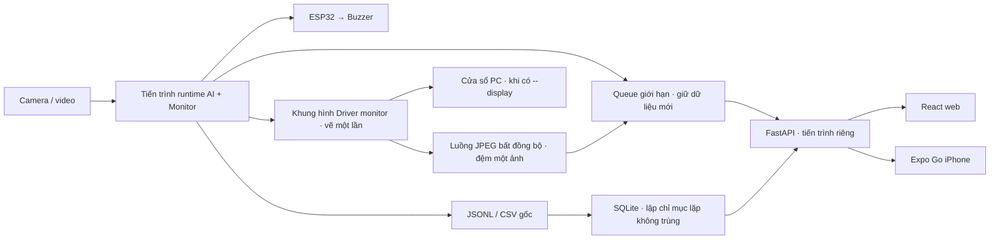

# Dashboard web và app iPhone trong mạng Wi-Fi

> Tiếp tục theo feature: [bản đồ context](CONTEXT-MAP.md), [checkpoint mới nhất](CHECKPOINT.md), [docs](docs/README.md).

Web và app chỉ đọc dữ liệu của runtime. Camera, model và ESP32 → buzzer chạy tại PC/Radxa. Cả hai giao diện có Giám sát, Lịch sử phiên và Kết nối; không có lệnh khởi động/dừng hệ thống hoặc chỉnh ngưỡng từ xa. App cảnh báo bằng banner và rung khi đang mở, mỗi đợt ALERT một lần. Phiên phát lại video được ghi rõ; không rung như cảnh báo camera thật.

## Chạy trên Windows

Tại PowerShell trong thư mục dự án:

```powershell
& '.\.venv\Scripts\python.exe' -m pip install -r requirements-dashboard.lock.txt
& '.\.venv\Scripts\python.exe' -m driver_monitor serve --source 0 --backend onnx --display
```

Mặc định `serve` dùng `configs/camera_pc.yaml`, cổng 8765 và mục tiêu truyền ảnh **15 FPS**. Thêm `--display` như lệnh trên để mở cửa sổ Driver monitor tại PC; web/app nhận chính khung hình đã vẽ đó, gồm khung mặt/mắt, trạng thái, xác suất và bộ đếm. Bỏ `--display` để chạy không màn hình. Chỉ một runtime mở camera và chạy AI; web/app chỉ nhận ảnh cùng kết quả. Có thể chọn `--preview-fps 2`, `5`, `10`, `15` hoặc `30`; tốc độ thực còn phụ thuộc nguồn, suy luận và client.

Web đã build nằm trong `frontend/web/dist`; Python phục vụ web và API cùng cổng, không cần Node.js để dùng web. Terminal hiển thị địa chỉ PC, địa chỉ LAN và mã kết nối. Mã được lưu riêng trong `logs/.dashboard-token`; không đưa file này vào Git hoặc gửi kèm bản xuất nhật ký. Có thể ghi đè bằng biến môi trường `DRIVER_MONITOR_TOKEN` dài ít nhất 16 ký tự. Nhật ký truy cập HTTP bị tắt; mã WebSocket nằm trong thông điệp đầu tiên, không nằm trong URL.

Mở `http://127.0.0.1:8765` tại PC. Nhập địa chỉ máy chủ và mã từ terminal. Khi mở trên máy khác hoặc iPhone, dùng `http://<IPv4-PC>:8765`; xem IPv4 bằng `ipconfig` hoặc dòng LAN trong terminal. `127.0.0.1` trên iPhone trỏ về chính điện thoại nên app sẽ từ chối địa chỉ này và giải thích cách sửa. Người dùng đã xác nhận app kết nối được sau khi nhập IPv4 Wi-Fi của PC. Hai thiết bị cùng Wi-Fi; nếu Windows hỏi quyền mạng, cho phép Python trên mạng Private. Không mở cổng ra Internet. Trong Expo Go, cho phép truy cập mạng nội bộ khi iOS yêu cầu. Mã kết nối bảo vệ truy cập; HTTP LAN không mã hóa nội dung truyền.

Nếu ESP32 đã nối, chỉ định cổng thực tế:

```powershell
& '.\.venv\Scripts\python.exe' -m driver_monitor serve --source 0 --backend onnx --display --esp32-port COM5
```

COM5 chỉ là ví dụ, cần dùng cổng thiết bị của bạn. Khi chưa cấu hình, giao diện hiện **Chưa cấu hình**. Khi đã cấu hình nhưng chưa nhận ACK, hiện **Chưa nhận ACK**. Nhấn Ctrl+C tại terminal để dừng; runtime gửi lệnh tắt và đóng camera. Watchdog firmware tắt còi sau 2 giây không nhận lệnh. Không chạy `run` và `serve` đồng thời với cùng camera/ESP32.

Phát lại video để kiểm tra cả hệ thống và giao diện:

```powershell
& '.\.venv\Scripts\python.exe' -m driver_monitor serve --source 'reports/yawn_camera_check/20261007T070644_475102Z.avi' --backend onnx --realtime --display
```

Không có `--realtime` thì video được xử lý nhanh nhất có thể, nhưng quyết định luôn dùng thời gian nguồn video. Video kết thúc: runtime gửi OFF, phiên hiện đã kết thúc, API vẫn mở để xem lịch sử. Dừng API bằng Ctrl+C.

### Khi cổng 8765 đang được sử dụng

Lỗi `WinError 10048` thường do một phiên `serve` cũ vẫn chạy. Đóng cửa sổ Driver monitor hoặc kết thúc video chỉ dừng suy luận; API vẫn phục vụ lịch sử. Nhấn `Ctrl+C` trong terminal đã chạy phiên cũ, chờ terminal trở về dấu nhắc rồi mới chạy lại `serve`. Không chạy hai phiên với cùng camera/ESP32.

Lệnh `serve` giữ cổng trước khi khởi động suy luận. Nếu cổng bận, lệnh thoát ngay với hướng dẫn, không mở camera/serial và không tạo phiên nhật ký mới. Để xem PID đang giữ cổng trên Windows:

```powershell
netstat -ano -p tcp | Select-String ':8765\s'
```

Chỉ khi ứng dụng khác cần giữ cổng này, dùng `--port 8766` và đổi địa chỉ trên cả web/app thành `http://<IPv4-PC>:8766`. Camera/ESP32 vẫn chỉ được một runtime sử dụng.

## Mở app bằng Expo Go trên iPhone

Cài Expo Go bản hỗ trợ SDK 57 trên App Store. Máy phát triển cần Node.js ≥22.13; phiên phát triển đã dùng Node 24.11.1. Các module native được khóa theo Expo SDK; không tự nâng riêng React Native.

```powershell
npm.cmd ci
npm.cmd run start:mobile
```

Giữ terminal `serve` chạy. Mở Camera iPhone, quét QR từ terminal Expo rồi mở Expo Go. Trong app nhập cùng địa chỉ IPv4 và mã kết nối như web. Mã được lưu bằng `expo-secure-store`; không lưu trong URL. App tạm ngắt WebSocket và camera khi vào nền, đồng bộ lại khi mở. Bản này chưa có cảnh báo nền, TestFlight hoặc kết nối Internet.

Trong Lịch sử phiên, lọc ngày, tìm mã phiên/nguồn trong trang, mở chi tiết để xem sự kiện và biểu đồ 60 giây cuối phiên. CSV chứa toàn bộ số liệu đã lưu của phiên; iPhone dùng bảng chia sẻ iOS. Nhật ký JSONL gốc vẫn được giữ; không lưu thêm video, không tự xóa dữ liệu.

## Kiến trúc và API



`driver_monitor/dashboard_transport.py` xuất snapshot tối đa 5 Hz và khi đổi trạng thái; `Monitor` vẫn là nơi tính sự kiện và cảnh báo. `dashboard_video.py` nén JPEG trong luồng riêng, với đệm chỉ một khung hình chờ. JPEG chỉ được tạo khi có client đang xem, mặc định tối đa 15 Hz, có lựa chọn đến 30 Hz, giới hạn 640×480, mã hóa một lần cho các client. Số thứ tự ảnh độc lập với bản tin trạng thái để không giới hạn tốc độ ảnh xuống 5 Hz. Mỗi kênh giữ giới hạn dữ liệu; client chậm không chặn camera/serial. Dữ liệu thiếu giữ `null`, không chuyển thành xác suất 0.

Biểu đồ chia ba hàng **Mắt 1, Mắt 2, Ngáp**, mỗi hàng có giá trị hiện tại và màu riêng. Ba hàng dùng chung cửa sổ 60 giây và thang 0–100%, ngắt đường qua dữ liệu thiếu hoặc khoảng mất quan sát. Quá 2 giây không có dữ liệu mới thì giao diện làm mờ dữ liệu cũ và tự kết nối lại. Web kiểm tra riêng số thứ tự ảnh và thời gian nhận ảnh: JPEG bị đứng hoặc yêu cầu ảnh treo vẫn hiện chưa cập nhật dù WebSocket còn hoạt động. App dùng HEAD có xác thực để đọc số thứ tự ảnh, rồi expo-image tải JPEG với header Bearer và cachePolicy none; chờ ảnh hiện tại tải xong trước khi thay ảnh mới, có timeout để phục hồi yêu cầu treo. Khi chuyển phiên, phản hồi chậm từ phiên cũ không ghi đè chi tiết đang xem; rời màn hình sẽ ngắt việc tải thêm trang cũ.

REST dùng `Authorization: Bearer <mã>`:

| GET | Nội dung |
|---|---|
| `/api/v1/status` | Snapshot mới nhất hoặc `null` khi chưa có phiên |
| `/api/v1/health` | Tình trạng chỉ mục lịch sử |
| `/api/v1/sessions` | Phân trang; lọc `start`, `end` có múi giờ |
| `/api/v1/sessions/{id}` | Thông tin và tóm tắt phiên |
| `/api/v1/sessions/{id}/series` | Chuỗi snapshot lịch sử |
| `/api/v1/sessions/{id}/events` | Sự kiện Monitor và lỗi thiết bị |
| `/api/v1/sessions/{id}/export.csv` | Toàn bộ số liệu phiên |
| `/api/v1/frame.jpg` | JPEG mới nhất, không cache, 503 nếu chưa có ảnh mới |

`HEAD /api/v1/frame.jpg` đọc `X-Frame-Sequence` mà không truyền thân ảnh, dùng cùng mã xác thực. Thêm `?after=<số-thứ-tự>` cho GET/HEAD để chờ tối đa 250 ms; trả 204 nếu chưa có ảnh khác, tránh tải lại JPEG cũ. `X-Frame-Age-Ms` cho biết tuổi khung hình tại API. Mã kết nối không nằm trong URL ảnh. SQLite bỏ qua dòng lỗi để tiếp tục nhập các dòng hợp lệ; dữ liệu thiếu hoặc sai kiểu được chuẩn hóa ở chỉ mục. Nếu file bị thay thế/rút ngắn hoặc phần đầu đã nhập thay đổi, chỉ mục phiên tương ứng được dựng lại từ file hiện có; nhật ký nguồn không bị sửa.

Chuỗi và sự kiện có `limit` ≤1000, `offset`, `next_offset`. WebSocket `/api/v1/ws`: thông điệp đầu trong 5 giây phải là `{"type":"auth","token":"<mã>"}`. Các thông điệp sau có `{"type":"snapshot","snapshot":...,"server_utc":...}`. Không có API điều khiển. SQLite tại `logs/dashboard.sqlite3`; không gửi database hoặc mã kết nối lên Git.

## Phát triển và kiểm tra

```powershell
npm.cmd run dev:web
npm.cmd run build:web
npm.cmd run typecheck
npm.cmd run test:clients
npm.cmd exec -- playwright install chromium
npm.cmd run test:web
npm.cmd exec --workspace=@driver-monitor/mobile -- expo-doctor
& '.\.venv\Scripts\python.exe' -m unittest discover -s tests -v
```

Khi phát triển bằng Vite, nhập địa chỉ API thật (mặc định `http://127.0.0.1:8765`). Python hỗ trợ CORS cho origin HTTP trong mạng LAN. Bản production web được phục vụ cùng API, không dùng Vite.

Đo cùng config/video với hai client WebSocket + hai client ảnh, đối chiếu quyết định từng frame:

```powershell
& '.\.venv\Scripts\python.exe' tools/benchmark_dashboard.py --source 'reports/yawn_camera_check/20261007T070644_475102Z.avi' --frames 1131 --display --preview-fps 15
```

Kết quả tại `reports/dashboard_verification/<UTC>/result.json`. Đo này dùng client mô phỏng trên cùng PC, không thay thế phép đo LAN với iPhone thật. `--camera-seconds 20 --source 0` kiểm tra camera hiện có; không đánh giá nhận diện đúng khi chưa có nhãn.

Kiểm tra web đã build với API và video thật:

```powershell
& '.\.venv\Scripts\python.exe' tools/check_dashboard_web.py --source 'reports/yawn_camera_check/20261007T070644_475102Z.avi'
```

Kết quả được ghi tại `reports/dashboard_verification/web-browser.json`. Bài kiểm tra mở Chromium, xác nhận ảnh, lịch sử, tải CSV và đo từ UTC snapshot đến khi DOM cập nhật trên cùng PC. Phép đo này chưa bao gồm Wi-Fi hoặc iPhone thật. Ba bài kiểm thử giao diện dùng dữ liệu mô phỏng bao phủ bốn trạng thái, dữ liệu thiếu, mất kết nối, ảnh đứng/treo và chuyển nhanh giữa các phiên.

Cây dependency phát triển Expo/Metro còn 23 cảnh báo trong lần `npm audit` ngày 08/10/2026, gồm các phụ thuộc `braces` và `node-forge` chưa có bản vá trên npm lúc kiểm tra. Không dùng `npm audit fix --force` vì đề xuất hạ Expo/React Native làm sai bộ SDK. Những gói công cụ này không được chép vào bản web tĩnh hoặc gói Python chạy trên Radxa; lockfile giữ phiên bản đã kiểm tra, cần theo dõi bản vá khi tiếp tục phát triển app.

## Kết quả bàn giao và các quyết định triển khai

Kiểm tra phần mềm ngày 09/10 đạt 102 bài Python, 10 bài client chung, 3 bài Chromium; build web, TypeScript và export iOS đạt. Web đã build chạy với API/video thật, ảnh 640×480, ba hàng biểu đồ, lịch sử và CSV đạt; ảnh render khoảng 12,9 FPS, p95 cập nhật DOM 184 ms trong 18 mẫu trên cùng PC.

Phát lại 1.131 frame giữ nguyên quyết định so với `run`. Cả hai lượt đều mở cửa sổ Driver monitor; tốc độ xử lý lần lượt 18,35 và 16,54 FPS, giảm 9,89%. Hai client mô phỏng nhận cùng ảnh khoảng 13,22 FPS/client khi đặt mục tiêu 15 FPS; p95 nhận snapshot 203,26 ms. Kết quả này đạt mục tiêu giảm không quá 10% trong lượt đo, nhưng gần giới hạn và chịu tải máy/cache; chưa bảo đảm trên máy khác. Hồ sơ số liệu: `reports/dashboard_verification/latest.json`, `20261009T093508Z/result.json` và `web-browser.json`. Số đo 2/5 FPS trước ngày 09/10 thuộc bản nén ảnh trong vòng AI, không đại diện cho bản bất đồng bộ hiện tại.

Một lượt rà soát độc lập được thực hiện, sau đó sửa lỗi nhật ký sai kiểu/dòng lỗi, tắt worker bị treo, khoảng trống biểu đồ, ảnh app quá hạn và phản hồi phiên cũ. Các kiểm thử quan sát thất bại trước sửa rồi đạt sau sửa. Bộ đếm thiếu không bị coi là 0 để tạo trùng sự kiện khi hồi phục. Chỉ mục cũng nhận biết file bị thay thế/rút ngắn bằng kích thước, định danh file và checksum phần đầu, rồi dựng lại dữ liệu dẫn xuất; file nguồn được giữ nguyên.

Các quyết định và giới hạn cần giữ khi tiếp tục:

| Quyết định | Lý do | Chi phí / giới hạn |
|---|---|---|
| Nhánh `feature/lan-dashboard-ios` trong checkout hiện có | Dữ liệu/model cục bộ ở workspace được cấp quyền | Cùng thư mục làm việc; cần giữ các thay đổi trước đó |
| Dùng ledger và TDD cục bộ | Skill executing-plans thiếu các script/subskill đi kèm | Theo dõi bằng hồ sơ cục bộ |
| Giữ thay đổi chưa commit theo từng tác vụ | Tránh gộp nhầm phần model/báo cáo đã có trước | Cần phân loại diff khi commit/push |
| Expo SDK 57 và module đã kiểm tra | Khớp SDK của Expo Go được xác minh lúc triển khai | Người dùng xác nhận đã kết nối; chưa nghiệm thu đầy đủ ảnh/rung/CSV |
| Khung hình Driver monitor dùng chung, JPEG bất đồng bộ, mặc định 15 FPS | Yêu cầu cửa sổ PC và cùng giao diện trên web/app; kiểm thử nén chậm không chặn AI | Tốc độ thực phụ thuộc nguồn/thiết bị; lượt PC đo được khoảng 13,22 FPS/client |
| HEAD có xác thực trên tài nguyên JPEG | Kiểm tra số thứ tự mà không tải hai thân JPEG | Thêm một yêu cầu header mỗi lượt kiểm tra ảnh app |
| Dựng lại chỉ mục khi thế hệ file thay đổi | Lịch sử phản ánh file nguồn hiện tại | Không phục hồi được bản gốc đã bị ghi đè bên ngoài |
| Giữ phân trang toàn phiên và CSV trong bộ nhớ ở bản đầu | Lịch sử/video hiện có đã đạt; chưa xác định giới hạn phiên lớn | Thời gian tải và bộ nhớ tăng theo phiên; cần đo với phiên dài |
| Nghiệm thu đầy đủ iPhone, Radxa, ESP32 và độ trễ Wi-Fi để chờ | Bo chưa setup; iPhone mới được xác nhận kết nối | Ảnh/rung/CSV, phần cứng và độ trễ LAN cần quan sát thêm |
| Tác giả kiểm tra PDF và ghi audit sau rà soát mã | Reviewer không tự render/audit lại | Trang/thiết bị khác và bản vá dependency vẫn cần theo dõi |

Không còn lỗi Minor được hoãn từ rà soát; lỗi mất sự kiện khi thay file đã được nâng mức và sửa. Bản web đã kiểm tra trên PC. Người dùng xác nhận app kết nối thành công; nghiệm thu ảnh/rung/CSV và chuyển nền trong Expo Go trên iPhone thật chưa hoàn tất. Khi cập nhật bản này, dừng `serve` bằng Ctrl+C rồi chạy lại; tải lại trang web và Reload app trong Expo Go để nhận bố cục ba hàng.

## Radxa

Sau khi setup Linux/driver và xác minh camera, model RKNN, cài thêm `requirements-dashboard.lock.txt`. Chép cả `frontend/web/dist` cùng package runtime. Dùng profile đã xác minh trên bo, không tự thay bằng trọng số PC chưa chuyển NPU:

```bash
.venv/bin/python -m driver_monitor serve --config configs/driver_monitor.yaml --backend rknn --source /dev/video0 --esp32-port /dev/ttyUSB0
```

Mẫu `radxa_rock4d/systemd/driver-monitor-dashboard@.service` dùng `/opt/driver-monitor`. Cấu hình `/etc/driver-monitor/dashboard.env` theo mẫu; chọn đúng nguồn, cổng và `DRIVER_MONITOR_PREVIEW_FPS` sau khi đo trên bo (mẫu đặt 15). Dịch vụ chạy không màn hình. Chỉ bật một dịch vụ sở hữu camera và ESP32:

```bash
sudo install -m 644 radxa_rock4d/systemd/driver-monitor-dashboard@.service /etc/systemd/system/
sudo systemctl daemon-reload
sudo systemctl enable --now driver-monitor-dashboard@<ten-nguoi-dung>
journalctl -u driver-monitor-dashboard@<ten-nguoi-dung> -f
```

Node.js chỉ cần trên máy phát triển web/app; Radxa phục vụ web đã build bằng Python. Cài và đo trên Radxa, nhận ACK ESP32 thực, iPhone/Expo Go thực và phép đo LAN còn cần thực hiện.
