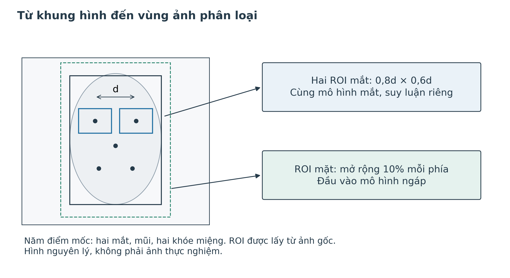
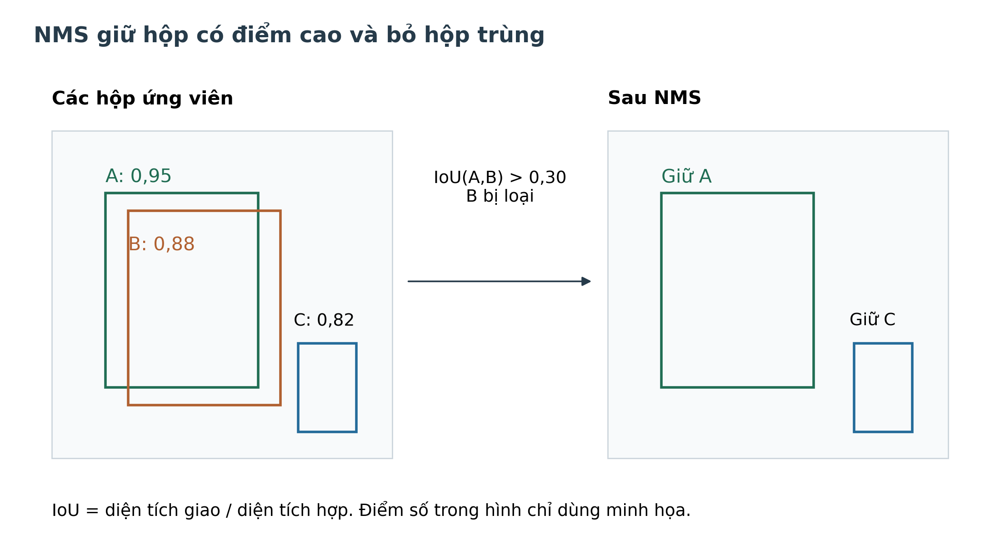
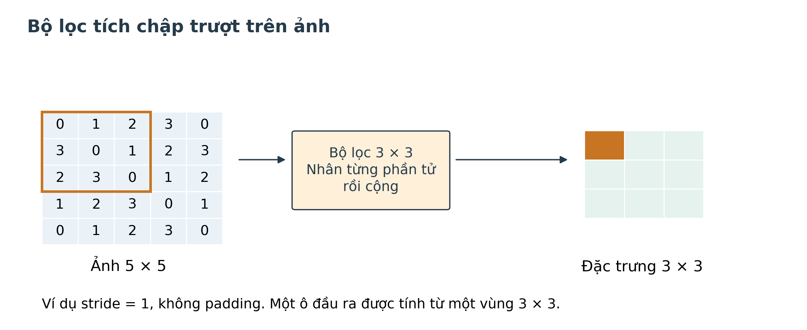
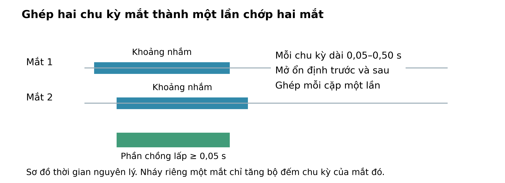
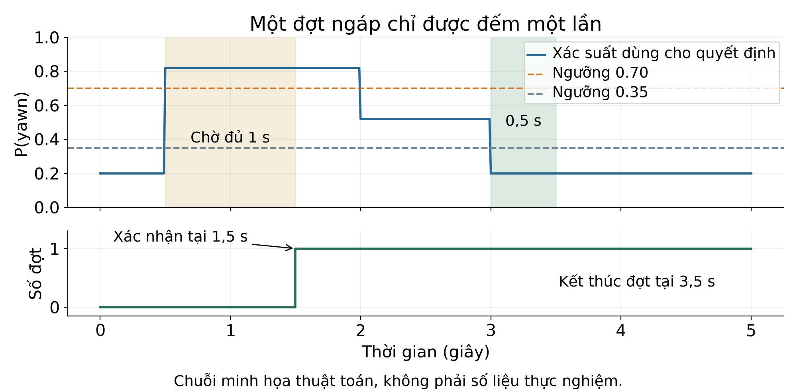
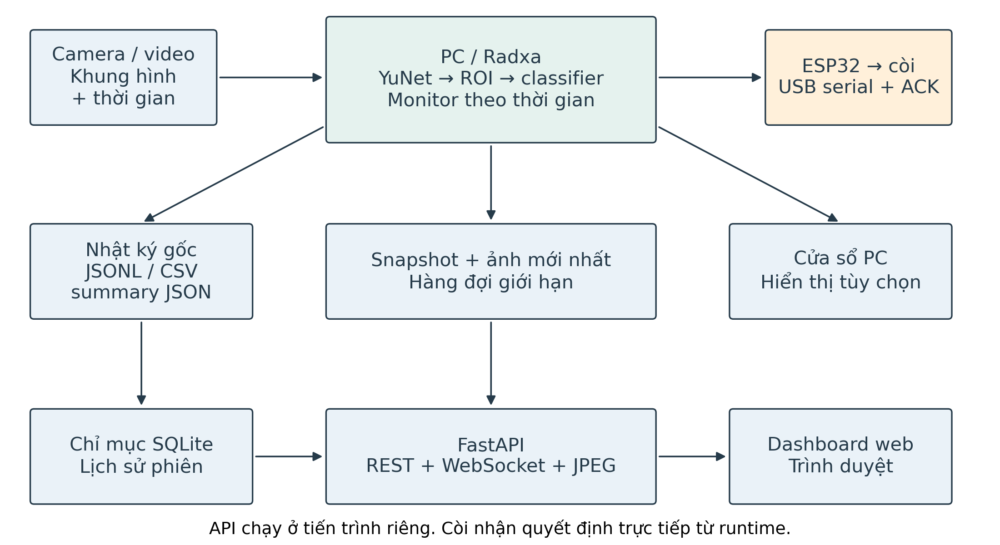
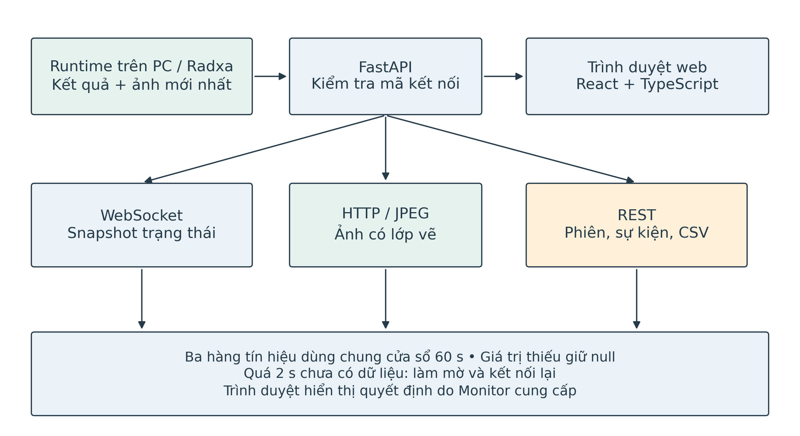

TRƯỜNG:

KHOA:

NGÀNH:

# BÁO CÁO ĐỒ ÁN

HỆ THỐNG GIÁM SÁT VÀ PHÁT HIỆN SỰ MẤT TẬP TRUNG CỦA TÀI XẾ

Hướng đến triển khai trên Radxa ROCK 4D

Sinh viên thực hiện:

Mã số sinh viên:

Lớp:

Giảng viên hướng dẫn:

Tháng             năm

# NHIỆM VỤ NGHIÊN CỨU

## I. Nội dung

Tên đề tài: HỆ THỐNG GIÁM SÁT VÀ PHÁT HIỆN SỰ MẤT TẬP TRUNG CỦA TÀI XẾ

Đề tài nghiên cứu cách dùng camera để theo dõi mắt và biểu hiện ngáp của tài xế. Chương trình phát hiện khuôn mặt, cắt vùng ảnh, phân loại rồi xác nhận sự kiện theo thời gian. Khi đủ điều kiện cảnh báo, máy xử lý gửi lệnh đến ESP32 để điều khiển còi. Nhật ký được lưu lại để đối chiếu từng phiên. Phần mềm dùng chung cho thử nghiệm trên PC và triển khai trên máy tính nhúng.

Dữ liệu ban đầu gồm hai mô hình phân loại mắt và ngáp, các tập ảnh cùng chương trình kiểm thử của dự án. Nhóm dùng ảnh tĩnh, video phát lại và camera để kiểm tra từng khối cũng như toàn bộ chuỗi xử lý. Việc chuẩn bị cho Radxa gồm chuyển đổi mô hình, cấu hình vận hành và dịch vụ systemd.

## II. Thời gian thực hiện

# TÓM TẮT

Nhắm mắt kéo dài và ngáp là những biểu hiện có thể quan sát bằng camera khi theo dõi tài xế. Cách tiếp cận này không đòi hỏi người sử dụng đeo cảm biến, nhưng kết quả phụ thuộc ánh sáng, góc camera và tư thế khuôn mặt. Một khung hình riêng lẻ dễ gây nhầm lẫn. Vì vậy, đề tài kết hợp mô hình phân loại ảnh với điều kiện duy trì theo thời gian để xác nhận biểu hiện cần cảnh báo.

Hệ thống được xây dựng bằng Python và OpenCV. YuNet tìm khuôn mặt cùng năm điểm mốc, từ đó chương trình cắt hai vùng mắt và một vùng mặt mở rộng trên ảnh gốc. Hai mô hình YOLOv8n phân loại các lớp Closed/Open và no_yawn/yawn. Bộ quyết định theo dõi xác suất, chất lượng ảnh và thời gian để tạo bốn trạng thái NORMAL, WARNING, ALERT và UNKNOWN. Kết quả được hiển thị, ghi nhật ký và gửi qua serial đến ESP32.

Quá trình phát triển tập trung vào hai lỗi đã gặp: cười nhe răng bị nhận thành ngáp và mắt mở hẹp bị nhận thành nhắm. Nhóm bổ sung dữ liệu cười, hiệu chỉnh mô hình trên vùng cắt của chương trình và tạm ngắt xác nhận mắt khi hình học khuôn mặt thay đổi. Các phép đo ở Chương 5 sử dụng camera_pc với eye_refined_v4 và yawn_camera_refined. Trên video camera có hai đợt ngáp, số đợt được xác nhận tăng từ 0/2 lên 2/2, còn đoạn cười không làm tăng bộ đếm. Do video đã tham gia hiệu chỉnh, đây là kết quả phát triển trên dữ liệu đã khảo sát.

Một phiên camera PC xử lý 152 khung hình trong khoảng 10,05 giây, đạt 15,13 FPS với độ trễ p95 là 32 ms. Phiên đo chưa có nhãn hành vi nên chỉ phản ánh vận hành trong thời gian ngắn. Trên ROCK 4D, nhật ký ghi nhận Debian 12, môi trường Python, suy luận thử ONNX CPU và camera USB được hệ điều hành nhận diện. Hiệu năng camera, độ chính xác và suy luận NPU trên bo chưa được đo đầy đủ [37].

Dashboard web dùng FastAPI và React để hiển thị ảnh, trạng thái và lịch sử trong mạng nội bộ. Dữ liệu từ suy luận đi qua hàng đợi giới hạn, giúp việc truyền ảnh không giữ chậm bộ quyết định. Lịch sử được đọc từ nhật ký gốc qua chỉ mục SQLite, có thể lọc phiên và xuất CSV để xem lại.

# DANH MỤC CÁC TỪ VIẾT TẮT

| Từ viết tắt | Diễn giải | Ý nghĩa trong đề tài |
| --- | --- | --- |
| AI | Artificial Intelligence | Trí tuệ nhân tạo |
| CNN | Convolutional Neural Network | Mạng nơ-ron tích chập |
| ROI | Region of Interest | Vùng ảnh quan tâm |
| FPS | Frames per Second | Số khung hình xử lý trong một giây |
| CPU | Central Processing Unit | Bộ xử lý trung tâm |
| NPU | Neural Processing Unit | Bộ xử lý tăng tốc mạng nơ-ron |
| ONNX | Open Neural Network Exchange | Định dạng trao đổi mô hình |
| RKNN | Rockchip Neural Network | Định dạng và bộ công cụ mô hình của Rockchip |
| EMA | Exponential Moving Average | Trung bình trượt theo hàm mũ |
| ACK | Acknowledgement | Phản hồi xác nhận lệnh |
| GPIO | General Purpose Input/Output | Chân vào/ra đa dụng |
| JSONL | JSON Lines | Định dạng nhật ký, mỗi dòng một đối tượng JSON |

# THÔNG TIN KẾT QUẢ NGHIÊN CỨU CỦA ĐỀ TÀI

## 1. Thông tin chung

Tên đề tài: HỆ THỐNG GIÁM SÁT VÀ PHÁT HIỆN SỰ MẤT TẬP TRUNG CỦA TÀI XẾ

## 2. Mục tiêu đề tài

Xây dựng hệ thống quan sát một tài xế bằng camera, nhận biết trạng thái mắt và ngáp, xác nhận sự kiện theo thời gian rồi phát cảnh báo tại chỗ. Phần mềm cần lưu dữ liệu vận hành và dùng chung quy tắc quyết định khi chạy trên PC hoặc máy tính nhúng.

## 3. Nội dung thực hiện

Nhóm đã xây dựng driver_monitor với YuNet, hai bộ phân loại, bộ quyết định theo thời gian, nhật ký và giao tiếp ESP32. Phần mềm PC được kiểm tra trên ảnh, chuỗi quan sát, video kỹ thuật và một số phiên camera. Hướng triển khai Radxa sử dụng ONNX CPU trước, đồng thời chuẩn bị chuyển đổi RKNN và dịch vụ khởi động tự động.

## 4. Kết quả nghiên cứu

Hồ sơ sau lần sửa bỏ sót ngáp ghi nhận 67 kiểm thử driver_monitor đạt, bao phủ mắt, ngáp, serial và mất dữ liệu [30]. Phép đối chiếu trên 407 vùng ảnh cho tỷ lệ đồng thuận nhãn PyTorch và ONNX là 100%. Các tệp JSON và nhật ký lưu chi tiết từng phép thử. Đánh giá trên video cabin độc lập và phần cứng thật vẫn cần được thực hiện riêng.

## 5. Sinh viên chịu trách nhiệm thực hiện đề tài

## 6. Nhận xét của người hướng dẫn

# CHƯƠNG 1. TỔNG QUAN

## 1.1. Lý do chọn đề tài

Tài xế mệt mỏi có thể nhắm mắt lâu, ngáp hoặc thay đổi nhịp chớp mắt trong khi lái xe. Những biểu hiện nhìn thấy trên khuôn mặt tạo cơ sở cho một hệ thống giám sát bằng camera. Đề tài lựa chọn hướng này để kết hợp xử lý ảnh, học sâu và điều khiển cảnh báo trên nền tảng nhúng.

Khó khăn xuất hiện ngay khi đưa mô hình ra camera. Mắt đang mở có thể trông hẹp khi tài xế ngẩng đầu, còn cười nhe răng có thể giống ngáp trong một ảnh tĩnh. Ánh sáng kém hoặc vùng cắt lệch cũng làm dự đoán kém tin cậy. Vì thế, chương trình cần kiểm tra chất lượng quan sát và theo dõi biểu hiện qua nhiều thời điểm.

Từ các tình huống đó, nhóm xây dựng chuỗi xử lý gồm định vị khuôn mặt, phân loại vùng ảnh và xác nhận theo thời gian. Các lỗi tái hiện được dùng để điều chỉnh dữ liệu và kiểm tra lại mô hình. Nhật ký, cấu hình và trọng số được lưu cùng kết quả để có thể tìm lại nguyên nhân khi hệ thống nhận sai.

## 1.2. Mục tiêu đề tài

Mục tiêu của đề tài là theo dõi nhắm mắt kéo dài và các đợt ngáp, phát cảnh báo tại chỗ khi đủ điều kiện, đồng thời lưu diễn biến phiên chạy. PC được dùng để phát triển và thử nghiệm trước khi chuyển sang Radxa ROCK 4D. Hai nền tảng sử dụng cùng cấu trúc dữ liệu và bộ quyết định theo thời gian.

YuNet đảm nhiệm định vị khuôn mặt; hai mô hình còn lại phân loại mắt và ngáp. Bộ quyết định sử dụng thời gian của nguồn ảnh và trả UNKNOWN khi thiếu dữ liệu hoặc chất lượng thấp. Tên lớp, cách tiền xử lý và checksum được lưu trong manifest để xác định đúng mô hình trước mỗi lần chạy.

Bảng 1-1 trình bày các chỉ tiêu đặt ra cho giai đoạn nghiệm thu. Đây là mục tiêu của hệ thống; việc đối chiếu với kết quả thực hiện được trình bày tại Chương 5.

*Bảng 1-1. Các chỉ tiêu nghiệm thu đặt ra*

| Hạng mục | Chỉ tiêu |
| --- | --- |
| Phân loại mắt | F1 ≥90% trên tập kiểm thử độc lập |
| Phân loại ngáp | F1 ≥85% trên tập kiểm thử độc lập |
| Sự kiện nhắm mắt kéo dài | Phát hiện ≥90% sự kiện có nhãn |
| Cảnh báo nhầm | Không quá 1 lần/giờ quan sát bình thường |
| Xử lý trên bo | ≥15 FPS ở 640×480; độ trễ p95 ≤200 ms |
| Phản ứng còi | ≤300 ms sau thời điểm đủ điều kiện xác nhận |
| Chuyển mô hình | F1 giảm không quá 2 điểm phần trăm so với bản .pt |
| Vận hành | Chạy liên tục 2 giờ; lỗi thiết bị có trạng thái và nhật ký |

## 1.3. Đối tượng nghiên cứu

Đối tượng nghiên cứu là hình ảnh khuôn mặt của một tài xế, tập trung vào hai mắt và biểu hiện ngáp. Nhóm khảo sát cách tạo vùng cắt, ảnh hưởng của chất lượng ảnh đến phân loại và điều kiện cần để ghép các quan sát liên tiếp thành một sự kiện.

Các công cụ chính gồm Python, OpenCV, PyTorch, ONNX Runtime, RKNN và giao tiếp serial với ESP32. PC phục vụ thực nghiệm phần mềm. Nền tảng nhúng được chọn là Radxa ROCK 4D, dùng đích chuyển đổi RK3576 theo tài liệu phần cứng [3].

## 1.4. Giới hạn đề tài

Hệ thống theo dõi một tài xế có khuôn mặt nằm trong vùng ghế lái đã cấu hình. Khi mất mặt, có nhiều mặt phù hợp, ảnh quá tối hoặc kết quả mắt chưa đủ chắc chắn, chương trình trả UNKNOWN. Cabin đủ sáng là điều kiện thiết kế ban đầu; các tình huống ngoài phạm vi này cần được đánh giá bổ sung.

Dữ liệu hiện có gồm ảnh tĩnh, video kỹ thuật và video camera dùng trong hiệu chỉnh. Chưa có bộ video cabin được gán nhãn, tách theo người và đủ dài để đánh giá tỷ lệ phát hiện sự kiện hay số cảnh báo nhầm mỗi giờ. Mức độc lập theo người của các tập ảnh phát triển cũng chưa được xác nhận.

Camera cung cấp ảnh cho PC hoặc Radxa. Máy xử lý chạy AI, quyết định trạng thái, lưu nhật ký và gửi lệnh USB serial đến ESP32 điều khiển còi. Dashboard web cho phép xem ảnh, trạng thái và lịch sử trong mạng nội bộ. Radxa đã có kết quả cài đặt ban đầu và suy luận thử ONNX CPU; các phép thử NPU, còi vật lý và vận hành dài hạn chưa hoàn tất [37].

## 1.5. Phương pháp nghiên cứu

Nhóm đối chiếu tài liệu xử lý ảnh và mạng phân loại với checkpoint đang dùng để chọn cách triển khai. Mỗi kết quả được gắn với mã nguồn, cấu hình và tệp đo tương ứng. Cách làm này giúp xác định một thay đổi thuộc mô hình, bộ quyết định hay điều kiện vận hành.

Thực nghiệm đi từ từng khối đến toàn hệ thống. Ảnh có nhãn dùng để đánh giá bộ phân loại. Chuỗi xác suất và vùng cắt dùng để kiểm tra logic sự kiện. Camera và video phát lại dùng để xem các khối phối hợp ra sao. Chỉ số phân loại ảnh và độ chính xác cảnh báo theo thời gian được báo riêng vì chúng đo hai nhiệm vụ khác nhau.

Với lỗi đã tái hiện, nhóm so sánh trước và sau thay đổi trên cùng dữ liệu. Mẫu dùng để chữa lỗi được ghi rõ trong hồ sơ. Model được chọn bằng tập huấn luyện và validation; khi chuyển định dạng, phép đối chiếu kiểm tra cả đầu vào, thứ tự lớp và xác suất đầu ra.

## 1.6. Bố cục đồ án

Báo cáo gồm sáu chương. Sau phần tổng quan, Chương 2 giải thích các thuật toán và thành phần sử dụng trong hệ thống. Chương 3 trình bày thiết kế, còn Chương 4 mô tả việc xây dựng phần mềm và hiệu chỉnh mô hình. Kết quả thực nghiệm được phân tích ở Chương 5. Chương 6 nêu kết luận và các công việc cần tiếp tục.

## 1.7. Nội dung đồ án

Nội dung thực hiện bắt đầu từ sơ đồ khối, sau đó triển khai thu nhận ảnh, YuNet, cắt ROI và phân loại. Bộ quyết định theo dõi mắt, ngáp và chớp mắt theo thời gian. Từ trạng thái đã xác nhận, chương trình điều khiển cảnh báo, cập nhật giao diện và ghi nhật ký.

# CHƯƠNG 2. CƠ SỞ LÝ THUYẾT

## 2.1. Tổng quan về xử lý ảnh

### 2.1.1. Giới thiệu xử lý ảnh

Xử lý ảnh biến dữ liệu điểm ảnh thành thông tin phục vụ một nhiệm vụ cụ thể. Với hệ thống này, thông tin cần lấy là vị trí khuôn mặt, vùng mắt và biểu hiện ngáp. Khung hình chứa cả tài xế lẫn nền xung quanh, nên chương trình xác định vùng cần quan sát trước khi phân loại.

Ảnh số là một lưới điểm ảnh. Ảnh màu còn có các kênh thành phần với thứ tự tùy thư viện. OpenCV đọc ảnh theo BGR, trong khi hai bộ phân loại nhận RGB. Bước đổi kênh phải được thực hiện giống nhau khi huấn luyện, đánh giá và chạy camera.

Ở cấu hình thử nghiệm, camera cung cấp ảnh 640×480. YuNet nhận ảnh thu nhỏ để giảm khối lượng tính toán, còn các vùng mắt và mặt được lấy từ ảnh gốc. Nhờ vậy, bộ phân loại vẫn nhận được chi tiết có trong khung hình ban đầu.

### 2.1.2. Các bước cơ bản trong xử lý ảnh

Chuỗi xử lý bắt đầu bằng một khung hình và thời điểm lấy ảnh. YuNet tìm hộp mặt cùng các điểm mốc, rồi chương trình chọn vùng ghế lái và cắt hai mắt, mặt mở rộng. Các vùng này trở thành đầu vào của hai bộ phân loại.

Trước khi phân loại, vùng ảnh được đổi sang RGB, đưa cạnh ngắn về kích thước yêu cầu, cắt giữa và chuẩn hóa. Model trả xác suất từng lớp. Bộ quyết định kết hợp xác suất với chất lượng quan sát và thời gian để xác định trạng thái cuối cùng.

### 2.1.3. Vùng ảnh quan tâm

ROI là vùng ảnh được chọn để xử lý. Chương trình dùng một ROI lớn cho ghế lái và các ROI nhỏ hơn cho mắt, mặt. ROI ghế lái giới hạn vị trí được theo dõi; các ROI mắt và mặt cung cấp đầu vào cho mô hình.

Vùng cắt trên camera có thể chứa lông mày, da hoặc nền khác với ảnh mắt cắt sẵn trong tập dữ liệu. Khi đầu nghiêng, hình học vùng cắt cũng thay đổi. Vì vậy, dữ liệu đánh giá và huấn luyện bổ sung được tạo bằng cùng quy trình cắt ROI của chương trình.

### 2.1.4. Chất lượng ảnh

Chương trình kiểm tra độ sáng, độ sắc nét, tỷ lệ điểm ảnh quá sáng và kích thước khuôn mặt. Trung vị mức xám đại diện cho độ sáng; phương sai Laplace biểu diễn mức biến thiên chi tiết. Các phép tính được thực hiện trên mặt và từng vùng mắt theo cấu hình.

Những chỉ số trên giúp loại một phần ảnh kém chất lượng. Chúng vẫn có thể bỏ lọt trường hợp che mắt hoặc phản xạ kính, nên chương trình còn xét xác suất phân loại và độ ổn định hình học. Nếu bằng chứng chưa đủ, kết quả giữ ở UNKNOWN.

Để mô tả độ sắc nét, gọi G là ảnh mức xám và L là kết quả áp dụng Laplace. Toán tử này phản ánh biến thiên bậc hai theo hai hướng của ảnh [21]. Trong chương trình, phương sai của L được dùng làm chỉ số sắc nét S; μ là giá trị trung bình của L và N là số điểm ảnh.

L = ∂²G/∂x² + ∂²G/∂y²;    S = (1/N)Σ(L − μ)²             (2.1)

Ảnh mờ thường có đáp ứng Laplace thấp vì các cạnh bị mất chi tiết. Nhiễu hoặc nền nhiều họa tiết lại có thể làm chỉ số tăng. Do đó, chương trình kiểm tra riêng mặt và từng mắt, tránh dùng độ nét của toàn khuôn mặt để thay cho chất lượng vùng mí mắt.

Độ sáng được biểu diễn bằng median(G), giúp giảm ảnh hưởng của một số điểm ảnh có giá trị cực đoan. Tỷ lệ quá sáng được tính bằng số điểm ảnh G>235 chia cho N. Nếu chỉ số trên mặt hoặc mắt không đạt điều kiện, quan sát bị loại khỏi xác nhận liên tục. Các ngưỡng được trình bày ở Chương 3 là lựa chọn phát triển của dự án, cần kiểm chứng bằng dữ liệu cabin.

### 2.1.5. Nội suy và chuẩn hóa đầu vào

Thay đổi kích thước ảnh cần xác định giá trị tại các vị trí không trùng với lưới điểm ảnh cũ. Nội suy bilinear sử dụng bốn điểm lân cận và trọng số theo khoảng cách theo hai hướng. Với a và b thuộc [0,1] là phần tọa độ nằm giữa các điểm lưới, giá trị nội suy được biểu diễn như sau.

I = (1−a)(1−b)I₀₀ + a(1−b)I₁₀ + (1−a)bI₀₁ + abI₁₁     (2.2)

Chương trình classifier dùng PIL bilinear, đổi BGR thành RGB rồi đưa cạnh ngắn về 224 pixel. Cạnh còn lại được tính theo tỷ lệ, sau đó cắt giữa thành 224×224. Quy trình này giữ tỷ lệ trước khi cắt; một phần ngoài rìa ROI có thể bị bỏ. Việc kéo trực tiếp mọi vùng ảnh thành hình vuông có thể thay đổi hình học đầu vào so với quy trình đã dùng để huấn luyện và đánh giá.

Giá trị điểm ảnh uint8 được chuyển sang số thực, chia cho 255 và chuẩn hóa theo mean, std trong manifest. Với cấu hình hiện có, mean bằng 0 và std bằng 1 nên bước chuẩn hóa chỉ đưa giá trị về [0,1]. Đây là chuẩn hóa dữ liệu đầu vào, khác với Batch Normalization bên trong mạng. Backend RKNN nhận uint8 và sử dụng cấu hình chuyển đổi tương ứng; chia 255 ở cả host lẫn graph sẽ làm sai đầu vào.

## 2.2. Giải thuật Facial Landmarks

### 2.2.1. Giới thiệu về Facial Landmarks

Facial landmarks là các điểm mốc trên khuôn mặt. Chương trình dùng chúng để xác định tâm mắt, khoảng cách hai mắt và sự thay đổi hình học qua thời gian. Trạng thái mở hay nhắm được nhận biết ở bước phân loại ảnh mắt sau đó.

Bộ phát hiện YuNet trong OpenCV Zoo cung cấp hộp khuôn mặt, điểm tin cậy và năm điểm mốc [1]. Các điểm mốc gồm hai mắt, mũi và hai vị trí miệng. Chương trình sử dụng tệp face_detection_yunet_2023mar.onnx, kiểm tra checksum trước khi tải. Phiên bản nguồn được ghi trong manifest để có thể đối chiếu khi thay model.

Ảnh detector được thu nhỏ có giữ tỷ lệ và thêm vùng đệm để phù hợp kích thước 320×320. Sau khi phát hiện, các tọa độ được chuyển về ảnh gốc. Việc chuyển ngược tọa độ phải loại cả hệ số thu nhỏ lẫn độ lệch do vùng đệm; nếu chỉ nhân theo kích thước, vùng cắt mắt có thể lệch vị trí.

Hình 2-1 cho thấy cách lấy hai vùng mắt theo khoảng cách d giữa hai tâm mắt. Vùng mặt mở rộng được đưa vào mô hình ngáp. Các vùng cắt đều lấy trên ảnh gốc sau khi đổi tọa độ.



*Hình 2-1. Các điểm mốc khuôn mặt và vùng ảnh đưa vào bộ phân loại*

### 2.2.2. Theo dõi thay đổi hình học khuôn mặt

Đường nối hai mắt và vị trí mũi cho biết một số thay đổi hình học hai chiều. Chương trình theo dõi tâm mặt, khoảng cách mắt, góc đường mắt và vị trí mũi tương đối. Biến đổi lớn trong thời gian ngắn khiến kênh mắt được đánh dấu đang chuyển động.

Khi tài xế đổi góc mặt hoặc ngẩng đầu, chuỗi xác nhận mắt tạm ngắt để hạn chế dùng ROI đang thay đổi. Chương trình chưa suy ra tư thế đầu ba chiều đã hiệu chuẩn từ các điểm mốc này. Các ngưỡng chuyển động cần được kiểm tra trên video thực.

### 2.2.3. Nguyên lý phát hiện khuôn mặt bằng YuNet

YuNet trong OpenCV Zoo được gọi qua FaceDetectorYN với tệp ONNX [1]. Mỗi kết quả gồm hộp mặt, năm điểm mốc và điểm tin cậy. Năm điểm tương ứng hai tâm mắt, mũi và hai khóe miệng. Cấu trúc đầu ra được mô tả trong ví dụ chính thức của OpenCV [22].

YuNet tạo các ứng viên từ đặc trưng ảnh, lọc theo điểm tin cậy rồi dùng NMS để loại hộp trùng. Cấu hình đặt ngưỡng tin cậy 0,80, ngưỡng NMS 0,30 và top-k là 5.000. Top-k giới hạn số ứng viên được xét trước NMS; hệ thống vẫn chỉ theo dõi một tài xế.

Sau NMS, chương trình giữ các mặt có tâm nằm trong ROI ghế lái và đạt kích thước tối thiểu. Nếu còn đúng một mặt, quá trình phân loại tiếp tục. Không có mặt tạo lý do no_face, còn nhiều mặt phù hợp tạo ambiguous_faces.

### 2.2.4. IoU và loại bỏ các hộp trùng

Intersection over Union, viết tắt IoU, là tỷ số diện tích phần giao với diện tích phần hợp của hai hộp A và B. Giá trị nằm trong [0,1]; giá trị lớn biểu thị hai hộp chồng lấp nhiều.

IoU(A,B) = |A ∩ B| / |A ∪ B|                              (2.3)

NMS giữ hộp có điểm cao nhất, loại các hộp chồng lấp với nó vượt ngưỡng rồi lặp lại trên phần còn lại. FaceDetectorYN thực hiện bước này. Hàm iou trong vision.py được dùng ở bước theo dõi: so sánh hộp mặt mở rộng hiện tại với hộp trước, đánh dấu thay đổi đối tượng khi IoU nhỏ hơn 0,20.

Khi vùng theo dõi thay đổi, lịch sử sự kiện được xóa để tránh ghép quan sát của hai khuôn mặt. Phép kiểm tra chỉ dựa vào hình học, nên chuyển động lớn của cùng một người cũng có thể gây reset. Giới hạn này cần được xem xét trong phép thử camera.

Trong ví dụ ở Hình 2-2, A và B cùng bao quanh một vùng mặt. NMS giữ A vì có điểm cao hơn, loại B khi độ chồng lấp vượt ngưỡng, rồi xét tiếp C. Điểm số trong hình chỉ dùng để minh họa.



*Hình 2-2. Nguyên lý loại hộp trùng bằng NMS*

### 2.2.5. Letterbox và chuyển ngược tọa độ

Letterbox thu nhỏ ảnh theo một hệ số chung rồi thêm vùng đệm để đạt kích thước yêu cầu. Với ảnh gốc W×H và kích thước detector D×D, hệ số tỷ lệ r được chọn theo cạnh giới hạn. Gọi oₓ, oᵧ là độ lệch vùng đệm; điểm phát hiện (x′,y′) được đưa về ảnh gốc theo công thức sau.

r = min(D/W,D/H);    x = (x′−oₓ)/r;    y = (y′−oᵧ)/r      (2.4)

Runtime dùng D=320, làm tròn kích thước ảnh thu nhỏ và chia vùng đệm về hai phía. Ví dụ ảnh 640×480 có hệ số 0,5, tạo vùng ảnh 320×240 với đệm theo chiều cao. Cả hộp mặt và năm điểm mốc đều phải bỏ độ lệch này trước khi chia tỷ lệ. ROI được cắt trên ảnh gốc, không cắt từ ảnh detector đã thu nhỏ.

## 2.3. Khoảng cách Euclid

Khoảng cách Euclid biểu diễn độ dài giữa hai điểm trong mặt phẳng ảnh. Với hai tâm mắt E₁(x₁, y₁) và E₂(x₂, y₂), khoảng cách d được xác định theo công thức (2.5).

d = √[(x₂ − x₁)² + (y₂ − y₁)²]                                      (2.5)

Hệ thống sử dụng d để tính kích thước ROI mắt và chuẩn hóa mức thay đổi hình học. Khi tài xế gần hoặc xa camera, kích thước khuôn mặt thay đổi, nhưng vùng mắt vẫn được xác định theo tỷ lệ của d. Khoảng cách này đo trên ảnh, không phải khoảng cách vật lý giữa tài xế và camera.

## 2.4. Ngôn ngữ Python và các thư viện sử dụng

### 2.4.1. Ngôn ngữ Python

Python phối hợp đọc ảnh, gọi model, cập nhật bộ quyết định, gửi serial và ghi kết quả. Các nhiệm vụ được chia thành module để kiểm tra riêng. Chẳng hạn, logic thời gian nhận trực tiếp chuỗi Observation trong kiểm thử mà không cần mở camera.

Trong môi trường PC đã kiểm kê, Python có phiên bản 3.12.10. Các thư viện được ghi trong tệp dependency của dự án. Môi trường chuyển RKNN được tách riêng trên Linux vì yêu cầu của Toolkit2 khác với môi trường xuất mô hình trên PC. Phiên bản thư viện là một thành phần của hồ sơ tái lập kết quả.

### 2.4.2. Thư viện OpenCV

OpenCV đảm nhiệm đọc camera/video, đổi màu, thay đổi kích thước, kiểm tra chất lượng và chạy YuNet trên CPU. Sau bước định vị, các vùng ảnh được chuyển đến backend mô hình để phân loại. Cửa sổ hiển thị cũng sử dụng OpenCV.

Khung hình hiển thị giữ hộp mặt và hai hộp mắt, kèm trạng thái, xác suất, số sự kiện, FPS, độ trễ và lý do chất lượng chưa đạt. Nhật ký lưu thông tin từng mắt để đối chiếu khi bộ đếm hoặc cảnh báo khác với quan sát thực tế.

### 2.4.3. PyTorch, Ultralytics và ONNX Runtime

PyTorch và Ultralytics được sử dụng để tải, kiểm kê, huấn luyện bổ sung và xuất checkpoint. ONNX Runtime được sử dụng để chạy các tệp ONNX trên PC. Hai backend được đặt sau cùng một giao diện, cung cấp xác suất theo tên lớp để bộ quyết định không phụ thuộc định dạng mô hình.

Ultralytics cung cấp YOLOv8 cho nhiều nhiệm vụ, trong đó có phân loại ảnh [2]. Hai checkpoint của đề tài thuộc biến thể YOLOv8n classification, nhận đầu vào 224×224. Kiến trúc này được xác định từ model đã kiểm kê.

## 2.5. Tổng quan về máy tính nhúng

### 2.5.1. Giới thiệu tổng quan

Máy tính nhúng thực hiện xử lý ngay trong hệ thống. Với đề tài, bo nhận ảnh camera, chạy nhận biết và phát lệnh cảnh báo tại chỗ. Chế độ không màn hình, tự khởi động và lưu lỗi thiết bị giúp kiểm tra vận hành khi lắp trên phương tiện.

### 2.5.2. Yêu cầu của nền tảng triển khai

Bo cần hỗ trợ camera, cổng giao tiếp ESP32 và backend suy luận của mô hình. Việc lựa chọn còn phụ thuộc bộ nhớ, nguồn, nhiệt độ và độ ổn định driver. Các yếu tố này phải được đo khi vận hành trên thiết bị cụ thể.

### 2.5.3. Máy tính nhúng Radxa ROCK 4D

ROCK 4D sử dụng SoC RK3576 hoặc RK3576J; tài liệu Radxa nêu các lựa chọn RAM LPDDR5 2 GB, 4 GB, 8 GB và 16 GB [3]. Bo có USB, Ethernet, HDMI, GPIO và giao tiếp camera. Thiết bị trong đề tài đã chạy Debian 12 ARM64, còn dung lượng RAM thực chưa được kiểm kê đầy đủ [37].

Trong dự án, đích chuyển đổi được đặt là rk3576. YuNet tiếp tục chạy trên CPU, còn hai classifier có bộ tiếp nhận RKNN Lite2 để hướng tới chạy NPU. Bộ chương trình chung cho phép đối chiếu bản ONNX CPU và bản RKNN với cùng quy tắc thời gian. Thông số tốc độ và chất lượng thực trên bo cần có phép đo riêng.

## 2.6. Tổng quan về camera

### 2.6.1. Giới thiệu

Camera cung cấp chuỗi ảnh liên tiếp cho hệ thống. Trong cấu hình thử nghiệm, độ phân giải yêu cầu là 640×480. Nguồn có thể là chỉ số thiết bị hoặc đường dẫn camera tùy hệ điều hành. Chương trình probe_camera.py hỗ trợ kiểm tra thiết bị có mở được và có trả về khung hình hay không.

Hồ sơ camera PC ghi nhận nguồn 0 hoạt động và thiết bị được liệt kê là camera tích hợp. Kết quả được báo theo chỉ số nguồn và môi trường đo vì chưa có căn cứ gán nguồn này cho một webcam USB cụ thể.

### 2.6.2. Thông số kỹ thuật camera rời

### 2.6.3. Yêu cầu vị trí lắp camera

Camera cần nhìn đủ khuôn mặt và hai mắt, tránh cắt mất vùng quan sát hoặc để ánh sáng chiếu thẳng vào ống kính. Sau khi cố định camera, người vận hành điều chỉnh ROI ghế lái. Một góc lắp mới cần được đánh giá lại vì nó làm thay đổi hình dạng và chất lượng ROI.

## 2.7. Tổng quan về ESP32 và còi cảnh báo

### 2.7.1. Giới thiệu

ESP32 nhận lệnh cảnh báo từ máy xử lý và điều khiển còi. Python đảm nhiệm suy luận và quyết định trạng thái. Firmware kiểm tra lệnh serial, phản hồi xác nhận và theo dõi thời gian mất liên lạc.

### 2.7.2. Cấu hình giao tiếp trong chương trình

Firmware sử dụng serial 115200 baud và GPIO25 để điều khiển còi active ở mức HIGH. Chân điều khiển cần nối với module có mạch driver phù hợp mức logic 3,3 V hoặc tầng công suất được thiết kế theo tải. Các thông số này là cấu hình của sketch hiện có; chúng chưa phải kết quả đo trên mạch đã lắp.

### 2.7.3. Chức năng watchdog

Watchdog đo thời gian kể từ lệnh hợp lệ gần nhất. Nếu còi đang bật mà hơn 2.000 ms không có lệnh mới, ESP32 tắt còi và phát thông báo lỗi. Host gửi lại trạng thái định kỳ để duy trì liên lạc, đồng thời gửi lệnh tắt khi chương trình kết thúc bình thường.

## 2.8. Mô hình YOLOv8n classification

### 2.8.1. Bài toán phân loại ảnh

Hai bài toán phân loại sử dụng các lớp Closed/Open cho mắt và no_yawn/yawn cho ngáp. Mỗi mô hình nhận một vùng ảnh đã được xác định trước. YuNet và bộ cắt ROI chịu trách nhiệm tìm vị trí cần lấy trên khung hình.

Mô hình mắt được gọi riêng cho từng ROI nhưng dùng chung một bộ trọng số, tạo hai phân phối xác suất. Mô hình ngáp nhận vùng mặt mở rộng để có ngữ cảnh quanh miệng. Dữ liệu huấn luyện bổ sung cần được cắt theo đúng hai loại đầu vào này.

### 2.8.2. Cấu trúc mạng

Kiểm kê checkpoint và graph ONNX ngày 10/10/2026 ghi nhận mỗi classifier có 1.440.850 tham số, với 201.308.672 phép nhân–cộng ở các lớp Conv/Linear cho đầu vào 224×224 [8], [34]. Hai mô hình có cùng kiến trúc và trọng số được huấn luyện riêng. Lượng phép tính này mô tả một lượt phân loại, còn thời gian chạy toàn chuỗi cần đo trực tiếp.

Phần trích đặc trưng gồm các lớp tích chập và khối C2f. Kích thước không gian giảm dần theo các tầng, trong khi số kênh tăng lên. Ở cuối backbone, tensor có kích thước 256×7×7. Khối Classify chuyển số kênh lên 1.280 bằng Conv 1×1, BatchNorm và SiLU, dùng phép gộp trung bình toàn cục để tạo vector đặc trưng, sau đó đưa qua lớp tuyến tính 1.280→2. Khối có Dropout với xác suất p=0,0 trong các checkpoint đã kiểm kê. Khi suy luận, Softmax tạo phân phối xác suất hai lớp.

*Bảng 2-1. Các tầng chính của mỗi classifier tại đầu vào 224×224*

| Tầng | Khối | Đầu ra C×H×W hoặc vector | Số tham số |
| --- | --- | --- | --- |
| Đầu vào | RGB, batch 1 | 3×224×224 | 0 |
| 0 | Conv 3×3, stride 2 | 16×112×112 | 464 |
| 1 | Conv 3×3, stride 2 | 32×56×56 | 4.672 |
| 2 | C2f, 1 bottleneck | 32×56×56 | 7.360 |
| 3 | Conv 3×3, stride 2 | 64×28×28 | 18.560 |
| 4 | C2f, 2 bottleneck | 64×28×28 | 49.664 |
| 5 | Conv 3×3, stride 2 | 128×14×14 | 73.984 |
| 6 | C2f, 2 bottleneck | 128×14×14 | 197.632 |
| 7 | Conv 3×3, stride 2 | 256×7×7 | 295.424 |
| 8 | C2f, 1 bottleneck | 256×7×7 | 460.288 |
| 9 | Classify: Conv, GAP, Linear | Vector 2 | 332.802 |
| Tổng | Backbone và đầu phân loại | Vector 2 | 1.440.850 |


*Hình 2-3. Cấu trúc hai mô hình phân loại mắt và ngáp*

Khối C2f chia đặc trưng theo kênh, đưa một nhánh qua các khối bottleneck và ghép các nhánh để tạo đầu ra. Các kết nối này cho phép sử dụng đặc trưng ở những mức biến đổi khác nhau. Số bottleneck ở mỗi tầng tuân theo cấu hình nano của checkpoint. Hình 2-4 minh họa một khối có hai bottleneck trong mô hình được kiểm kê.


*Hình 2-4. Khối C2f có hai bottleneck trong classifier*

### 2.8.3. Tiền xử lý và xác suất đầu ra

Vùng ảnh được chuyển BGR sang RGB, resize cạnh ngắn đến 224 pixel bằng nội suy bilinear và cắt giữa về 224×224. Giá trị điểm ảnh được chia 255; mean bằng 0 và std bằng 1 ở cả ba kênh. Đầu vào PyTorch và ONNX có thứ tự NCHW. Bộ tiếp nhận RKNN sử dụng ảnh RGB uint8 NHWC và cấu hình chuẩn hóa tương ứng trong quá trình chuyển đổi để tránh chia 255 hai lần.

Với vector điểm số z, xác suất lớp i được tính theo công thức Softmax (2.6). Mỗi mô hình trả về hai giá trị có tổng gần bằng 1. Chương trình kiểm tra giá trị hữu hạn, khoảng [0, 1], đủ nhãn và tổng phân phối trước khi sử dụng.

P(i) = exp(zᵢ) / Σⱼ exp(zⱼ)                                              (2.6)

Thứ tự lớp được đọc từ manifest: chỉ số 0 của mô hình mắt là Closed, chỉ số 1 là Open; đối với mô hình ngáp, chỉ số 0 là no_yawn và chỉ số 1 là yawn. Bộ quyết định nhận xác suất theo tên lớp. Một xác suất cao thể hiện mức ưu tiên của mô hình trên ảnh đang xét, chưa phải bảo đảm rằng dự đoán đúng hoặc đã được hiệu chuẩn cho mọi tài xế.

### 2.8.4. Nguyên lý mạng nơ-ron tích chập

CNN học các bộ lọc dùng chung trên nhiều vị trí của ảnh. Mỗi lớp tạo một bản đồ đặc trưng, rồi các lớp tiếp theo tiếp tục biến đổi biểu diễn đó. Trong đề tài, đặc trưng học từ ảnh mắt hoặc mặt được đưa đến đầu phân loại để tạo điểm số của hai lớp.

Phép tích chập trong cách triển khai Conv2d của PyTorch được tính bằng tương quan chéo giữa đầu vào và bộ lọc [23]. Bỏ qua chi tiết padding để trình bày nguyên lý, với X là đầu vào, K là bộ lọc và b là bias, phần tử đầu ra có thể viết như sau.

Yₒ(i,j) = bₒ + Σc Σu Σv Kₒ,c(u,v)Xc(i·s+u,j·s+v)        (2.7)

Các ký hiệu o và c biểu thị kênh đầu ra và đầu vào; u,v là chỉ số trong bộ lọc; s là stride. Bộ lọc 3×3 sử dụng một vùng lân cận để tạo đặc trưng, còn stride 2 giảm số vị trí đầu ra. Padding bổ sung biên để kiểm soát kích thước. Bộ lọc 1×1 biến đổi các kênh tại cùng một vị trí, không mở rộng trực tiếp vùng lân cận không gian.

Hình 2-5 minh họa một phép tích chập trên ảnh một kênh. Bộ lọc nhân với từng phần tử trong vùng 3 × 3 rồi cộng lại để tạo một giá trị đầu ra. Khi bộ lọc trượt, các giá trị ghép thành bản đồ đặc trưng.



*Hình 2-5. Minh họa bộ lọc tích chập 3 × 3*

Trong lớp Conv của Ultralytics được cài trong dự án, phép Conv2d nối với BatchNorm2d và SiLU. Batch Normalization chuẩn hóa theo thống kê kênh rồi áp dụng hai hệ số học được γ và β [24]. Trong huấn luyện, thống kê được tính từ dữ liệu của batch; khi đánh giá, lớp dùng thống kê lưu trong model.

BN(x) = γ(x−μ)/√(σ²+ε) + β                                (2.8)

SiLU là hàm kích hoạt kết hợp đầu vào với sigmoid [25]. Nó tạo quan hệ phi tuyến để một chuỗi lớp không bị rút gọn thành một phép biến đổi tuyến tính duy nhất.

SiLU(x) = x·sigmoid(x) = x/(1+exp(−x))                     (2.9)

Hiệu quả phân loại phụ thuộc cả trọng số lẫn vùng ảnh đầu vào. Vì vậy, mô hình cần được đánh giá trên ROI do camera tạo ra, đặc biệt ở các trường hợp đổi góc mặt, đeo kính hoặc ánh sáng kém.

### 2.8.5. Khối C2f và đầu phân loại

Theo mã nguồn C2f trong thư viện Ultralytics của môi trường dự án, đầu vào đi qua Conv 1×1 rồi được chia thành hai phần theo kênh. Một phần được giữ, phần còn lại đi qua chuỗi bottleneck. Đầu ra mỗi bottleneck cũng được giữ để ghép với các phần trước. Sau phép ghép, Conv 1×1 tạo số kênh đầu ra yêu cầu. Trình tự này tương ứng với Hình 2-4 và mô tả chính thức của khối C2f [26].

Có thể biểu diễn nguyên lý bằng các tensor A, B₀ sau phép chia; Bᵢ là đầu ra bottleneck thứ i và n là số bottleneck. Phép Concat ghép tensor theo chiều kênh, không cộng giá trị từng phần tử.

Bᵢ = Fᵢ(Bᵢ₋₁);    Y = Conv₁×₁(Concat(A,B₀,…,Bₙ))         (2.10)

Bottleneck trong khối sử dụng hai phép Conv 3×3. Nếu shortcut được bật và kích thước phù hợp, đầu vào được cộng vào đầu ra đã biến đổi, tạo kết nối dư Y=X+F(X). Phép cộng này yêu cầu cùng kích thước tensor. Cấu hình số bottleneck trong các tầng của checkpoint nano là 1, 2, 2 và 1 như Bảng 2-1; không áp dụng thông số của một model detector khác cho hai classifier này.

Đầu Classify biến đổi tensor cuối backbone thành 1.280 kênh rồi dùng gộp trung bình toàn cục, hay GAP. Mỗi kênh được lấy trung bình theo hai chiều không gian để tạo một phần tử vector đặc trưng. Với U là tensor trước GAP, đặc trưng f ở kênh k có dạng sau [27].

fₖ = (1/(H·W))Σi Σj Uₖ(i,j);    z = Wf + b                (2.11)

Lớp tuyến tính biến vector f thành hai điểm số z, sau đó Softmax tạo xác suất khi suy luận. Với bộ ngáp, hai điểm số tương ứng no_yawn và yawn; với bộ mắt, chúng tương ứng Closed và Open. Toàn vùng ảnh đầu vào được tổng hợp thành một nhãn phân loại, vì vậy đầu Classify không tạo hộp định vị mắt hoặc miệng.

### 2.8.6. Hàm mất mát và học chuyển giao

Huấn luyện có giám sát sử dụng ảnh cùng nhãn để điều chỉnh trọng số, sao cho mô hình tăng điểm số cho lớp đúng. Cross-entropy đo sai khác giữa phân phối dự đoán và nhãn. Với yᵢ,c bằng 1 khi ảnh i thuộc lớp c và bằng 0 ở lớp còn lại, mất mát trung bình được biểu diễn dưới đây [28].

LCE = −(1/N)Σi Σc yᵢ,c·log(pᵢ,c)                          (2.12)

Các script hiệu chỉnh trong dự án gọi cross_entropy trên logits; hàm thực hiện phần chuyển điểm số sang dạng log xác suất. Đầu ra Softmax dùng cho suy luận không được đưa qua Softmax thêm một lần trước hàm này. Các mẫu có trọng số theo nhóm nguồn và lớp để một nhóm dữ liệu lớn không chi phối toàn bộ mất mát. Giá trị mất mát và chỉ số validation phục vụ lựa chọn model, còn test được giữ cho đánh giá sau khi chốt.

Học chuyển giao tận dụng một phần trọng số đã có, rồi cập nhật phần cần thích nghi với dữ liệu mới. Đối với model ngáp yawn_camera_refined, backbone cùng convolution và BatchNorm của Classify được giữ; chỉ lớp Linear 1.280→2 được huấn luyện lại trên dữ liệu ảnh cũ và vùng cắt camera [30]. Với model mắt hiệu chỉnh ở profile PC, script refine_eye_tail.py cập nhật phần cuối Classify trên các đặc trưng backbone đã trích, gồm khối Conv và Linear. Cách chọn phần huấn luyện được xác định từ script và so sánh checkpoint, không suy ra chỉ từ tên file [14], [15].

Script huấn luyện lại lớp Linear dùng Adam; script hiệu chỉnh phần cuối model mắt dùng AdamW. Các bộ tối ưu theo dõi trung bình động của gradient và bình phương gradient để điều chỉnh bước cập nhật từng tham số. AdamW còn áp dụng weight decay tách khỏi cập nhật gradient. Các thuật toán này chỉ chạy trong giai đoạn huấn luyện; khi camera hoạt động, runtime suy luận với trọng số đã chốt và không tự học thêm từ tài xế.

Ảnh cười, nói chuyện và mắt mở ở góc khó được dùng làm mẫu âm cho các lỗi tương ứng. Khi một ảnh lỗi đã vào tập train, kết quả trên ảnh đó được ghi là kiểm tra hồi quy. Khả năng tổng quát phải được đánh giá bằng dữ liệu chưa tham gia hiệu chỉnh, ưu tiên tách theo người.

### 2.8.7. Tổng hợp các mạng AI trong pipeline

Một cấu hình vận hành nạp ba mạng: YuNet, classifier mắt và classifier ngáp. YuNet định vị khuôn mặt; hai classifier xử lý biểu hiện. Cả hai mắt dùng chung checkpoint và được suy luận riêng. Bảng 2-2 trình bày đầu vào, đầu ra và vai trò của từng mạng [34].

*Bảng 2-2. Các mạng có trọng số trong một cấu hình vận hành*

| Mạng | Đầu vào suy luận | Đầu ra | Quy mô được kiểm kê |
| --- | --- | --- | --- |
| YuNet 2023mar | BGR, 1×3×320×320 qua OpenCV DNN | Hộp mặt, 5 điểm mốc, score | 53.104 phần tử trọng số/bias Conv trong ONNX |
| YOLOv8n-cls mắt | Một crop mắt RGB, 1×3×224×224 | Closed và Open | 1.440.850 tham số |
| YOLOv8n-cls ngáp | Crop mặt mở rộng RGB, 1×3×224×224 | no_yawn và yawn | 1.440.850 tham số |

Graph YuNet đang dùng có 53 nút Conv, 15 ReLU, bốn MaxPool, hai Resize và hai phép Add. Các khối dùng Conv 1×1 kết hợp tích chập 3×3 theo từng kênh để giảm lượng tính toán. Backbone tạo đặc trưng ở stride 8, 16 và 32. Đặc trưng độ phân giải thấp được phóng lớn và cộng với đặc trưng ở mức trước, sau đó biến đổi để đưa vào các đầu dự đoán. Hình 2-6 được dựng từ kết nối và kích thước tensor trong chính artifact ONNX của dự án.


*Hình 2-6. Kiến trúc YuNet và ba mức đặc trưng theo graph đang dùng*

Tại đầu vào 320×320 đã kiểm tra qua OpenCV 4.11.0, ba mức có 1.600, 400 và 100 vị trí. Mỗi mức trả về bốn nhóm: cls có một giá trị, obj có một giá trị, bbox có bốn giá trị và kps có mười giá trị ở từng vị trí. OpenCV giải mã và loại bỏ hộp trùng, tạo kết quả cuối có 15 giá trị cho mỗi mặt. Năm điểm mốc tương ứng hai tâm mắt, mũi và hai góc miệng. Chúng cung cấp tọa độ tạo ROI; nhãn mắt nhắm và ngáp được xác định ở hai classifier sau đó.

Kích thước khai báo của tệp YuNet ONNX là 1×3×640×640. Runtime dự án dùng OpenCV DNN 4.x với đầu vào 320×320; phép kiểm tra tensor đã xác nhận đầu ra theo kích thước này. Khi chuyển bộ thực thi, cần kiểm tra lại khả năng thay đổi kích thước thay vì suy ra rằng mọi ONNX runtime sẽ chấp nhận 320×320. Tệp có 53.121 phần tử initializer tổng cộng, gồm cả hằng số phục vụ graph; số 53.104 ở Bảng 2-2 chỉ đếm các tensor trọng số/bias Conv đã xuất, không đồng nhất với số tham số của một mô hình huấn luyện trước khi gộp lớp.

YuNet được lấy từ OpenCV Zoo và giữ nguyên trọng số, với phiên bản nguồn và SHA256 trong manifest [1]. Hai classifier bắt đầu từ checkpoint mắt/ngáp có sẵn của người thực hiện, rồi được fine-tune cục bộ bằng các script trong dự án. Các trường train_args của checkpoint nền ghi mô hình khởi tạo yolov8n-cls.pt, kích thước 224, cấu hình 40 epoch và seed 42. Những trường cấu hình đó cần được đọc cùng hồ sơ huấn luyện; chúng không đủ để xác nhận độc lập toàn bộ quá trình train gốc trên Kaggle.

Ở một frame quan sát hợp lệ theo cấu hình một góc cắt, ba lượt phân loại gồm hai mắt và một mặt có tổng 603.926.016 MAC cho Conv/Linear. Con số này chưa gồm YuNet, chuẩn bị ROI, logic, camera hoặc dashboard; không dùng để suy ra FPS. Mô hình ngáp xử lý từng ảnh; thông tin chuỗi thời gian được hợp nhất bởi Monitor ở mục 2.9.

### 2.8.8. Kiến trúc fine-tune và các biến thể dữ liệu

Các bản hiệu chỉnh mắt, ngáp USB và blur giữ nguyên mười tầng chính trong Bảng 2-1, số kênh và đầu ra hai lớp. Kiểm kê chín manifest, mười checkpoint PyTorch khác nhau và các graph ONNX tương ứng xác nhận cấu trúc các tầng giống nhau. Tên các thư mục thể hiện mục đích hiệu chỉnh hoặc cách tạo đầu vào, không biểu thị một họ mạng mới [34].

Phần backbone của classifier có 1.108.048 tham số. Đầu Classify gồm 330.240 tham số ở Conv 1×1 và affine BatchNorm, cùng 2.562 tham số ở Linear 1.280→2; GAP không có tham số học. Bản eye_refined_v4 cập nhật toàn bộ 332.802 tham số ở Classify, tương đương khoảng 23,10% mô hình, trong khi giữ backbone và thống kê chạy BatchNorm. Bản mắt eye_refined trước đó chỉ cập nhật Linear.

Các bản ngáp smile_refined, yawn_camera_refined, yawn_usb_refined và yawn_usb_robust giữ bộ trích đặc trưng, chỉ cập nhật Linear, tương đương khoảng 0,178% số tham số. Bản blur_refined cũng cập nhật Linear của cả model mắt và model ngáp từ các checkpoint trong profile PC. Hình 2-7 thể hiện phạm vi trọng số được cập nhật; thông tin huấn luyện bổ sung được lưu ngoài train_args nền để đối chiếu đúng nguồn dữ liệu và checkpoint được chọn.


*Hình 2-7. Phạm vi tham số được cập nhật trong các bản fine-tune*

Ở hướng blur, dữ liệu train giữ ảnh rõ và ảnh mờ thực, bổ sung Gaussian blur với sigma từ 0,45 đến 1,05 và motion blur dài 3 hoặc 5 pixel theo nhiều góc. Biến đổi được áp dụng ở độ phân giải ROI trước bước chuẩn bị ảnh 224×224. Các bản sinh từ cùng ảnh gốc kế thừa cùng phần dữ liệu. Chỉ dữ liệu validation thực chưa tăng cường được dùng để hiệu chỉnh ngưỡng nét; cấu hình ứng viên có ngưỡng mặt 16 và mắt 5. Đây là một profile thử nghiệm riêng [36].

Bản yawn_usb_robust bổ sung nhiễu RGB với sigma 3 và 7, Gaussian blur nhẹ sigma 0,5, nén JPEG quality 70, cùng thay đổi biên crop vào/ra hai pixel. Các biến đổi này tạo dữ liệu train để thích nghi camera USB và góc thấp; chúng không thay thế đầu vào live hoặc làm thay đổi số lớp. Validation và phép kiểm tra mới được tách khỏi các mẫu tăng cường train [35].

Bản yawn_usb_dual_view dùng hai cách tạo ảnh từ cùng ROI: cắt giữa theo preprocessing đã có và đệm biên thành ảnh vuông trước preprocessing. Cùng model được gọi trên từng ảnh, rồi lấy giá trị P(yawn) lớn nhất. Cách gộp này được khai báo trong manifest; score gộp chưa được hiệu chuẩn và cần kiểm tra nhận nhầm cười. Cấu hình đó tham chiếu trọng số yawn_camera_refined, không tạo checkpoint mạng mới.

## 2.9. Quyết định theo thời gian

Bộ quyết định được xây dựng trong core.py, eye_events.py và eye_motion.py [29]. Các quy tắc dưới đây xác nhận biểu hiện theo thời gian của nguồn ảnh và là cơ sở cho thiết kế ở Chương 3.

Một lần chớp mắt và một lần nhắm kéo dài đều có thể tạo nhãn Closed. Sự khác nhau nằm ở thời lượng. Chương trình đo từ timestamp của chuỗi quan sát thay vì đếm một số frame cố định, nhờ đó cùng một ngưỡng thời gian vẫn được giữ khi FPS thay đổi.

Ngáp được xử lý bằng hai ngưỡng: ngưỡng cao để bắt đầu và ngưỡng thấp để kết thúc. Khoảng giữa hai ngưỡng giúp duy trì cùng một đợt khi xác suất dao động. Bộ đếm chỉ tăng ở thời điểm xác nhận đợt mới.

Cấu hình PC còn dùng EMA theo thời gian để làm trơn xác suất ngáp. Với Δt là khoảng cách giữa hai quan sát và τ=0,20 s, hệ số α được xác định bằng công thức (2.13). Khi dữ liệu bị ngắt, trạng thái lọc được khởi tạo lại để không kéo dài bằng chứng cũ qua khoảng mất quan sát.

α = 1 − exp(−Δt/τ);    p̄ₜ = p̄ₜ₋₁ + α(pₜ − p̄ₜ₋₁)                   (2.13)

### 2.9.1. Quan sát hợp lệ và tính liên tục của thời gian

Thuật toán theo thời gian tiếp nhận Observation gồm timestamp, phân phối xác suất từng mắt, phân phối ngáp và chỉ số chất lượng. Điều kiện hợp lệ bao gồm đúng nhãn, giá trị hữu hạn, từng xác suất thuộc [0,1] và tổng gần bằng 1 trong sai số 0,001. Timestamp phải tăng nghiêm ngặt; timestamp đảo hoặc lặp bị từ chối. Tuổi frame và khoảng cách giữa các frame được kiểm tra để tránh dùng ảnh cũ như bằng chứng mới.

Với chuỗi quan sát đang xét, Δt=tₖ−tₖ₋₁ là khoảng cách thời gian. Khoảng vượt 0,25 s ngắt xác nhận. Một chuỗi đủ 1,5 s không chỉ có điểm đầu và điểm cuối cách nhau 1,5 s; mọi quan sát trung gian phải thỏa điều kiện duy trì. Ví dụ nhắm ở t=0 rồi mất camera đến t=2 không được kết luận đã nhắm liên tục hai giây.

Camera sử dụng đồng hồ monotonic, trong khi video sử dụng thời gian nguồn hoặc sidecar timestamp. Do đó, xử lý clip nhanh hơn tốc độ thực không làm các thời gian xác nhận bị rút ngắn. Đây là cơ sở để cùng một logic được dùng khi chạy trực tiếp và khi phát lại dữ liệu kiểm thử.

### 2.9.2. Phân loại từng mắt và xác nhận nhắm kéo dài

Gọi p₁ và p₂ là xác suất Closed của hai ROI mắt. Mỗi mắt được coi Closed khi p≥0,80; Open khi 1−p≥0,80; ngoài hai miền đó là chưa xác định. Hai miền quyết định tách nhau nên một xác suất nằm gần ranh giới không bị ép thành nhãn chắc chắn.

C = (p₁≥0,80) ∧ (p₂≥0,80);    O = (p₁≤0,20) ∧ (p₂≤0,20)   (2.14)

Khi C đúng trên các quan sát liên tiếp hợp lệ, thuật toán ghi t₀ tại lần đầu và tính T=t−t₀. T đạt 1,5 s tạo bằng chứng nhắm mắt kéo dài. Một mắt nhắm và một mắt mở không thỏa C, do đó không tạo nhánh cảnh báo này. Nếu chất lượng hoặc độ chắc chắn không đạt, chuỗi xác nhận nhắm kéo dài bị xóa và hệ thống trả UNKNOWN.

Confidence thể hiện mức ưu tiên của classifier trên một ROI. Một dự đoán Closed sai nhưng có xác suất cao vẫn có thể tạo bằng chứng nhắm. Vì vậy, lỗi này cần được kiểm tra ở dữ liệu, model và chất lượng ảnh; kéo dài thời gian xác nhận chỉ thay đổi độ trễ và khả năng lọc nhiễu ngắn.

### 2.9.3. Đếm chu kỳ mắt và ghép chớp mắt hai mắt

Mỗi mắt có một bộ trạng thái theo dõi mở, đóng và trở lại mở. Trước khi bắt đầu hoặc hoàn tất chu kỳ, profile PC yêu cầu Open được duy trì 0,10 s. Khi đóng bắt đầu ở a và mở trở lại lần đầu ở b, thời lượng đóng là b−a; thời gian chờ xác nhận mở sau b không được cộng vào khoảng đóng.

Chu kỳ riêng một mắt được lưu làm thông tin chẩn đoán nếu thời lượng đạt tối thiểu 0,05 s. Để được dùng như blink hai mắt, mỗi chu kỳ còn phải không quá 0,50 s và có phần chồng lấp với chu kỳ mắt còn lại. Với hai khoảng đóng [a₁,b₁] và [a₂,b₂], độ dài chồng lấp được xác định như sau.

Tlap = min(b₁,b₂) − max(a₁,a₂);    Tlap ≥ 0,05 s             (2.15)

Runtime ghép hai sự kiện một lần rồi loại chúng khỏi hàng đợi chờ. Chỉ hai chu kỳ ngắn phù hợp mới tăng bộ blink both; nháy riêng một mắt hoặc nhắm kéo dài chỉ có thể tăng số chu kỳ chẩn đoán. Điểm khởi tạo ở trạng thái Closed cũng chưa đủ tạo chu kỳ, vì chưa quan sát được bước mở trước đó.

Một chuyển tiếp có confidence chưa rõ được phép tồn tại trong khoảng grace tối đa 0,15 s ở bộ sự kiện mắt; nếu kéo dài hơn, chu kỳ bị ngắt. Khoảng grace này không được dùng để nối qua frame thiếu, frame cũ hoặc chất lượng không đạt. Logic nhắm kéo dài vẫn yêu cầu bằng chứng chắc chắn liên tục, khác với cơ chế xử lý chuyển tiếp ngắn của bộ đếm.

Để đánh giá chớp mắt tăng, gọi B₀ là số blink trong cửa sổ hiện tại dài 5 s và B₁ là số trong cửa sổ 5 s trước. Hai cửa sổ cần có quan sát đủ trước khi so sánh; bộ baseline chỉ sẵn sàng sau ít nhất 10 s theo dõi sự kiện mắt liên tục.

BlinkIncrease = BaselineReady ∧ (B₀≥4) ∧ (B₀≥B₁+1)         (2.16)

Các giá trị 4 và 1 là ngưỡng thực nghiệm của dự án, chưa phải một quy luật sinh lý áp dụng cho mọi người. Mất quan sát ngắt tính liên tục của baseline. Cách dùng cửa sổ theo giây giúp tránh biến thay đổi FPS thành thay đổi giả của tần suất chớp mắt.

Hình 2-8 biểu diễn hai khoảng nhắm trên cùng trục thời gian. Hai chu kỳ chỉ được ghép khi đạt điều kiện độ dài, trạng thái mở trước và sau, cùng thời gian chồng lấp. Nháy riêng một mắt không làm tăng bộ đếm chớp hai mắt.



*Hình 2-8. Phần chồng lấp của hai chu kỳ mắt khi ghép chớp hai mắt*

### 2.9.4. Bộ lọc EMA theo thời gian

EMA kết hợp giá trị đã lọc với mẫu mới. Hệ số α được tính từ khoảng thời gian Δt và hằng số τ, nên tốc độ cập nhật thích ứng với nhịp nhận ảnh. Với Δt nhỏ, mẫu mới đóng góp ít hơn vào giá trị đã lọc.

Với τ=0,20 s và Δt khoảng 1/15 s, α xấp xỉ 0,283. Nếu xác suất cũ bằng 0,40 và mẫu mới bằng 0,90 thì giá trị sau một bước xấp xỉ 0,542. Đó là ví dụ tính toán của bộ lọc, không phải kết quả đo trên video. Một mẫu tăng cao đơn lẻ chưa làm xác suất lọc chuyển ngay thành giá trị cao của mẫu đó.

EMA làm giảm dao động nhưng cũng tạo độ trễ. Nó không bổ sung đặc trưng để phân biệt cười với ngáp. Nhật ký vì thế giữ cả xác suất thô và xác suất lọc, giúp nhận ra lỗi xuất phát từ model hay bước xác nhận. Khi dữ liệu toàn khung hình bị ngắt, bộ lọc được khởi tạo lại.

### 2.9.5. Hysteresis và xác nhận một đợt ngáp

Hysteresis dùng ngưỡng bắt đầu cao hơn ngưỡng kết thúc và duy trì trạng thái trong miền giữa. Project kết hợp nguyên lý này với bộ đếm thời gian. Ở trạng thái chưa ngáp, p đã lọc cần đạt ít nhất 0,70 liên tục 1 s để xác nhận. Khi đã ngáp, p phải giảm xuống không quá 0,35 liên tục 0,5 s để kết thúc.

Nếu xác suất ở giữa 0,35 và 0,70, một đợt đã xác nhận được giữ hoạt động nhưng một đợt mới chưa được xác nhận. Nếu điều kiện bắt đầu bị phá trước đủ 1 s, bộ đếm thời gian bắt đầu bị xóa. Tương tự, p tăng khỏi miền kết thúc trước đủ 0,5 s sẽ xóa bộ đếm kết thúc. Nhờ đó, dao động bên trong một biểu hiện không tự tạo thêm một sự kiện ở mỗi frame.

Khi chuyển sang đợt xác nhận, timestamp được thêm một lần vào hàng đợi ngáp. Các timestamp quá 60 s được loại. Gọi Y là số sự kiện còn lại, bằng chứng ngáp thường xuyên là Y≥2. Giới hạn này là quy tắc vận hành đã chọn; một sự kiện ngáp đơn lẻ được ghi nhật ký nhưng không đủ bật còi.

Khi kênh mắt chưa xác định nhưng ảnh và kênh ngáp vẫn hợp lệ, core.py tiếp tục cập nhật bằng chứng ngáp, trong khi trạng thái tổng thể vẫn UNKNOWN và còi tắt. Nếu lỗi thuộc toàn frame thì xác nhận đang dở của cả hai kênh bị ngắt. Sự kiện đã xác nhận trước đó được giữ đến khi hết cửa sổ hoặc thay đổi đối tượng; chương trình không ghép chuỗi xác nhận dở qua khoảng thiếu dữ liệu.

Ở chuỗi minh họa trong Hình 2-9, xác suất vượt ngưỡng từ 0,5 s. Đợt ngáp được đếm tại 1,5 s sau khi duy trì đủ một giây, và chỉ kết thúc khi xác suất thấp liên tục đủ 0,5 s. Bộ đếm không tăng thêm trong cùng đợt. Đây là dữ liệu dựng để giải thích thuật toán.



*Hình 2-9. Diễn biến xác suất và thời điểm xác nhận một đợt ngáp*

### 2.9.6. Máy trạng thái và hợp nhất bằng chứng

Máy trạng thái hữu hạn tổ chức quyết định theo một tập trạng thái và điều kiện chuyển. Hệ thống có NORMAL, WARNING, ALERT và UNKNOWN. Gọi E là nhắm kéo dài, F là ngáp thường xuyên và B là chớp mắt tăng; khi quan sát hợp lệ, điều kiện khởi phát ALERT được biểu diễn như sau.

AlertTrigger = E ∨ (F ∧ B);    WarningEvidence = F ∨ B      (2.17)

Khi AlertTrigger đúng, bộ trạng thái bật cảnh báo và lưu nguyên nhân. Khi chỉ một bằng chứng F hoặc B xuất hiện, trạng thái là WARNING và còi chưa bật. Khi không còn điều kiện khởi phát sau một ALERT, hệ thống yêu cầu 1 s quan sát hợp lệ để hồi phục. Dữ liệu UNKNOWN làm tắt cảnh báo ngay, không chờ thời gian hồi phục.

Quy tắc hợp nhất thể hiện các chỉ báo hành vi được chọn trong chương trình. Để đánh giá nó, cần video có nhãn sự kiện và thời gian quan sát bình thường đủ dài. F1 của từng ảnh mắt hoặc mặt chỉ phản ánh chất lượng bộ phân loại.

### 2.9.7. Kiểm tra ổn định hình học khi đầu chuyển động

Bộ EyeMotion dùng đường nối hai mắt và mũi để theo dõi biến đổi hai chiều. Gọi M là trung điểm hai mắt, N là vị trí mũi và d là khoảng cách mắt; chương trình dùng tâm C=(M+N)/2, góc đường mắt θ và vị trí mũi chuẩn hóa q=(N−M)/d. Chỉ số dịch tâm giữa hai pose được chuẩn hóa bằng khoảng cách mắt trung bình.

Shift = ‖Cₜ−Cᵣ‖ / ((dₜ+dᵣ)/2);    θ = atan2(Δy,Δx)      (2.18)

Ngoài Shift, thuật toán kiểm tra thay đổi q, thay đổi d theo tỷ lệ và chênh lệch góc đường mắt. Pose hiện tại được so với các pose còn trong cửa sổ 0,30 s; giá trị biến đổi lớn nhất được dùng để quyết định. Cách so với cửa sổ có thể phát hiện một thay đổi diễn ra qua nhiều frame, thay vì chỉ xét hai frame kề nhau.

Biến đổi dịch tâm, hình học hoặc tỷ lệ đạt 0,08, hoặc góc thay đổi đạt 3°, làm kênh mắt thành head_motion. Chuỗi sự kiện mắt bị ngắt và chỉ được dùng trở lại sau thời gian ổn định 0,35 s. Pose cũ được bỏ sau khi phát hiện thay đổi để một tư thế mới giữ yên không bị so mãi với tư thế trước.

Các đại lượng trên mô tả biến đổi hai chiều từ năm điểm mốc. Chúng chưa cho biết góc pitch/yaw ba chiều hoặc độ mở mí mắt. Chuyển động nhỏ có thể lọt ngưỡng, trong khi chớp mắt xảy ra lúc tạm ngắt có thể bị bỏ sót. Vì thế, bộ lọc hình học được đánh giá cùng classifier và bộ quyết định.

## 2.10. Các chỉ số đánh giá

Độ chính xác phân loại được đánh giá bằng precision, recall và F1. Với lớp dương đang xét, TP là mẫu đúng được nhận biết, FP là mẫu lớp khác bị nhận nhầm và FN là mẫu đúng bị bỏ sót. Các chỉ số được xác định theo công thức (2.19).

Precision = TP/(TP + FP);    Recall = TP/(TP + FN)                       (2.19)

F1 = 2·Precision·Recall/(Precision + Recall)                            (2.20)

Macro-F1 là trung bình F1 của các lớp, giúp xem xét cả hai lớp thay vì chỉ dựa vào tổng số dự đoán đúng. Trong tập ảnh chỉ có mắt nhắm, chỉ số cần báo là recall lớp Closed; không sử dụng macro-F1 hai lớp như thể tập đó có đủ hai lớp.

Đối với toàn hệ thống, còn cần đánh giá sự kiện theo thời gian. Tỷ lệ phát hiện nhắm mắt kéo dài phải dựa trên số sự kiện có nhãn; số báo nhầm mỗi giờ phải dựa trên thời gian quan sát bình thường. FPS và độ trễ mô tả hiệu năng, không phải độ chính xác. Độ trễ p95 là mức mà khoảng 95% mẫu độ trễ trong phiên đo không vượt quá.

## 2.11. Chuyển đổi mô hình và suy luận trên NPU

Quá trình chuyển mô hình trong dự án gồm .pt→ONNX→RKNN. PyTorch là định dạng checkpoint dùng huấn luyện; ONNX phục vụ đối chiếu và chạy CPU; RKNN phục vụ nền tảng Rockchip. Bộ công cụ Toolkit2 thực hiện chuyển đổi, còn Lite2 cung cấp giao diện suy luận cho môi trường bo [4].

Trước khi dùng bản chuyển đổi, cần kiểm tra cùng một ảnh sau tiền xử lý tạo được nhãn và xác suất tương đương. Với INT8, dữ liệu calibration phải đại diện cho đầu vào vận hành và chỉ lấy từ tập train. Bản RKNN nền của dự án được chuyển không lượng tử hóa; độ chính xác trên NPU thật và bản INT8 chưa có kết quả nghiệm thu.

## 2.12. Giao tiếp dữ liệu và giao diện giám sát

FastAPI cung cấp các tài nguyên HTTP cho trạng thái, phiên chạy, số liệu và sự kiện. WebSocket giữ kết nối để chuyển snapshot đến trình duyệt khi có dữ liệu mới [32]. REST dùng Bearer token trong header; WebSocket xác thực mã kết nối ở thông điệp đầu trước khi gửi dữ liệu.

Dữ liệu hiển thị đi qua hàng đợi giới hạn. Khi bên nhận chậm, hàng đợi bỏ bản xuất cũ và giữ dữ liệu mới hơn, trong khi bộ quyết định và nhật ký gốc tiếp tục hoạt động. Khung hình được vẽ một lần rồi chuyển cho cửa sổ PC và luồng nén JPEG. Bộ nén chỉ giữ một ảnh chờ và dùng chung ảnh đã mã hóa cho các kết nối đang xem.

SQLite lưu dữ liệu cục bộ bằng bảng và chỉ mục. Bộ nhập dùng định danh phiên cùng vị trí byte của bản ghi làm khóa chống trùng, lưu cursor theo file, chỉ nhập dòng JSONL hoàn chỉnh và tiếp tục sau khi khởi động lại. UTC dùng trình bày thời gian; timestamp nguồn vẫn phân biệt camera monotonic với thời gian video.

React tổ chức các thành phần của dashboard web; TypeScript mô tả cấu trúc dữ liệu trao đổi với API. Trình duyệt hiển thị kết quả do máy xử lý cung cấp, bao gồm trạng thái, xác suất và bộ đếm. Logic xác nhận chớp mắt, ngáp và cảnh báo nằm tại Monitor.

# CHƯƠNG 3. TÍNH TOÁN THIẾT KẾ

## 3.1. Tính toán và thiết kế hệ thống

### 3.1.1. Thiết kế sơ đồ khối hệ thống

Thiết kế chia hệ thống thành thu nhận ảnh, xử lý thị giác, phân loại, quyết định theo thời gian và các khối đầu ra. PC chạy Python, OpenCV và ONNX CPU. Khi triển khai Radxa, backend phân loại có thể chuyển sang RKNN Lite2 trong khi dữ liệu đầu vào và quy tắc quyết định vẫn thống nhất.

Hình 3-1 cho thấy đường đi từ camera đến cảnh báo và dashboard web. Video là nguồn thay thế khi phát lại thử nghiệm. ESP32 nhận lệnh serial từ máy xử lý. Radxa đã có nhật ký cài đặt và suy luận thử ONNX CPU; camera liên tục, NPU và còi vật lý cần được kiểm tra ở các phép thử riêng [37].



*Hình 3-1. Kiến trúc tổng thể hệ thống giám sát trạng thái tài xế*

Mỗi khung hình dùng được cung cấp hai ROI mắt và một ROI mặt mở rộng. Hai lượt phân loại mắt dùng chung trọng số, còn ROI mặt đi vào mô hình ngáp. Bộ quyết định nhận xác suất theo tên lớp cùng thời gian và chất lượng rồi cập nhật trạng thái cho hiển thị, serial và nhật ký.


*Hình 3-2. Sơ đồ các khối xử lý AI trong runtime*

### 3.1.2. Thiết kế giao tiếp ESP32 và còi

Máy tính kết nối ESP32 qua USB serial để gửi lệnh. GPIO25 của ESP32 điều khiển đầu vào của module còi active có mạch driver phù hợp. Nguồn module được chọn theo điện áp định mức thực tế và có mass chung với ESP32. Sơ đồ này được mô tả trong tài liệu firmware; việc lắp ráp và đo trên thiết bị cần được thực hiện riêng.

*Bảng 3-1. Kết nối theo cấu hình firmware hiện có*

| Điểm kết nối | Đích kết nối |
| --- | --- |
| USB của PC hoặc Radxa | Cổng USB ESP32 |
| GPIO25 | IN của module còi active có driver |
| GND ESP32 | GND của module còi |
| Nguồn cấp module | Theo định mức module; dùng GND chung |

Hình 3-3 mô tả kết nối theo firmware hiện có. Đường GPIO25 chỉ truyền tín hiệu điều khiển tới driver của còi. Đường ACK phản hồi việc nhận lệnh; thời điểm phát âm thực tế vẫn cần đo trên thiết bị. Watchdog xử lý trường hợp host ngừng gửi lệnh trong khi ESP32 còn được cấp nguồn.


*Hình 3-3. Kiến trúc kết nối ESP32 và module còi active*

### 3.1.3. Lưu đồ hoạt động toàn bộ chương trình

Đầu phiên, chương trình đọc cấu hình, kiểm tra manifest, nạp model và mở nguồn ảnh. Với mỗi frame, hệ thống kiểm tra timestamp, tìm mặt, tạo ROI và đánh giá chất lượng. Quan sát đạt yêu cầu được phân loại và chuyển đến bộ quyết định. Dữ liệu thiếu hoặc lỗi làm ngắt chuỗi xác nhận liên quan và tạo trạng thái UNKNOWN.

Sau mỗi lần cập nhật, kết quả được ghi nhật ký, đưa tới khối cảnh báo và hiển thị nếu có cửa sổ. Phiên kết thúc khi hết video, hết thời lượng hoặc nhận lệnh thoát. Chương trình gửi tắt còi, giải phóng camera, đóng tài nguyên và lưu bản tổng hợp. Hình 3-4 trình bày trình tự này.


*Hình 3-4. Lưu đồ xử lý một phiên camera hoặc video*

## 3.2. Thiết kế vùng cắt và kiểm tra quan sát

### 3.2.1. Tính toán vùng mắt và mặt

Với d là khoảng cách hai tâm mắt trong ảnh gốc, chiều rộng vùng mắt bằng 0,8d và chiều cao bằng 0,6d. Tâm vùng cắt đặt tại điểm mắt tương ứng. Các biên được giới hạn trong kích thước ảnh để không đọc vượt dữ liệu. Nếu điểm mốc không hữu hạn hoặc vùng mắt quá nhỏ, quan sát bị từ chối.

Vùng mặt được mở rộng thêm 10% kích thước hộp mặt ở mỗi phía. Tổng kích thước trước khi giới hạn vào khung hình tương ứng khoảng 1,2 lần chiều rộng và chiều cao hộp phát hiện. Việc mở rộng cung cấp thêm ngữ cảnh vùng miệng cho mô hình ngáp. Khi đánh giá các bản model, tỷ lệ cắt này được giữ cố định để so sánh cùng loại đầu vào.

Hình 3-5 minh họa hai ROI mắt và vùng mặt mở rộng. Hộp mặt phát hiện được vẽ nét liền, vùng mở rộng dùng nét đứt, còn các hộp nhỏ nằm quanh tâm mắt. Đây là hình nguyên lý giải thích cách tạo đầu vào cho classifier.


*Hình 3-5. Kiến trúc tạo ROI và suy luận các bộ phân loại*

### 3.2.2. Điều kiện chất lượng của profile PC

Profile PC dùng các ngưỡng tại Bảng 3-2. Bộ phát hiện chỉ chọn một khuôn mặt nằm trong ROI ghế lái và đủ kích thước. Nếu không có mặt hoặc có nhiều mặt phù hợp, chương trình không tự chọn một người bất kỳ. Khi đối tượng theo dõi thay đổi, lịch sử sự kiện được xóa để tránh trộn dữ liệu của hai người.

*Bảng 3-2. Các thông số quan sát đang sử dụng trên PC*

| Thông số | Giá trị |
| --- | --- |
| Kích thước camera yêu cầu | 640×480 |
| Kích thước ảnh detector | 320×320, có vùng đệm giữ tỷ lệ |
| Confidence detector | 0,80 |
| Cạnh nhỏ nhất của mặt | 80 pixel |
| Chiều rộng vùng mắt nhỏ nhất | 12 pixel |
| Độ sáng tối thiểu | Trung vị mức xám 25 |
| Phương sai Laplace vùng mặt tối thiểu | 20 |
| Phương sai Laplace vùng mắt tối thiểu | 6 |
| Tỷ lệ điểm ảnh mặt quá sáng tối đa | 0,60; điểm ảnh mức xám >235 |
| Kích thước ROI mắt | 0,8d × 0,6d |
| Phần mở rộng mỗi phía vùng mặt | 10% |

Các ngưỡng tại Bảng 3-2 được chọn trong giai đoạn phát triển camera PC. Khi thay đổi góc lắp hoặc ánh sáng, cần đánh giá lại trên dữ liệu phù hợp và lưu ngưỡng cùng kết quả thử. Bộ validation cabin độc lập hiện chưa đủ để khóa các thông số này.

## 3.3. Thiết kế xác nhận trạng thái mắt

### 3.3.1. Phân biệt trạng thái từng mắt

Mỗi mắt được xác nhận Closed khi P(Closed)≥0,8 và Open khi P(Open)≥0,8. Nếu không đạt một trong hai điều kiện, mắt được coi là chưa xác định. Hai mắt cùng Closed mới tạo bằng chứng hai mắt nhắm. Một mắt Closed và mắt còn lại Open được hiển thị là one closed; sự kiện này không được sử dụng như nhắm hai mắt kéo dài.

Nếu model nhận sai mắt mở thành Closed, bước kiểm tra phải trở lại ROI và dữ liệu phân loại. Đề tài giữ điều kiện cả hai mắt cùng nhắm khi tổng hợp cảnh báo, đồng thời hiệu chỉnh classifier trên các vùng mắt thực để xử lý lỗi nhận biết.

### 3.3.2. Nhắm mắt kéo dài

Khi cả hai mắt Closed ở các quan sát liên tiếp dùng được, chương trình ghi thời điểm bắt đầu. Nếu thời gian duy trì đạt 1,5 s, trạng thái chuyển sang ALERT với lý do eyes_closed_too_long. Một lần chớp mắt ngắn không đủ thời gian để xác nhận nhánh cảnh báo này.

Khoảng cách giữa frame vượt 250 ms, dữ liệu đã cũ, timestamp không tăng hoặc chất lượng mắt không dùng được sẽ ngắt chuỗi xác nhận. Khoảng không quan sát được không được cộng vào thời gian nhắm. Sau khi hết bằng chứng cảnh báo, trạng thái hồi phục cần 1 s quan sát hợp lệ; UNKNOWN làm tắt cảnh báo ngay.

### 3.3.3. Ngắt xác nhận khi đầu chuyển động

Chương trình so sánh hình học khuôn mặt trong cửa sổ 0,30 s. Thay đổi vị trí, tỷ lệ hoặc hình học chuẩn hóa đạt 0,08, hoặc góc đường mắt thay đổi từ 3° trở lên, tạo trạng thái eye_quality=head_motion. Bộ sự kiện mắt được ngắt và chỉ hoạt động trở lại sau ít nhất 0,35 s kể từ thay đổi gần nhất.

Sau khi phát hiện chuyển động, chương trình bỏ các mốc tư thế cũ để một tư thế mới giữ yên có thể trở lại trạng thái hợp lệ. Khoảng chờ cũng có thể bỏ qua chớp mắt thật. Phép đánh giá cần đo cả số đếm nhầm giảm được và các sự kiện bị bỏ sót.

Hình 3-6 tách ba nhiệm vụ dùng chung xác suất mắt: xác nhận nhắm kéo dài, ghép chớp hai mắt và đếm chu kỳ riêng từng mắt. Mỗi nhiệm vụ có điều kiện thời gian riêng.


*Hình 3-6. Các nhánh xác nhận mắt theo thời gian*

## 3.4. Thiết kế xác nhận ngáp

Một đợt ngáp bắt đầu được xác nhận khi xác suất sử dụng cho quyết định ≥0,70 liên tục ít nhất 1 s. Sau khi xác nhận, bộ đếm tăng một lần và trạng thái đợt được giữ. Đợt kết thúc khi xác suất ≤0,35 liên tục ít nhất 0,5 s. Khi xác suất nằm giữa hai ngưỡng, trạng thái đợt hiện tại chưa bị kết thúc.

Profile PC dùng EMA với τ=0,20 s, đồng thời lưu xác suất thô để đối chiếu. Bộ lọc giảm dao động trong một đợt ngáp. Những trường hợp cười bị nhận sai cần được xử lý bằng dữ liệu và mô hình phân loại.

Một lần ngáp được ghi vào nhật ký. Khi có ít nhất hai đợt đã xác nhận trong cửa sổ 60 s, hệ thống có bằng chứng frequent_yawning và tạo WARNING. Điều kiện này riêng lẻ chưa bật còi. Khi bằng chứng ngáp thường xuyên cùng xuất hiện với chớp mắt tăng, trạng thái chuyển ALERT.

Hình 3-7 mô tả quá trình hình thành ứng viên, xác nhận và kết thúc đợt ngáp. Bộ đếm tăng một lần khi ứng viên đủ thời gian xác nhận, sau đó chờ đợt hiện tại kết thúc mới nhận đợt mới.


*Hình 3-7. Thiết kế xác nhận một đợt ngáp*

## 3.5. Thiết kế đếm chớp mắt và chu kỳ mắt

Chu kỳ mắt là một lần chuyển từ mở sang đóng và trở lại mở của một mắt. Bộ đếm này phục vụ chẩn đoán nên có thể tăng khi người dùng nháy riêng một mắt. Chớp mắt hai mắt, được dùng cho nhánh cảnh báo, yêu cầu hai khoảng đóng có chồng lấp và thời lượng phù hợp từ 0,05 đến 0,5 s. Vì vậy, tổng eye cycles không đồng nghĩa tổng blink both.

Profile PC yêu cầu trạng thái Open đủ 0,10 s trước khi chuẩn bị hoặc hoàn tất chu kỳ. Khoảng chờ xác nhận mở không được cộng thêm vào thời lượng đóng. Chuyển động đầu và khoảng mất frame ngắt sự kiện chưa hoàn thành để không ghép một lần đóng ở trước khoảng thiếu dữ liệu với lần mở ở sau đó.

Để xác định chớp mắt tăng, chương trình so sánh hai cửa sổ 5 s đã quan sát hoàn chỉnh. Cửa sổ hiện tại cần có ít nhất bốn blink và tăng ít nhất một lần so với cửa sổ trước. Chỉ sử dụng một cửa sổ chưa đầy đủ có thể tạo so sánh sai, đặc biệt khi chương trình vừa khởi động hoặc dữ liệu vừa bị ngắt.

## 3.6. Thiết kế trạng thái và điều khiển cảnh báo

*Bảng 3-3. Điều kiện tạo trạng thái của hệ thống*

| Trạng thái | Ý nghĩa và điều kiện |
| --- | --- |
| NORMAL | Quan sát hợp lệ; chưa có bằng chứng tạo WARNING hoặc ALERT |
| WARNING | Có ngáp thường xuyên hoặc chớp mắt tăng; còi chưa bật |
| ALERT | Hai mắt nhắm đủ 1,5 s, hoặc đồng thời ngáp thường xuyên và chớp mắt tăng |
| UNKNOWN | Dữ liệu thiếu, sai thời gian, mặt không xác định, chất lượng không đạt hoặc mắt chưa chắc chắn; còi tắt |

Hình 3-8 tổng hợp ba bằng chứng: nhắm mắt kéo dài, ngáp thường xuyên và chớp mắt tăng. Khi mắt chưa chắc chắn, trạng thái tổng thể là UNKNOWN và buzzer tắt; kênh ngáp hợp lệ vẫn có thể được ghi nhận riêng. Nhánh hồi phục giữ cảnh báo đến khi có đủ 1 giây quan sát hợp lệ sau khi hết điều kiện kích hoạt.


*Hình 3-8. Thiết kế hợp nhất bằng chứng và trạng thái cảnh báo*

Khối serial nhận trạng thái cảnh báo và nguyên nhân. Khi bật, host gửi chuỗi ALERT 1 kèm lý do; khi tắt, gửi ALERT 0. Firmware phản hồi OK ALERT 1 hoặc OK ALERT 0 để xác nhận lệnh. Host gửi lại trạng thái mỗi 500 ms và thử kết nối lại khi có lỗi.

Trước khi gửi trạng thái bật, chương trình còn kiểm tra độ mới của quyết định. Điều này tránh gửi lại một lệnh bật cũ sau khi chờ mở cổng hoặc chờ ESP32 khởi động. Dữ liệu thiếu kết quả mới trên 250 ms làm ngắt cảnh báo tại host; watchdog 2 s của firmware là lớp xử lý khi host không còn gửi được lệnh.

Hình 3-9 mô tả lệnh, ACK, heartbeat và nhánh watchdog trong firmware. Trao đổi serial này điều khiển trực tiếp khối ESP32–buzzer; hình biểu diễn thiết kế, không phải phép đo độ trễ trên phần cứng thật.


*Hình 3-9. Trao đổi lệnh ESP32 và điều khiển buzzer*

## 3.7. Thiết kế nhật ký và quản lý mô hình

Mỗi phiên tạo ba loại tệp. JSONL lưu sự kiện, thay đổi trạng thái và lỗi. CSV ghi quan sát theo frame để đối chiếu với video. Tệp summary JSON tổng hợp thời lượng, số frame, FPS, độ trễ và phân bố trạng thái. Cấu hình, nguồn ảnh và model đi kèm giúp xác định điều kiện đã tạo ra số liệu.

Manifest mô hình lưu tên lớp, kích thước đầu vào, tiền xử lý, đường dẫn artifact và SHA256. Khi khởi động, runtime xác minh artifact tương ứng với backend. Trong cấu hình PC hiện tại, manifest yawn_camera_refined quy định các artifact ngáp mới và tham chiếu nguyên trạng checkpoint mắt eye_refined_v4. Các trọng số gốc được giữ để so sánh trước và sau hiệu chỉnh.

Cấu trúc phần mềm tại Hình 3-10 thể hiện ranh giới giữa Capture, Vision/classifiers, Monitor và các khối đầu ra. Observation chứa thời điểm, chất lượng và xác suất theo tên lớp; Status chứa trạng thái, nguyên nhân và số sự kiện. SerialAlertSink tiếp nhận trạng thái bật/tắt, còn Journal ghi kết quả cùng cấu hình phiên.


*Hình 3-10. Thiết kế các module của runtime dùng chung*

## 3.8. Thiết kế thu nhận camera và phát lại video

Camera dùng đồng hồ monotonic để ghi thời điểm lấy frame. Khối đọc giữ frame mới nhất, không tạo hàng đợi dài để mọi frame cũ lần lượt đi qua model. Cách này ưu tiên độ mới của quyết định; các frame không được xử lý trong điều kiện quá tải không được dùng làm bằng chứng duy trì mắt nhắm.

Video sử dụng thời gian của video hoặc sidecar timestamp nếu clip được ghi bằng công cụ của dự án. Chương trình kiểm tra timestamp và thông tin nguồn khi phát lại. Nếu file AVI có FPS danh nghĩa khác tốc độ ghi thực, sidecar giúp sử dụng đúng thời gian lấy ảnh. Tốc độ phát lại nhanh hơn thời gian thực không làm thay đổi ngưỡng xác nhận sự kiện trong thời gian video.

## 3.9. Thiết kế giám sát bằng web

Chế độ serve tách tiến trình API khỏi tiến trình camera và suy luận. Runtime chuyển MonitorSnapshot qua hàng đợi giới hạn, gồm phiên, số thứ tự, thời gian, trạng thái, xác suất, bộ đếm, chất lượng và tình trạng thiết bị. Trình duyệt hiển thị kết quả từ Monitor. Giá trị thiếu giữ null để biểu đồ thể hiện khoảng mất dữ liệu.



*Hình 3-11. Luồng dữ liệu giữa máy xử lý và dashboard web trong mạng nội bộ*

API và camera được bảo vệ bằng mã tạo tại máy xử lý. Mã không nằm trong URL WebSocket hoặc nhật ký truy cập. Ảnh lấy từ bộ nhớ mới nhất, giới hạn 640×480 và giữ lớp vẽ Driver monitor, gồm trạng thái, xác suất, bộ đếm, khung mặt và mắt. Luồng JPEG mã hóa dùng chung cho client, giữ một ảnh chờ; mục tiêu mặc định 15 FPS, có lựa chọn 2, 5, 10, 15 hoặc 30 FPS. Tốc độ nhận thực tế bị giới hạn bởi nguồn, suy luận, thiết bị và mạng; số thứ tự ảnh độc lập với bản tin trạng thái.

*Bảng 3-4. Các tài nguyên đọc của API giám sát*

| Tài nguyên | Vai trò |
| --- | --- |
| status, health | Snapshot và tình trạng chỉ mục |
| sessions, sessions/{id} | Danh sách và chi tiết phiên |
| sessions/{id}/series, events | Chuỗi số liệu và sự kiện có phân trang |
| sessions/{id}/export.csv | Xuất toàn bộ số liệu đã lưu của phiên |
| frame.jpg | JPEG mới nhất, có xác thực, không cache |
| ws | WebSocket, xác thực bằng thông điệp đầu |

Dashboard đặt ảnh camera cạnh ba hàng tín hiệu Mắt 1, Mắt 2 và Ngáp. Các hàng dùng chung cửa sổ 60 s và thang 0–100% để đối chiếu theo thời gian. Khi quá 2 s chưa có bản tin mới, giao diện làm mờ dữ liệu cũ và thử kết nối lại. Phần lịch sử hỗ trợ lọc ngày, chọn phiên, xem sự kiện và xuất CSV.

# CHƯƠNG 4. THI CÔNG HỆ THỐNG

## 4.1. Giới thiệu

Chương này trình bày phần mềm PC, dashboard web, các bước hiệu chỉnh model và cài đặt ban đầu trên Radxa. Runtime nằm trong package driver_monitor. PC và Radxa dùng chung Monitor để giữ thống nhất cách xác nhận sự kiện.

Các phần đã thực hiện gồm tổ chức dữ liệu, lập trình camera, giao tiếp ESP32, nhật ký và công cụ chuyển đổi mô hình. Việc thi công được mô tả theo từng khối để đối chiếu với thiết kế ở Chương 3.

## 4.2. Thi công hệ thống

### 4.2.1. Chuẩn bị phần cứng và môi trường phần mềm

Môi trường PC trong hồ sơ preflight sử dụng Windows 11 AMD64, Python 3.12.10 và khoảng 16,87 GB RAM theo số byte hệ thống trả về [9]. Các dependency suy luận gồm OpenCV 4.11.0.86, ONNX Runtime 1.20.1 và NumPy 1.26.4. PyTorch 2.6.0, torchvision 0.21.0 và Ultralytics 8.4.163 phục vụ thao tác mô hình trong môi trường phát triển.

Thiết kế gồm máy xử lý, camera, ESP32 và module còi active. Camera DV20 USB đã được hệ điều hành trên Radxa nhận diện; thiết bị camera trong các phép đo PC và phần nguồn của bộ lắp hoàn chỉnh cần được ghi nhận riêng. Bảng 4-1 phân biệt thiết bị dùng thử phần mềm với nền tảng triển khai dự kiến.

*Bảng 4-1. Thành phần và vai trò trong hệ thống*

| Thành phần | Vai trò | Hồ sơ hiện có |
| --- | --- | --- |
| PC Windows | Phát triển và suy luận ONNX CPU | Preflight, ảnh đánh giá, nhật ký camera |
| Camera nguồn 0 | Thu nhận khung hình trên PC | Đọc được ảnh 640×480; chưa xác nhận camera rời |
| Radxa ROCK 4D | Nền tảng nhúng được chọn | Debian 12 ARM64, ONNX CPU smoke và nhận diện camera theo nhật ký; chưa đo vận hành liên tục |
| ESP32 | Nhận serial, điều khiển còi | Sketch và mô phỏng I/O host |
| Còi active và driver | Tạo cảnh báo âm thanh | Thiết kế kết nối GPIO25 |

### 4.2.2. Lắp ráp và kiểm tra phần cứng

### 4.2.3. Lập trình khối cảnh báo ESP32

Firmware trong esp32_buzzer.ino khởi tạo chân còi ở trạng thái tắt. Chương trình đọc các dòng ASCII từ serial, kiểm tra định dạng, cập nhật chân điều khiển và gửi ACK cho lệnh hợp lệ. Dòng lệnh sai trả ERR UNKNOWN_COMMAND; dòng vượt 160 ký tự bị bỏ và trả ERR TOO_LONG. Chỉ lệnh hợp lệ làm mới thời điểm watchdog.

Ở phía Python, SerialAlertSink xử lý gửi trạng thái, chờ ACK, thông báo lỗi và kết nối lại. Kết nối USB có thể làm ESP32 khởi động lại, vì vậy chương trình có khoảng chờ boot và kiểm tra lại độ mới trước khi gửi lệnh bật. Khi kết thúc bình thường hoặc cleanup sau lỗi, runtime cố gắng gửi lệnh tắt rồi đóng tài nguyên.

Firmware được biên dịch và chạy trong chương trình kiểm thử C++ trên host với I/O giả. Các ca thử bao phủ khởi động, ACK, heartbeat, timeout 2.000 ms, lệnh sai, tràn dòng và rollover của millis [10]. Kết quả phản ánh logic của sketch trong môi trường mô phỏng.

### 4.2.4. Lập trình Python

Chương trình dòng lệnh được gọi bằng python -m driver_monitor. Lệnh run hỗ trợ nguồn camera hoặc video, backend torch/onnx/rknn, YAML cấu hình, giới hạn thời lượng và chế độ hiển thị hoặc không màn hình. Các lệnh preflight, parity và evaluate-classifier hỗ trợ kiểm tra môi trường và mô hình trước khi chạy hệ thống.

Các module chính được trình bày tại Bảng 4-2. Bộ quyết định core không phụ thuộc camera, NumPy hay serial, nên có thể kiểm tra bằng Observation được xây dựng trực tiếp. Khối vision và khối models xử lý dữ liệu ảnh; runtime phối hợp các khối và bảo đảm giải phóng tài nguyên khi dừng.

*Bảng 4-2. Tổ chức các module của runtime*

| Module | Chức năng |
| --- | --- |
| config.py | Đọc và kiểm tra cấu hình YAML |
| capture.py | Camera mới nhất, video và timestamp |
| vision.py | YuNet, ROI, chất lượng, lựa chọn mặt |
| eye_motion.py | Kiểm tra thay đổi hình học khuôn mặt |
| models.py | Manifest, tiền xử lý, backend mô hình |
| core.py | Quyết định NORMAL/WARNING/ALERT/UNKNOWN |
| eye_events.py | Chu kỳ từng mắt và blink hai mắt |
| alerting.py | Serial, ACK, heartbeat, kết nối lại |
| journal.py | JSONL, CSV và summary |
| overlay.py | Hiển thị trạng thái và chỉ số |
| evaluation.py | Đánh giá ảnh, parity và sự kiện |
| runtime.py | Điều phối toàn bộ phiên chạy |

### 4.2.5. Hướng dẫn sử dụng và thao tác trên PC

Trước khi chạy, kiểm tra nguồn bằng probe_camera.py và bảo đảm camera chỉ có một chương trình sử dụng. Ví dụ 4-1 chạy từ thư mục gốc dự án trong PowerShell. camera_pc.yaml là cấu hình gắn với các phép đo PC được trình bày trong báo cáo.

```powershell
& '.\.venv\Scripts\python.exe' -m driver_monitor run `
  --source 0 --backend onnx `
  --config configs/camera_pc.yaml --display
```

*Ví dụ 4-1. Khởi động camera với profile PC.*

Khi cửa sổ mở, người sử dụng đưa khuôn mặt vào vùng camera, giữ đầu ổn định và quan sát lý do nếu chương trình báo UNKNOWN. Có thể kiểm tra lần lượt mở hai mắt, nháy một mắt, chớp hai mắt và nhắm hai mắt kéo dài. Eye cycles và Blink both có ý nghĩa khác nhau; nháy riêng một mắt không dùng làm chớp hai mắt cho nhánh cảnh báo.

Để thử video, thay nguồn 0 bằng đường dẫn clip. Nếu clip được ghi bằng công cụ record_camera.py, giữ tệp timestamps.json cạnh file video. Có thể thêm --realtime để xem theo thời gian nguồn hoặc --headless để chạy không cửa sổ. Phím Q/Esc dùng để thoát ở chế độ hiển thị; sau phiên, đường dẫn summary được in ra terminal.

```powershell
& '.\.venv\Scripts\python.exe' -m driver_monitor run `
  --source 'data_collection/videos/clip.avi' `
  --backend onnx --config configs/camera_pc.yaml `
  --display --realtime
```

*Ví dụ 4-2. Phát lại một clip với cấu hình PC; thay đường dẫn bằng file thực.*

## 4.3. Tổ chức dữ liệu huấn luyện và đánh giá

### 4.3.1. Dữ liệu phân loại ban đầu

Các nguồn ảnh được người thực hiện cung cấp gồm Eyes dataset, MRL eye dataset và Yawning dataset trên Kaggle [5]–[7]. Dự án lưu các tập ảnh phân loại mắt và ngáp với các phần train, validation và test. Số lượng snapshot cục bộ được trình bày tại Bảng 4-3. Các số này mô tả dữ liệu trong dự án, không phải toàn bộ quy mô của mỗi nguồn Kaggle.

*Bảng 4-3. Số ảnh của các tập phân loại cục bộ ban đầu*

| Tập dữ liệu | Train | Validation | Test |
| --- | --- | --- | --- |
| Mắt | 1.112 | 122 | 218 |
| Ngáp/không ngáp | 1.111 | 122 | 215 |

Hai notebook train_eye_classifier.ipynb và train_yawn_classifier.ipynb được xây dựng cho bài toán phân loại. Bbox toàn ảnh ở các dữ liệu cũ không chứng minh khả năng định vị mắt hoặc mặt. Đối với checkpoint đang sử dụng, các phép đo mAP của một lần huấn luyện detector trước đây không được dùng để thay cho F1 của classifier.

Các phần dữ liệu hiện có chưa chứng minh độc lập theo người hoặc clip. So sánh hash chỉ phát hiện ảnh trùng hoàn toàn; những frame gần nhau vẫn có thể nằm ở các phần khác nhau. Vì vậy, chỉ số trên tập ảnh cục bộ được xem là kết quả phát triển, cần đối chiếu thêm với dữ liệu độc lập.

### 4.3.2. Dữ liệu bổ sung cho mô hình ngáp

Để xử lý lỗi cười nhe răng bị nhận thành ngáp, dự án bổ sung các ảnh có nhãn cười từ SMILEsmileD/SMILEs và GENKI-4K [11], [12]. Chỉ ảnh có nhãn cười được dùng làm mẫu không ngáp; ảnh không cười không tự động được xem là không ngáp. Dữ liệu ngáp cũ tiếp tục được sử dụng để bảo toàn khả năng nhận biết lớp yawn.

SMILEs có 3.690 ảnh cười được sử dụng, chia thành 2.545 train, 563 validation và 582 test. GENKI có 2.162 ảnh cười ban đầu; sau khi loại ba ảnh trùng đầu vào qua các phần, còn 1.516 train, 322 validation và 316 test. Chia theo hash và loại trùng giúp kiểm soát trùng chính xác, nhưng chưa chứng minh tách người.

Video 20261007T070644_475102Z.avi có 1.131 frame, dài 37,969 giây theo timestamp ghi ảnh. Nhãn được rà soát bằng hình ảnh; khoảng chuyển tiếp chưa rõ không dùng làm nhãn học. Lần ngáp đầu cung cấp đoạn train 6–9 s và validation 10–12 s. Lần ngáp thứ hai 28–34 s chỉ được đo sau khi chốt model. Mẫu train camera lấy cách nhau ít nhất 0,2 s, có 14 vùng ngáp, 28 vùng bình thường và 10 vùng cười. Các đoạn cùng người/cùng clip vẫn có tương quan nên không được xem là test độc lập theo người [30].

### 4.3.3. Dữ liệu bổ sung cho mô hình mắt

ROI mắt được tạo bằng YuNet và tỷ lệ cắt của runtime. Nhãn được xem riêng cho từng mắt, kể cả trong ảnh cười hoặc ngáp. Những vùng mờ, bị che hoặc khó xác định giữ nhãn Unknown và không tham gia huấn luyện Open/Closed.

Dự án sử dụng một phần dữ liệu CEW từ nguồn tác giả để bổ sung trường hợp mắt nhắm [13]. Phần mặt được dùng gồm 200 train, 50 validation và 60 audit, mỗi mặt cung cấp hai vùng mắt. Các mặt từ cùng ảnh gốc được giữ cùng phần dữ liệu. Bộ dữ liệu này vẫn chưa đủ chứng minh tách hoàn toàn theo người.

Một ảnh mắt mở hẹp được dùng để tái hiện lỗi, sau đó đưa vào train làm mẫu âm khó của lớp Closed. Hồ sơ ghi rõ việc này để phân biệt kiểm tra hồi quy với đánh giá độc lập. Tập train có ảnh gốc, lật, xám, giảm sáng và xoay ±8°. Validation và audit giữ ảnh nguyên bản.

## 4.4. Hiệu chỉnh các mô hình

### 4.4.1. Hiệu chỉnh mô hình ngáp

Mô hình ngáp giữ nguyên backbone, convolution và BatchNorm của Classify, chỉ cập nhật Linear 1.280→2. Giai đoạn đầu bổ sung ảnh cười tạo bản smile_refined. Khi có video camera thật, bản này bỏ sót ngáp dù nhiều vùng mặt có chất lượng đạt; dữ liệu camera được bổ sung để tạo yawn_camera_refined [14], [30]. Kiến trúc, thứ tự lớp và tiền xử lý vẫn giữ nguyên.

Script refine_yawn_camera.py trích đặc trưng bằng cùng YuNet và quy trình cắt/tiền xử lý của runtime. Loss giữ dữ liệu ngáp và ảnh cười cũ, bổ sung nhóm camera cân bằng theo hành vi. Backbone và convolution không được cập nhật từ video một người. Các ứng viên phải giữ chỉ số ngáp cùng tỷ lệ nhận nhầm cười trên validation trước khi được lựa chọn.

Bản yawn_camera_refined của profile PC dùng seed 42, Adam, learning rate 0,002, trọng số loss camera 0,15, regularization 0,001 và mốc 150. Test ảnh cũ cùng lần ngáp thứ hai không tham gia lựa chọn ứng viên; kết quả được báo sau khi lưu và khóa checkpoint. PyTorch–ONNX được đối chiếu lại từ điểm ảnh, còn phép phát lại dùng toàn bộ video và timestamp nguồn. Khoảng train/validation từ cùng clip chỉ là dữ liệu phát triển, chưa chứng minh khả năng nhận biết người khác.

Hai bản ngáp tiếp theo dùng camera USB để hiệu chỉnh lớp Linear. yawn_usb_refined bổ sung vùng mặt camera; yawn_usb_robust tiếp tục từ bản này, bổ sung clip góc thấp và các phép tăng cường ảnh mô tả ở mục 2.8.8. Hồ sơ robust ghi 47 ảnh gốc train cùng sáu biến thể mỗi ảnh, tổng 329 crop của clip này, và giữ thêm 42 mẫu train camera trước đó cùng dữ liệu tĩnh. Ứng viên robust được chọn tại mốc 150, trọng số camera 0,9, regularization 0,001 [35]. Việc train này không cập nhật backbone và không sử dụng video kiểm tra lossless mới.

### 4.4.2. Hiệu chỉnh mô hình mắt

Mô hình mắt eye_refined_v4 giữ nguyên backbone, hiệu chỉnh convolution 1×1, tham số affine BatchNorm và Linear trong khối Classify. Tổng số tham số tham gia hiệu chỉnh là 332.802, trong khi thống kê chạy BatchNorm được giữ cố định. Kiểm kê thấy năm tensor thay đổi; cấu trúc 1.440.850 tham số vẫn giữ nguyên [15].

Việc lựa chọn sử dụng validation cùng điều kiện kiểm tra hồi quy cho ca lỗi đã biết, bảo toàn khả năng nhận biết mắt nhắm và cải thiện mắt mở trên ROI thực. Epoch được chọn là 2. Những bản chỉ thay Linear hoặc không đủ dữ liệu Closed không đáp ứng đồng thời các điều kiện được giữ trong hồ sơ thử nghiệm nhưng không dùng làm cấu hình PC hiện tại.

### 4.4.3. Quản lý các trọng số được sử dụng

*Bảng 4-4. Các mô hình của cấu hình camera_pc trong các phép đo PC*

| Thành phần | Tệp hoặc manifest | Nhãn/đặc điểm |
| --- | --- | --- |
| Detector | models/face_detection_yunet_2023mar.onnx | Mặt và năm điểm mốc; CPU |
| Manifest PC | models/yawn_camera_refined/manifest.json | Ngáp mới; tham chiếu checkpoint mắt đang dùng |
| Mắt | models/eye_refined_v4/best_eye.pt/.onnx | Closed, Open |
| Ngáp | models/yawn_camera_refined/best_yawn.pt | no_yawn, yawn |
| ONNX ngáp | models/yawn_camera_refined/best_yawn.onnx | Xuất từ đúng checkpoint ngáp hiện tại |

SHA256 manifest PC: d2349de3521811f8627a7a54a526d3dae0c7a110aa3c0e6ae8770ca435134520. SHA256 checkpoint mắt: 122a79bd1122b1791f4d6758ed698eae599e72200fea86e246bf6be14a942ae4. SHA256 checkpoint ngáp: c31bb50bb024c93ed5caa4bf6553680c140396daa47a8a8b4e402e9d15e8e359. Các giá trị cho phép đối chiếu đúng bản tạo kết quả. Manifest gốc và các trọng số trước hiệu chỉnh được giữ để so sánh; artifact RKNN nền không đại diện cho trọng số PC hiện tại.

*Bảng 4-5. Các manifest đã khảo sát và vai trò của từng phiên bản*

| Manifest trong models/ | Model mắt | Model ngáp | Vai trò |
| --- | --- | --- | --- |
| manifest.json | best_eye nền | best_yawn nền | Đối chiếu gốc; có RKNN nền |
| eye_refined/ | eye_refined | smile_refined | Thử nghiệm mắt chỉ cập nhật Linear |
| eye_refined_v4/ | eye_refined_v4 | smile_refined | Đối chiếu trước sửa ngáp camera |
| smile_refined/ | best_eye nền | smile_refined | Bổ sung dữ liệu cười |
| yawn_camera_refined/ | eye_refined_v4 | yawn_camera_refined | Profile camera_pc và camera_yawn_refined |
| yawn_usb_dual_view/ | eye_refined_v4 | yawn_camera_refined | Thử hai góc cắt cùng trọng số |
| yawn_usb_refined/ | eye_refined_v4 | yawn_usb_refined | Ứng viên camera USB trước robust |
| yawn_usb_robust/ | eye_refined_v4 | yawn_usb_robust | Profile USB đang kiểm tra |
| blur_refined/ | blur_refined mắt | blur_refined ngáp | Ứng viên riêng với ảnh rõ/mờ |

Mỗi đường dẫn ở cột manifest chỉ một tệp manifest.json trong thư mục tương ứng. Hai profile PC và USB robust dùng cùng checkpoint mắt eye_refined_v4 nhưng dùng trọng số ngáp khác nhau. CLI serve mặc định camera_pc.yaml; CLI run mặc định driver_monitor.yaml, là profile nền. Để tái hiện kết quả USB phải chọn rõ configs/camera_usb_robust.yaml. Các tệp .pt, .onnx và .rknn là các định dạng thực thi của trọng số được xuất, không phải các kiến trúc AI độc lập.

Các số liệu ở Chương 5 thuộc camera_pc và yawn_camera_refined tại thời điểm đo. Profile được chọn cho lần triển khai tiếp theo là models/yawn_kaggle_near_medium/runtime.yaml, kết hợp eye_refined_v4 với model ngáp near/medium Kaggle. Khi tái hiện, cần chỉ rõ profile, manifest và trọng số vì kết quả của một cấu hình không đại diện cho mọi ứng viên [38].

Kiến trúc đã được kiểm kê không đồng nghĩa chất lượng ngáp đã nghiệm thu. Video camera USB lossless mới ngày 10/10/2026 có 424 frame, 37,97 giây, hai đợt ngáp được rà soát và một đoạn cười nhe răng. Bản robust xác nhận một trong hai đợt; đợt đầu có chuỗi P(yawn) sau EMA vượt ngưỡng dài nhất 0,890 giây, chưa đủ điều kiện một giây. Đợt thứ hai được xác nhận tại 29,891 giây. Đoạn cười không tạo sự kiện ngáp. PyTorch–ONNX trên 23 ảnh kiểm tra có sai khác xác suất tối đa khoảng 2,67×10⁻⁶; ảnh và input 224×224 phát lại khớp bản ghi gốc [35]. Các bằng chứng này xác nhận còn vấn đề chất lượng dự đoán trên camera, trong khi phép đối chiếu backend đã đạt ở các mẫu được kiểm tra.

## 4.5. Chuẩn bị chuyển đổi và đóng gói Radxa

### 4.5.1. Chuyển mô hình nền sang RKNN

Hai mô hình nền đã được xuất ONNX và chuyển sang RKNN trong môi trường Linux x86_64 qua WSL. Hồ sơ chuyển đổi ghi Python 3.12.10, Torch 2.4.0+cpu, ONNX 1.17.0 và Toolkit2 2.3.2 [16]. Đích là rk3576, không lượng tử hóa. Môi trường này tách với môi trường PyTorch 2.6.0 dùng xuất và hiệu chỉnh trên PC.

rknn_conversion.json ghi nhận hai artifact nền đã được tạo, còn các trường npu_inference_tested, accuracy_tested và physical_board_tested đều false. Chúng chưa được thử trên NPU thật và chưa chứa trọng số hiệu chỉnh dùng trong các phép đo PC.

### 4.5.2. Bộ tiếp nhận RKNN Lite2 và gói vận hành

Backend RKNN Lite2 cung cấp xác suất theo tên lớp, giống giao diện PyTorch và ONNX. Kiểm thử với transport giả xác nhận cách truyền RGB uint8 NHWC và tránh chuẩn hóa hai lần. Khả năng thực thi trên NPU cần được kiểm tra khi có bo và model tương ứng.

Bộ ONNX đã được đóng gói thành DA2-radxa-onnx.zip, chuyển sang ROCK 4D và giải nén tại /home/radxa/DA2. Nhật ký cài đặt ghi nhận đúng đích RK3576 và suy luận thử hai mô hình thành công [37]. Các artifact RKNN nền được quản lý riêng; chúng không đại diện cho trọng số hiệu chỉnh của profile được chọn. Khi tái tạo gói cần chỉ định rõ manifest, đối chiếu checksum và loại venv cùng video cá nhân khỏi gói.

Phân chia xử lý dự kiến được trình bày tại Hình 4-1. CPU thu nhận camera, chạy YuNet, tạo vùng cắt và thực hiện logic quyết định. NPU đảm nhiệm hai bộ phân loại thông qua RKNN Lite2. Cấu trúc này giữ nguyên giao diện quan sát và quyết định của runtime PC; các khối nét đứt là phần chưa được xác nhận bằng suy luận trên bo thực.


*Hình 4-1. Kiến trúc triển khai CPU và NPU dự kiến trên Radxa ROCK 4D*

### 4.5.3. Cài đặt hệ điều hành và driver trên ROCK 4D

Nhật ký ngày 15/10/2026 ghi nhận ROCK 4D chạy Debian 12 ARM64, Python 3.11.2 và kernel 6.1.84-13-rk2410-nocsf. Script nhận diện RK3576 và suy luận thử hai mô hình ONNX CPU trên ảnh zero 224×224. Camera DV20 USB xuất hiện tại /dev/video0, /dev/video1 và /dev/media0 sau các lỗi USB trước đó. Phép thử xác nhận môi trường cài đặt và thiết bị được nhận diện [37].

### 4.5.4. Nạp và chạy mô hình hiệu chỉnh trên NPU

### 4.5.5. Lắp đặt hệ thống trong cabin

## 4.6. Chuẩn bị công cụ đánh giá video độc lập

Thư mục data_collection có hướng dẫn thu video và mẫu nhãn gồm subject_id, clip_id, split, lighting, start, end và label. Các nhãn sự kiện được xác định bằng việc xem video, không suy ra trực tiếp từ dự đoán của model. Tài liệu yêu cầu tách theo người trước rồi theo clip và giữ ít nhất hai người chỉ dùng cho test trong tổng số tối thiểu năm người [17].

Lệnh prepare-dataset tạo crop bằng cùng YuNet, tỷ lệ vùng cắt và quality của runtime. Các lệnh evaluate-session và evaluate-study đối chiếu CSV theo frame với nhãn, tổng hợp theo người và ánh sáng. Bộ đánh giá kiểm tra timestamp, clip, cấu hình và model tương ứng để tránh so sánh nhãn của clip này với log của clip khác.

Mục tiêu cho tập test cuối là tối thiểu 30 sự kiện nhắm mắt kéo dài, 30 đợt ngáp và hai giờ quan sát bình thường. Dữ liệu cần có cười, nói chuyện, kính, quay đầu và các tình huống chất lượng thấp. Công cụ thu nhận và đánh giá đã được chuẩn bị; bộ dữ liệu nghiệm thu tương ứng chưa hoàn thành.

## 4.7. Lập trình dashboard web

Phần xuất dữ liệu được triển khai trong dashboard_data.py và dashboard_transport.py, luồng nén JPEG tại dashboard_video.py, phần API tại dashboard_server.py, chỉ mục lịch sử tại dashboard_history.py. Hàm run nhận observer tùy chọn; lỗi bộ xuất dữ liệu được ghi nhận và không dừng quyết định hoặc serial. Lệnh serve dùng mặc định profile PC hiện tại, mở cửa sổ Driver monitor khi thêm --display; không mở màn hình khi chạy dịch vụ. Dừng tiến trình gửi lệnh tắt còi, kết thúc worker và đóng các kết nối.

Giao diện web dùng React và Vite trong frontend/web. frontend/shared chứa kiểu dữ liệu, API client, nhãn hiển thị và xử lý kết nối. Dependencies được khóa bằng package-lock.json để tái lập môi trường build. Bản web sau khi build được phục vụ trực tiếp cùng Python API.


*Hình 4-2. Dashboard web hiển thị dữ liệu mô phỏng trong kiểm thử Chromium*

Hình 4-2 cho thấy bố cục dashboard với dữ liệu mô phỏng. Các ca thử trình duyệt bao phủ NORMAL, WARNING, ALERT, UNKNOWN, xác suất thiếu, kết nối quá hạn và phiên phát lại. Ảnh JPEG bị treo được đánh dấu quá hạn riêng với WebSocket; phản hồi chậm của phiên cũ không ghi đè phiên mới. Khi chưa có ảnh mới, API trả 204 theo số thứ tự ảnh. Phép thử chặn bộ nén JPEG xác nhận quyết định cảnh báo vẫn được xuất trong thời gian nén chờ.

DASHBOARD.md hướng dẫn chạy hệ thống, lấy địa chỉ IPv4, nhập mã kết nối và phát lại video. Web đã build được phục vụ cùng API Python, nên Radxa không cần Node.js khi vận hành. Sau bước cài đặt ONNX CPU, camera, serial và dịch vụ trên bo cần được cấu hình và thử theo thiết bị thực [37].

# CHƯƠNG 5. KẾT QUẢ THỰC NGHIỆM

## 5.1. Kết quả

### 5.1.1. Phân loại mắt trên các tập ảnh phát triển

Kết quả của bản eye_refined_v4 được trình bày tại Bảng 5-1 [15]. Tập 218 ảnh mắt cắt sẵn có hai lớp cân bằng và cho macro-F1 100%, tương đương mô hình nền. Tập ROI thực gồm 189 vùng mắt có 59 Open và 130 Closed cho macro-F1 97,54%. Tại ngưỡng P(Closed)≥0,8, số mắt Open bị xác nhận Closed giảm từ một trường hợp xuống không có trường hợp trong tập này.

*Bảng 5-1. Kết quả mô hình mắt hiệu chỉnh*

| Phép đánh giá | Số mẫu | Kết quả |
| --- | --- | --- |
| Ảnh mắt cắt sẵn ban đầu | 218 | Macro-F1 100% |
| ROI mắt trong audit phát triển | 189 | Macro-F1 97,54% |
| Recall Closed tại ngưỡng 0,8 của tập ROI | 130 Closed | 93,85% |
| Open bị nhận Closed ≥0,8 trong tập ROI | 59 Open | 0 trường hợp; nền có 1 |
| ROI mắt CEW, chỉ lớp Closed | 120 | Recall tại ngưỡng 0,8: 94,17% |

Tập CEW chỉ có lớp Closed nên được đánh giá bằng recall tại ngưỡng sử dụng, không diễn giải thành macro-F1 hai lớp. Các tập audit đã được quan sát trong quá trình phát triển các ứng viên. Nhãn ROI được rà soát bằng hình ảnh trong quá trình phát triển và cần người thực hiện đề tài kiểm tra lại. Vì vậy, bảng số liệu chưa được xem là vòng nghiệm thu độc lập cuối cùng.

Một ca mắt mở hẹp dùng chữa lỗi có P(Closed) của hai mắt giảm từ khoảng 0,92764/0,91446 xuống 0,04614/0,04987. Ảnh này đã được bổ sung vào train, nên kết quả chỉ xác nhận việc khắc phục ca hồi quy đã biết. Việc nhận đúng mắt mở trong ảnh này chưa chứng minh chương trình xử lý đúng mọi trường hợp nháy một mắt trên camera.

### 5.1.2. Phân loại ngáp và kiểm tra nhầm cười

Bảng 5-2 so sánh classifier sửa nhầm cười smile_refined với classifier hiện tại yawn_camera_refined. Trên 215 ảnh qua crop runtime, bản hiện tại có F1 lớp yawn 97,12%, macro-F1 98,09% và recall tại P≥0,70 bằng 95,28% [30]. Sáu ảnh không đạt chất lượng được tính vào bỏ sót, không loại khỏi mẫu số. Các split ảnh cũ chưa có bằng chứng độc lập theo người.

*Bảng 5-2. So sánh trước và sau bổ sung dữ liệu camera cho classifier ngáp*

| Phép đo | Bản sửa cười trước | Bản camera hiện tại |
| --- | --- | --- |
| F1 yawn trên 215 ảnh qua ROI mặt | 96,62% | 97,12% |
| Macro-F1 trên cùng tập ROI mặt | 97,62% | 98,09% |
| Recall yawn tại P≥0,70 | 94,34% | 95,28% |
| Macro-F1 trên 215 ảnh gốc | 99,53% | 99,53% |
| Nhầm ngáp trên 316 ảnh cười GENKI | 2/316 | 1/316 |
| Nhầm ngáp trên 172 ảnh GENKI đạt quality | 0/172 | 0/172 |
| Nhầm ngáp trên 582 ảnh cười SMILEs | 0/582 | 0/582 |

Các phép đo ảnh cười/ảnh gốc được báo từ đặc trưng của bộ trích đã đóng băng và đầu Linear đã lưu; nhóm 215 ảnh ROI được suy luận lại từ pixel bằng ONNX. “Nhầm ngáp” ở đây là P(yawn)≥0,70 trên ảnh, chưa phải sự kiện hoặc số lần bật buzzer. SMILEs gồm ảnh mặt xám cắt 64×64, nên phép đo classifier không đại diện toàn pipeline camera với điều kiện mặt tối thiểu.

Bản hiệu chỉnh giữ được kết quả trên ảnh cũ và cải thiện tình huống camera đã tái hiện. Bước đánh giá tiếp theo cần dùng video mới sau khi khóa model, bao gồm ngáp tự nhiên, cười, nói chuyện, kính và thay đổi ánh sáng.

### 5.1.3. Tương đương PyTorch và ONNX

Với checkpoint mắt đang dùng, kiểm tra 407 vùng ảnh thật cho đồng thuận nhãn PyTorch–ONNX 100% và sai khác xác suất tối đa khoảng 3,24×10⁻⁶ [15]. Artifact mắt được giữ nguyên trong bản sửa ngáp.

Với classifier ngáp hiện tại, phép parity suy luận lại từ pixel trên 215 ảnh test qua cùng YuNet và quality. Có 209 ảnh được suy luận và sáu ảnh UNKNOWN; trên các mẫu suy luận, hai backend đồng thuận nhãn 100%, sai khác xác suất tối đa khoảng 1,04×10⁻⁶ và macro-F1 giảm 0 điểm phần trăm. Các ảnh UNKNOWN vẫn được tính là bỏ sót trong F1 [30].

Hai backend cho kết quả tương đương trên các mẫu đã kiểm tra. Khi chuyển sang RKNN/NPU, cần đối chiếu riêng với cùng bộ ảnh và manifest của trọng số sẽ triển khai.

### 5.1.4. Kiểm thử logic, thiết bị và firmware mô phỏng

Hồ sơ rà soát bổ sung dashboard ghi nhận 102 kiểm thử đạt [31], [33]. Các ca bao phủ thay đổi FPS, timestamp đảo, frame cũ, mất frame, confidence thấp, ngáp, chớp mắt, nhắm kéo dài và hồi phục. Nhóm kiểm thử serial kiểm tra ACK, timeout, kết nối lại và độ mới trạng thái. Kết quả được lưu trong software_tests.json cùng thời điểm rà soát [31].

Các phép thử model–Monitor dùng vùng cắt thật xác nhận một mắt nhắm cùng một mắt mở không trở thành hai mắt nhắm; nháy một mắt tạo một eye cycle và không tạo blink hai mắt. Chuỗi nhắm hai mắt kéo dài vẫn tạo cảnh báo sau ngưỡng 1,5 s. Các chuỗi này được xây dựng để cô lập logic và classifier, không phải video nháy tự nhiên của cùng một khuôn mặt.

Firmware được kiểm tra bằng chương trình C++ trên host, bao gồm việc tắt khi mất lệnh quá 2 s. Phép kiểm tra serial với I/O giả không đo thời điểm còi thật phát âm hoặc đặc tính của cổng USB thực. Hồ sơ chưa có phép đo ACK, GPIO hoặc watchdog sau khi nạp lên ESP32.

### 5.1.5. Phát lại video kỹ thuật

Để kiểm tra toàn pipeline, công cụ check_eye_classifier.py tạo video lossless từ ảnh thật và phát qua decoder, YuNet, crop, classifier và Monitor. Clip mặt mở mắt có 45 frame dùng được: mô hình nền tạo ALERT ở 22 frame sau khi đủ thời gian xác nhận, trong khi bản mắt hiệu chỉnh không tạo ALERT. Clip mặt có hai mắt nhắm thực vẫn tạo ALERT ở 22/45 frame với bản mới [15].

Phép thử chuyển động sử dụng một ảnh mở mắt được xoay rồi đưa về góc ban đầu. Trên cùng video kỹ thuật 45 frame và cùng classifier đối chiếu, chính sách đếm cũ tạo một eye cycle; chính sách có kiểm tra hình học không tạo eye cycle, với 12 frame được đánh dấu head_motion [18].

Video lặp ảnh hoặc biến đổi ảnh dùng để kiểm tra đường xử lý và những lỗi cụ thể. Nó chưa mô tả chuyển động mí mắt hoặc ngáp tự nhiên. Số frame ALERT trong phép thử cần được phân biệt với số sự kiện độc lập.

### 5.1.6. Kết quả chạy camera trên PC

Phiên camera tham chiếu trước bản sửa ngáp được lưu tại reports/eye_classifier_camera_check/20261006T162405_044346Z.summary.json, sử dụng source 0 và ONNX [19]. Kết quả được trình bày tại Bảng 5-3. Chương trình có 109 frame NORMAL và 43 frame UNKNOWN, không ghi nhận lỗi runtime trong phiên này.

*Bảng 5-3. Phiên camera PC với cấu hình mắt hiệu chỉnh*

| Chỉ số | Kết quả đo |
| --- | --- |
| Nguồn ảnh | Camera 0 trên PC |
| Backend | ONNX CPU |
| Độ phân giải yêu cầu | 640×480 |
| Số frame | 152 |
| Thời gian chạy | 10,047 s |
| FPS trung bình | 15,13 |
| Độ trễ đọc frame đến quyết định p95 | 32 ms |
| Phân bố trạng thái | 109 NORMAL; 43 UNKNOWN |
| Lỗi runtime | Không có trong phiên |

Phiên camera chưa có nhãn hành vi nên trường accuracy giữ null. Số đo phản ánh hiệu năng trong khoảng chạy ngắn trên PC. Tỷ lệ UNKNOWN là khoảng 28,29%, cho thấy chất lượng quan sát còn cần được xem xét khi tổ chức phép thử dài hơn.

### 5.1.7. Phát lại video camera sau hiệu chỉnh ngáp

Video 20261007T070644_475102Z.avi được phát lại qua decoder, YuNet, ba vùng cắt, các classifier và Monitor bằng ONNX. Hai bản dùng cùng 1.131 frame, cùng timestamp ghi ảnh và cùng ngưỡng chất lượng/quyết định. Nhãn sự kiện được rà soát từ hình ảnh, với hai đợt ngáp và 17 giây bình thường có nhãn, gồm đoạn cười [30].

*Bảng 5-4. Kết quả phát lại video camera để sửa bỏ sót ngáp*

| Chỉ số | Bản sửa cười trước | Bản camera hiện tại |
| --- | --- | --- |
| Frame được xử lý | 1.131 | 1.131 |
| Thời gian nguồn | 37,969 s | 37,969 s |
| Ngáp được xác nhận | 0/2 đợt | 2/2 đợt |
| Thời điểm xác nhận | Không có | 10,625 s và 29,047 s |
| Sự kiện ngáp trong 17 s bình thường có nhãn | 0 | 0 |
| Sự kiện ngáp dư ngoài hai đợt có nhãn | 0 | 0 |

Hình 5-1 cho thấy xác suất ở hai đợt ngáp trước/sau sửa và thời điểm bộ đếm tăng. Điều kiện xác nhận vẫn là P sau EMA≥0,70 liên tục 1 giây, EMA có τ=0,20 giây. Bản mới không làm tăng bộ đếm trong đoạn cười của clip.


*Hình 5-1. Xác suất và bộ đếm ngáp trước và sau hiệu chỉnh camera*

Bản hiện tại xử lý offline khoảng 51,37 FPS với p95 từ đọc frame tới quyết định 33 ms theo summary. Đây là tốc độ phát lại trên PC, không phải FPS camera trực tiếp hoặc NPU Radxa. Có 373 frame bị đánh giá mờ; tổng UNKNOWN là 512/1.131 frame, tương đương 45,27%, còn gồm mắt chưa rõ và chuyển động đầu. Nhiều frame mờ làm lần ngáp đầu xác nhận muộn.

Video đã tham gia một phần vào hiệu chỉnh nên kết quả 2/2 được dùng để đánh giá quá trình phát triển. Lần ngáp thứ hai không tham gia chọn model nhưng vẫn thuộc cùng người và cùng clip. Khoảng 17 giây bình thường chưa đủ để suy ra tỷ lệ cảnh báo nhầm mỗi giờ.

### 5.1.8. Kết quả chuyển đổi RKNN nền

Hai artifact RKNN nền đã được tạo thành công với target rk3576 và không lượng tử hóa [16]. Phép smoke qua graph simulator Toolkit2 trên 20 ảnh mắt và 20 ảnh ngáp có đồng thuận nhãn 40/40 so với ONNX. Sai khác xác suất tối đa ở nhóm mắt khoảng 4,03×10⁻⁴ và nhóm ngáp khoảng 1,19×10⁻⁵ [20].

Graph simulator dùng ONNX cùng cấu hình chuyển đổi để kiểm tra quy ước dữ liệu. Nó chưa chạy blob RKNN trên NPU vật lý. Phép đo ở mục này thuộc hai model nền; các trọng số hiệu chỉnh cần được chuyển và kiểm tra riêng.

### 5.1.9. Kết quả suy luận NPU trên Radxa ROCK 4D

### 5.1.10. Kết quả cảnh báo trên ESP32 và còi thực

### 5.1.11. Kết quả video cabin độc lập theo người và ánh sáng

### 5.1.12. Kết quả chạy liên tục hai giờ

### 5.1.13. Kiểm thử dashboard và truyền dữ liệu trên PC

Phép đối chiếu dùng cùng profile camera_pc.yaml, ONNX CPU và video camera phát triển gồm 1,131 frame, khoảng 37.969 s thời gian nguồn. Cả lượt run và serve đều mở cửa sổ Driver monitor. Hai client mô phỏng đồng thời nhận WebSocket và yêu cầu JPEG. Các trường trạng thái, mắt, ngáp, blink và cảnh báo trong CSV được đối chiếu từng frame; 1131/1131 frame giữ nguyên quyết định [33].

*Bảng 5-5. Đo tải dashboard trên cùng video và cấu hình PC*

| Chỉ số | Kết quả |
| --- | --- |
| Preview được chọn | 15 FPS; giới hạn ảnh 640×480 |
| Tốc độ ảnh nhận tại hai client | 13.22 / 13.22 FPS |
| Suy luận trước khi bật dashboard | 18.35 FPS |
| Suy luận cùng API và hai client | 16.54 FPS |
| Thay đổi FPS so với trước | -9.89% |
| Độ trễ nhận snapshot p95 | 203.26 ms |
| RAM đỉnh API và tiến trình con | 186.27 MiB |
| Đối chiếu quyết định | Giữ nguyên toàn bộ 1131 frame |
| Dừng API bằng tín hiệu Windows | Kết thúc bình thường; mã thoát 0 |

Phép đo trong Bảng 5-5 dùng mục tiêu ảnh 15 FPS và giữ nguyên model, ngưỡng. Tốc độ xử lý giảm 9,89%, sát giới hạn mục tiêu 10%. Hai lượt chạy tuần tự còn chịu ảnh hưởng tải máy và cache, nên cần lặp phép đo để đánh giá độ ổn định. Độ trễ được tính từ lúc xuất snapshot đến lúc client mô phỏng nhận trên cùng PC; đường truyền Wi-Fi thực chưa được đo trong phép thử này.

Phiên camera nguồn 0 với hai client chạy 20.032 s, nhận 371 frame, đạt 18.52 FPS; p95 nhận snapshot 205.35 ms. Kiểm kê thiết bị tại thời điểm đo thấy Integrated Camera và Integrated IR Camera, chưa thấy camera USB rời. Có 369 frame UNKNOWN; phiên không có nhãn hành vi nên không đánh giá độ chính xác nhận biết hoặc nghiệm thu điều kiện cabin.

Ba kiểm thử giao diện Chromium, 10 kiểm thử client, kiểm tra TypeScript và build web đã đạt. Với API và video thật, web hiển thị ảnh 640×480, ba hàng biểu đồ, lịch sử và tải CSV mà không ghi nhận lỗi JavaScript. Tốc độ render ảnh khoảng 12,90 FPS trong cửa sổ đo ngắn; 18 mẫu độ trễ từ UTC snapshot đến DOM có p95 là 184 ms trên cùng PC. Kiểm thử API còn bao phủ mã sai, xác thực WebSocket, giá trị null, nhập lịch sử chống trùng, dòng JSONL chưa hoàn chỉnh và dừng tiến trình [33].

## 5.2. Nhận xét và đánh giá

### 5.2.1. Những nội dung đã có bằng chứng

Chuỗi xử lý PC đã nối thu nhận ảnh, YuNet, phân loại, quyết định, hiển thị và nhật ký. Kiểm thử bao phủ dữ liệu thiếu và điều kiện thời gian. Manifest gắn mỗi kết quả với nhãn, tiền xử lý và trọng số tương ứng.

Trên video phát triển, số đợt ngáp được xác nhận tăng từ 0/2 lên 2/2 sau hiệu chỉnh. Model mắt cải thiện ca mắt mở hẹp và một số ROI thực. Các phép thử hồi quy vẫn được giữ; khả năng nhận biết trong cabin cần được đánh giá trên dữ liệu mới.

### 5.2.2. Đối chiếu với mục tiêu đề tài

*Bảng 5-6. Đối chiếu bằng chứng với các chỉ tiêu*

| Chỉ tiêu | Bằng chứng hiện có và giới hạn |
| --- | --- |
| F1 mắt ≥90%, ngáp ≥85% độc lập | Các phép đo ảnh vượt ngưỡng số học; chưa chứng minh test cuối độc lập theo người |
| Nhắm kéo dài ≥90%; nhầm ≤1/giờ | Có kiểm thử logic và video kỹ thuật; chưa đủ video gán nhãn để đánh giá |
| Trên bo ≥15 FPS; p95 ≤200 ms | Phiên PC 15,13 FPS, p95 32 ms; chưa đo trên Radxa |
| Còi phản ứng ≤300 ms | Có logic host/firmware; chưa đo còi vật lý |
| F1 RKNN giảm ≤2 điểm phần trăm | ONNX đồng thuận trên mẫu đã thử; chưa đánh giá RKNN của trọng số hiện tại |
| Chạy hai giờ, xử lý lỗi rõ | Có nhật ký và test lỗi; chưa chạy đủ hai giờ với phần cứng |

### 5.2.3. Hạn chế của thực nghiệm

Giới hạn chính là thiếu video có nhãn và tách theo người. Ảnh tĩnh không mô tả diễn biến sự kiện, nên F1 phân loại cao chưa đủ để suy ra tỷ lệ phát hiện nhắm kéo dài hay số cảnh báo nhầm mỗi giờ.

Ngưỡng chất lượng quá chặt làm tăng UNKNOWN; quá lỏng có thể giữ lại ROI sai lệch. Cần đánh giá riêng các nhóm kính, góc camera, thiếu sáng và nói chuyện để xác định điều kiện gây lỗi.

Radxa mới có kết quả cài đặt, suy luận thử ONNX CPU và nhận diện camera. Camera liên tục, NPU, serial, còi vật lý và độ ổn định dài hạn trên bo chưa được nghiệm thu [37].

# CHƯƠNG 6. KẾT LUẬN VÀ HƯỚNG PHÁT TRIỂN

## 6.1. Kết luận

Đề tài đã xây dựng phần mềm theo dõi mắt và ngáp trên PC bằng YuNet, hai classifier YOLOv8n và bộ quyết định theo thời gian. Chương trình nhận camera hoặc video, giữ UNKNOWN khi thiếu bằng chứng, hỗ trợ giao tiếp ESP32 và lưu nhật ký. Manifest ghi lại lớp, tiền xử lý và phiên bản model để có thể tái hiện phép thử.

Thực nghiệm cho thấy vùng cắt camera khác với ảnh cắt sẵn có thể làm mô hình nhận sai. Bổ sung dữ liệu cười, hiệu chỉnh mắt/ngáp và kiểm tra chuyển động đầu đã cải thiện những trường hợp tái hiện được. Kiểm thử phần mềm và phép đối chiếu PyTorch–ONNX xác nhận hoạt động trên phạm vi dữ liệu đã khảo sát.

Dashboard web hiển thị ảnh, ba hàng tín hiệu và lịch sử qua API có xác thực. Trên video đối chiếu, việc bật dashboard giữ nguyên quyết định theo từng frame. ROCK 4D đã hoàn tất bước cài đặt và suy luận thử ONNX CPU. Công việc tiếp theo là đo trên camera, NPU và ESP32 thực, đồng thời xây dựng tập video cabin độc lập [37].

## 6.2. Hướng phát triển

Giai đoạn tiếp theo cần cố định camera, ghi nhận thiết bị và thu video có nhãn. Dữ liệu bao gồm mở mắt, chớp hai mắt, nháy một mắt, nhắm kéo dài, ngáp, cười, nói chuyện và chuyển động đầu. Người và clip được tách trước khi tạo ROI. Model cùng ngưỡng được chọn bằng validation rồi khóa trước lần đánh giá cuối.

Với ROCK 4D, cần chuyển đúng trọng số đã chọn sang RKNN và đối chiếu xác suất trên bo trước khi đo FPS, độ trễ, CPU, RAM và nhiệt độ. Hồ sơ preflight cần ghi bộ nhớ, hệ điều hành, driver, camera và serial. INT8 được xem xét sau khi có dữ liệu calibration phù hợp và kết quả kiểm tra chất lượng.

Phần cảnh báo cần được lắp với ESP32 và còi để đo thời gian phản ứng, ACK và hành vi khi mất liên lạc. Phép chạy liên tục hai giờ cần bao gồm mất camera, mất serial, dừng tiến trình, mất mặt và nhiều mặt. Các kết quả đó sẽ làm cơ sở đối chiếu các chỉ tiêu nghiệm thu.

# TÀI LIỆU THAM KHẢO

[1] OpenCV Zoo, Face Detection with YuNet, nguồn mô hình: https://github.com/opencv/opencv_zoo/tree/main/models/face_detection_yunet. Bản nguồn trong manifest: commit 47534e27c9851bb1128ccc0102f1145e27f23f98. Truy cập ngày 07/10/2026.

[2] Ultralytics, YOLOv8, tài liệu mô hình: https://docs.ultralytics.com/models/yolov8/. Truy cập ngày 07/10/2026.

[3] Radxa, ROCK 4D Hardware Information: https://docs.radxa.com/en/rock4/rock4d/hardware-use/hardware-info. Truy cập ngày 07/10/2026.

[4] Rockchip, RKNN Toolkit2: https://github.com/airockchip/rknn-toolkit2. Phiên bản chuyển đổi được ghi trong dự án: 2.3.2. Truy cập ngày 07/10/2026.

[5] Charunisa, Eyes dataset, Kaggle: https://www.kaggle.com/datasets/charunisa/eyes-dataset. Nguồn dữ liệu do người thực hiện cung cấp.

[6] Tauilabdelilah, MRL eye dataset, Kaggle: https://www.kaggle.com/datasets/tauilabdelilah/mrl-eye-dataset. Nguồn dữ liệu do người thực hiện cung cấp.

[7] Deepankarvarma, Yawning dataset classification, Kaggle: https://www.kaggle.com/datasets/deepankarvarma/yawning-dataset-classification. Nguồn dữ liệu do người thực hiện cung cấp.

[8] Hồ sơ dự án, reports/model_architecture_inventory.json; tools/inspect_model_architecture.py. Kiểm kê cấu trúc classifier, YuNet, artifact và profile; cập nhật ngày 10/10/2026.

[9] Hồ sơ dự án, reports/preflight_pc.json; requirements-host.lock.txt; configs/camera_pc.yaml; driver_monitor/config.py. Môi trường và cấu hình PC.

[10] Hồ sơ dự án, esp32_buzzer/esp32_buzzer.ino; esp32_buzzer/README.md; tools/firmware_test.cpp; reports/software_verification.json. Firmware và kiểm tra mô phỏng.

[11] SMILEsmileD, SMILEs: https://github.com/hromi/SMILEsmileD. Bản dữ liệu trong hồ sơ dự án: commit 6afac66f50061948eed7da5a351cecd9c4a99fe3.

[12] The MPLab GENKI Database, GENKI-4K Subset: https://mplab.ucsd.edu/398/. Nguồn và checksum được lưu trong hồ sơ dữ liệu dự án.

[13] F. Song, X. Tan, X. Liu và S. Chen, Eyes Closeness Detection from Still Images with Multi-scale Histograms of Principal Oriented Gradients, Pattern Recognition, tập 47, 2014, tr. 2825–2838. CEW: https://parnec.nuaa.edu.cn/_upload/tpl/02/db/731/template731/pages/xtan/ClosedEyeDatabases.html.

[14] Hồ sơ dự án, reports/smile_fix_verification.json; models/smile_refined/evaluation.json; reports/smile_refinement_pixels.json; reports/yawn_smile_refined_parity.json.

[15] Hồ sơ dự án, reports/eye_classifier_verification.json; models/eye_refined_v4/manifest.json; models/eye_refined_v4/evaluation.json; reports/eye_classifier_verification.json; reports/eye_refinement_pixels.json; reports/eye_classifier_replay.json.

[16] Hồ sơ dự án, reports/rknn_conversion.json; requirements-rknn-linux.lock.txt; driver_monitor/exporting.py; DEPLOY_RADXA.md; radxa_rock4d/README.md.

[17] Hồ sơ dự án, data_collection/README.md; data_collection/annotations.template.csv; driver_monitor/dataset.py; driver_monitor/evaluation.py.

[18] Hồ sơ dự án, reports/eye_motion_verification.json; reports/eye_motion_replay.json; driver_monitor/eye_motion.py; driver_monitor/eye_events.py.

[19] Hồ sơ dự án, reports/eye_classifier_camera_check/20261006T162405_044346Z.summary.json, CSV và JSONL cùng phiên. Phép đo camera thành công ngày 06/10/2026.

[20] Hồ sơ dự án, reports/rknn_simulator_smoke.json. Phép smoke graph simulator của các model nền.

[21] OpenCV, Laplace Operator: https://docs.opencv.org/4.x/d5/db5/tutorial_laplace_operator.html. Cơ sở toán tử Laplace; cách dùng phương sai và các ngưỡng thuộc mã nguồn dự án. Truy cập ngày 07/10/2026.

[22] OpenCV, DNN-based Face Detection and Recognition: https://docs.opencv.org/4.x/d0/dd4/tutorial_dnn_face.html. Tham khảo FaceDetectorYN và cấu trúc đầu ra phát hiện khuôn mặt. Truy cập ngày 07/10/2026.

[23] PyTorch, Conv2d: https://docs.pytorch.org/docs/stable/generated/torch.nn.Conv2d.html. Đối chiếu nguyên lý với nn.Conv2d trong môi trường dự án. Truy cập ngày 07/10/2026.

[24] PyTorch, BatchNorm2d: https://docs.pytorch.org/docs/stable/generated/torch.nn.BatchNorm2d.html. Truy cập ngày 07/10/2026.

[25] PyTorch, SiLU: https://docs.pytorch.org/docs/stable/generated/torch.nn.SiLU.html. Truy cập ngày 07/10/2026.

[26] Ultralytics, C2f và Bottleneck, nn.modules.block: https://docs.ultralytics.com/reference/nn/modules/block/. Đối chiếu mã nguồn cài trong dự án, Ultralytics 8.4.163. Truy cập ngày 07/10/2026.

[27] Ultralytics, Classify, nn.modules.head: https://docs.ultralytics.com/reference/nn/modules/head/. Đối chiếu cấu trúc checkpoint và mã nguồn dự án. Truy cập ngày 07/10/2026.

[28] PyTorch, CrossEntropyLoss: https://docs.pytorch.org/docs/stable/generated/torch.nn.CrossEntropyLoss.html. Truy cập ngày 07/10/2026.

[29] Hồ sơ dự án, driver_monitor/core.py; driver_monitor/vision.py; driver_monitor/eye_events.py; driver_monitor/eye_motion.py; driver_monitor/models.py; tools/refine_yawn_head.py; tools/refine_eye_tail.py. Cơ sở thuật toán, ngưỡng và cách hiệu chỉnh được mô tả trong báo cáo.

[30] Hồ sơ dự án, reports/yawn_camera_check/candidate.regression.json; models/yawn_camera_refined/manifest.json; validation.json; evaluation.json; reports/yawn_camera_check/candidate.regression.json; yawn_onnx_parity.json; tools/refine_yawn_camera.py; tools/check_yawn_replay.py; tests/test_yawn_camera_classifier.py. Bản sửa ngáp và video camera phát triển ngày 07/10/2026.

[31] Hồ sơ rà soát báo cáo, reports/reference_style/system_design_scope/scope_audit.json; software_tests.json. Đối chiếu phạm vi với driver_monitor/, cấu hình camera_pc.yaml và esp32_buzzer/esp32_buzzer.ino.

[32] FastAPI, WebSockets: https://fastapi.tiangolo.com/advanced/websockets/. Tham khảo cơ chế kết nối; cấu hình xác thực và queue theo dashboard_server.py. Truy cập ngày 08/10/2026.

[33] Hồ sơ dự án, reports/dashboard_verification/latest.json; tools/benchmark_dashboard.py; tests/test_dashboard_*.py; frontend/shared/tests/; frontend/web/tests/; DASHBOARD.md. Kết quả PC, giao diện mô phỏng và phạm vi phần cứng chưa quan sát trực tiếp.

[34] Hồ sơ kiểm kê kiến trúc ngày 10/10/2026, reports/model_architecture_inventory.json; models/**/manifest.json; driver_monitor/models.py; driver_monitor/vision.py; tools/inspect_model_architecture.py; tools/draw_ai_model_details.py. Đã kiểm tra checksum, nhãn checkpoint, graph ONNX và kích thước tensor; không phải phép đo độ chính xác hay nghiệm thu phần cứng.

[35] Hồ sơ camera USB và model robust, models/yawn_usb_refined/manifest.json; models/yawn_usb_robust/manifest.json; evaluation.json; validation.json; reports/usb_yawn_diagnosis/diagnosis.json; data_reviews/usb_camera_lossless_locked_check.json; tools/refine_yawn_camera.py. Video lossless kiểm tra được giữ ngoài train; kết quả một trên hai đợt ngáp ngày 10/10/2026.

[36] Hồ sơ ứng viên blur, models/blur_refined/manifest.json; eye.training.json; yawn.training.json; evaluation.json; reports/BLUR_REFINEMENT.md; configs/blur_training.yaml; configs/camera_blur_candidate.yaml; driver_monitor/blur.py; tools/refine_blur.py. Gaussian/motion blur trên ROI và hiệu chỉnh ngưỡng nét bằng validation thực.

[37] Hồ sơ triển khai ngày 15/10/2026, docs/evidence/2026-10-15-radxa-setup.md. Nhật ký cài đặt, suy luận thử ONNX CPU và liệt kê camera do người thực hiện cung cấp; chưa có nghiệm thu NPU hoặc camera liên tục trên bo.

[38] Cấu hình chạy được lựa chọn, models/yawn_kaggle_near_medium/runtime.yaml; manifest.json; CHECKPOINT.md, cập nhật ngày 15/10/2026. Dùng để nhận diện profile triển khai, không thay cho kết quả lịch sử của camera_pc.
