# NHIỆM VỤ NGHIÊN CỨU

## I. Nội dung

Tên đề tài: HỆ THỐNG GIÁM SÁT VÀ PHÁT HIỆN SỰ MẤT TẬP TRUNG CỦA TÀI XẾ

Nội dung nghiên cứu gồm thu nhận ảnh từ camera, phát hiện khuôn mặt và các điểm mốc, phân loại trạng thái mắt và ngáp, xây dựng thuật toán xác nhận theo thời gian, lập trình giao tiếp cảnh báo với ESP32 và lưu nhật ký hoạt động. Phần mềm được tổ chức thành một bộ chương trình dùng chung để thử nghiệm trên máy tính cá nhân và chuẩn bị chuyển sang máy tính nhúng.

Các số liệu ban đầu gồm hai mô hình phân loại mắt và ngáp, các tập ảnh huấn luyện, kiểm tra và các chương trình thử nghiệm có trong dự án. Dữ liệu camera và các phép thử phát lại được sử dụng để kiểm tra sự hoạt động của các khối phần mềm. Phần triển khai trên bo được chuẩn bị bằng bộ chuyển đổi mô hình, cấu hình vận hành và dịch vụ systemd.

## II. Thời gian thực hiện

# TÓM TẮT

Trong quá trình điều khiển ô tô, trạng thái nhắm mắt kéo dài và ngáp thường xuyên là những biểu hiện cần được theo dõi để hỗ trợ cảnh báo cho tài xế. Camera cho phép thu nhận các biểu hiện này mà không yêu cầu người sử dụng đeo cảm biến. Tuy nhiên, chất lượng nhận biết còn phụ thuộc vào ánh sáng, vị trí đặt camera, đặc điểm khuôn mặt và sự thay đổi tư thế. Vì vậy, một hệ thống giám sát cần kết hợp xử lý ảnh với quy tắc xác nhận theo thời gian để hạn chế cảnh báo từ các biến đổi xuất hiện trong một vài khung hình.

Đề tài xây dựng hệ thống giám sát và phát hiện các biểu hiện mất tập trung đã chọn bằng ngôn ngữ Python, thư viện OpenCV và hai mô hình YOLOv8n dùng cho bài toán phân loại. Bộ phát hiện YuNet xác định khuôn mặt và tâm hai mắt; các vùng ảnh tương ứng được lấy từ khung hình gốc để đưa vào mô hình. Mô hình mắt phân loại Closed và Open, trong khi mô hình ngáp phân loại no_yawn và yawn. Kết quả được xử lý bằng bộ quyết định theo thời gian, tạo ra các trạng thái NORMAL, WARNING, ALERT và UNKNOWN. Chương trình có giao tiếp serial với ESP32 để điều khiển còi và lưu nhật ký phục vụ kiểm tra sau mỗi phiên.

Trong quá trình phát triển, mô hình ngáp được bổ sung ảnh cười để giảm nhầm lẫn giữa cười nhe răng và ngáp. Mô hình mắt được hiệu chỉnh trên các vùng cắt tương ứng với chương trình thực tế, kết hợp cơ chế tạm dừng xác nhận khi hình học khuôn mặt thay đổi. Cấu hình camera_pc dùng cho các phép đo tại Chương 5 sử dụng checkpoint mắt eye_refined_v4 và checkpoint ngáp yawn_camera_refined; manifest của bản ngáp tham chiếu đúng các artifact mắt đang dùng. Các phép đánh giá ảnh và kiểm thử phần mềm cho thấy sự cải thiện ở các trường hợp đã kiểm tra. Phát lại video camera có hai đợt ngáp, bản trước xác nhận 0/2 và bản yawn_camera_refined xác nhận 2/2; đoạn cười không làm tăng bộ đếm. Video một người này đã được dùng trong hiệu chỉnh nên kết quả chỉ là kiểm thử phát triển.

Phiên camera trên PC ghi nhận 152 khung hình trong khoảng 10,05 giây, đạt 15,13 FPS và độ trễ p95 bằng 32 ms. Đây là phép đo vận hành ngắn, chưa có nhãn hành vi để xác định độ chính xác sự kiện. Trên ROCK 4D, Debian 12 và môi trường Python đã được cài đặt; nhật ký do người thực hiện cung cấp ghi nhận suy luận thử ONNX CPU thành công và camera USB được hệ điều hành nhận diện. Kết quả này chưa chứng minh tốc độ camera ổn định, chất lượng nhận biết hoặc suy luận NPU của các trọng số hiệu chỉnh [39].

Giao diện giám sát trong mạng nội bộ sử dụng FastAPI, React và React Native/Expo. Dữ liệu hiển thị được tách khỏi suy luận bằng hàng đợi giới hạn; lịch sử lấy từ nhật ký gốc và chỉ mục SQLite. App iPhone đã được xác nhận kết nối qua Wi-Fi của PC. Bản Android 1.1.0 đã được đóng gói APK và kiểm tra trên LDPlayer 9, gồm kết nối, ảnh tổng hợp, cảnh báo, lịch sử và mở bảng chia sẻ CSV. Các phép thử giả lập chưa thay thế nghiệm thu camera, rung và mạng trên điện thoại thật [40].

# MỤC LỤC

{{TOC}}

# DANH MỤC CÁC TỪ VIẾT TẮT

| Từ viết tắt | Diễn giải | Ý nghĩa trong đề tài |
|---|---|---|
| AI | Artificial Intelligence | Trí tuệ nhân tạo |
| CNN | Convolutional Neural Network | Mạng nơ-ron tích chập |
| ROI | Region of Interest | Vùng ảnh quan tâm |
| FPS | Frames per Second | Số khung hình xử lý trong một giây |
| CPU | Central Processing Unit | Bộ xử lý trung tâm |
| NPU | Neural Processing Unit | Bộ xử lý tăng tốc mạng nơ-ron |
| ONNX | Open Neural Network Exchange | Định dạng trao đổi mô hình |
| RKNN | Rockchip Neural Network | Định dạng và bộ công cụ mô hình của Rockchip |
| EMA | Exponential Moving Average | Trung bình trượt theo hàm mũ |
| ACK | Acknowledgement | Phản hồi xác nhận lệnh |
| GPIO | General Purpose Input/Output | Chân vào/ra đa dụng |
| JSONL | JSON Lines | Định dạng nhật ký, mỗi dòng một đối tượng JSON |

# DANH MỤC CÁC BẢNG BIỂU

{{TABLES}}

# DANH MỤC CÁC HÌNH ẢNH

{{FIGURES}}

# THÔNG TIN KẾT QUẢ NGHIÊN CỨU CỦA ĐỀ TÀI

## 1. Thông tin chung

Tên đề tài: HỆ THỐNG GIÁM SÁT VÀ PHÁT HIỆN SỰ MẤT TẬP TRUNG CỦA TÀI XẾ

## 2. Mục tiêu đề tài

Xây dựng chương trình quan sát một tài xế bằng camera, xác định trạng thái mắt và ngáp, kết hợp các dấu hiệu theo thời gian để tạo cảnh báo và lưu dữ liệu vận hành. Chuẩn bị mô hình và bộ phần mềm có thể sử dụng trên PC và chuyển sang máy tính nhúng với cùng quy tắc quyết định.

## 3. Nội dung thực hiện

Hệ thống đã có bộ chương trình driver_monitor, bộ phát hiện YuNet, hai mô hình phân loại, cấu hình camera và video, nhật ký, công cụ đánh giá và firmware còi ESP32. Phần mềm trên PC đã được kiểm tra bằng các tập ảnh, chuỗi quan sát có nhãn, video kỹ thuật và một số phiên camera. Phương án triển khai Radxa gồm bộ chuyển ONNX sang RKNN, bộ tiếp nhận RKNN Lite2 và dịch vụ khởi động tự động.

## 4. Kết quả nghiên cứu

Các phép kiểm thử được lưu trong các tệp báo cáo JSON và nhật ký của dự án. Bản kiểm tra sau sửa bỏ sót ngáp trên camera ghi nhận 67 kiểm thử driver_monitor đạt yêu cầu, bao gồm các ca mắt, ngáp, serial và mất dữ liệu [30]. Tỷ lệ đồng thuận nhãn PyTorch–ONNX đạt 100% trên 407 vùng ảnh được kiểm tra. Các kết quả này xác nhận một phần tính đúng đắn của chương trình và quá trình chuyển mô hình, nhưng chưa thay thế việc nghiệm thu trên video cabin độc lập và phần cứng thật.

## 5. Sinh viên chịu trách nhiệm thực hiện đề tài

## 6. Nhận xét của người hướng dẫn

# CHƯƠNG 1. TỔNG QUAN

## 1.1. Lý do chọn đề tài

Khả năng quan sát và phản ứng của tài xế là một yếu tố quan trọng trong quá trình điều khiển phương tiện. Khi tài xế mệt mỏi, những biểu hiện như nhắm mắt lâu, chớp mắt thay đổi hoặc ngáp có thể xuất hiện trong quá trình lái xe. Việc xây dựng một mô hình theo dõi các biểu hiện quan sát được từ khuôn mặt là hướng nghiên cứu phù hợp với xử lý ảnh và các hệ thống nhúng.

Trong một hệ thống sử dụng camera, việc phát hiện đúng khuôn mặt mới là bước đầu. Chương trình còn phải xác định vùng mắt và vùng mặt, nhận biết từng trạng thái, phân biệt chuyển động thông thường với sự kiện cần cảnh báo và xử lý khi quan sát không đạt chất lượng. Một khung hình có mắt trông hẹp do thay đổi góc nhìn có thể tạo ra kết quả khác với trạng thái thực. Tương tự, cười nhe răng có thể bị nhầm thành ngáp nếu dữ liệu huấn luyện chưa đại diện cho tình huống đó.

Xuất phát từ các vấn đề trên, đề tài tập trung xây dựng hệ thống giám sát dựa trên kết quả phân loại và thời gian duy trì của biểu hiện. Nhóm thực hiện sử dụng các mô hình có sẵn trong dự án, đánh giá trên vùng ảnh của chương trình và hiệu chỉnh những trường hợp nhận biết sai đã được tái hiện. Mục tiêu của quá trình này là tạo được một bộ phần mềm có thể kiểm tra, đối chiếu kết quả và tiếp tục triển khai trên máy tính nhúng.

## 1.2. Mục tiêu đề tài

Mục tiêu chung là xây dựng hệ thống thu nhận hình ảnh tài xế, phát hiện trạng thái nhắm mắt kéo dài và theo dõi các đợt ngáp, từ đó phát cảnh báo tại chỗ và lưu nhật ký. Hệ thống được phát triển trên PC trước khi chuyển sang Radxa ROCK 4D. Hai môi trường dùng chung cấu trúc dữ liệu và thuật toán quyết định để tránh sai khác giữa bản thử nghiệm và bản nhúng.

Về phần nhận biết, đề tài sử dụng YuNet để tìm khuôn mặt và điểm mốc, sau đó dùng hai bộ phân loại mắt và ngáp. Về phần điều khiển, kết quả được xác nhận theo thời gian thực của nguồn ảnh, có trạng thái không xác định khi dữ liệu thiếu hoặc chất lượng thấp. Về phần triển khai, mô hình được quản lý bằng manifest, có thông tin lớp, tiền xử lý và checksum để kiểm tra trước khi chạy.

Bảng 1-1 trình bày các chỉ tiêu đặt ra cho giai đoạn nghiệm thu. Đây là mục tiêu của hệ thống; việc đối chiếu với kết quả thực hiện được trình bày tại Chương 5.

@table Bảng 1-1. Các chỉ tiêu nghiệm thu đặt ra
| Hạng mục | Chỉ tiêu |
|---|---|
| Phân loại mắt | F1 ≥90% trên tập kiểm thử độc lập |
| Phân loại ngáp | F1 ≥85% trên tập kiểm thử độc lập |
| Sự kiện nhắm mắt kéo dài | Phát hiện ≥90% sự kiện có nhãn |
| Cảnh báo nhầm | Không quá 1 lần/giờ quan sát bình thường |
| Xử lý trên bo | ≥15 FPS ở 640×480; độ trễ p95 ≤200 ms |
| Phản ứng còi | ≤300 ms sau thời điểm đủ điều kiện xác nhận |
| Chuyển mô hình | F1 giảm không quá 2 điểm phần trăm so với bản .pt |
| Vận hành | Chạy liên tục 2 giờ; lỗi thiết bị có trạng thái và nhật ký |

## 1.3. Đối tượng nghiên cứu

Đối tượng nghiên cứu là hình ảnh khuôn mặt của một tài xế, đặc biệt là hai vùng mắt và biểu hiện ngáp. Đề tài khảo sát việc kết hợp bộ phát hiện khuôn mặt với mô hình phân loại ảnh, ảnh hưởng của vùng cắt tới kết quả nhận biết và cách sử dụng các kết quả liên tiếp để xác nhận sự kiện.

Các thành phần kỹ thuật được nghiên cứu gồm ngôn ngữ Python, OpenCV, PyTorch, ONNX Runtime, định dạng RKNN, giao tiếp serial và firmware ESP32. PC là môi trường thực nghiệm hiện tại. Radxa ROCK 4D là nền tảng triển khai được lựa chọn, với mã đích chuyển đổi RK3576 phù hợp thông tin phần cứng của nhà sản xuất [3].

## 1.4. Giới hạn đề tài

Hệ thống được xây dựng cho một tài xế trong điều kiện cabin đủ sáng, với khuôn mặt có thể quan sát được. Vùng ghế lái cần được cấu hình phù hợp vị trí đặt camera. Những trường hợp mất mặt, có nhiều khuôn mặt trong vùng theo dõi, ảnh quá tối hoặc kết quả mắt thiếu chắc chắn được chuyển sang UNKNOWN. Trạng thái này thể hiện giới hạn của quan sát tại thời điểm xử lý.

Dữ liệu hiện có gồm ảnh tĩnh, video kỹ thuật dùng kiểm tra tích hợp và một video camera được người thực hiện ghi để hiệu chỉnh nhận biết ngáp. Chưa có bộ video cabin được gán nhãn và tách theo người đủ để đánh giá tỷ lệ phát hiện sự kiện, số cảnh báo nhầm mỗi giờ hoặc khả năng hoạt động lâu dài. Các tập ảnh phát triển cũng chưa chứng minh được tính độc lập theo người.

Phạm vi thực hiện gồm quan sát mắt và ngáp bằng camera, xử lý trên PC hoặc Radxa, gửi lệnh USB serial tới ESP32 để điều khiển buzzer và lưu nhật ký tại máy xử lý. Web và app Android/iPhone hỗ trợ xem ảnh, trạng thái, số liệu và lịch sử trong cùng mạng Wi-Fi; giao diện không điều khiển runtime. Radxa đã hoàn tất cài đặt ban đầu và suy luận thử ONNX CPU theo nhật ký được cung cấp. Các kết quả NPU, còi vật lý và vận hành dài hạn chưa được nghiệm thu. App hiện nhận banner/rung khi đang mở; cảnh báo nền hoặc khi khóa màn hình chưa được triển khai [39], [40].

## 1.5. Phương pháp nghiên cứu

Nhóm thực hiện nghiên cứu tài liệu về xử lý ảnh, mô hình phân loại và công cụ triển khai mạng nơ-ron trên phần cứng nhúng. Các phương pháp được lựa chọn phải phù hợp với dữ liệu đầu vào và cấu trúc checkpoint đang sử dụng. Việc đánh giá dựa trên mã nguồn, thông tin mô hình, cấu hình và các tệp kết quả được tạo khi chạy chương trình.

Quá trình thực nghiệm được chia thành các mức. Trước hết, kiểm tra ảnh để đánh giá bộ phân loại; tiếp theo, dùng chuỗi xác suất và vùng ảnh có nhãn để kiểm tra logic sự kiện; sau đó, chạy toàn bộ chương trình trên camera hoặc video để kiểm tra sự phối hợp của các khối. Các kết quả của từng mức được ghi riêng, tránh sử dụng số đo phân loại ảnh để thay cho độ chính xác cảnh báo trên video.

Đối với lỗi nhận biết, chương trình được kiểm tra trên cùng dữ liệu trước và sau thay đổi. Việc hiệu chỉnh mô hình sử dụng tập huấn luyện và tập validation; các ảnh đã dùng để tái hiện và chữa lỗi được xác định rõ trong hồ sơ dữ liệu. Quá trình chuyển mô hình kiểm tra cả tiền xử lý, thứ tự lớp và xác suất đầu ra.

## 1.6. Bố cục đồ án

Đồ án được trình bày trong sáu chương. Chương 1 giới thiệu lý do, mục tiêu, đối tượng và phạm vi nghiên cứu. Chương 2 trình bày cơ sở lý thuyết của các thành phần được sử dụng. Chương 3 mô tả việc tính toán và thiết kế hệ thống. Chương 4 trình bày tổ chức dữ liệu, hiệu chỉnh mô hình và lập trình các khối. Chương 5 trình bày kết quả thực nghiệm cùng nhận xét. Chương 6 tổng hợp kết luận và hướng phát triển.

## 1.7. Nội dung đồ án

Nội dung của đồ án đi từ xây dựng sơ đồ khối đến lập trình bộ thu nhận ảnh, phát hiện khuôn mặt, cắt vùng ảnh và phân loại. Trên cơ sở đầu ra mô hình, bộ quyết định xác nhận trạng thái nhắm mắt, ngáp và chớp mắt theo thời gian. Các kết quả này được sử dụng để điều khiển cảnh báo, hiển thị thông tin và lưu nhật ký.

# CHƯƠNG 2. CƠ SỞ LÝ THUYẾT

## 2.1. Tổng quan về xử lý ảnh

### 2.1.1. Giới thiệu xử lý ảnh

Xử lý ảnh là quá trình biến đổi và phân tích dữ liệu hình ảnh nhằm thu được thông tin cần thiết cho một nhiệm vụ. Trong đề tài, thông tin cần quan tâm là vị trí khuôn mặt, vùng mắt và các biểu hiện được mô hình phân loại. Khung hình camera chứa cả tài xế và môi trường xung quanh, vì vậy cần xác định vùng ảnh liên quan trước khi đưa vào bộ nhận biết.

Ảnh số được biểu diễn bằng các điểm ảnh trên một lưới hai chiều. Ảnh màu có các kênh thành phần; các thư viện có thể sử dụng thứ tự kênh khác nhau. Khung hình OpenCV được đọc theo BGR, trong khi hai mô hình phân loại sử dụng RGB. Việc đổi đúng thứ tự kênh là một bước của tiền xử lý và phải nhất quán khi đánh giá cũng như khi triển khai.

Trong chương trình, một khung hình 640×480 được sử dụng để thu nhận thông tin. Bộ phát hiện hoạt động trên ảnh thu nhỏ nhằm giảm lượng xử lý. Các vùng mắt và mặt được cắt từ ảnh gốc để giữ chi tiết. Cách tổ chức này cho phép giảm kích thước đầu vào của khối phát hiện mà vẫn sử dụng vùng ảnh đủ rõ cho bộ phân loại.

### 2.1.2. Các bước cơ bản trong xử lý ảnh

Quá trình xử lý trong đề tài gồm thu nhận, phát hiện, chọn vùng ảnh, tiền xử lý, phân loại và quyết định. Thu nhận cung cấp khung hình cùng thời điểm lấy ảnh. Phát hiện cung cấp hộp khuôn mặt và điểm mốc. Từ các tọa độ này, chương trình xác định hai vùng mắt và vùng mặt mở rộng để đưa vào các mô hình tương ứng.

Tiền xử lý chuyển vùng ảnh sang RGB, thay đổi kích thước cạnh ngắn, cắt giữa và chuẩn hóa giá trị điểm ảnh. Hai mô hình trả về phân phối xác suất của các lớp. Bộ quyết định sử dụng các xác suất cùng chất lượng và thời gian quan sát để xác định trạng thái của hệ thống. Như vậy, kết quả cuối cùng phụ thuộc cả mô hình và tính liên tục của dữ liệu.

### 2.1.3. Vùng ảnh quan tâm

Vùng ảnh quan tâm, hay ROI, là phần ảnh được lựa chọn để giải quyết một nhiệm vụ. Hệ thống có hai mức ROI. Mức thứ nhất là vùng ghế lái được cấu hình bằng tọa độ tương đối trong toàn khung hình. Mức thứ hai là các vùng mắt và mặt được tính từ khuôn mặt đã phát hiện. Mức thứ nhất giúp hạn chế lựa chọn nhầm người; mức thứ hai tạo đầu vào cho bộ phân loại.

Việc cắt ROI ảnh hưởng trực tiếp tới phân phối dữ liệu của mô hình. Ảnh mắt đã cắt sẵn trong tập dữ liệu có thể khác vùng mắt do YuNet tạo ra ở camera. Vùng cắt thực tế có thể chứa thêm lông mày, da và nền ảnh, hoặc thay đổi khi tài xế nghiêng đầu. Vì vậy, vùng cắt dùng để đánh giá và huấn luyện bổ sung cần được tạo bằng cùng quy trình của chương trình.

### 2.1.4. Chất lượng ảnh

Chất lượng ảnh được kiểm tra thông qua độ sáng, độ sắc nét, tỷ lệ vùng quá sáng và kích thước khuôn mặt. Chương trình dùng trung vị mức xám để biểu diễn độ sáng và phương sai của toán tử Laplace để mô tả độ sắc nét. Những chỉ số này được tính trên vùng mặt và mắt theo cấu hình hiện tại.

Các chỉ số chất lượng giúp phát hiện một số trường hợp quan sát kém, nhưng không xác định được mọi dạng che khuất hoặc phản xạ kính. Một ảnh đạt ngưỡng sắc nét vẫn có thể tạo dự đoán sai. Vì vậy, hệ thống còn kiểm tra mức chắc chắn của mô hình và sự ổn định hình học của khuôn mặt. Khi không đủ thông tin, kết quả được giữ ở UNKNOWN.

Để mô tả độ sắc nét, gọi G là ảnh mức xám và L là kết quả áp dụng Laplace. Toán tử này phản ánh biến thiên bậc hai theo hai hướng của ảnh [21]. Trong chương trình, phương sai của L được dùng làm chỉ số sắc nét S; μ là giá trị trung bình của L và N là số điểm ảnh.

@equation L = ∂²G/∂x² + ∂²G/∂y²;    S = (1/N)Σ(L − μ)²             (2.1)

Khi các chi tiết cạnh bị làm mờ, đáp ứng Laplace thường giảm. Tuy nhiên, nhiễu và họa tiết nền cũng có thể làm phương sai tăng. Vì vậy, S là chỉ báo chất lượng theo cấu hình camera, không phải một chứng nhận rằng mí mắt đã được quan sát đúng. Mã nguồn tính chỉ số trên cả mặt và từng ROI mắt; một vùng mặt rõ không thay thế điều kiện hai vùng mắt rõ.

Độ sáng được biểu diễn bằng median(G), giúp giảm ảnh hưởng của một số điểm ảnh có giá trị cực đoan. Tỷ lệ quá sáng được tính bằng số điểm ảnh G>235 chia cho N. Nếu chỉ số trên mặt hoặc mắt không đạt điều kiện, quan sát bị loại khỏi xác nhận liên tục. Các ngưỡng được trình bày ở Chương 3 là lựa chọn phát triển của project, cần kiểm chứng bằng dữ liệu cabin.

### 2.1.5. Nội suy và chuẩn hóa đầu vào

Thay đổi kích thước ảnh cần xác định giá trị tại các vị trí không trùng với lưới điểm ảnh cũ. Nội suy bilinear sử dụng bốn điểm lân cận và trọng số theo khoảng cách theo hai hướng. Với a và b thuộc [0,1] là phần tọa độ nằm giữa các điểm lưới, giá trị nội suy được biểu diễn như sau.

@equation I = (1−a)(1−b)I₀₀ + a(1−b)I₁₀ + (1−a)bI₀₁ + abI₁₁     (2.2)

Chương trình classifier dùng PIL bilinear, đổi BGR thành RGB rồi đưa cạnh ngắn về 224 pixel. Cạnh còn lại được tính theo tỷ lệ, sau đó cắt giữa thành 224×224. Quy trình này giữ tỷ lệ trước khi cắt; một phần ngoài rìa ROI có thể bị bỏ. Việc kéo trực tiếp mọi vùng ảnh thành hình vuông có thể thay đổi hình học đầu vào so với quy trình đã dùng để huấn luyện và đánh giá.

Giá trị điểm ảnh uint8 được chuyển sang số thực, chia cho 255 và chuẩn hóa theo mean, std trong manifest. Với cấu hình hiện có, mean bằng 0 và std bằng 1 nên bước chuẩn hóa chỉ đưa giá trị về [0,1]. Đây là chuẩn hóa dữ liệu đầu vào, khác với Batch Normalization bên trong mạng. Backend RKNN nhận uint8 và sử dụng cấu hình chuyển đổi tương ứng; chia 255 ở cả host lẫn graph sẽ làm sai đầu vào.

## 2.2. Giải thuật Facial Landmarks

### 2.2.1. Giới thiệu về Facial Landmarks

Facial landmarks là các điểm mốc thể hiện vị trí của những bộ phận trên khuôn mặt. Trong đề tài, các điểm mốc được dùng để xác định tâm mắt, khoảng cách hai mắt và một số biến đổi hình học của khuôn mặt. Đây là dữ liệu vị trí; việc xác định mắt mở hay nhắm được thực hiện bởi mô hình phân loại vùng mắt.

Bộ phát hiện YuNet trong OpenCV Zoo cung cấp hộp khuôn mặt, điểm tin cậy và năm điểm mốc [1]. Các điểm mốc gồm hai mắt, mũi và hai vị trí miệng. Chương trình sử dụng tệp face_detection_yunet_2023mar.onnx, kiểm tra checksum trước khi tải. Phiên bản nguồn được ghi trong manifest để có thể đối chiếu khi thay model.

Ảnh detector được thu nhỏ có giữ tỷ lệ và thêm vùng đệm để phù hợp kích thước 320×320. Sau khi phát hiện, các tọa độ được chuyển về ảnh gốc. Việc chuyển ngược tọa độ phải loại cả hệ số thu nhỏ lẫn độ lệch do vùng đệm; nếu chỉ nhân theo kích thước, vùng cắt mắt có thể lệch vị trí.

### 2.2.2. Theo dõi thay đổi hình học khuôn mặt

Chương trình dùng điểm mắt và mũi để biểu diễn vị trí tương đối của khuôn mặt. Các đại lượng được theo dõi gồm tâm, khoảng cách hai mắt, góc đường nối hai mắt và vị trí mũi so với tâm mắt. Khi các đại lượng thay đổi nhiều trong một khoảng thời gian ngắn, vùng mắt được đánh dấu là đang chuyển động.

Cơ chế này được sử dụng để ngắt chuỗi xác nhận mắt khi tài xế đổi góc hoặc ngẩng đầu. Các điểm mốc chỉ tạo tín hiệu hình học hai chiều; chương trình không hiệu chuẩn góc quay đầu ba chiều. Do đó, khả năng nhận biết tư thế và các ngưỡng chuyển động vẫn cần được đánh giá bằng dữ liệu video thực tế.

### 2.2.3. Nguyên lý phát hiện khuôn mặt bằng YuNet

YuNet là bộ phát hiện khuôn mặt dùng mạng nơ-ron được cung cấp qua OpenCV Zoo [1]. Hệ thống gọi FaceDetectorYN với model ONNX để nhận vị trí mặt và năm điểm mốc. Mỗi hàng kết quả chứa tọa độ hộp mặt, tọa độ hai mắt, mũi, hai vị trí miệng và điểm tin cậy. Các thông tin đầu ra này được mô tả trong ví dụ chính thức của OpenCV [22].

Trong chuỗi xử lý, mạng tạo ứng viên khuôn mặt từ đặc trưng của ảnh. Bộ tiếp nhận lọc ứng viên theo điểm tin cậy và áp dụng loại bỏ cực đại không trùng, hay NMS, để giảm các hộp cùng mô tả một khuôn mặt. Mã nguồn project đặt ngưỡng điểm tin cậy 0,80, ngưỡng NMS 0,30 và top-k bằng 5.000. Top-k là giới hạn ứng viên trước NMS, không phải số tài xế được theo dõi.

Sau khi phát hiện, runtime tiếp tục lọc theo tâm mặt nằm trong ROI ghế lái và kích thước mặt tối thiểu. Chỉ trường hợp còn đúng một mặt mới được xử lý. Không có mặt tạo no_face; nhiều mặt phù hợp tạo ambiguous_faces. Bộ phát hiện trả vị trí, còn hai classifier trả biểu hiện mắt và ngáp.

### 2.2.4. IoU và loại bỏ các hộp trùng

Intersection over Union, viết tắt IoU, là tỷ số diện tích phần giao với diện tích phần hợp của hai hộp A và B. Giá trị nằm trong [0,1]; giá trị lớn biểu thị hai hộp chồng lấp nhiều.

@equation IoU(A,B) = |A ∩ B| / |A ∪ B|                              (2.3)

NMS xét các hộp theo thứ tự điểm tin cậy, giữ hộp có điểm cao rồi loại các hộp có mức chồng lấp vượt ngưỡng. Quá trình lặp lại với các hộp còn lại. Trong project, NMS do FaceDetectorYN thực hiện. Hàm iou trong vision.py có nhiệm vụ riêng: so sánh hộp mặt mở rộng hiện tại với hộp trước đó để nhận biết sự thay đổi đối tượng theo dõi khi IoU nhỏ hơn 0,20.

Điều kiện đổi đối tượng làm xóa lịch sử sự kiện nhằm tránh ghép dữ liệu của các khuôn mặt khác nhau. Phép kiểm tra này xác định tính liên tục của vùng theo dõi bằng hình học khuôn mặt. Một chuyển động lớn cũng có thể làm hộp thay đổi đủ nhiều để xóa lịch sử; giới hạn này cần được xem xét khi đánh giá camera thực.

### 2.2.5. Letterbox và chuyển ngược tọa độ

Letterbox thu nhỏ ảnh theo một hệ số chung rồi thêm vùng đệm để đạt kích thước yêu cầu. Với ảnh gốc W×H và kích thước detector D×D, hệ số tỷ lệ r được chọn theo cạnh giới hạn. Gọi oₓ, oᵧ là độ lệch vùng đệm; điểm phát hiện (x′,y′) được đưa về ảnh gốc theo công thức sau.

@equation r = min(D/W,D/H);    x = (x′−oₓ)/r;    y = (y′−oᵧ)/r      (2.4)

Runtime dùng D=320, làm tròn kích thước ảnh thu nhỏ và chia vùng đệm về hai phía. Ví dụ ảnh 640×480 có hệ số 0,5, tạo vùng ảnh 320×240 với đệm theo chiều cao. Cả hộp mặt và năm điểm mốc đều phải bỏ độ lệch này trước khi chia tỷ lệ. ROI được cắt trên ảnh gốc, không cắt từ ảnh detector đã thu nhỏ.

## 2.3. Khoảng cách Euclid

Khoảng cách Euclid biểu diễn độ dài giữa hai điểm trong mặt phẳng ảnh. Với hai tâm mắt E₁(x₁, y₁) và E₂(x₂, y₂), khoảng cách d được xác định theo công thức (2.5).

@equation d = √[(x₂ − x₁)² + (y₂ − y₁)²]                                      (2.5)

Hệ thống sử dụng d để tính kích thước ROI mắt và chuẩn hóa mức thay đổi hình học. Khi tài xế gần hoặc xa camera, kích thước khuôn mặt thay đổi, nhưng vùng mắt vẫn được xác định theo tỷ lệ của d. Khoảng cách này đo trên ảnh, không phải khoảng cách vật lý giữa tài xế và camera.

## 2.4. Ngôn ngữ Python và các thư viện sử dụng

### 2.4.1. Ngôn ngữ Python

Python được sử dụng để tổ chức quá trình đọc ảnh, gọi mô hình, xử lý thời gian, điều khiển serial và lưu kết quả. Các khối chức năng được chia thành module thay vì đặt toàn bộ chương trình trong một vòng lặp camera. Cách tổ chức này cho phép kiểm tra riêng logic quyết định mà không cần mở camera hoặc nạp mô hình.

Trong môi trường PC đã kiểm kê, Python có phiên bản 3.12.10. Các thư viện được ghi trong tệp dependency của dự án. Môi trường chuyển RKNN được tách riêng trên Linux vì yêu cầu của Toolkit2 khác với môi trường xuất mô hình trên PC. Phiên bản thư viện là một thành phần của hồ sơ tái lập kết quả.

### 2.4.2. Thư viện OpenCV

OpenCV được sử dụng để đọc camera và video, thay đổi kích thước ảnh, chuyển không gian màu, tính chỉ số chất lượng, gọi YuNet và hiển thị khung hình. Trong pipeline hiện tại, OpenCV xử lý phần hình ảnh và phát hiện khuôn mặt trên CPU. Các vùng ảnh sau xử lý được chuyển sang bộ nhận mô hình để phân loại.

Chương trình hiển thị hộp khuôn mặt, hai hộp mắt, trạng thái hệ thống và các chỉ số vận hành. Thông tin hiển thị gồm trạng thái mắt, ngáp, xác suất, số sự kiện, FPS, độ trễ và lý do chưa đủ chất lượng. Hai chữ R/L đã được bỏ khỏi màn hình theo yêu cầu sử dụng, trong khi dữ liệu từng mắt vẫn được lưu trong nhật ký.

### 2.4.3. PyTorch, Ultralytics và ONNX Runtime

PyTorch và Ultralytics được sử dụng để tải, kiểm kê, huấn luyện bổ sung và xuất checkpoint. ONNX Runtime được sử dụng để chạy các tệp ONNX trên PC. Hai backend được đặt sau cùng một giao diện, cung cấp xác suất theo tên lớp để bộ quyết định không phụ thuộc định dạng mô hình.

Ultralytics cung cấp các biến thể YOLOv8 cho nhiều nhiệm vụ, trong đó có phân loại ảnh [2]. Các checkpoint của dự án được kiểm kê là YOLOv8n classification, đầu vào 224×224. Tên thư mục dự án yolov10n không thể hiện kiến trúc thực của các checkpoint này.

## 2.5. Tổng quan về máy tính nhúng

### 2.5.1. Giới thiệu tổng quan

Máy tính nhúng được sử dụng để thực hiện một hoặc một nhóm nhiệm vụ trong một hệ thống. Với đề tài, nhiệm vụ dự kiến là nhận ảnh camera, chạy mô hình và phát lệnh cảnh báo tại chỗ. Bộ chương trình cần hoạt động không màn hình, tự khởi động và ghi lỗi thiết bị để thuận tiện cho việc kiểm tra khi lắp trên phương tiện.

### 2.5.2. Yêu cầu của nền tảng triển khai

Nền tảng triển khai cần hỗ trợ camera, cổng giao tiếp ESP32 và môi trường suy luận phù hợp mô hình. Ngoài tốc độ xử lý, cần kiểm tra bộ nhớ, nhiệt độ, nguồn cấp và độ ổn định của driver. Việc tạo thành công tệp mô hình cho phần cứng đích chưa xác nhận được các yếu tố vận hành này.

### 2.5.3. Máy tính nhúng Radxa ROCK 4D

Theo tài liệu phần cứng của Radxa, ROCK 4D có phiên bản RK3576 và RK3576J, sử dụng RAM LPDDR5 với các lựa chọn dung lượng 2 GB, 4 GB, 8 GB và 16 GB [3]. Các giao tiếp của bo gồm USB, Ethernet, HDMI, GPIO và giao tiếp camera. Dung lượng RAM và hệ điều hành của bo cụ thể trong đề tài chưa được kiểm kê.

Trong dự án, đích chuyển đổi được đặt là rk3576. YuNet tiếp tục chạy trên CPU, còn hai classifier có bộ tiếp nhận RKNN Lite2 để hướng tới chạy NPU. Bộ chương trình chung cho phép đối chiếu bản ONNX CPU và bản RKNN với cùng quy tắc thời gian. Thông số tốc độ và chất lượng thực trên bo cần có phép đo riêng.

## 2.6. Tổng quan về camera

### 2.6.1. Giới thiệu

Camera cung cấp chuỗi ảnh liên tiếp cho hệ thống. Trong cấu hình thử nghiệm, độ phân giải yêu cầu là 640×480. Nguồn có thể là chỉ số thiết bị hoặc đường dẫn camera tùy hệ điều hành. Chương trình probe_camera.py hỗ trợ kiểm tra thiết bị có mở được và có trả về khung hình hay không.

Các phép đo hiện có xác nhận nguồn 0 hoạt động trên PC. Hồ sơ kiểm tra thiết bị trước đó ghi nhận camera tích hợp; chưa xác nhận được nguồn 0 là camera USB rời. Vì vậy, kết quả camera trong báo cáo được xác định bằng chỉ số nguồn và môi trường đo, không gán một tên webcam thương mại khi chưa có thông tin thiết bị.

### 2.6.2. Thông số kỹ thuật camera rời

### 2.6.3. Yêu cầu vị trí lắp camera

Camera cần quan sát đủ khuôn mặt và hai mắt, hạn chế vùng ảnh bị cắt hoặc ánh sáng trực tiếp vào ống kính. ROI ghế lái được điều chỉnh sau khi cố định vị trí camera. Trong giai đoạn thử nghiệm, thay đổi góc đặt camera phải được xem là một điều kiện dữ liệu cần đánh giá vì nó có thể làm thay đổi vùng cắt và độ tin cậy mô hình.

## 2.7. Tổng quan về ESP32 và còi cảnh báo

### 2.7.1. Giới thiệu

ESP32 là bộ điều khiển nhận lệnh từ máy tính và điều khiển còi trong thiết kế của đề tài. Khối này không thực hiện nhận biết khuôn mặt hoặc suy luận hai mô hình. Chương trình Python quyết định trạng thái cảnh báo và gửi lệnh, trong khi firmware ESP32 xử lý lệnh hợp lệ và giám sát thời gian mất liên lạc.

### 2.7.2. Cấu hình giao tiếp trong chương trình

Firmware sử dụng serial 115200 baud và GPIO25 để điều khiển còi active ở mức HIGH. Chân điều khiển cần nối với module có mạch driver phù hợp mức logic 3,3 V hoặc tầng công suất được thiết kế theo tải. Các thông số này là cấu hình của sketch hiện có; chúng chưa phải kết quả đo trên mạch đã lắp.

### 2.7.3. Chức năng watchdog

Watchdog theo dõi thời gian từ lệnh hợp lệ gần nhất. Nếu còi đang bật và không có lệnh mới trong 2.000 ms, firmware tắt còi và phát thông báo lỗi. Cơ chế này hạn chế việc giữ tín hiệu cảnh báo cũ khi chương trình máy tính ngừng gửi dữ liệu. Chương trình host còn gửi lại trạng thái định kỳ và gửi lệnh tắt khi thoát bình thường.

## 2.8. Mô hình YOLOv8n classification

### 2.8.1. Bài toán phân loại ảnh

Phân loại ảnh là bài toán gán đầu vào cho một trong các lớp đã xác định. Đề tài có hai bộ phân loại độc lập: bộ mắt có lớp Closed và Open; bộ ngáp có lớp no_yawn và yawn. Mô hình không tự xác định vị trí của mắt trong toàn khung hình. Vị trí được cung cấp bởi YuNet và bộ cắt ROI trước khi ảnh được đưa vào classifier.

Hai vùng mắt sử dụng chung trọng số mô hình mắt nhưng được suy luận riêng. Vì vậy, hệ thống có hai phân phối xác suất mắt tương ứng với hai vùng ảnh. Mô hình ngáp nhận vùng mặt mở rộng, không chỉ nhận một hình chữ nhật miệng. Các ảnh huấn luyện và đánh giá cần phù hợp loại đầu vào này.

### 2.8.2. Cấu trúc mạng

Theo kiểm kê trực tiếp checkpoint và graph ONNX ngày 10/10/2026, mỗi classifier có 1.440.850 tham số và 201.308.672 phép nhân–cộng cho các lớp Conv/Linear ở một lượt xử lý đầu vào 224×224 [8], [36]. Đây là lượng tính toán của từng mô hình trong phạm vi được kiểm kê, không phải số đo thời gian chạy toàn pipeline. Mô hình mắt và ngáp có cùng kiến trúc nhưng được huấn luyện cho các lớp khác nhau. Tên thư mục yolov10n không xác định kiến trúc của các checkpoint; loại mạng trong các artifact đang dùng là YOLOv8n classification.

Phần trích đặc trưng gồm các lớp tích chập và khối C2f. Kích thước không gian giảm dần theo các tầng, trong khi số kênh tăng lên. Ở cuối backbone, tensor có kích thước 256×7×7. Khối Classify chuyển số kênh lên 1.280 bằng Conv 1×1, BatchNorm và SiLU, dùng phép gộp trung bình toàn cục để tạo vector đặc trưng, sau đó đưa qua lớp tuyến tính 1.280→2. Khối có Dropout với xác suất p=0,0 trong các checkpoint đã kiểm kê. Khi suy luận, Softmax tạo phân phối xác suất hai lớp.

@table Bảng 2-1. Các tầng chính của mỗi classifier tại đầu vào 224×224
| Tầng | Khối | Đầu ra C×H×W hoặc vector | Số tham số |
|---|---|---|---|
| Đầu vào | RGB, batch 1 | 3×224×224 | 0 |
| 0 | Conv 3×3, stride 2 | 16×112×112 | 464 |
| 1 | Conv 3×3, stride 2 | 32×56×56 | 4.672 |
| 2 | C2f, 1 bottleneck | 32×56×56 | 7.360 |
| 3 | Conv 3×3, stride 2 | 64×28×28 | 18.560 |
| 4 | C2f, 2 bottleneck | 64×28×28 | 49.664 |
| 5 | Conv 3×3, stride 2 | 128×14×14 | 73.984 |
| 6 | C2f, 2 bottleneck | 128×14×14 | 197.632 |
| 7 | Conv 3×3, stride 2 | 256×7×7 | 295.424 |
| 8 | C2f, 1 bottleneck | 256×7×7 | 460.288 |
| 9 | Classify: Conv, GAP, Linear | Vector 2 | 332.802 |
| Tổng | Backbone và đầu phân loại | Vector 2 | 1.440.850 |

Khối C2f chia đặc trưng theo kênh, đưa một nhánh qua các khối bottleneck và ghép các nhánh để tạo đầu ra. Các kết nối này cho phép sử dụng đặc trưng ở những mức biến đổi khác nhau. Số bottleneck ở mỗi tầng tuân theo cấu hình nano của checkpoint. Hình 2-2 minh họa một khối có hai bottleneck trong mô hình được kiểm kê.

### 2.8.3. Tiền xử lý và xác suất đầu ra

Vùng ảnh được chuyển BGR sang RGB, resize cạnh ngắn đến 224 pixel bằng nội suy bilinear và cắt giữa về 224×224. Giá trị điểm ảnh được chia 255; mean bằng 0 và std bằng 1 ở cả ba kênh. Đầu vào PyTorch và ONNX có thứ tự NCHW. Bộ tiếp nhận RKNN sử dụng ảnh RGB uint8 NHWC và cấu hình chuẩn hóa tương ứng trong quá trình chuyển đổi để tránh chia 255 hai lần.

Với vector điểm số z, xác suất lớp i được tính theo công thức Softmax (2.6). Mỗi mô hình trả về hai giá trị có tổng gần bằng 1. Chương trình kiểm tra giá trị hữu hạn, khoảng [0, 1], đủ nhãn và tổng phân phối trước khi sử dụng.

@equation P(i) = exp(zᵢ) / Σⱼ exp(zⱼ)                                              (2.6)

Thứ tự lớp được đọc từ manifest: chỉ số 0 của mô hình mắt là Closed, chỉ số 1 là Open; đối với mô hình ngáp, chỉ số 0 là no_yawn và chỉ số 1 là yawn. Bộ quyết định nhận xác suất theo tên lớp. Một xác suất cao thể hiện mức ưu tiên của mô hình trên ảnh đang xét, chưa phải bảo đảm rằng dự đoán đúng hoặc đã được hiệu chuẩn cho mọi tài xế.

### 2.8.4. Nguyên lý mạng nơ-ron tích chập

Mạng nơ-ron tích chập, viết tắt CNN, học các phép biến đổi trên vùng lân cận của ảnh để tạo bản đồ đặc trưng. Một lớp tích chập sử dụng các bộ lọc có trọng số dùng chung ở nhiều vị trí. Các lớp được ghép liên tiếp, tạo biểu diễn được dùng bởi lớp phân loại. Trong đề tài, mạng học đặc trưng từ ảnh mắt hoặc mặt thay cho việc lập trình một ngưỡng độ sáng cố định để nhận biết biểu hiện.

Phép tích chập trong cách triển khai Conv2d của PyTorch được tính bằng tương quan chéo giữa đầu vào và bộ lọc [23]. Bỏ qua chi tiết padding để trình bày nguyên lý, với X là đầu vào, K là bộ lọc và b là bias, phần tử đầu ra có thể viết như sau.

@equation Yₒ(i,j) = bₒ + Σc Σu Σv Kₒ,c(u,v)Xc(i·s+u,j·s+v)        (2.7)

Các ký hiệu o và c biểu thị kênh đầu ra và đầu vào; u,v là chỉ số trong bộ lọc; s là stride. Bộ lọc 3×3 sử dụng một vùng lân cận để tạo đặc trưng, còn stride 2 giảm số vị trí đầu ra. Padding bổ sung biên để kiểm soát kích thước. Bộ lọc 1×1 biến đổi các kênh tại cùng một vị trí, không mở rộng trực tiếp vùng lân cận không gian.

Trong lớp Conv của Ultralytics được cài trong project, phép Conv2d nối với BatchNorm2d và SiLU. Batch Normalization chuẩn hóa theo thống kê kênh rồi áp dụng hai hệ số học được γ và β [24]. Trong huấn luyện, thống kê được tính từ dữ liệu của batch; khi đánh giá, lớp dùng thống kê lưu trong model.

@equation BN(x) = γ(x−μ)/√(σ²+ε) + β                                (2.8)

SiLU là hàm kích hoạt kết hợp đầu vào với sigmoid [25]. Nó tạo quan hệ phi tuyến để một chuỗi lớp không bị rút gọn thành một phép biến đổi tuyến tính duy nhất.

@equation SiLU(x) = x·sigmoid(x) = x/(1+exp(−x))                     (2.9)

Các phép tính trên mô tả cấu trúc mạng đã kiểm kê. Chúng không bảo đảm rằng classifier sẽ nhận đúng mọi góc mặt, kính hoặc điều kiện ánh sáng. Hiệu quả của trọng số cần được kiểm tra trên đầu vào tạo bằng pipeline camera, vì sự khác nhau giữa crop huấn luyện và crop vận hành có thể thay đổi kết quả.

### 2.8.5. Khối C2f và đầu phân loại

Theo mã nguồn C2f trong thư viện Ultralytics của môi trường project, đầu vào đi qua Conv 1×1 rồi được chia thành hai phần theo kênh. Một phần được giữ, phần còn lại đi qua chuỗi bottleneck. Đầu ra mỗi bottleneck cũng được giữ để ghép với các phần trước. Sau phép ghép, Conv 1×1 tạo số kênh đầu ra yêu cầu. Trình tự này tương ứng với Hình 2-2 và mô tả chính thức của khối C2f [26].

Có thể biểu diễn nguyên lý bằng các tensor A, B₀ sau phép chia; Bᵢ là đầu ra bottleneck thứ i và n là số bottleneck. Phép Concat ghép tensor theo chiều kênh, không cộng giá trị từng phần tử.

@equation Bᵢ = Fᵢ(Bᵢ₋₁);    Y = Conv₁×₁(Concat(A,B₀,…,Bₙ))         (2.10)

Bottleneck trong khối sử dụng hai phép Conv 3×3. Nếu shortcut được bật và kích thước phù hợp, đầu vào được cộng vào đầu ra đã biến đổi, tạo kết nối dư Y=X+F(X). Phép cộng này yêu cầu cùng kích thước tensor. Cấu hình số bottleneck trong các tầng của checkpoint nano là 1, 2, 2 và 1 như Bảng 2-1; không áp dụng thông số của một model detector khác cho hai classifier này.

Đầu Classify biến đổi tensor cuối backbone thành 1.280 kênh rồi dùng gộp trung bình toàn cục, hay GAP. Mỗi kênh được lấy trung bình theo hai chiều không gian để tạo một phần tử vector đặc trưng. Với U là tensor trước GAP, đặc trưng f ở kênh k có dạng sau [27].

@equation fₖ = (1/(H·W))Σi Σj Uₖ(i,j);    z = Wf + b                (2.11)

Lớp tuyến tính biến vector f thành hai điểm số z, sau đó Softmax tạo xác suất khi suy luận. Với bộ ngáp, hai điểm số tương ứng no_yawn và yawn; với bộ mắt, chúng tương ứng Closed và Open. Toàn vùng ảnh đầu vào được tổng hợp thành một nhãn phân loại, vì vậy đầu Classify không tạo hộp định vị mắt hoặc miệng.

### 2.8.6. Hàm mất mát và học chuyển giao

Huấn luyện có giám sát sử dụng ảnh cùng nhãn để điều chỉnh trọng số, sao cho mô hình tăng điểm số cho lớp đúng. Cross-entropy đo sai khác giữa phân phối dự đoán và nhãn. Với yᵢ,c bằng 1 khi ảnh i thuộc lớp c và bằng 0 ở lớp còn lại, mất mát trung bình được biểu diễn dưới đây [28].

@equation LCE = −(1/N)Σi Σc yᵢ,c·log(pᵢ,c)                          (2.12)

Các script hiệu chỉnh trong project gọi cross_entropy trên logits; hàm thực hiện phần chuyển điểm số sang dạng log xác suất. Đầu ra Softmax dùng cho suy luận không được đưa qua Softmax thêm một lần trước hàm này. Các mẫu có trọng số theo nhóm nguồn và lớp để một nhóm dữ liệu lớn không chi phối toàn bộ mất mát. Giá trị mất mát và chỉ số validation phục vụ lựa chọn model, còn test được giữ cho đánh giá sau khi chốt.

Học chuyển giao tận dụng một phần trọng số đã có, rồi cập nhật phần cần thích nghi với dữ liệu mới. Đối với model ngáp yawn_camera_refined, backbone cùng convolution và BatchNorm của Classify được giữ; chỉ lớp Linear 1.280→2 được huấn luyện lại trên dữ liệu ảnh cũ và vùng cắt camera [30]. Với model mắt hiệu chỉnh ở profile PC, script refine_eye_tail.py cập nhật phần cuối Classify trên các đặc trưng backbone đã trích, gồm khối Conv và Linear. Cách chọn phần huấn luyện được xác định từ script và so sánh checkpoint, không suy ra chỉ từ tên file [14], [15].

Script huấn luyện lại lớp Linear dùng Adam; script hiệu chỉnh phần cuối model mắt dùng AdamW. Các bộ tối ưu theo dõi trung bình động của gradient và bình phương gradient để điều chỉnh bước cập nhật từng tham số. AdamW còn áp dụng weight decay tách khỏi cập nhật gradient. Các thuật toán này chỉ chạy trong giai đoạn huấn luyện; khi camera hoạt động, runtime suy luận với trọng số đã chốt và không tự học thêm từ tài xế.

Mẫu cười, nói chuyện hoặc mắt mở ở góc khó có thể cung cấp dữ liệu âm quan trọng. Tuy nhiên, nếu một ảnh lỗi đã được đưa vào train thì kết quả đúng trên chính ảnh đó chỉ là kiểm tra hồi quy. Tính tổng quát cần được đo trên ảnh và video chưa dùng để huấn luyện, ưu tiên tách theo người để hạn chế rò rỉ.

### 2.8.7. Tổng hợp các mạng AI trong pipeline

Một cấu hình vận hành nạp ba mạng có trọng số: một YuNet để định vị, một classifier mắt và một classifier ngáp. Hai kiểu kiến trúc được sử dụng là YuNet và YOLOv8n-cls. Hai vùng mắt dùng chung một checkpoint; chương trình gọi mạng mắt hai lần thay vì duy trì hai mạng riêng cho từng mắt. Bảng 2-2 phân biệt nhiệm vụ, dữ liệu đầu vào và đầu ra của ba mạng [36].

@table Bảng 2-2. Các mạng có trọng số trong một cấu hình vận hành
| Mạng | Đầu vào suy luận | Đầu ra | Quy mô được kiểm kê |
|---|---|---|---|
| YuNet 2023mar | BGR, 1×3×320×320 qua OpenCV DNN | Hộp mặt, 5 điểm mốc, score | 53.104 phần tử trọng số/bias Conv trong ONNX |
| YOLOv8n-cls mắt | Một crop mắt RGB, 1×3×224×224 | Closed và Open | 1.440.850 tham số |
| YOLOv8n-cls ngáp | Crop mặt mở rộng RGB, 1×3×224×224 | no_yawn và yawn | 1.440.850 tham số |

Graph YuNet đang dùng có 53 nút Conv, 15 ReLU, bốn MaxPool, hai Resize và hai phép Add. Các khối dùng Conv 1×1 kết hợp tích chập 3×3 theo từng kênh để giảm lượng tính toán. Backbone tạo đặc trưng ở stride 8, 16 và 32. Đặc trưng độ phân giải thấp được phóng lớn và cộng với đặc trưng ở mức trước, sau đó biến đổi để đưa vào các đầu dự đoán. Hình 2-3 được dựng từ kết nối và kích thước tensor trong chính artifact ONNX của dự án.

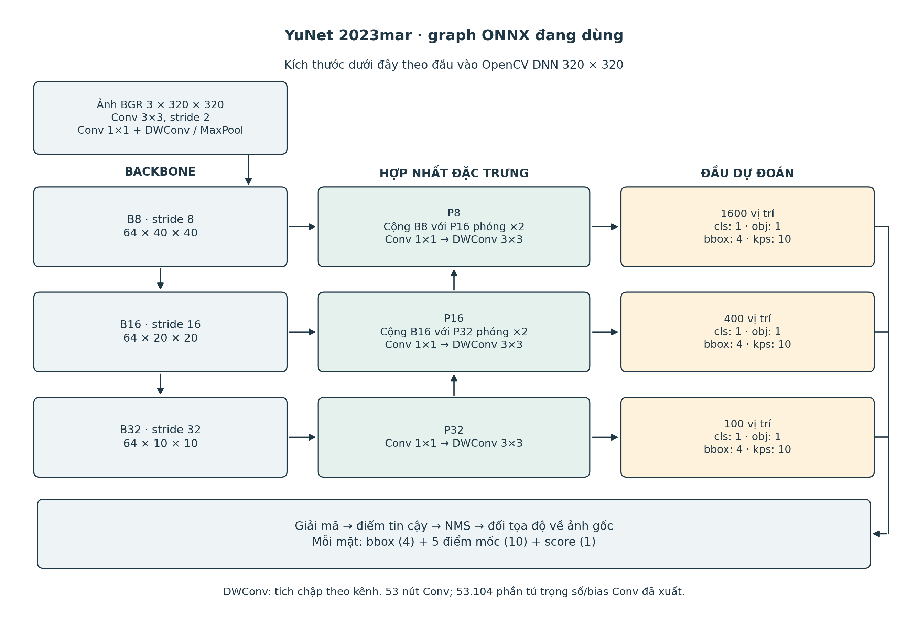

Tại đầu vào 320×320 đã kiểm tra qua OpenCV 4.11.0, ba mức có 1.600, 400 và 100 vị trí. Mỗi mức trả về bốn nhóm: cls có một giá trị, obj có một giá trị, bbox có bốn giá trị và kps có mười giá trị ở từng vị trí. OpenCV giải mã và loại bỏ hộp trùng, tạo kết quả cuối có 15 giá trị cho mỗi mặt. Năm điểm mốc tương ứng hai tâm mắt, mũi và hai góc miệng. Chúng cung cấp tọa độ tạo ROI; nhãn mắt nhắm và ngáp được xác định ở hai classifier sau đó.

Kích thước khai báo của tệp YuNet ONNX là 1×3×640×640. Runtime project dùng OpenCV DNN 4.x với đầu vào 320×320; phép kiểm tra tensor đã xác nhận đầu ra theo kích thước này. Khi chuyển bộ thực thi, cần kiểm tra lại khả năng thay đổi kích thước thay vì suy ra rằng mọi ONNX runtime sẽ chấp nhận 320×320. Tệp có 53.121 phần tử initializer tổng cộng, gồm cả hằng số phục vụ graph; số 53.104 ở Bảng 2-2 chỉ đếm các tensor trọng số/bias Conv đã xuất, không đồng nhất với số tham số của một mô hình huấn luyện trước khi gộp lớp.

YuNet được lấy từ OpenCV Zoo và giữ nguyên trọng số, với phiên bản nguồn và SHA256 trong manifest [1]. Hai classifier bắt đầu từ checkpoint mắt/ngáp có sẵn của người thực hiện, rồi được fine-tune cục bộ bằng các script trong project. Các trường train_args của checkpoint nền ghi mô hình khởi tạo yolov8n-cls.pt, kích thước 224, cấu hình 40 epoch và seed 42. Những trường cấu hình đó cần được đọc cùng hồ sơ huấn luyện; chúng không đủ để xác nhận độc lập toàn bộ quá trình train gốc trên Kaggle.

Ở một frame quan sát hợp lệ theo cấu hình một góc cắt, ba lượt phân loại gồm hai mắt và một mặt có tổng 603.926.016 MAC cho Conv/Linear. Con số này chưa gồm YuNet, chuẩn bị ROI, logic, camera hoặc dashboard; không dùng để suy ra FPS. Mô hình ngáp xử lý từng ảnh; thông tin chuỗi thời gian được hợp nhất bởi Monitor ở mục 2.9.

### 2.8.8. Kiến trúc fine-tune và các biến thể dữ liệu

Các bản hiệu chỉnh mắt, ngáp USB và blur giữ nguyên mười tầng chính trong Bảng 2-1, số kênh và đầu ra hai lớp. Kiểm kê chín manifest, mười checkpoint PyTorch khác nhau và các graph ONNX tương ứng xác nhận cấu trúc các tầng giống nhau. Tên các thư mục thể hiện mục đích hiệu chỉnh hoặc cách tạo đầu vào, không biểu thị một họ mạng mới [36].

Phần backbone của classifier có 1.108.048 tham số. Đầu Classify gồm 330.240 tham số ở Conv 1×1 và affine BatchNorm, cùng 2.562 tham số ở Linear 1.280→2; GAP không có tham số học. Bản eye_refined_v4 cập nhật toàn bộ 332.802 tham số ở Classify, tương đương khoảng 23,10% mô hình, trong khi giữ backbone và thống kê chạy BatchNorm. Bản mắt eye_refined trước đó chỉ cập nhật Linear.

Các bản ngáp smile_refined, yawn_camera_refined, yawn_usb_refined và yawn_usb_robust giữ bộ trích đặc trưng, chỉ cập nhật Linear, tương đương khoảng 0,178% số tham số. Bản blur_refined cũng cập nhật Linear của cả model mắt và model ngáp từ các checkpoint trong profile PC. Hình 2-4 thể hiện phạm vi trọng số được cập nhật; thông tin huấn luyện bổ sung được lưu ngoài train_args nền để đối chiếu đúng nguồn dữ liệu và checkpoint được chọn.

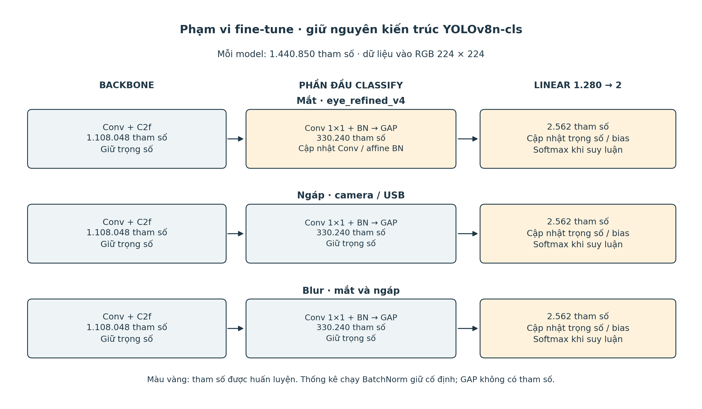

Ở hướng blur, dữ liệu train giữ ảnh rõ và ảnh mờ thực, bổ sung Gaussian blur với sigma từ 0,45 đến 1,05 và motion blur dài 3 hoặc 5 pixel theo nhiều góc. Biến đổi được áp dụng ở độ phân giải ROI trước bước chuẩn bị ảnh 224×224. Các bản sinh từ cùng ảnh gốc kế thừa cùng phần dữ liệu. Chỉ dữ liệu validation thực chưa tăng cường được dùng để hiệu chỉnh ngưỡng nét; cấu hình ứng viên có ngưỡng mặt 16 và mắt 5. Đây là một profile thử nghiệm riêng [38].

Bản yawn_usb_robust bổ sung nhiễu RGB với sigma 3 và 7, Gaussian blur nhẹ sigma 0,5, nén JPEG quality 70, cùng thay đổi biên crop vào/ra hai pixel. Các biến đổi này tạo dữ liệu train để thích nghi camera USB và góc thấp; chúng không thay thế đầu vào live hoặc làm thay đổi số lớp. Validation và phép kiểm tra mới được tách khỏi các mẫu tăng cường train [37].

Bản yawn_usb_dual_view dùng hai cách tạo ảnh từ cùng ROI: cắt giữa theo preprocessing đã có và đệm biên thành ảnh vuông trước preprocessing. Cùng model được gọi trên từng ảnh, rồi lấy giá trị P(yawn) lớn nhất. Cách gộp này được khai báo trong manifest; score gộp chưa được hiệu chuẩn và cần kiểm tra nhận nhầm cười. Cấu hình đó tham chiếu trọng số yawn_camera_refined, không tạo checkpoint mạng mới.

## 2.9. Quyết định theo thời gian

Các giải thuật tại mục này được mô tả từ core.py, eye_events.py và eye_motion.py của project [29]. Chúng xử lý các chỉ báo hành vi theo quy tắc đã chọn; kết quả nghiệm thu cần được đo bằng dữ liệu độc lập.

Một lần chớp mắt thông thường và nhắm mắt kéo dài có thể cùng tạo ra nhãn Closed ở một số khung hình. Để phân biệt, chương trình sử dụng thời điểm bắt đầu và kết thúc chuỗi quan sát thay cho một số lượng frame cố định. Khi FPS thay đổi, cùng một khoảng thời gian thực vẫn được đánh giá theo cùng ngưỡng.

Đối với ngáp, hai ngưỡng khác nhau được dùng để bắt đầu và kết thúc một đợt. Cách sử dụng ngưỡng vào cao và ngưỡng ra thấp hạn chế tách một biểu hiện đang duy trì thành nhiều sự kiện khi xác suất dao động gần ranh giới. Một đợt được xác nhận chỉ tăng bộ đếm một lần cho đến khi đủ điều kiện kết thúc.

Cấu hình PC còn dùng EMA theo thời gian để làm trơn xác suất ngáp. Với Δt là khoảng cách giữa hai quan sát và τ=0,20 s, hệ số α được xác định bằng công thức (2.13). Khi dữ liệu bị ngắt, trạng thái lọc được khởi tạo lại để không kéo dài bằng chứng cũ qua khoảng mất quan sát.

@equation α = 1 − exp(−Δt/τ);    p̄ₜ = p̄ₜ₋₁ + α(pₜ − p̄ₜ₋₁)                   (2.13)

### 2.9.1. Quan sát hợp lệ và tính liên tục của thời gian

Thuật toán theo thời gian tiếp nhận Observation gồm timestamp, phân phối xác suất từng mắt, phân phối ngáp và chỉ số chất lượng. Điều kiện hợp lệ bao gồm đúng nhãn, giá trị hữu hạn, từng xác suất thuộc [0,1] và tổng gần bằng 1 trong sai số 0,001. Timestamp phải tăng nghiêm ngặt; timestamp đảo hoặc lặp bị từ chối. Tuổi frame và khoảng cách giữa các frame được kiểm tra để tránh dùng ảnh cũ như bằng chứng mới.

Với chuỗi quan sát đang xét, Δt=tₖ−tₖ₋₁ là khoảng cách thời gian. Khoảng vượt 0,25 s ngắt xác nhận. Một chuỗi đủ 1,5 s không chỉ có điểm đầu và điểm cuối cách nhau 1,5 s; mọi quan sát trung gian phải thỏa điều kiện duy trì. Ví dụ nhắm ở t=0 rồi mất camera đến t=2 không được kết luận đã nhắm liên tục hai giây.

Camera sử dụng đồng hồ monotonic, trong khi video sử dụng thời gian nguồn hoặc sidecar timestamp. Do đó, xử lý clip nhanh hơn tốc độ thực không làm các thời gian xác nhận bị rút ngắn. Đây là cơ sở để cùng một logic được dùng khi chạy trực tiếp và khi phát lại dữ liệu kiểm thử.

### 2.9.2. Phân loại từng mắt và xác nhận nhắm kéo dài

Gọi p₁ và p₂ là xác suất Closed của hai ROI mắt. Mỗi mắt được coi Closed khi p≥0,80; Open khi 1−p≥0,80; ngoài hai miền đó là chưa xác định. Hai miền quyết định tách nhau nên một xác suất nằm gần ranh giới không bị ép thành nhãn chắc chắn.

@equation C = (p₁≥0,80) ∧ (p₂≥0,80);    O = (p₁≤0,20) ∧ (p₂≤0,20)   (2.14)

Khi C đúng trên các quan sát liên tiếp hợp lệ, thuật toán ghi t₀ tại lần đầu và tính T=t−t₀. T đạt 1,5 s tạo bằng chứng nhắm mắt kéo dài. Một mắt nhắm và một mắt mở không thỏa C, do đó không tạo nhánh cảnh báo này. Nếu chất lượng hoặc độ chắc chắn không đạt, chuỗi xác nhận nhắm kéo dài bị xóa và hệ thống trả UNKNOWN.

Mức confidence là một điều kiện của quyết định, không phải xác suất đã hiệu chuẩn rằng một người đang buồn ngủ. Nếu classifier nhận nhầm mắt mở thành Closed với p gần 1, logic vẫn có thể nhận bằng chứng sai. Ngăn lỗi này cần cải thiện dữ liệu, model hoặc chất lượng quan sát; chỉ tăng thời gian xác nhận có thể làm giảm một số báo nhầm nhưng cũng tăng độ trễ.

### 2.9.3. Đếm chu kỳ mắt và ghép chớp mắt hai mắt

Mỗi mắt có một bộ trạng thái theo dõi mở, đóng và trở lại mở. Trước khi bắt đầu hoặc hoàn tất chu kỳ, profile PC yêu cầu Open được duy trì 0,10 s. Khi đóng bắt đầu ở a và mở trở lại lần đầu ở b, thời lượng đóng là b−a; thời gian chờ xác nhận mở sau b không được cộng vào khoảng đóng.

Chu kỳ riêng một mắt được lưu làm thông tin chẩn đoán nếu thời lượng đạt tối thiểu 0,05 s. Để được dùng như blink hai mắt, mỗi chu kỳ còn phải không quá 0,50 s và có phần chồng lấp với chu kỳ mắt còn lại. Với hai khoảng đóng [a₁,b₁] và [a₂,b₂], độ dài chồng lấp được xác định như sau.

@equation Tlap = min(b₁,b₂) − max(a₁,a₂);    Tlap ≥ 0,05 s             (2.15)

Runtime ghép hai sự kiện một lần rồi loại chúng khỏi hàng đợi chờ. Chỉ hai chu kỳ ngắn phù hợp mới tăng bộ blink both; nháy riêng một mắt hoặc nhắm kéo dài chỉ có thể tăng số chu kỳ chẩn đoán. Điểm khởi tạo ở trạng thái Closed cũng chưa đủ tạo chu kỳ, vì chưa quan sát được bước mở trước đó.

Một chuyển tiếp có confidence chưa rõ được phép tồn tại trong khoảng grace tối đa 0,15 s ở bộ sự kiện mắt; nếu kéo dài hơn, chu kỳ bị ngắt. Khoảng grace này không được dùng để nối qua frame thiếu, frame cũ hoặc chất lượng không đạt. Logic nhắm kéo dài vẫn yêu cầu bằng chứng chắc chắn liên tục, khác với cơ chế xử lý chuyển tiếp ngắn của bộ đếm.

Để đánh giá chớp mắt tăng, gọi B₀ là số blink trong cửa sổ hiện tại dài 5 s và B₁ là số trong cửa sổ 5 s trước. Hai cửa sổ cần có quan sát đủ trước khi so sánh; bộ baseline chỉ sẵn sàng sau ít nhất 10 s theo dõi sự kiện mắt liên tục.

@equation BlinkIncrease = BaselineReady ∧ (B₀≥4) ∧ (B₀≥B₁+1)         (2.16)

Các giá trị 4 và 1 là ngưỡng thực nghiệm của project, chưa phải một quy luật sinh lý áp dụng cho mọi người. Mất quan sát ngắt tính liên tục của baseline. Cách dùng cửa sổ theo giây giúp tránh biến thay đổi FPS thành thay đổi giả của tần suất chớp mắt.

### 2.9.4. Bộ lọc EMA theo thời gian

EMA, hay trung bình trượt hàm mũ, cập nhật giá trị đã lọc bằng cách kết hợp giá trị cũ với quan sát mới. Công thức đã trình bày dùng α phụ thuộc Δt và τ. Khi Δt nhỏ, mỗi mẫu mới có trọng số nhỏ; khi Δt lớn hơn trong miền dữ liệu hợp lệ, trọng số mẫu mới tăng. Cách này giữ cùng hằng số thời gian khi FPS thay đổi.

Với τ=0,20 s và Δt khoảng 1/15 s, α xấp xỉ 0,283. Nếu xác suất cũ bằng 0,40 và mẫu mới bằng 0,90 thì giá trị sau một bước xấp xỉ 0,542. Đó là ví dụ tính toán của bộ lọc, không phải kết quả đo trên video. Một mẫu tăng cao đơn lẻ chưa làm xác suất lọc chuyển ngay thành giá trị cao của mẫu đó.

Làm trơn tạo đánh đổi giữa dao động và độ trễ. Nó không thêm thông tin phân biệt cười với ngáp. Nếu model nhận nhầm cười liên tục, EMA có thể làm dự đoán sai ổn định hơn. Vì vậy, project lưu cả xác suất thô và xác suất lọc để đối chiếu, đồng thời hiệu chỉnh classifier bằng dữ liệu âm. Khi ngắt dữ liệu toàn frame, trạng thái lọc được xóa.

### 2.9.5. Hysteresis và xác nhận một đợt ngáp

Hysteresis dùng ngưỡng bắt đầu cao hơn ngưỡng kết thúc và duy trì trạng thái trong miền giữa. Project kết hợp nguyên lý này với bộ đếm thời gian. Ở trạng thái chưa ngáp, p đã lọc cần đạt ít nhất 0,70 liên tục 1 s để xác nhận. Khi đã ngáp, p phải giảm xuống không quá 0,35 liên tục 0,5 s để kết thúc.

Nếu xác suất ở giữa 0,35 và 0,70, một đợt đã xác nhận được giữ hoạt động nhưng một đợt mới chưa được xác nhận. Nếu điều kiện bắt đầu bị phá trước đủ 1 s, bộ đếm thời gian bắt đầu bị xóa. Tương tự, p tăng khỏi miền kết thúc trước đủ 0,5 s sẽ xóa bộ đếm kết thúc. Nhờ đó, dao động bên trong một biểu hiện không tự tạo thêm một sự kiện ở mỗi frame.

Khi chuyển sang đợt xác nhận, timestamp được thêm một lần vào hàng đợi ngáp. Các timestamp quá 60 s được loại. Gọi Y là số sự kiện còn lại, bằng chứng ngáp thường xuyên là Y≥2. Giới hạn này là quy tắc vận hành đã chọn; một sự kiện ngáp đơn lẻ được ghi nhật ký nhưng không đủ bật còi.

Khi kênh mắt chưa xác định nhưng ảnh và kênh ngáp vẫn hợp lệ, core.py tiếp tục cập nhật bằng chứng ngáp, trong khi trạng thái tổng thể vẫn UNKNOWN và còi tắt. Nếu lỗi thuộc toàn frame thì xác nhận đang dở của cả hai kênh bị ngắt. Sự kiện đã xác nhận trước đó được giữ đến khi hết cửa sổ hoặc thay đổi đối tượng; chương trình không ghép chuỗi xác nhận dở qua khoảng thiếu dữ liệu.

### 2.9.6. Máy trạng thái và hợp nhất bằng chứng

Máy trạng thái hữu hạn tổ chức quyết định theo một tập trạng thái và điều kiện chuyển. Hệ thống có NORMAL, WARNING, ALERT và UNKNOWN. Gọi E là nhắm kéo dài, F là ngáp thường xuyên và B là chớp mắt tăng; khi quan sát hợp lệ, điều kiện khởi phát ALERT được biểu diễn như sau.

@equation AlertTrigger = E ∨ (F ∧ B);    WarningEvidence = F ∨ B      (2.17)

Khi AlertTrigger đúng, bộ trạng thái bật cảnh báo và lưu nguyên nhân. Khi chỉ một bằng chứng F hoặc B xuất hiện, trạng thái là WARNING và còi chưa bật. Khi không còn điều kiện khởi phát sau một ALERT, hệ thống yêu cầu 1 s quan sát hợp lệ để hồi phục. Dữ liệu UNKNOWN làm tắt cảnh báo ngay, không chờ thời gian hồi phục.

Phép hợp nhất trên là quy tắc xác định trong chương trình, chưa phải một model học được mức buồn ngủ hoặc một thang điểm lâm sàng. Nó biểu diễn các chỉ báo hành vi đã chọn. Các tiêu chí phát hiện sự kiện và báo nhầm cần được đánh giá trên video có nhãn, tách khỏi F1 phân loại một ảnh mắt hoặc mặt.

### 2.9.7. Kiểm tra ổn định hình học khi đầu chuyển động

Bộ EyeMotion dùng đường nối hai mắt và mũi để theo dõi biến đổi hai chiều. Gọi M là trung điểm hai mắt, N là vị trí mũi và d là khoảng cách mắt; chương trình dùng tâm C=(M+N)/2, góc đường mắt θ và vị trí mũi chuẩn hóa q=(N−M)/d. Chỉ số dịch tâm giữa hai pose được chuẩn hóa bằng khoảng cách mắt trung bình.

@equation Shift = ‖Cₜ−Cᵣ‖ / ((dₜ+dᵣ)/2);    θ = atan2(Δy,Δx)      (2.18)

Ngoài Shift, thuật toán kiểm tra thay đổi q, thay đổi d theo tỷ lệ và chênh lệch góc đường mắt. Pose hiện tại được so với các pose còn trong cửa sổ 0,30 s; giá trị biến đổi lớn nhất được dùng để quyết định. Cách so với cửa sổ có thể phát hiện một thay đổi diễn ra qua nhiều frame, thay vì chỉ xét hai frame kề nhau.

Biến đổi dịch tâm, hình học hoặc tỷ lệ đạt 0,08, hoặc góc thay đổi đạt 3°, làm kênh mắt thành head_motion. Chuỗi sự kiện mắt bị ngắt và chỉ được dùng trở lại sau thời gian ổn định 0,35 s. Pose cũ được bỏ sau khi phát hiện thay đổi để một tư thế mới giữ yên không bị so mãi với tư thế trước.

Các phép tính dùng năm điểm mốc, không tái tạo góc pitch/yaw ba chiều hoặc đo độ mở mí mắt. Một chuyển động nhẹ chưa qua ngưỡng vẫn có thể làm ROI thay đổi; một chớp mắt thực xuất hiện trong thời gian tạm dừng có thể bị bỏ sót. Vì vậy, bộ lọc hình học cần được đánh giá cùng classifier và logic thời gian, không chỉ quan sát việc bộ đếm giảm.

## 2.10. Các chỉ số đánh giá

Độ chính xác phân loại được đánh giá bằng precision, recall và F1. Với lớp dương đang xét, TP là mẫu đúng được nhận biết, FP là mẫu lớp khác bị nhận nhầm và FN là mẫu đúng bị bỏ sót. Các chỉ số được xác định theo công thức (2.19).

@equation Precision = TP/(TP + FP);    Recall = TP/(TP + FN)                       (2.19)
@equation F1 = 2·Precision·Recall/(Precision + Recall)                            (2.20)

Macro-F1 là trung bình F1 của các lớp, giúp xem xét cả hai lớp thay vì chỉ dựa vào tổng số dự đoán đúng. Trong tập ảnh chỉ có mắt nhắm, chỉ số cần báo là recall lớp Closed; không sử dụng macro-F1 hai lớp như thể tập đó có đủ hai lớp.

Đối với toàn hệ thống, còn cần đánh giá sự kiện theo thời gian. Tỷ lệ phát hiện nhắm mắt kéo dài phải dựa trên số sự kiện có nhãn; số báo nhầm mỗi giờ phải dựa trên thời gian quan sát bình thường. FPS và độ trễ mô tả hiệu năng, không phải độ chính xác. Độ trễ p95 là mức mà khoảng 95% mẫu độ trễ trong phiên đo không vượt quá.

## 2.11. Chuyển đổi mô hình và suy luận trên NPU

Quá trình chuyển mô hình trong dự án gồm .pt→ONNX→RKNN. PyTorch là định dạng checkpoint dùng huấn luyện; ONNX phục vụ đối chiếu và chạy CPU; RKNN phục vụ nền tảng Rockchip. Bộ công cụ Toolkit2 thực hiện chuyển đổi, còn Lite2 cung cấp giao diện suy luận cho môi trường bo [4].

Trước khi dùng bản chuyển đổi, cần kiểm tra cùng một ảnh sau tiền xử lý tạo được nhãn và xác suất tương đương. Với INT8, dữ liệu calibration phải đại diện cho đầu vào vận hành và chỉ lấy từ tập train. Bản RKNN nền của dự án được chuyển không lượng tử hóa; độ chính xác trên NPU thật và bản INT8 chưa có kết quả nghiệm thu.

## 2.12. Giao tiếp dữ liệu và giao diện giám sát

REST tổ chức các yêu cầu đọc theo tài nguyên, gồm trạng thái, phiên chạy, chuỗi số liệu và sự kiện. Trong hệ thống này, FastAPI tiếp nhận yêu cầu HTTP và trả JSON hoặc JPEG; WebSocket duy trì kết nối để gửi snapshot theo thời gian mà client không cần liên tục tạo yêu cầu trạng thái [32]. Xác thực REST dùng header Bearer; WebSocket kiểm tra mã ở thông điệp đầu trước khi gửi dữ liệu riêng tư.

Hàng đợi giới hạn tách tốc độ suy luận khỏi tốc độ đọc của giao diện. Khi đầy, bản ghi xuất dữ liệu cũ có thể được bỏ để ưu tiên quan sát mới nhất; quá trình ra quyết định và ghi nhật ký gốc tiếp tục hoạt động. Đây là cơ chế bỏ dữ liệu hiển thị quá hạn, không xóa bằng chứng của phiên. Khung hình được vẽ một lần, dùng cho cửa sổ tại PC và luồng nén JPEG bất đồng bộ. Luồng nén có một ảnh chờ, chỉ hoạt động khi có nhu cầu xem; các client cùng nhận bản ảnh mã hóa.

SQLite lưu dữ liệu cục bộ bằng bảng và chỉ mục. Bộ nhập dùng định danh phiên cùng vị trí byte của bản ghi làm khóa chống trùng, lưu cursor theo file, chỉ nhập dòng JSONL hoàn chỉnh và tiếp tục sau khi khởi động lại. UTC dùng trình bày thời gian; timestamp nguồn vẫn phân biệt camera monotonic với thời gian video.

React quản lý giao diện web; React Native triển khai giao diện dùng chung cho Android và iPhone. TypeScript mô tả cùng hợp đồng dữ liệu cho các client. Expo Go phục vụ thử app iPhone; Android có APK đóng gói JavaScript để chạy độc lập với Metro. expo-image hiển thị JPEG có xác thực và không cache [33], [34]. AppState tạm ngắt preview và kết nối khi app vào nền; định danh đợt ALERT được lưu để hạn chế rung lặp sau kết nối lại. Các chức năng giao diện không tính lại blink, ngáp hoặc quyết định cảnh báo.

# CHƯƠNG 3. TÍNH TOÁN THIẾT KẾ

## 3.1. Tính toán và thiết kế hệ thống

### 3.1.1. Thiết kế sơ đồ khối hệ thống

Hệ thống được chia thành khối thu nhận ảnh, phát hiện và chọn ROI, phân loại, quyết định theo thời gian, cảnh báo và lưu nhật ký. Trên PC, các khối được thực hiện bằng Python và OpenCV; mô hình ONNX chạy CPU. Khi chuyển sang Radxa, bộ phân loại có thể sử dụng RKNN Lite2, còn cấu trúc dữ liệu và logic quyết định tiếp tục dùng chung.

Kiến trúc tổng thể tại Hình 3-1 thể hiện quan hệ giữa nguồn ảnh, máy xử lý, giao diện, nhật ký và khối cảnh báo. Camera và video là hai lựa chọn nguồn vào. ESP32 nhận quyết định qua serial khi có cấu hình cổng; firmware không thực hiện suy luận AI. Bước cài đặt và suy luận thử ONNX CPU trên Radxa đã có nhật ký; vận hành camera liên tục, NPU và cảnh báo vật lý vẫn cần kiểm tra riêng [39].

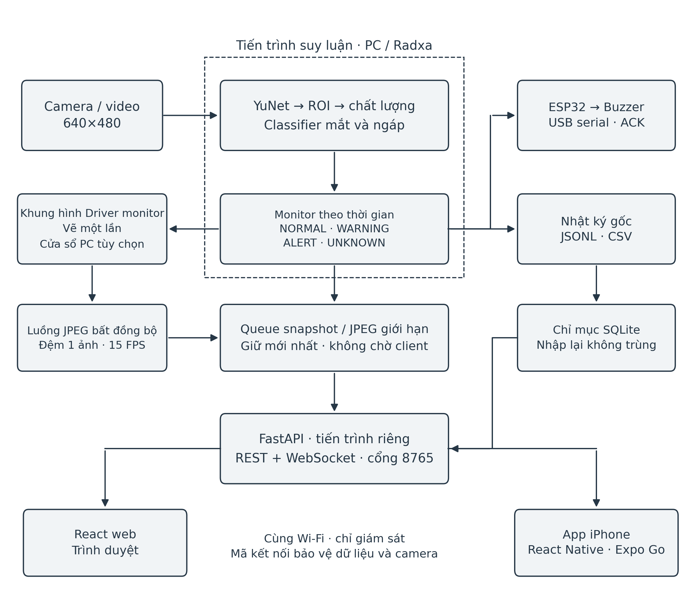

Một khung hình hợp lệ được tạo thành ba vùng ảnh: mắt thứ nhất, mắt thứ hai và mặt mở rộng. Hai lượt phân loại mắt sử dụng cùng model; lượt phân loại mặt sử dụng model ngáp. Bộ quyết định tiếp nhận kết quả theo tên lớp cùng thời điểm và chất lượng. Đầu ra trạng thái được gửi đồng thời tới khối hiển thị, serial và nhật ký.

### 3.1.2. Thiết kế giao tiếp ESP32 và còi

Máy tính kết nối ESP32 qua USB serial để gửi lệnh. GPIO25 của ESP32 điều khiển đầu vào của module còi active có mạch driver phù hợp. Nguồn module được chọn theo điện áp định mức thực tế và có mass chung với ESP32. Sơ đồ này được mô tả trong tài liệu firmware; việc lắp ráp và đo trên thiết bị cần được thực hiện riêng.

@table Bảng 3-1. Kết nối theo cấu hình firmware hiện có
| Điểm kết nối | Đích kết nối |
|---|---|
| USB của PC hoặc Radxa | Cổng USB ESP32 |
| GPIO25 | IN của module còi active có driver |
| GND ESP32 | GND của module còi |
| Nguồn cấp module | Theo định mức module; dùng GND chung |

Hình 3-3 mô tả kết nối theo firmware hiện có. Đường GPIO25 chỉ truyền tín hiệu điều khiển tới driver của còi. Đường ACK phản hồi việc nhận lệnh; thời điểm phát âm thực tế vẫn cần đo trên thiết bị. Watchdog xử lý trường hợp host ngừng gửi lệnh trong khi ESP32 còn được cấp nguồn.

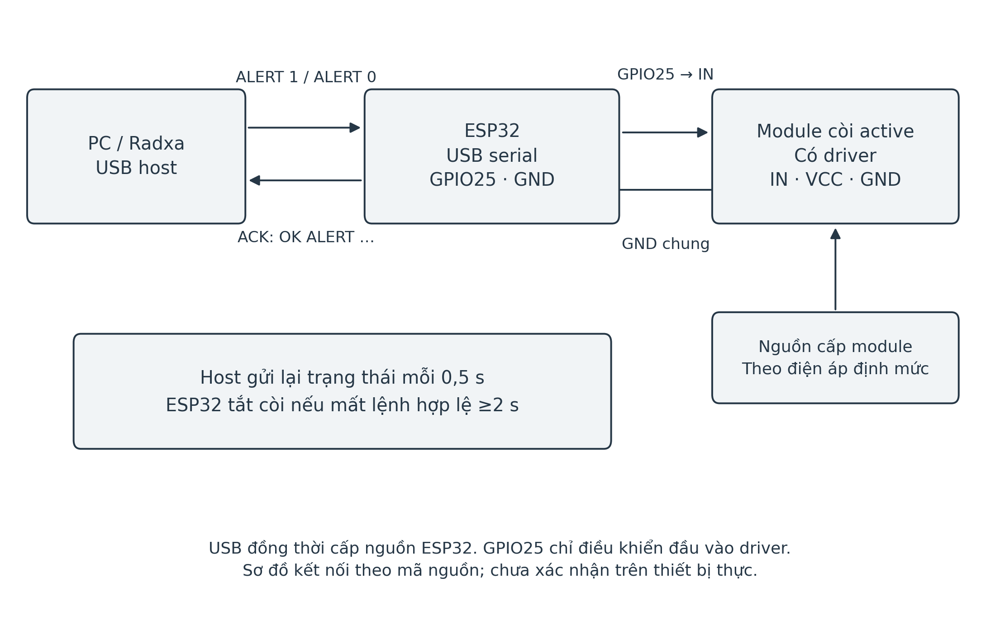

### 3.1.3. Lưu đồ hoạt động toàn bộ chương trình

Chương trình bắt đầu bằng việc đọc cấu hình, kiểm tra manifest và tải các mô hình. Sau khi mở nguồn ảnh, mỗi frame được kiểm tra thời gian, phát hiện mặt, tạo ROI và đánh giá chất lượng. Với quan sát dùng được, bộ phân loại trả xác suất cho bộ quyết định. Với dữ liệu thiếu hoặc lỗi, chương trình tạo quan sát UNKNOWN và ngắt chuỗi xác nhận liên quan.

Sau mỗi quyết định, trạng thái được cập nhật lên màn hình nếu đang chạy có giao diện, được ghi vào nhật ký và được chuyển tới bộ cảnh báo. Khi hết video, hết thời lượng chạy hoặc nhận lệnh thoát, chương trình giải phóng camera, đóng cửa sổ, gửi lệnh tắt và tạo tệp tổng hợp phiên. Các nhánh xử lý được trình bày tại Hình 3-4.

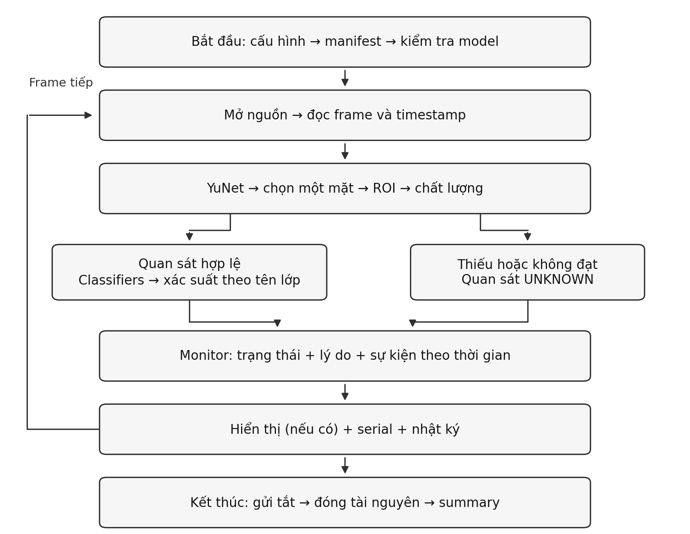

## 3.2. Thiết kế vùng cắt và kiểm tra quan sát

### 3.2.1. Tính toán vùng mắt và mặt

Với d là khoảng cách hai tâm mắt trong ảnh gốc, chiều rộng vùng mắt bằng 0,8d và chiều cao bằng 0,6d. Tâm vùng cắt đặt tại điểm mắt tương ứng. Các biên được giới hạn trong kích thước ảnh để không đọc vượt dữ liệu. Nếu điểm mốc không hữu hạn hoặc vùng mắt quá nhỏ, quan sát bị từ chối.

Vùng mặt được mở rộng thêm 10% kích thước hộp mặt ở mỗi phía. Tổng kích thước trước khi giới hạn vào khung hình tương ứng khoảng 1,2 lần chiều rộng và chiều cao hộp phát hiện. Việc mở rộng cung cấp thêm ngữ cảnh vùng miệng cho mô hình ngáp. Khi đánh giá các bản model, tỷ lệ cắt này được giữ cố định để so sánh cùng loại đầu vào.

Hình 3-5 minh họa vị trí các vùng cắt và cách đưa chúng vào hai classifier. Hộp nét liền là vùng mặt phát hiện, hộp nét đứt là vùng mặt mở rộng; hai hộp nhỏ là vùng mắt. Hình chỉ biểu diễn nguyên lý hình học, không phải ảnh thực nghiệm hoặc kết quả đo độ chính xác.

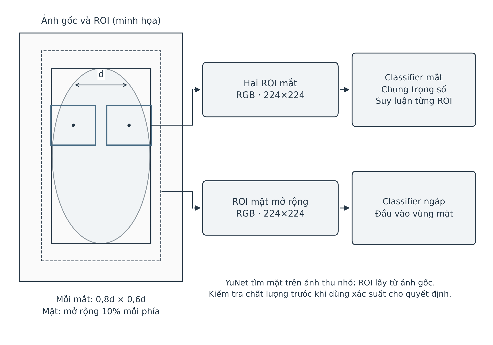

### 3.2.2. Điều kiện chất lượng của profile PC

Profile PC dùng các ngưỡng tại Bảng 3-2. Bộ phát hiện chỉ chọn một khuôn mặt nằm trong ROI ghế lái và đủ kích thước. Nếu không có mặt hoặc có nhiều mặt phù hợp, chương trình không tự chọn một người bất kỳ. Khi đối tượng theo dõi thay đổi, lịch sử sự kiện được xóa để tránh trộn dữ liệu của hai người.

@table Bảng 3-2. Các thông số quan sát đang sử dụng trên PC
| Thông số | Giá trị |
|---|---|
| Kích thước camera yêu cầu | 640×480 |
| Kích thước ảnh detector | 320×320, có vùng đệm giữ tỷ lệ |
| Confidence detector | 0,80 |
| Cạnh nhỏ nhất của mặt | 80 pixel |
| Chiều rộng vùng mắt nhỏ nhất | 12 pixel |
| Độ sáng tối thiểu | Trung vị mức xám 25 |
| Phương sai Laplace vùng mặt tối thiểu | 20 |
| Phương sai Laplace vùng mắt tối thiểu | 6 |
| Tỷ lệ điểm ảnh mặt quá sáng tối đa | 0,60; điểm ảnh mức xám >235 |
| Kích thước ROI mắt | 0,8d × 0,6d |
| Phần mở rộng mỗi phía vùng mặt | 10% |

Các giá trị trên là cấu hình phát triển cho camera PC, chưa được khóa bằng một bộ validation cabin độc lập. Điều kiện ánh sáng và góc camera khác có thể yêu cầu đánh giá lại. Mọi thay đổi ngưỡng cần được lưu cùng kết quả để xác định chính xác cấu hình đã tạo ra phép đo.

## 3.3. Thiết kế xác nhận trạng thái mắt

### 3.3.1. Phân biệt trạng thái từng mắt

Mỗi mắt được xác nhận Closed khi P(Closed)≥0,8 và Open khi P(Open)≥0,8. Nếu không đạt một trong hai điều kiện, mắt được coi là chưa xác định. Hai mắt cùng Closed mới tạo bằng chứng hai mắt nhắm. Một mắt Closed và mắt còn lại Open được hiển thị là one closed; sự kiện này không được sử dụng như nhắm hai mắt kéo dài.

Trong trường hợp model nhầm mắt còn mở thành Closed với xác suất cao, chỉ thay nhãn hiển thị không khắc phục được lỗi. Vì vậy, đề tài kiểm tra các vùng mắt thực và hiệu chỉnh classifier. Logic tổng hợp vẫn giữ điều kiện đồng thời của hai mắt, không thay đổi ngưỡng chỉ để làm cho ảnh lỗi qua kiểm tra.

### 3.3.2. Nhắm mắt kéo dài

Khi cả hai mắt Closed ở các quan sát liên tiếp dùng được, chương trình ghi thời điểm bắt đầu. Nếu thời gian duy trì đạt 1,5 s, trạng thái chuyển sang ALERT với lý do eyes_closed_too_long. Một lần chớp mắt ngắn không đủ thời gian để xác nhận nhánh cảnh báo này.

Khoảng cách giữa frame vượt 250 ms, dữ liệu đã cũ, timestamp không tăng hoặc chất lượng mắt không dùng được sẽ ngắt chuỗi xác nhận. Khoảng không quan sát được không được cộng vào thời gian nhắm. Sau khi hết bằng chứng cảnh báo, trạng thái hồi phục cần 1 s quan sát hợp lệ; UNKNOWN làm tắt cảnh báo ngay.

### 3.3.3. Ngắt xác nhận khi đầu chuyển động

Chương trình so sánh hình học khuôn mặt trong cửa sổ 0,30 s. Thay đổi vị trí, tỷ lệ hoặc hình học chuẩn hóa đạt 0,08, hoặc góc đường mắt thay đổi từ 3° trở lên, tạo trạng thái eye_quality=head_motion. Bộ sự kiện mắt được ngắt và chỉ hoạt động trở lại sau ít nhất 0,35 s kể từ thay đổi gần nhất.

Khi pose mới được nhận biết, các mốc cũ được bỏ để người giữ yên ở tư thế mới có thể trở lại quan sát hợp lệ. Cơ chế tạm dừng có thể làm bỏ sót chớp mắt xuất hiện trong thời gian chờ. Do đó, cần đánh giá cả khả năng giảm đếm nhầm và mức độ bỏ sót bằng video có nhãn, thay vì chỉ xem bộ đếm không tăng là kết quả đạt.

Hình 3-6 phân biệt việc xác nhận hai mắt nhắm, chớp hai mắt và chu kỳ riêng từng mắt. Các nhánh dùng cùng xác suất nhưng có điều kiện thời gian khác nhau; một mắt nhắm không trở thành bằng chứng hai mắt nhắm.

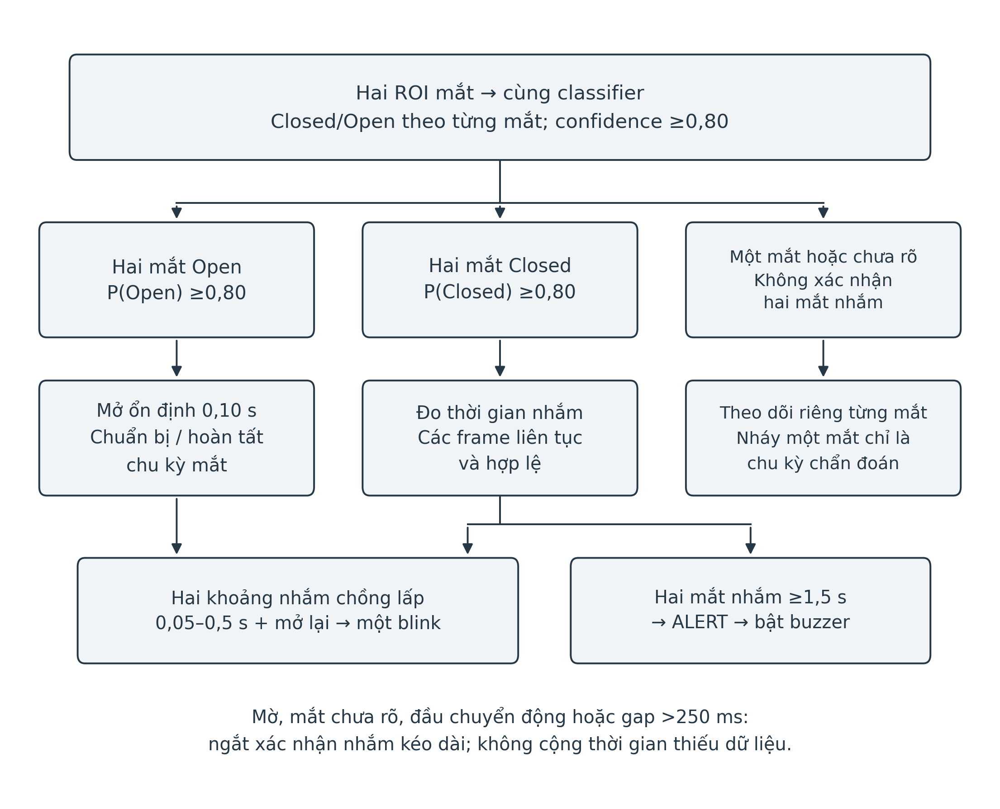

## 3.4. Thiết kế xác nhận ngáp

Một đợt ngáp bắt đầu được xác nhận khi xác suất sử dụng cho quyết định ≥0,70 liên tục ít nhất 1 s. Sau khi xác nhận, bộ đếm tăng một lần và trạng thái đợt được giữ. Đợt kết thúc khi xác suất ≤0,35 liên tục ít nhất 0,5 s. Khi xác suất nằm giữa hai ngưỡng, trạng thái đợt hiện tại chưa bị kết thúc.

Profile PC dùng xác suất sau EMA với hằng số thời gian 0,20 s; nhật ký đồng thời giữ xác suất thô để đối chiếu. Làm trơn có thể giảm dao động trong một đợt, nhưng không sửa được việc classifier nhận nhầm cười thành ngáp. Vấn đề nhầm lớp được xử lý bằng dữ liệu và hiệu chỉnh mô hình, còn EMA chỉ hỗ trợ tính ổn định theo thời gian.

Một lần ngáp được ghi vào nhật ký. Khi có ít nhất hai đợt đã xác nhận trong cửa sổ 60 s, hệ thống có bằng chứng frequent_yawning và tạo WARNING. Điều kiện này riêng lẻ chưa bật còi. Khi bằng chứng ngáp thường xuyên cùng xuất hiện với chớp mắt tăng, trạng thái chuyển ALERT.

Hình 3-7 trình bày ứng viên, xác nhận và kết thúc một đợt ngáp. Hai ngưỡng tạo hysteresis; chỉ thời điểm chuyển sang đợt đã xác nhận làm tăng bộ đếm.

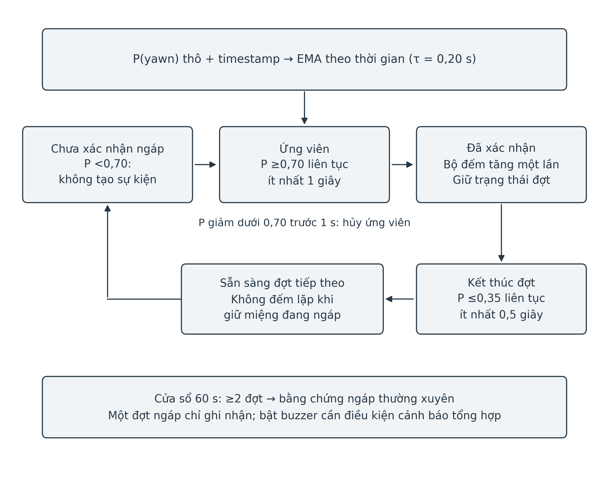

## 3.5. Thiết kế đếm chớp mắt và chu kỳ mắt

Chu kỳ mắt là một lần chuyển từ mở sang đóng và trở lại mở của một mắt. Bộ đếm này phục vụ chẩn đoán nên có thể tăng khi người dùng nháy riêng một mắt. Chớp mắt hai mắt, được dùng cho nhánh cảnh báo, yêu cầu hai khoảng đóng có chồng lấp và thời lượng phù hợp từ 0,05 đến 0,5 s. Vì vậy, tổng eye cycles không đồng nghĩa tổng blink both.

Profile PC yêu cầu trạng thái Open đủ 0,10 s trước khi chuẩn bị hoặc hoàn tất chu kỳ. Khoảng chờ xác nhận mở không được cộng thêm vào thời lượng đóng. Chuyển động đầu và khoảng mất frame ngắt sự kiện chưa hoàn thành để không ghép một lần đóng ở trước khoảng thiếu dữ liệu với lần mở ở sau đó.

Để xác định chớp mắt tăng, chương trình so sánh hai cửa sổ 5 s đã quan sát hoàn chỉnh. Cửa sổ hiện tại cần có ít nhất bốn blink và tăng ít nhất một lần so với cửa sổ trước. Chỉ sử dụng một cửa sổ chưa đầy đủ có thể tạo so sánh sai, đặc biệt khi chương trình vừa khởi động hoặc dữ liệu vừa bị ngắt.

## 3.6. Thiết kế trạng thái và điều khiển cảnh báo

@table Bảng 3-3. Điều kiện tạo trạng thái của hệ thống
| Trạng thái | Ý nghĩa và điều kiện |
|---|---|
| NORMAL | Quan sát hợp lệ; chưa có bằng chứng tạo WARNING hoặc ALERT |
| WARNING | Có ngáp thường xuyên hoặc chớp mắt tăng; còi chưa bật |
| ALERT | Hai mắt nhắm đủ 1,5 s, hoặc đồng thời ngáp thường xuyên và chớp mắt tăng |
| UNKNOWN | Dữ liệu thiếu, sai thời gian, mặt không xác định, chất lượng không đạt hoặc mắt chưa chắc chắn; còi tắt |

Hình 3-8 tổng hợp ba bằng chứng: nhắm mắt kéo dài, ngáp thường xuyên và chớp mắt tăng. Khi mắt chưa chắc chắn, trạng thái tổng thể là UNKNOWN và buzzer tắt; kênh ngáp hợp lệ vẫn có thể được ghi nhận riêng. Nhánh hồi phục giữ cảnh báo đến khi có đủ 1 giây quan sát hợp lệ sau khi hết điều kiện kích hoạt.

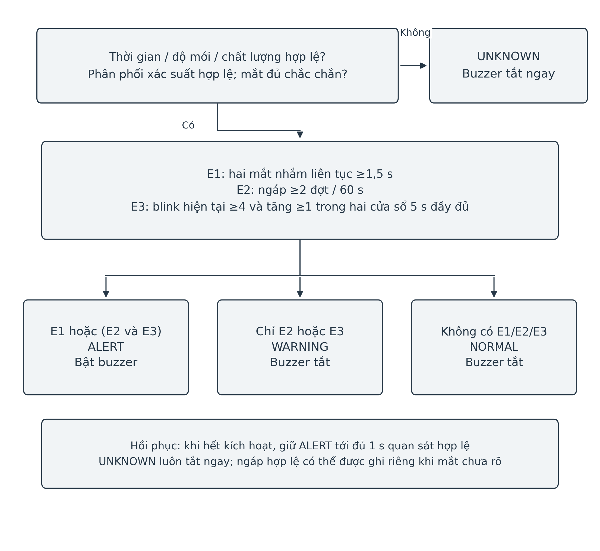

Khối serial nhận trạng thái cảnh báo và nguyên nhân. Khi bật, host gửi chuỗi ALERT 1 kèm lý do; khi tắt, gửi ALERT 0. Firmware phản hồi OK ALERT 1 hoặc OK ALERT 0 để xác nhận lệnh. Host gửi lại trạng thái mỗi 500 ms và thử kết nối lại khi có lỗi.

Trước khi gửi trạng thái bật, chương trình còn kiểm tra độ mới của quyết định. Điều này tránh gửi lại một lệnh bật cũ sau khi chờ mở cổng hoặc chờ ESP32 khởi động. Dữ liệu thiếu kết quả mới trên 250 ms làm ngắt cảnh báo tại host; watchdog 2 s của firmware là lớp xử lý khi host không còn gửi được lệnh.

Hình 3-9 mô tả lệnh, ACK, heartbeat và nhánh watchdog trong firmware. Trao đổi serial này điều khiển trực tiếp khối ESP32–buzzer; hình biểu diễn thiết kế, không phải phép đo độ trễ trên phần cứng thật.

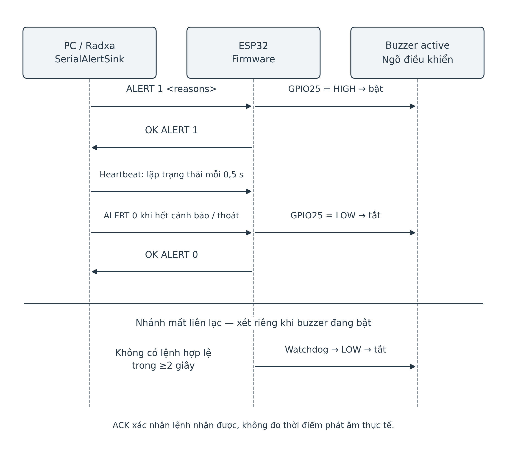

## 3.7. Thiết kế nhật ký và quản lý mô hình

Mỗi phiên có nhật ký JSONL, dữ liệu frame CSV và bản tổng hợp JSON. JSONL ghi thay đổi trạng thái, thống kê định kỳ và lỗi; CSV chứa kết quả theo frame phục vụ đối chiếu video; summary chứa số frame, thời gian, FPS, độ trễ và phân bố trạng thái. Thông tin nguồn, cấu hình và mô hình được ghi để xác định điều kiện của phép thử.

Manifest mô hình lưu tên lớp, kích thước đầu vào, tiền xử lý, đường dẫn artifact và SHA256. Khi khởi động, runtime xác minh artifact tương ứng với backend. Trong cấu hình PC hiện tại, manifest yawn_camera_refined quy định các artifact ngáp mới và tham chiếu nguyên trạng checkpoint mắt eye_refined_v4. Các trọng số gốc được giữ để so sánh trước và sau hiệu chỉnh.

Cấu trúc phần mềm tại Hình 3-10 thể hiện ranh giới giữa Capture, Vision/classifiers, Monitor và các khối đầu ra. Observation chứa thời điểm, chất lượng và xác suất theo tên lớp; Status chứa trạng thái, nguyên nhân và số sự kiện. SerialAlertSink tiếp nhận trạng thái bật/tắt, còn Journal ghi kết quả cùng cấu hình phiên.

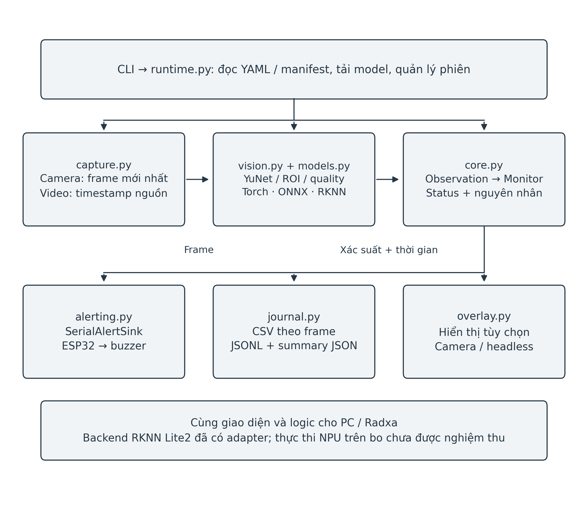

## 3.8. Thiết kế thu nhận camera và phát lại video

Camera dùng đồng hồ monotonic để ghi thời điểm lấy frame. Khối đọc giữ frame mới nhất, không tạo hàng đợi dài để mọi frame cũ lần lượt đi qua model. Cách này ưu tiên độ mới của quyết định; các frame không được xử lý trong điều kiện quá tải không được dùng làm bằng chứng duy trì mắt nhắm.

Video sử dụng thời gian của video hoặc sidecar timestamp nếu clip được ghi bằng công cụ của dự án. Chương trình kiểm tra timestamp và thông tin nguồn khi phát lại. Nếu file AVI có FPS danh nghĩa khác tốc độ ghi thực, sidecar giúp sử dụng đúng thời gian lấy ảnh. Tốc độ phát lại nhanh hơn thời gian thực không làm thay đổi ngưỡng xác nhận sự kiện trong thời gian video.

## 3.9. Thiết kế giám sát bằng web và ứng dụng di động

Chế độ serve chạy API ở tiến trình riêng với camera và suy luận. Runtime xuất MonitorSnapshot qua kênh giới hạn, gồm định danh phiên, số thứ tự, UTC, thời gian nguồn, trạng thái, nguyên nhân, xác suất, bộ đếm, chất lượng, FPS, độ trễ và tình trạng thiết bị. Kết quả được lấy từ Monitor; hai giao diện không tính lại điều kiện cảnh báo. Giá trị thiếu giữ null để tạo khoảng trống trên biểu đồ.

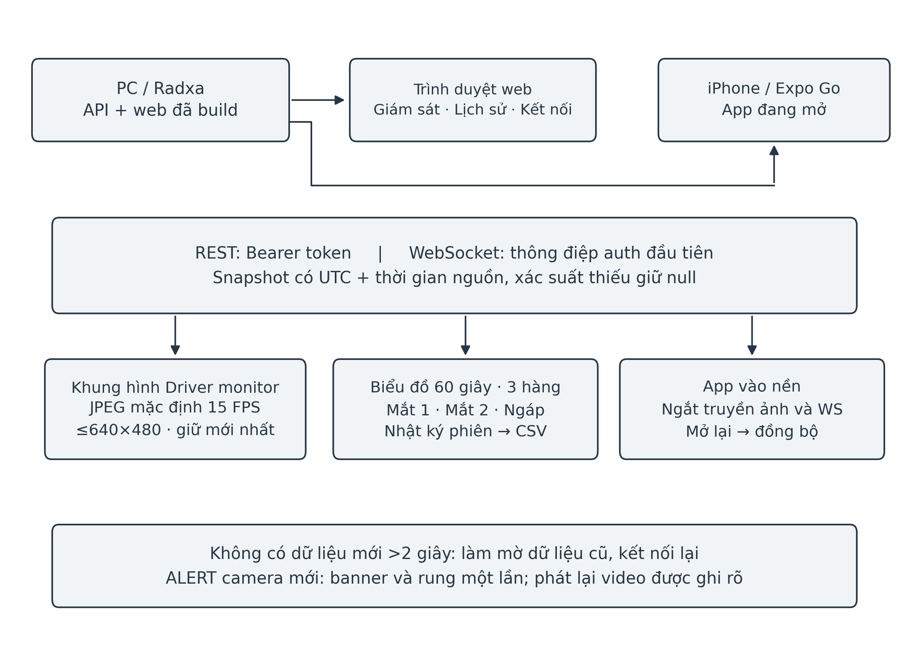

API và camera được bảo vệ bằng mã tạo tại máy xử lý. Mã không nằm trong URL WebSocket hoặc nhật ký truy cập. Ảnh lấy từ bộ nhớ mới nhất, giới hạn 640×480 và giữ lớp vẽ Driver monitor, gồm trạng thái, xác suất, bộ đếm, khung mặt và mắt. Luồng JPEG mã hóa dùng chung cho client, giữ một ảnh chờ; mục tiêu mặc định 15 FPS, có lựa chọn 2, 5, 10, 15 hoặc 30 FPS. Tốc độ nhận thực tế bị giới hạn bởi nguồn, suy luận, thiết bị và mạng; số thứ tự ảnh độc lập với bản tin trạng thái.

@table Bảng 3-4. Các tài nguyên đọc của API giám sát
| Tài nguyên | Vai trò |
|---|---|
| status, health | Snapshot và tình trạng chỉ mục |
| sessions, sessions/{id} | Danh sách và chi tiết phiên |
| sessions/{id}/series, events | Chuỗi số liệu và sự kiện có phân trang |
| sessions/{id}/export.csv | Xuất toàn bộ số liệu đã lưu của phiên |
| frame.jpg | JPEG mới nhất, có xác thực, không cache |
| ws | WebSocket, xác thực bằng thông điệp đầu |

Web bố trí camera và biểu đồ cạnh nhau, cùng nhóm chỉ số và thiết bị. Biểu đồ tách thành ba hàng Mắt 1, Mắt 2 và Ngáp, mỗi hàng có màu cùng xác suất hiện tại; dùng chung cửa sổ 60 s và thang 0–100% để đối chiếu. App dùng màn hình dọc với ba mục Giám sát, Lịch sử phiên và Kết nối. Khi quá 2 s không có dữ liệu mới, dữ liệu cũ được làm mờ và kết nối được thử lại. App chỉ rung một lần cho đợt ALERT camera mới khi đang mở; phát lại video được ghi rõ. Lịch sử gồm lọc ngày, phiên, chi tiết sự kiện và CSV. Không lưu thêm video hoặc tự xóa nhật ký.

# CHƯƠNG 4. THI CÔNG HỆ THỐNG

## 4.1. Giới thiệu

Phần thi công ở giai đoạn hiện tại tập trung vào phần mềm PC, ứng dụng giám sát, mô hình và cài đặt ban đầu trên Radxa. Runtime chính nằm trong package driver_monitor. Các chương trình cũ được giữ để đối chiếu hoặc chuyển tiếp tới runtime chung; việc duy trì hai bộ logic quyết định riêng cho PC và Radxa được thay bằng cùng một bộ Monitor.

Nội dung chương này trình bày các thành phần đã có trong dự án: tổ chức dữ liệu, hiệu chỉnh mô hình, tiền xử lý, lập trình camera, giao tiếp ESP32, nhật ký và công cụ chuyển đổi. Các mục lắp ráp thiết bị và thực nghiệm trên bo được dành riêng để bổ sung khi có kết quả.

## 4.2. Thi công hệ thống

### 4.2.1. Chuẩn bị phần cứng và môi trường phần mềm

Môi trường PC trong hồ sơ preflight sử dụng Windows 11 AMD64, Python 3.12.10 và khoảng 16,87 GB RAM theo số byte hệ thống trả về [9]. Các dependency suy luận gồm OpenCV 4.11.0.86, ONNX Runtime 1.20.1 và NumPy 1.26.4. PyTorch 2.6.0, torchvision 0.21.0 và Ultralytics 8.4.163 phục vụ thao tác mô hình trong môi trường phát triển.

Thiết kế phần cứng gồm máy tính xử lý, camera, ESP32 và module còi active. Bộ nguồn, chủng loại camera rời và dung lượng RAM của bo thực chưa được xác định bằng phép kiểm kê thiết bị. Bảng 4-1 phân biệt thành phần được dùng trong thử phần mềm với các thành phần trong phương án nhúng.

@table Bảng 4-1. Thành phần và vai trò trong hệ thống
| Thành phần | Vai trò | Hồ sơ hiện có |
|---|---|---|
| PC Windows | Phát triển và suy luận ONNX CPU | Preflight, ảnh đánh giá, nhật ký camera |
| Camera nguồn 0 | Thu nhận khung hình trên PC | Đọc được ảnh 640×480; chưa xác nhận camera rời |
| Radxa ROCK 4D | Nền tảng nhúng được chọn | Debian 12 ARM64, ONNX CPU smoke và nhận diện camera theo nhật ký; chưa đo vận hành liên tục |
| ESP32 | Nhận serial, điều khiển còi | Sketch và mô phỏng I/O host |
| Còi active và driver | Tạo cảnh báo âm thanh | Thiết kế kết nối GPIO25 |

### 4.2.2. Lắp ráp và kiểm tra phần cứng

### 4.2.3. Lập trình khối cảnh báo ESP32

Firmware trong esp32_buzzer.ino khởi tạo chân còi ở trạng thái tắt. Chương trình đọc các dòng ASCII từ serial, kiểm tra định dạng, cập nhật chân điều khiển và gửi ACK cho lệnh hợp lệ. Dòng lệnh sai trả ERR UNKNOWN_COMMAND; dòng vượt 160 ký tự bị bỏ và trả ERR TOO_LONG. Chỉ lệnh hợp lệ làm mới thời điểm watchdog.

Ở phía Python, SerialAlertSink xử lý gửi trạng thái, chờ ACK, thông báo lỗi và kết nối lại. Kết nối USB có thể làm ESP32 khởi động lại, vì vậy chương trình có khoảng chờ boot và kiểm tra lại độ mới trước khi gửi lệnh bật. Khi kết thúc bình thường hoặc cleanup sau lỗi, runtime cố gắng gửi lệnh tắt rồi đóng tài nguyên.

Sketch được biên dịch trong phép thử C++ trên host với các hàm I/O giả. Phép thử bao phủ khởi động, ACK, heartbeat, timeout 2.000 ms, lệnh sai, tràn dòng và rollover của millis [10]. Đây là kiểm tra logic firmware bằng mô phỏng, chưa phải cross-compile hoặc nạp sketch lên ESP32.

### 4.2.4. Lập trình Python

Chương trình dòng lệnh được gọi bằng python -m driver_monitor. Lệnh run hỗ trợ nguồn camera hoặc video, backend torch/onnx/rknn, YAML cấu hình, giới hạn thời lượng và chế độ hiển thị hoặc không màn hình. Các lệnh preflight, parity và evaluate-classifier hỗ trợ kiểm tra môi trường và mô hình trước khi chạy hệ thống.

Các module chính được trình bày tại Bảng 4-2. Bộ quyết định core không phụ thuộc camera, NumPy hay serial, nên có thể kiểm tra bằng Observation được xây dựng trực tiếp. Khối vision và khối models xử lý dữ liệu ảnh; runtime phối hợp các khối và bảo đảm giải phóng tài nguyên khi dừng.

@table Bảng 4-2. Tổ chức các module của runtime
| Module | Chức năng |
|---|---|
| config.py | Đọc và kiểm tra cấu hình YAML |
| capture.py | Camera mới nhất, video và timestamp |
| vision.py | YuNet, ROI, chất lượng, lựa chọn mặt |
| eye_motion.py | Kiểm tra thay đổi hình học khuôn mặt |
| models.py | Manifest, tiền xử lý, backend mô hình |
| core.py | Quyết định NORMAL/WARNING/ALERT/UNKNOWN |
| eye_events.py | Chu kỳ từng mắt và blink hai mắt |
| alerting.py | Serial, ACK, heartbeat, kết nối lại |
| journal.py | JSONL, CSV và summary |
| overlay.py | Hiển thị trạng thái và chỉ số |
| evaluation.py | Đánh giá ảnh, parity và sự kiện |
| runtime.py | Điều phối toàn bộ phiên chạy |

### 4.2.5. Hướng dẫn sử dụng và thao tác trên PC

Trước khi chạy, người sử dụng kiểm tra nguồn camera bằng công cụ probe_camera.py và bảo đảm chỉ có một chương trình chiếm thiết bị. Lệnh tại Ví dụ 4-1 được thực hiện trong thư mục gốc dự án bằng PowerShell. Cấu hình camera_pc.yaml chọn các mô hình hiệu chỉnh đang dùng cho thử nghiệm PC.

@code
& '.\.venv\Scripts\python.exe' -m driver_monitor run `
  --source 0 --backend onnx `
  --config configs/camera_pc.yaml --display
@endcode

Ví dụ 4-1. Khởi động camera với profile PC.

Khi cửa sổ mở, người sử dụng đưa khuôn mặt vào vùng camera, giữ đầu ổn định và quan sát lý do nếu chương trình báo UNKNOWN. Có thể kiểm tra lần lượt mở hai mắt, nháy một mắt, chớp hai mắt và nhắm hai mắt kéo dài. Eye cycles và Blink both có ý nghĩa khác nhau; nháy riêng một mắt không dùng làm chớp hai mắt cho nhánh cảnh báo.

Để thử video, thay nguồn 0 bằng đường dẫn clip. Nếu clip được ghi bằng công cụ record_camera.py, giữ tệp timestamps.json cạnh file video. Có thể thêm --realtime để xem theo thời gian nguồn hoặc --headless để chạy không cửa sổ. Phím Q/Esc dùng để thoát ở chế độ hiển thị; sau phiên, đường dẫn summary được in ra terminal.

@code
& '.\.venv\Scripts\python.exe' -m driver_monitor run `
  --source 'data_collection/videos/clip.avi' `
  --backend onnx --config configs/camera_pc.yaml `
  --display --realtime
@endcode

Ví dụ 4-2. Phát lại một clip với cấu hình PC; thay đường dẫn bằng file thực.

## 4.3. Tổ chức dữ liệu huấn luyện và đánh giá

### 4.3.1. Dữ liệu phân loại ban đầu

Các nguồn ảnh được người thực hiện cung cấp gồm Eyes dataset, MRL eye dataset và Yawning dataset trên Kaggle [5]–[7]. Dự án lưu các tập ảnh phân loại mắt và ngáp với các phần train, validation và test. Số lượng snapshot cục bộ được trình bày tại Bảng 4-3. Các số này mô tả dữ liệu trong dự án, không phải toàn bộ quy mô của mỗi nguồn Kaggle.

@table Bảng 4-3. Số ảnh của các tập phân loại cục bộ ban đầu
| Tập dữ liệu | Train | Validation | Test |
|---|---:|---:|---:|
| Mắt | 1.112 | 122 | 218 |
| Ngáp/không ngáp | 1.111 | 122 | 215 |

Hai notebook train_eye_classifier.ipynb và train_yawn_classifier.ipynb được xây dựng cho bài toán phân loại. Bbox toàn ảnh ở các dữ liệu cũ không chứng minh khả năng định vị mắt hoặc mặt. Đối với checkpoint đang sử dụng, các phép đo mAP của một lần huấn luyện detector trước đây không được dùng để thay cho F1 của classifier.

Việc chia dữ liệu hiện có chưa chứng minh độc lập theo người hoặc clip nguồn. Kiểm tra không trùng hash chỉ loại được ảnh trùng chính xác. Những ảnh của cùng một người hoặc các frame gần nhau vẫn có thể nằm ở các phần khác nhau nếu thiếu thông tin nguồn. Vì vậy, kết quả ảnh cục bộ là kết quả phát triển cần được xác nhận thêm bằng dữ liệu độc lập.

### 4.3.2. Dữ liệu bổ sung cho mô hình ngáp

Để xử lý lỗi cười nhe răng bị nhận thành ngáp, dự án bổ sung các ảnh có nhãn cười từ SMILEsmileD/SMILEs và GENKI-4K [11], [12]. Chỉ ảnh có nhãn cười được dùng làm mẫu không ngáp; ảnh không cười không tự động được xem là không ngáp. Dữ liệu ngáp cũ tiếp tục được sử dụng để bảo toàn khả năng nhận biết lớp yawn.

SMILEs có 3.690 ảnh cười được sử dụng, chia thành 2.545 train, 563 validation và 582 test. GENKI có 2.162 ảnh cười ban đầu; sau khi loại ba ảnh trùng đầu vào qua các phần, còn 1.516 train, 322 validation và 316 test. Chia theo hash và loại trùng giúp kiểm soát trùng chính xác, nhưng chưa chứng minh tách người.

Video 20261007T070644_475102Z.avi có 1.131 frame, dài 37,969 giây theo timestamp ghi ảnh. Nhãn được rà soát bằng hình ảnh; khoảng chuyển tiếp chưa rõ không dùng làm nhãn học. Lần ngáp đầu cung cấp đoạn train 6–9 s và validation 10–12 s. Lần ngáp thứ hai 28–34 s chỉ được đo sau khi chốt model. Mẫu train camera lấy cách nhau ít nhất 0,2 s, có 14 vùng ngáp, 28 vùng bình thường và 10 vùng cười. Các đoạn cùng người/cùng clip vẫn có tương quan nên không được xem là test độc lập theo người [30].

### 4.3.3. Dữ liệu bổ sung cho mô hình mắt

Các vùng mắt được tạo bằng YuNet và tỷ lệ ROI của runtime. Nhãn được xem riêng cho từng mắt; ảnh cười hay ngáp không tự tạo ra nhãn mắt. Các vùng không rõ trạng thái, mờ hoặc che mắt giữ nhãn Unknown và không tham gia huấn luyện như Open hoặc Closed.

Dự án sử dụng một phần dữ liệu CEW từ nguồn tác giả để bổ sung trường hợp mắt nhắm [13]. Phần mặt được dùng gồm 200 train, 50 validation và 60 audit, mỗi mặt cung cấp hai vùng mắt. Các mặt từ cùng ảnh gốc được giữ cùng phần dữ liệu. Bộ dữ liệu này vẫn chưa đủ chứng minh tách hoàn toàn theo người.

Một ca mắt mở hẹp được dùng để tái hiện lỗi và sau đó đưa vào train như mẫu âm khó của lớp Closed. Việc ghi rõ chuyển mẫu này sang train giúp tránh dùng kết quả đã chữa trên cùng ảnh làm bằng chứng độc lập. Tăng cường ảnh trong train gồm ảnh gốc, lật, xám, giảm sáng và xoay ±8°; validation và audit không tăng cường.

## 4.4. Hiệu chỉnh các mô hình

### 4.4.1. Hiệu chỉnh mô hình ngáp

Mô hình ngáp giữ nguyên backbone, convolution và BatchNorm của Classify, chỉ cập nhật Linear 1.280→2. Giai đoạn đầu bổ sung ảnh cười tạo bản smile_refined. Khi có video camera thật, bản này bỏ sót ngáp dù nhiều vùng mặt có chất lượng đạt; dữ liệu camera được bổ sung để tạo yawn_camera_refined [14], [30]. Kiến trúc, thứ tự lớp và tiền xử lý vẫn giữ nguyên.

Script refine_yawn_camera.py trích đặc trưng bằng cùng YuNet và quy trình cắt/tiền xử lý của runtime. Loss giữ dữ liệu ngáp và ảnh cười cũ, bổ sung nhóm camera cân bằng theo hành vi. Backbone và convolution không được cập nhật từ video một người. Các ứng viên phải giữ chỉ số ngáp cùng tỷ lệ nhận nhầm cười trên validation trước khi được lựa chọn.

Bản yawn_camera_refined của profile PC dùng seed 42, Adam, learning rate 0,002, trọng số loss camera 0,15, regularization 0,001 và mốc 150. Test ảnh cũ cùng lần ngáp thứ hai không tham gia lựa chọn ứng viên; kết quả được báo sau khi lưu và khóa checkpoint. PyTorch–ONNX được đối chiếu lại từ điểm ảnh, còn phép phát lại dùng toàn bộ video và timestamp nguồn. Khoảng train/validation từ cùng clip chỉ là dữ liệu phát triển, chưa chứng minh khả năng nhận biết người khác.

Hai bản ngáp tiếp theo dùng camera USB để hiệu chỉnh lớp Linear. yawn_usb_refined bổ sung vùng mặt camera; yawn_usb_robust tiếp tục từ bản này, bổ sung clip góc thấp và các phép tăng cường ảnh mô tả ở mục 2.8.8. Hồ sơ robust ghi 47 ảnh gốc train cùng sáu biến thể mỗi ảnh, tổng 329 crop của clip này, và giữ thêm 42 mẫu train camera trước đó cùng dữ liệu tĩnh. Ứng viên robust được chọn tại mốc 150, trọng số camera 0,9, regularization 0,001 [37]. Việc train này không cập nhật backbone và không sử dụng video kiểm tra lossless mới.

### 4.4.2. Hiệu chỉnh mô hình mắt

Mô hình mắt eye_refined_v4 giữ nguyên backbone, hiệu chỉnh convolution 1×1, tham số affine BatchNorm và Linear trong khối Classify. Tổng số tham số tham gia hiệu chỉnh là 332.802, trong khi thống kê chạy BatchNorm được giữ cố định. Kiểm kê thấy năm tensor thay đổi; cấu trúc 1.440.850 tham số vẫn giữ nguyên [15].

Việc lựa chọn sử dụng validation cùng điều kiện kiểm tra hồi quy cho ca lỗi đã biết, bảo toàn khả năng nhận biết mắt nhắm và cải thiện mắt mở trên ROI thực. Epoch được chọn là 2. Những bản chỉ thay Linear hoặc không đủ dữ liệu Closed không đáp ứng đồng thời các điều kiện được giữ trong hồ sơ thử nghiệm nhưng không dùng làm cấu hình PC hiện tại.

### 4.4.3. Quản lý các trọng số được sử dụng

@table Bảng 4-4. Các mô hình của cấu hình camera_pc trong các phép đo PC
| Thành phần | Tệp hoặc manifest | Nhãn/đặc điểm |
|---|---|---|
| Detector | models/face_detection_yunet_2023mar.onnx | Mặt và năm điểm mốc; CPU |
| Manifest PC | models/yawn_camera_refined/manifest.json | Ngáp mới; tham chiếu checkpoint mắt đang dùng |
| Mắt | models/eye_refined_v4/best_eye.pt/.onnx | Closed, Open |
| Ngáp | models/yawn_camera_refined/best_yawn.pt | no_yawn, yawn |
| ONNX ngáp | models/yawn_camera_refined/best_yawn.onnx | Xuất từ đúng checkpoint ngáp hiện tại |

SHA256 manifest PC: d2349de3521811f8627a7a54a526d3dae0c7a110aa3c0e6ae8770ca435134520. SHA256 checkpoint mắt: 122a79bd1122b1791f4d6758ed698eae599e72200fea86e246bf6be14a942ae4. SHA256 checkpoint ngáp: c31bb50bb024c93ed5caa4bf6553680c140396daa47a8a8b4e402e9d15e8e359. Các giá trị cho phép đối chiếu đúng bản tạo kết quả. Manifest gốc và các trọng số trước hiệu chỉnh được giữ để so sánh; artifact RKNN nền không đại diện cho trọng số PC hiện tại.

@table Bảng 4-5. Các manifest đã khảo sát và vai trò của từng phiên bản
| Manifest trong models/ | Model mắt | Model ngáp | Vai trò |
|---|---|---|---|
| manifest.json | best_eye nền | best_yawn nền | Đối chiếu gốc; có RKNN nền |
| eye_refined/ | eye_refined | smile_refined | Thử nghiệm mắt chỉ cập nhật Linear |
| eye_refined_v4/ | eye_refined_v4 | smile_refined | Đối chiếu trước sửa ngáp camera |
| smile_refined/ | best_eye nền | smile_refined | Bổ sung dữ liệu cười |
| yawn_camera_refined/ | eye_refined_v4 | yawn_camera_refined | Profile camera_pc và camera_yawn_refined |
| yawn_usb_dual_view/ | eye_refined_v4 | yawn_camera_refined | Thử hai góc cắt cùng trọng số |
| yawn_usb_refined/ | eye_refined_v4 | yawn_usb_refined | Ứng viên camera USB trước robust |
| yawn_usb_robust/ | eye_refined_v4 | yawn_usb_robust | Profile USB đang kiểm tra |
| blur_refined/ | blur_refined mắt | blur_refined ngáp | Ứng viên riêng với ảnh rõ/mờ |

Mỗi đường dẫn ở cột manifest chỉ một tệp manifest.json trong thư mục tương ứng. Hai profile PC và USB robust dùng cùng checkpoint mắt eye_refined_v4 nhưng dùng trọng số ngáp khác nhau. CLI serve mặc định camera_pc.yaml; CLI run mặc định driver_monitor.yaml, là profile nền. Để tái hiện kết quả USB phải chọn rõ configs/camera_usb_robust.yaml. Các tệp .pt, .onnx và .rknn là các định dạng thực thi của trọng số được xuất, không phải các kiến trúc AI độc lập.

Cần phân biệt cấu hình của phép đo với cấu hình được chọn để chạy sau đó. Các số liệu tại Chương 5 gắn với camera_pc và yawn_camera_refined ở thời điểm đo, không tự đại diện cho các ứng viên khác. Profile được lựa chọn trong phiên triển khai tiếp theo là models/yawn_kaggle_near_medium/runtime.yaml, dùng mắt eye_refined_v4 và mô hình ngáp near/medium Kaggle. Khi tái hiện phải ghi rõ profile, manifest và phiên bản trọng số tương ứng [41].

Kiến trúc đã được kiểm kê không đồng nghĩa chất lượng ngáp đã nghiệm thu. Video camera USB lossless mới ngày 10/10/2026 có 424 frame, 37,97 giây, hai đợt ngáp được rà soát và một đoạn cười nhe răng. Bản robust xác nhận một trong hai đợt; đợt đầu có chuỗi P(yawn) sau EMA vượt ngưỡng dài nhất 0,890 giây, chưa đủ điều kiện một giây. Đợt thứ hai được xác nhận tại 29,891 giây. Đoạn cười không tạo sự kiện ngáp. PyTorch–ONNX trên 23 ảnh kiểm tra có sai khác xác suất tối đa khoảng 2,67×10⁻⁶; ảnh và input 224×224 phát lại khớp bản ghi gốc [37]. Các bằng chứng này xác nhận còn vấn đề chất lượng dự đoán trên camera, trong khi phép đối chiếu backend đã đạt ở các mẫu được kiểm tra.

## 4.5. Chuẩn bị chuyển đổi và đóng gói Radxa

### 4.5.1. Chuyển mô hình nền sang RKNN

Hai mô hình nền đã được xuất ONNX và chuyển sang RKNN trong môi trường Linux x86_64 qua WSL. Hồ sơ chuyển đổi ghi Python 3.12.10, Torch 2.4.0+cpu, ONNX 1.17.0 và Toolkit2 2.3.2 [16]. Đích là rk3576, không lượng tử hóa. Môi trường này tách với môi trường PyTorch 2.6.0 dùng xuất và hiệu chỉnh trên PC.

Tệp rknn_conversion.json xác nhận quá trình tạo artifact đạt, nhưng các trường npu_inference_tested, accuracy_tested và physical_board_tested đều false. Hai blob nền này chưa được chạy trên NPU thật. Đặc biệt, chúng không chứa trọng số mắt và ngáp hiệu chỉnh hiện đang sử dụng trong profile PC.

### 4.5.2. Bộ tiếp nhận RKNN Lite2 và gói vận hành

Bộ tiếp nhận RKNN Lite2 trong models.py dùng cùng giao diện phân phối xác suất theo tên lớp như các backend khác. Kiểm thử với transport giả xác nhận quy ước RGB uint8 NHWC và việc không chuẩn hóa hai lần. Phép thử đó xác nhận cách truyền dữ liệu trong chương trình, chưa xác nhận khả năng thực thi model trên bo.

Bộ ONNX đã được đóng gói thành DA2-radxa-onnx.zip, chuyển sang ROCK 4D và giải nén tại /home/radxa/DA2. Nhật ký cài đặt ghi nhận đúng đích RK3576 và suy luận thử hai mô hình thành công [39]. Các artifact RKNN nền được quản lý riêng; chúng không đại diện cho trọng số hiệu chỉnh của profile được chọn. Khi tái tạo gói cần chỉ định rõ manifest, đối chiếu checksum và loại venv cùng video cá nhân khỏi gói.

Phân chia xử lý dự kiến được trình bày tại Hình 4-1. CPU thu nhận camera, chạy YuNet, tạo vùng cắt và thực hiện logic quyết định. NPU đảm nhiệm hai bộ phân loại thông qua RKNN Lite2. Cấu trúc này giữ nguyên giao diện quan sát và quyết định của runtime PC; các khối nét đứt là phần chưa được xác nhận bằng suy luận trên bo thực.

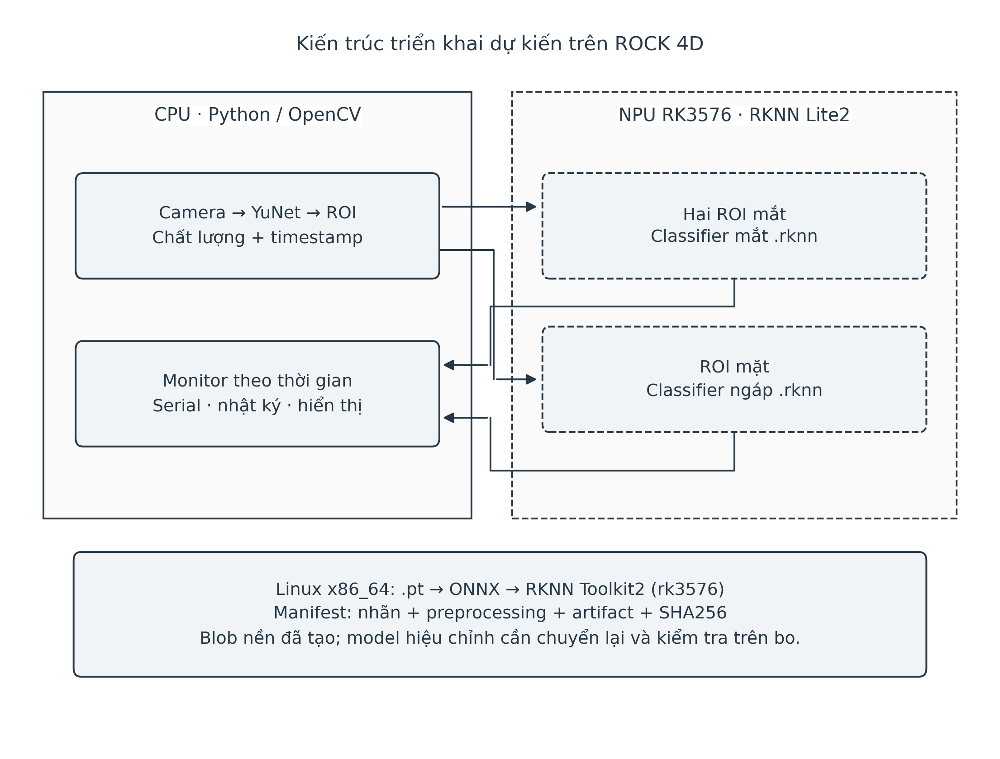

### 4.5.3. Cài đặt hệ điều hành và driver trên ROCK 4D

Đến ngày 15/10/2026, nhật ký được cung cấp ghi nhận ROCK 4D dùng Debian 12 ARM64, Python 3.11.2 và kernel 6.1.84-13-rk2410-nocsf. Script xác nhận RK3576 và hoàn tất suy luận thử ONNX CPU trên ảnh zero 224×224. Camera DV20 USB được liệt kê tại /dev/video0, /dev/video1 và /dev/media0 sau các lỗi USB trước đó. Đây là bằng chứng cài đặt và nhận diện thiết bị, chưa phải kiểm tra ảnh thực, FPS hoặc NPU [39].

### 4.5.4. Nạp và chạy mô hình hiệu chỉnh trên NPU

### 4.5.5. Lắp đặt hệ thống trong cabin

## 4.6. Chuẩn bị công cụ đánh giá video độc lập

Thư mục data_collection có hướng dẫn thu video và mẫu nhãn gồm subject_id, clip_id, split, lighting, start, end và label. Các nhãn sự kiện được xác định bằng việc xem video, không suy ra trực tiếp từ dự đoán của model. Tài liệu yêu cầu tách theo người trước rồi theo clip và giữ ít nhất hai người chỉ dùng cho test trong tổng số tối thiểu năm người [17].

Lệnh prepare-dataset tạo crop bằng cùng YuNet, tỷ lệ vùng cắt và quality của runtime. Các lệnh evaluate-session và evaluate-study đối chiếu CSV theo frame với nhãn, tổng hợp theo người và ánh sáng. Bộ đánh giá kiểm tra timestamp, clip, cấu hình và model tương ứng để tránh so sánh nhãn của clip này với log của clip khác.

Theo mục tiêu đã đặt ra, tập test cuối cần ít nhất 30 sự kiện nhắm mắt kéo dài, 30 đợt ngáp và hai giờ hoạt động bình thường. Những trường hợp nói chuyện, cười, kính, quay đầu và chất lượng không đạt cần được thu bổ sung. Các công cụ đã được chuẩn bị; dữ liệu và kết quả nghiệm thu tương ứng chưa có trong hồ sơ hiện tại.

## 4.7. Lập trình dashboard web và ứng dụng di động

Phần xuất dữ liệu được triển khai trong dashboard_data.py và dashboard_transport.py, luồng nén JPEG tại dashboard_video.py, phần API tại dashboard_server.py, chỉ mục lịch sử tại dashboard_history.py. Hàm run nhận observer tùy chọn; lỗi bộ xuất dữ liệu được ghi nhận và không dừng quyết định hoặc serial. Lệnh serve dùng mặc định profile PC hiện tại, mở cửa sổ Driver monitor khi thêm --display; không mở màn hình khi chạy dịch vụ. Dừng tiến trình gửi lệnh tắt còi, kết thúc worker và đóng các kết nối.

Mã giao diện được tổ chức trong npm workspaces: frontend/shared chứa kiểu dữ liệu, API client, nhãn và xử lý kết nối; frontend/web chứa React + Vite; frontend/mobile chứa React Native + Expo dùng chung cho Android và iPhone. Cây dependency được khóa bằng package-lock.json. Bản app 1.1.0 dùng Expo 57.0.29 và React Native 0.86.3; phần UI được tách theo màn kết nối, giám sát, preview, biểu đồ và lịch sử, giữ nguyên hợp đồng API [40].

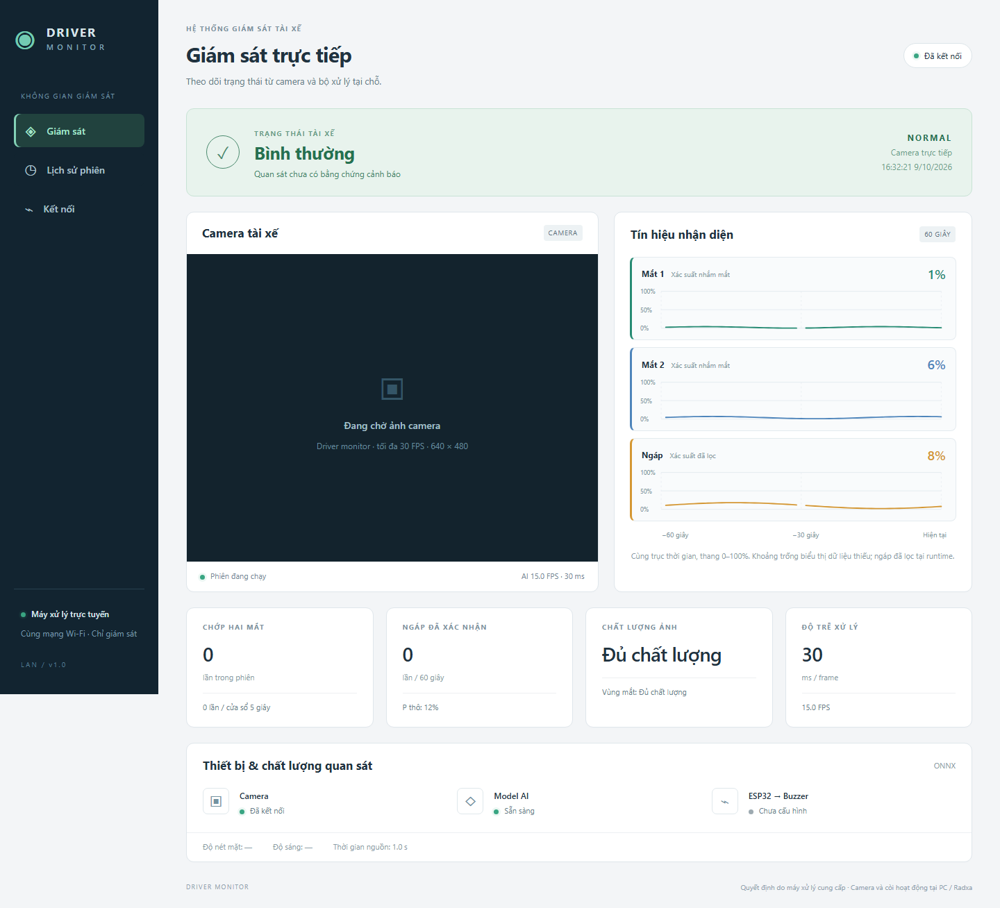

Ảnh Hình 4-2 minh họa bố cục ba hàng tín hiệu bằng dữ liệu mô phỏng; không dùng làm bằng chứng độ chính xác AI hoặc camera. Các trường hợp NORMAL, WARNING, ALERT, UNKNOWN, xác suất thiếu, kết nối quá hạn và phiên phát lại được thử trên trình duyệt. Bộ kiểm thử còn xác nhận ảnh JPEG đứng hoặc yêu cầu ảnh treo được đánh dấu quá hạn độc lập với WebSocket và phản hồi chậm từ phiên cũ không ghi đè phiên vừa chọn. Kiểm thử nén JPEG cố ý chặn xác nhận việc xuất cảnh báo không phải đợi bộ nén; yêu cầu ảnh theo số thứ tự trả 204 khi chưa có ảnh mới. App chờ ảnh đang tải hoàn tất trước khi thay nguồn và phục hồi khi yêu cầu treo. App đã kiểm tra TypeScript, xuất bundle iOS và chạy Expo Doctor. Người dùng xác nhận app đã kết nối khi dùng IPv4 Wi-Fi của PC; ảnh, rung, chuyển nền và chia sẻ CSV trên iPhone chưa được nghiệm thu đầy đủ.

DASHBOARD.md hướng dẫn chạy trên Windows, lấy IPv4, nhập mã và phát lại video. App iPhone dùng Expo Go; Android có APK nội bộ đóng gói sẵn JavaScript. Web được build sẵn và phục vụ cùng Python API nên Radxa không cần Node.js khi vận hành. Môi trường ONNX CPU trên bo đã được cài đặt; dịch vụ camera/serial và các phép đo hiệu năng trên bo vẫn cần kiểm tra sau cấu hình thiết bị [39], [40].

# CHƯƠNG 5. KẾT QUẢ THỰC NGHIỆM

## 5.1. Kết quả

### 5.1.1. Phân loại mắt trên các tập ảnh phát triển

Kết quả của bản eye_refined_v4 được trình bày tại Bảng 5-1 [15]. Tập 218 ảnh mắt cắt sẵn có hai lớp cân bằng và cho macro-F1 100%, tương đương mô hình nền. Tập ROI thực gồm 189 vùng mắt có 59 Open và 130 Closed cho macro-F1 97,54%. Tại ngưỡng P(Closed)≥0,8, số mắt Open bị xác nhận Closed giảm từ một trường hợp xuống không có trường hợp trong tập này.

@table Bảng 5-1. Kết quả mô hình mắt hiệu chỉnh
| Phép đánh giá | Số mẫu | Kết quả |
|---|---:|---|
| Ảnh mắt cắt sẵn ban đầu | 218 | Macro-F1 100% |
| ROI mắt trong audit phát triển | 189 | Macro-F1 97,54% |
| Recall Closed tại ngưỡng 0,8 của tập ROI | 130 Closed | 93,85% |
| Open bị nhận Closed ≥0,8 trong tập ROI | 59 Open | 0 trường hợp; nền có 1 |
| ROI mắt CEW, chỉ lớp Closed | 120 | Recall tại ngưỡng 0,8: 94,17% |

Tập CEW chỉ có lớp Closed nên được đánh giá bằng recall tại ngưỡng sử dụng, không diễn giải thành macro-F1 hai lớp. Các tập audit đã được quan sát trong quá trình phát triển các ứng viên. Nhãn ROI được rà soát bằng hình ảnh trong quá trình phát triển và cần người thực hiện đề tài kiểm tra lại. Vì vậy, bảng số liệu chưa được xem là vòng nghiệm thu độc lập cuối cùng.

Một ca mắt mở hẹp dùng chữa lỗi có P(Closed) của hai mắt giảm từ khoảng 0,92764/0,91446 xuống 0,04614/0,04987. Ảnh này đã được bổ sung vào train, nên kết quả chỉ xác nhận việc khắc phục ca hồi quy đã biết. Việc nhận đúng mắt mở trong ảnh này chưa chứng minh chương trình xử lý đúng mọi trường hợp nháy một mắt trên camera.

### 5.1.2. Phân loại ngáp và kiểm tra nhầm cười

Bảng 5-2 so sánh classifier sửa nhầm cười smile_refined với classifier hiện tại yawn_camera_refined. Trên 215 ảnh qua crop runtime, bản hiện tại có F1 lớp yawn 97,12%, macro-F1 98,09% và recall tại P≥0,70 bằng 95,28% [30]. Sáu ảnh không đạt chất lượng được tính vào bỏ sót, không loại khỏi mẫu số. Các split ảnh cũ chưa có bằng chứng độc lập theo người.

@table Bảng 5-2. So sánh trước và sau bổ sung dữ liệu camera cho classifier ngáp
| Phép đo | Bản sửa cười trước | Bản camera hiện tại |
|---|---:|---:|
| F1 yawn trên 215 ảnh qua ROI mặt | 96,62% | 97,12% |
| Macro-F1 trên cùng tập ROI mặt | 97,62% | 98,09% |
| Recall yawn tại P≥0,70 | 94,34% | 95,28% |
| Macro-F1 trên 215 ảnh gốc | 99,53% | 99,53% |
| Nhầm ngáp trên 316 ảnh cười GENKI | 2/316 | 1/316 |
| Nhầm ngáp trên 172 ảnh GENKI đạt quality | 0/172 | 0/172 |
| Nhầm ngáp trên 582 ảnh cười SMILEs | 0/582 | 0/582 |

Các phép đo ảnh cười/ảnh gốc được báo từ đặc trưng của bộ trích đã đóng băng và đầu Linear đã lưu; nhóm 215 ảnh ROI được suy luận lại từ pixel bằng ONNX. “Nhầm ngáp” ở đây là P(yawn)≥0,70 trên ảnh, chưa phải sự kiện hoặc số lần bật buzzer. SMILEs gồm ảnh mặt xám cắt 64×64, nên phép đo classifier không đại diện toàn pipeline camera với điều kiện mặt tối thiểu.

Kết quả bảo toàn các phép đo ảnh cũ trong khi cải thiện trường hợp camera đã tái hiện. Nhận biết ngáp tự nhiên, cười, nói chuyện, kính và ánh sáng khác cần tiếp tục được kiểm tra trên video mới sau khi khóa model.

### 5.1.3. Tương đương PyTorch và ONNX

Với checkpoint mắt đang dùng, kiểm tra 407 vùng ảnh thật cho đồng thuận nhãn PyTorch–ONNX 100% và sai khác xác suất tối đa khoảng 3,24×10⁻⁶ [15]. Artifact mắt được giữ nguyên trong bản sửa ngáp.

Với classifier ngáp hiện tại, phép parity suy luận lại từ pixel trên 215 ảnh test qua cùng YuNet và quality. Có 209 ảnh được suy luận và sáu ảnh UNKNOWN; trên các mẫu suy luận, hai backend đồng thuận nhãn 100%, sai khác xác suất tối đa khoảng 1,04×10⁻⁶ và macro-F1 giảm 0 điểm phần trăm. Các ảnh UNKNOWN vẫn được tính là bỏ sót trong F1 [30].

Những kết quả này xác nhận tương đương trong phạm vi dữ liệu và hai backend đã kiểm tra. Chưa suy rộng sang RKNN/NPU của trọng số hiện tại. Mỗi bước chuyển đổi tiếp theo cần cùng bộ đầu vào đối chiếu và manifest rõ ràng.

### 5.1.4. Kiểm thử logic, thiết bị và firmware mô phỏng

Bộ kiểm thử hiện tại trong tests/ ghi nhận 102 kiểm thử đạt trong lần rà soát bổ sung dashboard, không có kiểm thử thất bại [31], [35]. Các fixture camera thật kiểm tra ngáp, cười, trạng thái bình thường và tương đương PyTorch–ONNX. Báo cáo software_tests.json của lần rà soát lưu kết quả chạy cùng thời điểm hoàn thiện tài liệu [31]. Các tình huống bao phủ thay đổi FPS, timestamp đảo, frame cũ, khoảng mất frame, confidence thấp, một đợt ngáp, các đợt ngáp riêng biệt, chớp mắt, nhắm kéo dài và hồi phục. Phần serial có kiểm tra ACK, timeout, kết nối lại và độ mới trạng thái.

Các phép thử model–Monitor dùng vùng cắt thật xác nhận một mắt nhắm cùng một mắt mở không trở thành hai mắt nhắm; nháy một mắt tạo một eye cycle và không tạo blink hai mắt. Chuỗi nhắm hai mắt kéo dài vẫn tạo cảnh báo sau ngưỡng 1,5 s. Các chuỗi này được xây dựng để cô lập logic và classifier, không phải video nháy tự nhiên của cùng một khuôn mặt.

Firmware được kiểm tra bằng chương trình C++ trên host, bao gồm việc tắt khi mất lệnh quá 2 s. Phép kiểm tra serial với I/O giả không đo thời điểm còi thật phát âm hoặc đặc tính của cổng USB thực. Hồ sơ chưa có phép đo ACK, GPIO hoặc watchdog sau khi nạp lên ESP32.

### 5.1.5. Phát lại video kỹ thuật

Để kiểm tra toàn pipeline, công cụ check_eye_classifier.py tạo video lossless từ ảnh thật và phát qua decoder, YuNet, crop, classifier và Monitor. Clip mặt mở mắt có 45 frame dùng được: mô hình nền tạo ALERT ở 22 frame sau khi đủ thời gian xác nhận, trong khi bản mắt hiệu chỉnh không tạo ALERT. Clip mặt có hai mắt nhắm thực vẫn tạo ALERT ở 22/45 frame với bản mới [15].

Phép thử chuyển động sử dụng một ảnh mở mắt được xoay rồi đưa về góc ban đầu. Trên cùng video kỹ thuật 45 frame và cùng classifier đối chiếu, chính sách đếm cũ tạo một eye cycle; chính sách có kiểm tra hình học không tạo eye cycle, với 12 frame được đánh dấu head_motion [18].

Các clip lặp ảnh hoặc biến đổi ảnh chỉ xác nhận đường xử lý tích hợp và ca lỗi được xây dựng. Chúng chưa thể hiện chuyển động mí mắt hoặc ngáp tự nhiên. Số frame ALERT cũng không phải số sự kiện độc lập và không được tính vào yêu cầu tối thiểu 30 sự kiện nghiệm thu.

### 5.1.6. Kết quả chạy camera trên PC

Phiên camera tham chiếu trước bản sửa ngáp được lưu tại reports/eye_classifier_camera_check/20261006T162405_044346Z.summary.json, sử dụng source 0 và ONNX [19]. Kết quả được trình bày tại Bảng 5-3. Chương trình có 109 frame NORMAL và 43 frame UNKNOWN, không ghi nhận lỗi runtime trong phiên này.

@table Bảng 5-3. Phiên camera PC với cấu hình mắt hiệu chỉnh
| Chỉ số | Kết quả đo |
|---|---|
| Nguồn ảnh | Camera 0 trên PC |
| Backend | ONNX CPU |
| Độ phân giải yêu cầu | 640×480 |
| Số frame | 152 |
| Thời gian chạy | 10,047 s |
| FPS trung bình | 15,13 |
| Độ trễ đọc frame đến quyết định p95 | 32 ms |
| Phân bố trạng thái | 109 NORMAL; 43 UNKNOWN |
| Lỗi runtime | Không có trong phiên |

Phiên này không có nhãn hành vi của người trước camera; trường accuracy trong summary giữ null. Kết quả xác nhận việc chạy và hiệu năng của một phiên ngắn trên PC. Nó chưa chứng minh độ chính xác nhắm mắt/ngáp, tính ổn định hai giờ, hiệu năng camera rời hay hiệu năng Radxa. Tỷ lệ UNKNOWN khoảng 28,29% cũng cần được xem xét khi đánh giá khả năng quan sát.

### 5.1.7. Phát lại video camera sau hiệu chỉnh ngáp

Video 20261007T070644_475102Z.avi được phát lại qua decoder, YuNet, ba vùng cắt, các classifier và Monitor bằng ONNX. Hai bản dùng cùng 1.131 frame, cùng timestamp ghi ảnh và cùng ngưỡng chất lượng/quyết định. Nhãn sự kiện được rà soát từ hình ảnh, với hai đợt ngáp và 17 giây bình thường có nhãn, gồm đoạn cười [30].

@table Bảng 5-4. Kết quả phát lại video camera để sửa bỏ sót ngáp
| Chỉ số | Bản sửa cười trước | Bản camera hiện tại |
|---|---|---|
| Frame được xử lý | 1.131 | 1.131 |
| Thời gian nguồn | 37,969 s | 37,969 s |
| Ngáp được xác nhận | 0/2 đợt | 2/2 đợt |
| Thời điểm xác nhận | Không có | 10,625 s và 29,047 s |
| Sự kiện ngáp trong 17 s bình thường có nhãn | 0 | 0 |
| Sự kiện ngáp dư ngoài hai đợt có nhãn | 0 | 0 |

Hình 5-1 cho thấy xác suất ở hai đợt ngáp trước/sau sửa và thời điểm bộ đếm tăng. Điều kiện xác nhận vẫn là P sau EMA≥0,70 liên tục 1 giây, EMA có τ=0,20 giây. Bản mới không làm tăng bộ đếm trong đoạn cười của clip.

Bản hiện tại xử lý offline khoảng 51,37 FPS với p95 từ đọc frame tới quyết định 33 ms theo summary. Đây là tốc độ phát lại trên PC, không phải FPS camera trực tiếp hoặc NPU Radxa. Có 373 frame bị đánh giá mờ; tổng UNKNOWN là 512/1.131 frame, tương đương 45,27%, còn gồm mắt chưa rõ và chuyển động đầu. Nhiều frame mờ làm lần ngáp đầu xác nhận muộn.

Video này đã được xem và dùng hiệu chỉnh một phần nên phép phát lại là kiểm thử phát triển. Lần ngáp thứ hai không tham gia train/chọn model nhưng vẫn cùng người/cùng clip. Không sử dụng kết quả 2/2 để tuyên bố recall độc lập hoặc 0 báo nhầm trong 17 giây để chứng minh ≤1 lần/giờ. Các mục nghiệm thu cabin độc lập và phần cứng tiếp tục để trống.

### 5.1.8. Kết quả chuyển đổi RKNN nền

Hai artifact RKNN nền đã được tạo thành công với target rk3576 và không lượng tử hóa [16]. Phép smoke qua graph simulator Toolkit2 trên 20 ảnh mắt và 20 ảnh ngáp có đồng thuận nhãn 40/40 so với ONNX. Sai khác xác suất tối đa ở nhóm mắt khoảng 4,03×10⁻⁴ và nhóm ngáp khoảng 1,19×10⁻⁵ [20].

Simulator chạy graph được dựng từ ONNX và cấu hình chuyển đổi; nó không suy luận blob RKNN đã xuất trên NPU thật. Kết quả chỉ kiểm tra một phần quy ước dữ liệu và quá trình chuyển đổi của mô hình nền. Bản mắt/ngáp hiệu chỉnh trên PC chưa có kết quả tương ứng bằng RKNN.

### 5.1.9. Kết quả suy luận NPU trên Radxa ROCK 4D

### 5.1.10. Kết quả cảnh báo trên ESP32 và còi thực

### 5.1.11. Kết quả video cabin độc lập theo người và ánh sáng

### 5.1.12. Kết quả chạy liên tục hai giờ

### 5.1.13. Kiểm thử dashboard và truyền dữ liệu trên PC

Phép đối chiếu dùng cùng profile camera_pc.yaml, ONNX CPU và video camera phát triển gồm 1,131 frame, khoảng 37.969 s thời gian nguồn. Cả lượt run và serve đều mở cửa sổ Driver monitor. Hai client mô phỏng đồng thời nhận WebSocket và yêu cầu JPEG. Các trường trạng thái, mắt, ngáp, blink và cảnh báo trong CSV được đối chiếu từng frame; 1131/1131 frame giữ nguyên quyết định [35].

@table Bảng 5-5. Đo tải dashboard trên cùng video và cấu hình PC
| Chỉ số | Kết quả |
|---|---|
| Preview được chọn | 15 FPS; giới hạn ảnh 640×480 |
| Tốc độ ảnh nhận tại hai client | 13.22 / 13.22 FPS |
| Suy luận trước khi bật dashboard | 18.35 FPS |
| Suy luận cùng API và hai client | 16.54 FPS |
| Thay đổi FPS so với trước | -9.89% |
| Độ trễ nhận snapshot p95 | 203.26 ms |
| RAM đỉnh API và tiến trình con | 186.27 MiB |
| Đối chiếu quyết định | Giữ nguyên toàn bộ 1131 frame |
| Dừng API bằng tín hiệu Windows | Kết thúc bình thường; mã thoát 0 |

Phép đo 2/5 FPS trước ngày 09/10 thuộc bản nén ảnh trong vòng AI; không đại diện cho bản bất đồng bộ hiện tại. Lần kiểm tra trong bảng dùng mục tiêu 15 FPS và giữ nguyên model, ngưỡng, ghi nhận thay đổi -9.89% giữa hai lượt. Mức giảm 9.89% đạt mục tiêu không quá 10% trong lượt thử, nhưng gần giới hạn. Các lượt chạy tuần tự trong phiên phát triển và chịu thay đổi tải máy, cache; chưa phải thống kê lặp nhiều lần trên thiết bị độc lập. Tốc độ ảnh nhận được đo bằng số thứ tự JPEG mới, tách với FPS xử lý AI. Độ trễ trong bảng là thời gian từ xuất snapshot đến nhận tại client mô phỏng trên cùng PC, chưa bao gồm đo render trên iPhone hoặc truyền qua Wi-Fi thực.

Phiên camera nguồn 0 với hai client chạy 20.032 s, nhận 371 frame, đạt 18.52 FPS; p95 nhận snapshot 205.35 ms. Kiểm kê thiết bị tại thời điểm đo thấy Integrated Camera và Integrated IR Camera, chưa thấy camera USB rời. Có 369 frame UNKNOWN; phiên không có nhãn hành vi nên không đánh giá độ chính xác nhận biết hoặc nghiệm thu điều kiện cabin.

Ba kiểm thử giao diện trong Chromium đã đạt; 10 kiểm thử client chung, kiểm tra TypeScript, build web và export iOS đã đạt; Expo Doctor đạt 21/21 kiểm tra ở lần đối chiếu SDK trước, không đổi dependency trong lần cập nhật này. Kiểm tra bổ sung trên web đã build với API và video thật xác nhận ảnh 640×480, ba hàng biểu đồ, mở lịch sử và tải CSV thành công, không có lỗi JavaScript; tốc độ ảnh render khoảng 12.90 FPS trong cửa sổ đo ngắn. Độ trễ từ UTC snapshot đến cập nhật DOM trong 18 mẫu có p95 184 ms; đây là một trình duyệt trên cùng PC, chưa đại diện cho Wi-Fi hoặc iPhone thật. Các kiểm thử API xác nhận mã sai bị từ chối, xác thực WebSocket trước khi gửi dữ liệu, dữ liệu thiếu giữ null, nhập lặp không trùng, dòng JSONL chưa hoàn chỉnh chờ lần nhập sau, startup lỗi có nhật ký và dừng tiến trình đúng. Người dùng xác nhận app kết nối thành công; mục tiếp theo dành cho nghiệm thu đầy đủ trên iPhone thật.

### 5.1.14. Kiểm thử Expo Go trên iPhone thực

Người thực hiện đã xác nhận app Expo Go kết nối được với API qua địa chỉ IPv4 Wi-Fi của PC. Đây là xác nhận kết nối; chưa có kết quả nghiệm thu đầy đủ về ảnh camera, rung, chia sẻ CSV, độ trễ Wi-Fi và chuyển nền trên iPhone. App hiện chưa hỗ trợ thông báo khi khóa màn hình [40].

### 5.1.15. Kiểm thử ứng dụng Android trên giả lập

Bản Android 1.1.0 (versionCode 2) đã được build thành APK và cài trên LDPlayer 9 chạy Android 9. Kiểm tra sử dụng API trên PC với ảnh và số liệu tổng hợp, không mở camera hay serial thật. Các luồng kết nối, hiện/ẩn mã, NORMAL/UNKNOWN/ALERT, preview, biểu đồ, lịch sử, chi tiết phiên và mở bảng chia sẻ CSV đã được kiểm tra; bảng chia sẻ được đóng mà không chọn nơi nhận. Giao diện được xem ở chiều rộng tương đương 360dp và 617dp. Khi dừng API, app báo mất kết nối và làm mờ số liệu cũ [40].

Bản build Android, TypeScript, 10 kiểm thử client dùng chung, 18 kiểm thử công cụ build/docs và bundle iOS đã đạt trong lần cập nhật ngày 15/10/2026. Các kết quả này xác nhận phần mềm và thao tác trên giả lập; chưa xác nhận độ chính xác AI, rung trên điện thoại vật lý, truyền dữ liệu qua Wi-Fi thực hoặc cảnh báo nền. Ứng dụng tiếp tục sử dụng quyết định do PC/Radxa cung cấp.

## 5.2. Nhận xét và đánh giá

### 5.2.1. Những nội dung đã có bằng chứng

Phần mềm đã thực hiện được chuỗi thu nhận, phát hiện khuôn mặt, phân loại, quyết định, hiển thị và lưu nhật ký trên PC. Các kiểm thử cho thấy logic xử lý dữ liệu thiếu, khoảng mất frame và xác nhận theo thời gian hoạt động ở các tình huống được xây dựng. Việc đọc nhãn và tiền xử lý từ manifest giúp kiểm soát sai khác khi sử dụng các định dạng mô hình.

Hiệu chỉnh ngáp giữ hiệu quả trên ảnh cười và bảo toàn ngáp ở tập ảnh cũ; video camera phát triển cải thiện từ 0/2 lên 2/2 đợt xác nhận. Kết quả video này đã tham gia hiệu chỉnh nên chưa phải nghiệm thu độc lập. Hiệu chỉnh mắt cải thiện ca mắt mở hẹp cùng một số vùng cắt thực, trong khi kiểm tra nhắm kéo dài vẫn hoạt động. Những kết quả này phù hợp với việc tiếp tục thử camera, nhưng chưa đủ để kết luận hệ thống đã đáp ứng toàn bộ điều kiện lắp trên ô tô.

### 5.2.2. Đối chiếu với mục tiêu đề tài

@table Bảng 5-6. Đối chiếu bằng chứng với các chỉ tiêu
| Chỉ tiêu | Bằng chứng hiện có và giới hạn |
|---|---|
| F1 mắt ≥90%, ngáp ≥85% độc lập | Các phép đo ảnh vượt ngưỡng số học; chưa chứng minh test cuối độc lập theo người |
| Nhắm kéo dài ≥90%; nhầm ≤1/giờ | Có kiểm thử logic và video kỹ thuật; chưa đủ video gán nhãn để đánh giá |
| Trên bo ≥15 FPS; p95 ≤200 ms | Phiên PC 15,13 FPS, p95 32 ms; chưa đo trên Radxa |
| Còi phản ứng ≤300 ms | Có logic host/firmware; chưa đo còi vật lý |
| F1 RKNN giảm ≤2 điểm phần trăm | ONNX đồng thuận trên mẫu đã thử; chưa đánh giá RKNN của trọng số hiện tại |
| Chạy hai giờ, xử lý lỗi rõ | Có nhật ký và test lỗi; chưa chạy đủ hai giờ với phần cứng |

### 5.2.3. Hạn chế của thực nghiệm

Giới hạn lớn nhất là chưa có dữ liệu video tự nhiên được gán nhãn và tách theo người. Ảnh tĩnh không chứa thời điểm bắt đầu, kết thúc sự kiện hoặc khoảng quan sát bình thường đủ dài. Tỷ lệ F1 cao trên các ảnh đã cắt không thể tự chuyển thành khả năng phát hiện nhắm mắt kéo dài hoặc số cảnh báo nhầm mỗi giờ.

Các ngưỡng chất lượng và chuyển động vẫn là cấu hình phát triển. Nếu quá chặt, hệ thống có thể tạo nhiều UNKNOWN và bỏ qua biểu hiện cần theo dõi; nếu quá lỏng, vùng mắt thay đổi theo tư thế có thể tạo kết quả sai. Các điều kiện kính, góc camera nghiêng, ánh sáng thấp và nói chuyện cần được đánh giá theo từng nhóm thay vì chỉ tổng hợp một tỷ lệ chung.

Radxa mới được xác nhận ở mức cài đặt, suy luận thử ONNX CPU và nhận diện thiết bị camera qua hệ điều hành. Chưa có kết quả camera chạy liên tục, NPU, serial hoặc buzzer vật lý trên bo. Kiểm thử Android trên giả lập cũng chưa chứng minh độ rung, chất lượng Wi-Fi hoặc khả năng hoạt động khi khóa màn hình trên điện thoại thật. Vì vậy, chưa thể kết luận về độ ổn định dài hạn, nhiệt độ hay độ trễ cảnh báo vật lý [39], [40].

# CHƯƠNG 6. KẾT LUẬN VÀ HƯỚNG PHÁT TRIỂN

## 6.1. Kết luận

Đề tài đã xây dựng bộ phần mềm giám sát trạng thái mắt và ngáp trên PC, sử dụng YuNet, hai classifier YOLOv8n và quy tắc quyết định theo thời gian. Chương trình hỗ trợ camera, video, nhiều backend mô hình, trạng thái UNKNOWN, giao tiếp cảnh báo ESP32 và nhật ký. Các mô hình được quản lý bằng manifest để giữ đúng lớp, tiền xử lý và phiên bản.

Quá trình thực nghiệm phát hiện những sai khác giữa ảnh cắt sẵn và vùng cắt khi chạy camera. Việc bổ sung ảnh cười, hiệu chỉnh classifier mắt/ngáp và tạm dừng xác nhận khi hình học đầu thay đổi đã cải thiện các trường hợp được tái hiện. Bộ kiểm thử phần mềm và các phép đối chiếu PyTorch–ONNX cung cấp bằng chứng cho tính đúng đắn trong phạm vi dữ liệu đã thử.

Dashboard web đã hiển thị ảnh, ba hàng biểu đồ và lịch sử qua API có xác thực; quyết định giữ nguyên trên video thử. App iPhone đã được xác nhận kết nối; app Android 1.1.0 đã được cài và kiểm tra giao diện trên LDPlayer 9. Radxa đã có bằng chứng cài đặt và suy luận thử ONNX CPU. Nghiệm thu trên điện thoại thật, camera/NPU/ESP32 trên bo và video cabin độc lập vẫn cần tiếp tục [39], [40].

## 6.2. Hướng phát triển

Trước hết, cần cố định camera tại vị trí dự kiến, xác định đúng thiết bị và thu video cabin có nhãn. Dữ liệu cần bao gồm mắt mở, chớp hai mắt, nháy một mắt, nhắm kéo dài, ngáp, cười, nói chuyện và chuyển động đầu. Việc tách người và clip phải được thực hiện trước khi tạo crop. Cấu hình, model và ngưỡng được chọn bằng validation rồi khóa trước lần kiểm thử cuối.

Tiếp theo, thực hiện chuyển đổi các trọng số đang dùng sang RKNN và kiểm tra trên ROCK 4D. Bộ nhớ, hệ điều hành, driver NPU, camera và serial cần được ghi vào preflight của bo. Phép đối chiếu xác suất được thực hiện trước khi đo FPS, độ trễ, CPU, RAM và nhiệt độ. INT8 chỉ được lựa chọn khi có calibration phù hợp và vẫn bảo toàn các chỉ tiêu chất lượng.

Cuối cùng, lắp ESP32 và còi, đo phản ứng cảnh báo và thử mất liên lạc. Hệ thống cần chạy hai giờ và kiểm tra mất camera, mất serial, dừng tiến trình, mất mặt và nhiều mặt. Các kết quả được bổ sung vào báo cáo để đánh giá mức đáp ứng mục tiêu đề tài.

# TÀI LIỆU THAM KHẢO

[1] OpenCV Zoo, Face Detection with YuNet, nguồn mô hình: https://github.com/opencv/opencv_zoo/tree/main/models/face_detection_yunet. Bản nguồn trong manifest: commit 47534e27c9851bb1128ccc0102f1145e27f23f98. Truy cập ngày 07/10/2026.

[2] Ultralytics, YOLOv8, tài liệu mô hình: https://docs.ultralytics.com/models/yolov8/. Truy cập ngày 07/10/2026.

[3] Radxa, ROCK 4D Hardware Information: https://docs.radxa.com/en/rock4/rock4d/hardware-use/hardware-info. Truy cập ngày 07/10/2026.

[4] Rockchip, RKNN Toolkit2: https://github.com/airockchip/rknn-toolkit2. Phiên bản chuyển đổi được ghi trong dự án: 2.3.2. Truy cập ngày 07/10/2026.

[5] Charunisa, Eyes dataset, Kaggle: https://www.kaggle.com/datasets/charunisa/eyes-dataset. Nguồn dữ liệu do người thực hiện cung cấp.

[6] Tauilabdelilah, MRL eye dataset, Kaggle: https://www.kaggle.com/datasets/tauilabdelilah/mrl-eye-dataset. Nguồn dữ liệu do người thực hiện cung cấp.

[7] Deepankarvarma, Yawning dataset classification, Kaggle: https://www.kaggle.com/datasets/deepankarvarma/yawning-dataset-classification. Nguồn dữ liệu do người thực hiện cung cấp.

[8] Hồ sơ dự án, reports/model_architecture_inventory.json; tools/inspect_model_architecture.py. Kiểm kê cấu trúc classifier, YuNet, artifact và profile; cập nhật ngày 10/10/2026.

[9] Hồ sơ dự án, reports/preflight_pc.json; requirements-host.lock.txt; configs/camera_pc.yaml; driver_monitor/config.py. Môi trường và cấu hình PC.

[10] Hồ sơ dự án, esp32_buzzer/esp32_buzzer.ino; esp32_buzzer/README.md; tools/firmware_test.cpp; reports/software_verification.json. Firmware và kiểm tra mô phỏng.

[11] SMILEsmileD, SMILEs: https://github.com/hromi/SMILEsmileD. Bản dữ liệu trong hồ sơ dự án: commit 6afac66f50061948eed7da5a351cecd9c4a99fe3.

[12] The MPLab GENKI Database, GENKI-4K Subset: https://mplab.ucsd.edu/398/. Nguồn và checksum được lưu trong hồ sơ dữ liệu dự án.

[13] F. Song, X. Tan, X. Liu và S. Chen, Eyes Closeness Detection from Still Images with Multi-scale Histograms of Principal Oriented Gradients, Pattern Recognition, tập 47, 2014, tr. 2825–2838. CEW: https://parnec.nuaa.edu.cn/_upload/tpl/02/db/731/template731/pages/xtan/ClosedEyeDatabases.html.

[14] Hồ sơ dự án, reports/smile_fix_verification.json; models/smile_refined/evaluation.json; reports/smile_refinement_pixels.json; reports/yawn_smile_refined_parity.json.

[15] Hồ sơ dự án, reports/eye_classifier_verification.json; models/eye_refined_v4/manifest.json; models/eye_refined_v4/evaluation.json; reports/eye_classifier_verification.json; reports/eye_refinement_pixels.json; reports/eye_classifier_replay.json.

[16] Hồ sơ dự án, reports/rknn_conversion.json; requirements-rknn-linux.lock.txt; driver_monitor/exporting.py; DEPLOY_RADXA.md; radxa_rock4d/README.md.

[17] Hồ sơ dự án, data_collection/README.md; data_collection/annotations.template.csv; driver_monitor/dataset.py; driver_monitor/evaluation.py.

[18] Hồ sơ dự án, reports/eye_motion_verification.json; reports/eye_motion_replay.json; driver_monitor/eye_motion.py; driver_monitor/eye_events.py.

[19] Hồ sơ dự án, reports/eye_classifier_camera_check/20261006T162405_044346Z.summary.json, CSV và JSONL cùng phiên. Phép đo camera thành công ngày 06/10/2026.

[20] Hồ sơ dự án, reports/rknn_simulator_smoke.json. Phép smoke graph simulator của các model nền.

[21] OpenCV, Laplace Operator: https://docs.opencv.org/4.x/d5/db5/tutorial_laplace_operator.html. Cơ sở toán tử Laplace; cách dùng phương sai và các ngưỡng thuộc mã nguồn project. Truy cập ngày 07/10/2026.

[22] OpenCV, DNN-based Face Detection and Recognition: https://docs.opencv.org/4.x/d0/dd4/tutorial_dnn_face.html. Tham khảo FaceDetectorYN và cấu trúc đầu ra phát hiện khuôn mặt. Truy cập ngày 07/10/2026.

[23] PyTorch, Conv2d: https://docs.pytorch.org/docs/stable/generated/torch.nn.Conv2d.html. Đối chiếu nguyên lý với nn.Conv2d trong môi trường project. Truy cập ngày 07/10/2026.

[24] PyTorch, BatchNorm2d: https://docs.pytorch.org/docs/stable/generated/torch.nn.BatchNorm2d.html. Truy cập ngày 07/10/2026.

[25] PyTorch, SiLU: https://docs.pytorch.org/docs/stable/generated/torch.nn.SiLU.html. Truy cập ngày 07/10/2026.

[26] Ultralytics, C2f và Bottleneck, nn.modules.block: https://docs.ultralytics.com/reference/nn/modules/block/. Đối chiếu mã nguồn cài trong project, Ultralytics 8.4.163. Truy cập ngày 07/10/2026.

[27] Ultralytics, Classify, nn.modules.head: https://docs.ultralytics.com/reference/nn/modules/head/. Đối chiếu cấu trúc checkpoint và mã nguồn project. Truy cập ngày 07/10/2026.

[28] PyTorch, CrossEntropyLoss: https://docs.pytorch.org/docs/stable/generated/torch.nn.CrossEntropyLoss.html. Truy cập ngày 07/10/2026.

[29] Hồ sơ dự án, driver_monitor/core.py; driver_monitor/vision.py; driver_monitor/eye_events.py; driver_monitor/eye_motion.py; driver_monitor/models.py; tools/refine_yawn_head.py; tools/refine_eye_tail.py. Cơ sở thuật toán, ngưỡng và cách hiệu chỉnh được mô tả trong báo cáo.

[30] Hồ sơ dự án, reports/yawn_camera_check/candidate.regression.json; models/yawn_camera_refined/manifest.json; validation.json; evaluation.json; reports/yawn_camera_check/candidate.regression.json; yawn_onnx_parity.json; tools/refine_yawn_camera.py; tools/check_yawn_replay.py; tests/test_yawn_camera_classifier.py. Bản sửa ngáp và video camera phát triển ngày 07/10/2026.

[31] Hồ sơ rà soát báo cáo, reports/reference_style/system_design_scope/scope_audit.json; software_tests.json. Đối chiếu phạm vi với driver_monitor/, cấu hình camera_pc.yaml và esp32_buzzer/esp32_buzzer.ino.

[32] FastAPI, WebSockets: https://fastapi.tiangolo.com/advanced/websockets/. Tham khảo cơ chế kết nối; cấu hình xác thực và queue theo dashboard_server.py. Truy cập ngày 08/10/2026.

[33] Expo, Expo Image: https://docs.expo.dev/versions/latest/sdk/image/. Tham khảo header và cachePolicy; cấu hình thực trong frontend/mobile/App.tsx. Truy cập ngày 08/10/2026.

[34] Expo, Work with monorepos: https://docs.expo.dev/guides/monorepos/. Bộ SDK và module được đối chiếu bundledNativeModules.json, package-lock.json và Expo Doctor. Truy cập ngày 08/10/2026.

[35] Hồ sơ dự án, reports/dashboard_verification/latest.json; tools/benchmark_dashboard.py; tests/test_dashboard_*.py; frontend/shared/tests/; frontend/web/tests/; DASHBOARD.md. Kết quả PC, giao diện mô phỏng và phạm vi phần cứng chưa quan sát trực tiếp.

[36] Hồ sơ kiểm kê kiến trúc ngày 10/10/2026, reports/model_architecture_inventory.json; models/**/manifest.json; driver_monitor/models.py; driver_monitor/vision.py; tools/inspect_model_architecture.py; tools/draw_ai_model_details.py. Đã kiểm tra checksum, nhãn checkpoint, graph ONNX và kích thước tensor; không phải phép đo độ chính xác hay nghiệm thu phần cứng.

[37] Hồ sơ camera USB và model robust, models/yawn_usb_refined/manifest.json; models/yawn_usb_robust/manifest.json; evaluation.json; validation.json; reports/usb_yawn_diagnosis/diagnosis.json; data_reviews/usb_camera_lossless_locked_check.json; tools/refine_yawn_camera.py. Video lossless kiểm tra được giữ ngoài train; kết quả một trên hai đợt ngáp ngày 10/10/2026.

[38] Hồ sơ ứng viên blur, models/blur_refined/manifest.json; eye.training.json; yawn.training.json; evaluation.json; reports/BLUR_REFINEMENT.md; configs/blur_training.yaml; configs/camera_blur_candidate.yaml; driver_monitor/blur.py; tools/refine_blur.py. Gaussian/motion blur trên ROI và hiệu chỉnh ngưỡng nét bằng validation thực.

[39] Hồ sơ triển khai ngày 15/10/2026, docs/evidence/2026-10-15-radxa-setup.md. Nhật ký cài đặt, suy luận thử ONNX CPU và liệt kê camera do người thực hiện cung cấp; chưa có nghiệm thu NPU hoặc camera liên tục trên bo.

[40] Hồ sơ ứng dụng ngày 15/10/2026, docs/features/android.md; docs/features/iphone.md; docs/features/mobile-ui.md; docs/evidence/2026-10-15-mobile-ui-validation.json. APK Android 1.1.0, kiểm tra LDPlayer 9 bằng dữ liệu tổng hợp và giới hạn kiểm chứng thiết bị thật.

[41] Cấu hình chạy được lựa chọn, models/yawn_kaggle_near_medium/runtime.yaml; manifest.json; CHECKPOINT.md, cập nhật ngày 15/10/2026. Dùng để nhận diện profile triển khai, không thay cho kết quả lịch sử của camera_pc.
