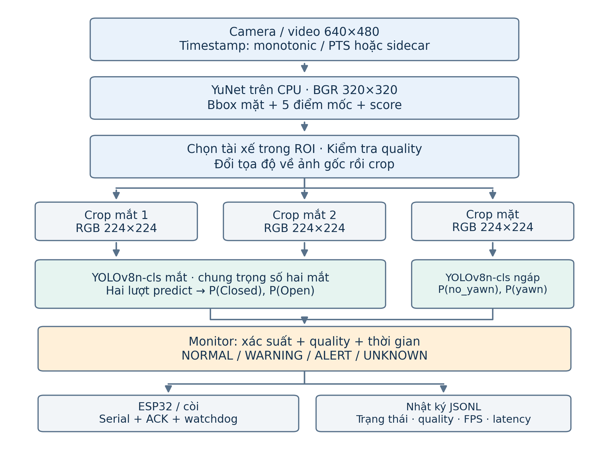
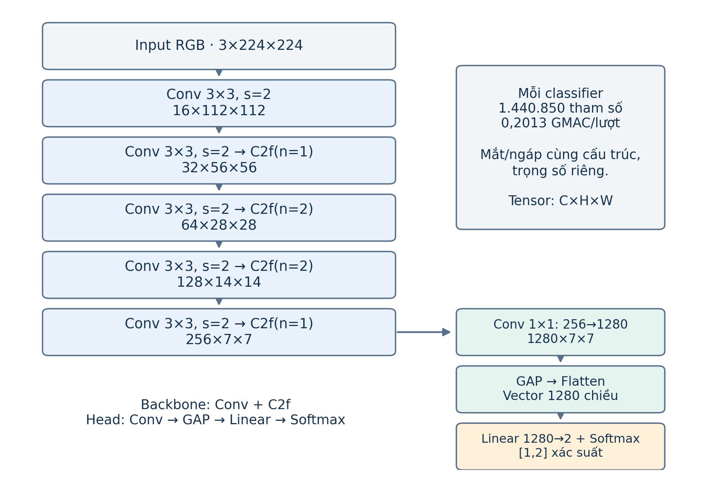
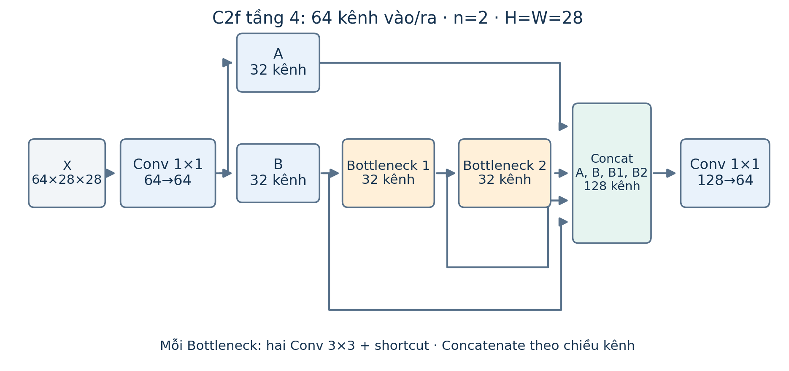

# BÁO CÁO KIẾN TRÚC MODEL

**Hệ thống giám sát trạng thái buồn ngủ của tài xế trên Radxa ROCK 4D**  
Ngày lập: 06/10/2026. Phạm vi: model hiện có, pipeline đã triển khai và phương án suy luận trên bo.

## 1. Kiến trúc tổng thể

Hệ thống sử dụng **YuNet để định vị mặt và các điểm mốc**, **YOLOv8n-cls để phân loại mắt**, và **YOLOv8n-cls để phân loại ngáp**. Xác suất theo từng frame được đưa vào bộ quyết định theo thời gian để tạo trạng thái NORMAL, WARNING, ALERT hoặc UNKNOWN. Đây là tên kiến trúc đã xác minh trực tiếp trong checkpoint và graph ONNX; tên thư mục dự án không quyết định tên model.

| Thành phần | Đầu vào trong runtime | Đầu ra | Vai trò |
|---|---|---|---|
| YuNet 2023mar | BGR 320×320, ảnh có padding | Bbox mặt, 5 điểm mốc, score | Định vị và hỗ trợ crop |
| Model mắt | RGB 224×224 cho từng mắt | 0: Closed; 1: Open | Phân loại mắt đóng/mở |
| Model ngáp | RGB 224×224 từ vùng mặt | 0: no_yawn; 1: yawn | Phân loại dấu hiệu ngáp |
| Monitor | Timestamp, quality và xác suất | Trạng thái, nguyên nhân, bật/tắt còi | Xác nhận sự kiện theo thời gian |



Một frame hợp lệ có **1 lượt YuNet + 2 lượt model mắt + 1 lượt model ngáp**. Hai mắt dùng cùng một bộ trọng số. Hai classifier mắt/ngáp được huấn luyện riêng, tổng cộng **2.881.700 tham số PyTorch**. Số lượt suy luận mắt không làm tăng số bộ trọng số cần lưu. Nguồn kiểm kê: [model_architecture_inventory.json](model_architecture_inventory.json).

<!-- page-break -->

## 2. Model định vị mặt: YuNet

### 2.1. Artifact và cấu trúc mạng

Model đang dùng là `face_detection_yunet_2023mar.onnx`, lấy từ OpenCV Zoo tại commit `47534e27c9851bb1128ccc0102f1145e27f23f98`. Thư mục model được cấp phép MIT. Đây là detector đã có trọng số; dự án sử dụng để định vị, chưa huấn luyện lại YuNet. [Nguồn OpenCV Zoo](https://github.com/opencv/opencv_zoo/tree/47534e27c9851bb1128ccc0102f1145e27f23f98/models/face_detection_yunet).

Kiểm kê graph hiện tại: **53 node Conv**, 15 Relu, 4 MaxPool, 2 Resize và 2 Add. Có **53.104 phần tử trọng số/bias của Conv** trong ONNX; tổng initializer là 53.121 phần tử, bao gồm 17 phần tử hằng hỗ trợ graph. Đây là số đếm của artifact xuất, không phải số tham số của một graph huấn luyện YuNet chưa fuse. Dung lượng file là **232.589 byte**, khoảng 227,1 KiB.

Backbone dùng một Conv 3×3 stride 2 ở đầu, sau đó nhiều cặp **Conv 1×1 trộn kênh và Conv 3×3 depthwise**. MaxPool giảm kích thước không gian. Các feature map cuối có 64 kênh; hai phép upsample và cộng đặc trưng đưa thông tin từ mức sâu về mức có độ phân giải cao hơn. Ba mức cuối cùng có stride 8, 16 và 32. Mô tả này được đọc từ graph thực trong file kiểm kê.

### 2.2. Đầu ra ba mức

Với đầu vào runtime 320×320, mỗi mức có bốn nhánh: `cls` cho điểm phân loại mặt; `obj` cho objectness; `bbox` gồm 4 giá trị định vị; `kps` gồm 10 tọa độ cho 5 điểm mốc. Các nhánh được giữ riêng trong **12 tensor đầu ra**.

| Stride | Lưới tại 320×320 | Số vị trí N | cls / obj | bbox | kps |
|---|---|---:|---|---|---|
| 8 | 40×40 | 1.600 | [1,N,1] | [1,N,4] | [1,N,10] |
| 16 | 20×20 | 400 | [1,N,1] | [1,N,4] | [1,N,10] |
| 32 | 10×10 | 100 | [1,N,1] | [1,N,4] | [1,N,10] |

OpenCV giải mã bbox/điểm mốc, kết hợp score bằng `sqrt(cls × obj)` sau khi chặn về [0,1], rồi lọc các bbox trùng bằng NMS. Kết quả mỗi mặt có 15 giá trị: x, y, w, h; tọa độ hai mắt, mũi và hai khóe miệng; score. Runtime đặt ngưỡng score **0,8**, NMS **0,3**. [Mã nguồn FaceDetectorYN của OpenCV 4.11](https://github.com/opencv/opencv/blob/4.11.0/modules/objdetect/src/face_detect.cpp).

### 2.3. Kích thước graph và kích thước thực thi

Metadata ONNX khai báo input **[1,3,640,640]**. Dự án chạy model bằng **OpenCV 4.11 DNN ở 320×320**; phép forward trên ảnh giả trong lần kiểm kê này đã xác nhận các tensor 1.600/400/100 vị trí như bảng trên. Đó là kiểm tra giao diện tensor, không đo độ chính xác. OpenCV Zoo giải thích OpenCV 4.x có thể suy luận theo kích thước ảnh đưa vào đối với bản 2023mar. [Ghi chú về input của YuNet](https://github.com/opencv/opencv_zoo/tree/47534e27c9851bb1128ccc0102f1145e27f23f98/models/face_detection_yunet).

Nếu chuyển YuNet sang ONNX Runtime trực tiếp, cần xuất graph có input phù hợp hoặc tuân thủ 640×640 đã khai báo. CLI chọn backend ONNX/RKNN hiện chỉ thay backend **hai classifier**; YuNet vẫn dùng OpenCV CPU.

<!-- page-break -->

## 3. Tiền xử lý và tạo vùng ảnh

### 3.1. Từ camera đến các crop

Camera mặc định 640×480. Runtime thu nhỏ ảnh giữ tỷ lệ và thêm padding đen để tạo ảnh YuNet 320×320. Với 640×480, nội dung ảnh là **320×240**, padding trên/dưới **40 pixel**. YuNet nhận BGR; OpenCV tạo blob float với scale 1, giữ thứ tự kênh. Tiền xử lý này khác đường RGB/chia 255 của classifier. [Mã nguồn OpenCV](https://github.com/opencv/opencv/blob/4.11.0/modules/objdetect/src/face_detect.cpp).

Bbox và điểm mốc được đổi về tọa độ ảnh gốc bằng cách bỏ padding và chia tỷ lệ resize. Các crop được lấy từ **ảnh gốc**, nhằm giữ chi tiết mắt và miệng. Runtime chỉ chấp nhận một mặt nằm trong ROI ghế lái; ROI mặc định toàn ảnh và cần chỉnh khi lắp camera.

Gọi d là khoảng cách Euclid giữa hai tâm mắt. Tham số crop trong `configs/driver_monitor.yaml`:

| Vùng ảnh | Công thức mặc định | Ghi chú |
|---|---|---|
| Mỗi mắt | Rộng 0,8d; cao 0,6d | Tâm crop trùng tâm mắt YuNet |
| Mặt cho model ngáp | Rộng 1,2w; cao 1,2h | Thêm 10% bbox mỗi phía, giữ tâm |
| Biên ảnh | Chặn tọa độ crop trong ảnh | Crop quá nhỏ/không hợp lệ bị từ chối |

Model ngáp hiện nhận **crop mặt mở rộng**, có cả vùng miệng và ngữ cảnh khuôn mặt. Việc đổi sang crop chỉ chứa miệng sẽ làm thay đổi phân bố đầu vào, cần đánh giá hoặc huấn luyện lại trước khi áp dụng.

### 3.2. Giao diện đầu vào hai classifier

Chuỗi xử lý chung: **BGR uint8 crop → RGB → resize cạnh ngắn thành 224 → center crop 224×224**. Resize dùng PIL bilinear. Tại Torch/ONNX, ảnh được chia 255, áp dụng mean [0,0,0], std [1,1,1], rồi chuyển thành float32 NCHW **[1,3,224,224]**. Resize cạnh ngắn và crop giữa được dùng đúng theo manifest, giữ tỷ lệ ảnh trước crop.

Tại RKNN Lite2, runtime gửi **RGB uint8 NHWC [1,224,224,3]**. Phép chuẩn hóa đã được cấu hình khi chuyển RKNN: mean [0,0,0], std [255,255,255]. Vì vậy, đường RKNN không chia 255 thêm ở phía Python. Xác suất được ánh xạ theo tên lớp đọc từ manifest, thay vì tự gán ý nghĩa chỉ số. Nguồn: [manifest](../models/manifest.json), [adapter](../driver_monitor/models.py).

### 3.3. Kiểm tra chất lượng quan sát

| Tiêu chí mặc định | Ngưỡng | Khi không đạt |
|---|---:|---|
| Kích thước mặt trong ảnh gốc | Cạnh nhỏ nhất ≥80 px | Không chọn làm tài xế hợp lệ |
| Chiều rộng crop mắt | ≥12 px | invalid_landmarks |
| Median độ sáng mặt/mắt | ≥25 trên thang 0–255 | too_dark |
| Variance Laplacian mặt/mắt | ≥20 | blurry |
| Tỷ lệ pixel mặt có độ sáng >235 | ≤60% | overexposed |
| Số mặt phù hợp ROI | Đúng 1 | no_face / ambiguous_faces |

Các gate này là phép tính chất lượng ảnh trong [vision.py](../driver_monitor/vision.py). Chúng không phải một model riêng nhận diện kính hoặc che mắt. Confidence thấp và quan sát không hợp lệ được chuyển sang UNKNOWN trong bộ quyết định; khả năng xử lý kính phản xạ, che khuất và tư thế đầu vẫn cần kiểm tra bằng video thực.

<!-- page-break -->

## 4. Kiến trúc hai classifier YOLOv8n-cls

### 4.1. Cấu hình và tensor theo từng tầng

Cả `best_eye.pt` và `best_yawn.pt` có `task=classify`, `yaml_file=yolov8n-cls.yaml`, `scale=n`, `nc=2`. Scale nano dùng depth **0,33**, width **0,25**, max_channels **1.024**. Các kênh đã scale là 16, 32, 64, 128 và 256; số Bottleneck thực trong bốn C2f là **1, 2, 2, 1**. Cấu hình gốc được đối chiếu với [YAML YOLOv8-cls của Ultralytics](https://github.com/ultralytics/ultralytics/blob/main/ultralytics/cfg/models/v8/yolov8-cls.yaml); số liệu dưới đây lấy từ checkpoint hiện có.

Quy ước tensor trong bảng là **[B,C,H,W]**, B=1. Số tham số tính cả trọng số/bias của BatchNorm, loại các buffer thống kê chạy. Hai model có cùng bảng tầng nhưng trọng số khác nhau.

| Tầng | Khối | Cấu hình thực | Tensor đầu ra | Tham số |
|---:|---|---|---|---:|
| Input | Ảnh RGB | 224×224, 3 kênh | [1,3,224,224] | 0 |
| 0 | Conv | 3→16; k=3; s=2 | [1,16,112,112] | 464 |
| 1 | Conv | 16→32; k=3; s=2 | [1,32,56,56] | 4.672 |
| 2 | C2f | 32→32; n=1 | [1,32,56,56] | 7.360 |
| 3 | Conv | 32→64; k=3; s=2 | [1,64,28,28] | 18.560 |
| 4 | C2f | 64→64; n=2 | [1,64,28,28] | 49.664 |
| 5 | Conv | 64→128; k=3; s=2 | [1,128,14,14] | 73.984 |
| 6 | C2f | 128→128; n=2 | [1,128,14,14] | 197.632 |
| 7 | Conv | 128→256; k=3; s=2 | [1,256,7,7] | 295.424 |
| 8 | C2f | 256→256; n=1 | [1,256,7,7] | 460.288 |
| 9 | Classify | Conv 1×1→GAP→Linear→Softmax | [1,2] | 332.802 |
| Tổng | Một classifier | Backbone + head hai lớp | [1,2] | **1.440.850** |



Backbone có **1.108.048 tham số**; head có **332.802 tham số**. Mô hình thực dùng head phân loại hai lớp. Graph này không chứa head bbox, SPPF, neck FPN/PAN hay nhánh dự đoán trực tiếp mức độ buồn ngủ; phép định vị được giao cho YuNet ở phía trước. Nguồn: [kiểm kê checkpoint/ONNX](model_architecture_inventory.json).

<!-- page-break -->

### 4.2. Conv, C2f và kết nối tắt

Khối Conv của classifier gồm **Conv2d → BatchNorm2d → SiLU**. SiLU(x)=x·sigmoid(x). Các Conv stride 2 giảm kích thước không gian; những Conv trong C2f giữ độ phân giải. C2f trong checkpoint dùng tỷ lệ kênh ẩn 0,5 và bật shortcut trong các Bottleneck.

Một C2f nhận X, dùng Conv 1×1 tạo hai phần A và B có cùng số kênh ẩn. B đi tuần tự qua n Bottleneck; A, B và đầu ra của từng Bottleneck được nối theo chiều kênh. Conv 1×1 cuối trộn đặc trưng để trả về số kênh đầu ra. Mỗi Bottleneck có hai Conv 3×3 và cộng đầu vào với đầu ra của nhánh biến đổi. Các nhánh ngắn giữ đường truyền đặc trưng và gradient. [Định nghĩa C2f/Bottleneck](https://docs.ultralytics.com/reference/nn/modules/block/).



Ở ví dụ tầng 4, mỗi nhánh có 32 kênh. Concatenate A, B, B1 và B2 tạo **128 kênh**, sau đó Conv 1×1 đưa về 64 kênh. Kích thước 28×28 được giữ qua toàn bộ khối.

### 4.3. Head phân loại và ý nghĩa xác suất

Head nhận feature **[1,256,7,7]**, qua Conv 1×1 thành **[1,1280,7,7]**. AdaptiveAvgPool2d lấy trung bình mỗi kênh thành **[1,1280,1,1]**; Flatten tạo vector 1.280 chiều; Linear 1280→2 tạo logits z. Dropout có p=0,0 trong cả hai checkpoint. [Định nghĩa Classify](https://docs.ultralytics.com/reference/nn/modules/head/).

Ở chế độ suy luận, Softmax trả `p_i = exp(z_i) / Σ exp(z_j)`. Với hai lớp, p0+p1=1. Tại Torch ở chế độ eval, head có thể trả cả xác suất và logits; adapter lấy xác suất. Bản ONNX xuất `probabilities` có shape **[1,2]**, đã có Softmax ở cuối. Runtime không áp dụng Softmax lần nữa lên xác suất.

| Checkpoint | Phần tử 0 | Phần tử 1 | Tín hiệu dùng trong Monitor |
|---|---|---|---|
| best_eye | P(Closed) | P(Open) | P(Closed/Open) của cả hai mắt |
| best_yawn | P(no_yawn) | P(yawn) | P(yawn) |

Xác suất Softmax thể hiện mức tin cậy tương đối của model trên đầu vào hiện tại. Ngưỡng 0,8 không tự chứng minh tỷ lệ đúng 80%; muốn diễn giải như xác suất đúng cần đánh giá calibration trên dữ liệu đại diện. Nhãn drowsy không tồn tại trong hai classifier này: Monitor suy ra cảnh báo từ các triệu chứng và thời gian.

### 4.4. Chi phí tính toán của classifier

Hook Conv2d/Linear trên input [1,3,224,224] cho **201.308.672 MAC/lượt** mỗi classifier, khoảng 0,2013 GMAC. Một frame hợp lệ chạy mắt hai lần và ngáp một lần: **603.926.016 MAC/frame** cho phần classifier. Phép đếm này chỉ bao gồm nhân–cộng của Conv/Linear, chưa gồm YuNet, BatchNorm, activation, pooling, crop, sao chép tensor và giao tiếp. Đây là chi phí lý thuyết, không thay thế phép đo FPS hoặc RAM trên Radxa.

<!-- page-break -->

## 5. Thông tin huấn luyện được checkpoint lưu lại

| Tham số | Model mắt | Model ngáp |
|---|---|---|
| Model khởi tạo | yolov8n-cls.pt | yolov8n-cls.pt |
| pretrained | true | true |
| imgsz | 224 | 224 |
| epochs cấu hình | 40 | 40 |
| batch cấu hình | 32 | 32 |
| optimizer cấu hình | auto | auto |
| lr0 lưu trong args | 0,01 | 0,01 |
| dropout | 0,0 | 0,0 |
| seed | 42 | 42 |
| Ngày lưu checkpoint UTC | 27/09/2026, 05:15:09 | 27/09/2026, 05:32:58 |
| Ultralytics ghi trong checkpoint | 8.4.163 | 8.4.163 |

Các giá trị trên là **cấu hình được lưu**, lấy trực tiếp từ `train_args`. Checkpoint có `epoch=-1` sau bước strip, vì vậy không dùng trường này để kết luận số epoch thực đã chạy. Optimizer `auto` cũng không xác minh optimizer/lr cuối cùng bằng riêng giá trị `lr0`; cần log training gốc nếu muốn báo cáo diễn biến huấn luyện. Không có lần fine-tune mới trong báo cáo kiến trúc này.

Tác vụ classify trong Ultralytics đang cài sử dụng **Cross-Entropy trên logits**, trung bình theo batch: `L = -(1/B) Σ log p(y_b | x_b)`. Đây là objective của implementation đang dùng; không phải loss hồi quy bbox hay mAP. Nguồn cục bộ: `ultralytics/utils/loss.py`, lớp `v8ClassificationLoss`, phiên bản 8.4.163. [Tài liệu classify](https://docs.ultralytics.com/tasks/classify/).

Dataset ảnh tĩnh người dùng cung cấp giúp học mắt đóng/mở và ngáp/không ngáp. Để huấn luyện phù hợp với pipeline này, ảnh đầu vào cần được tạo bằng **đúng quy trình crop YuNet**, có nói chuyện, cười, kính và các tư thế đầu thường gặp. Chia dữ liệu theo người hoặc clip nguồn; ảnh từ cùng người/clip không được trải qua cả train và test.

Đánh giá classifier dùng precision, recall, F1 từng lớp và confusion matrix. Với bài toán hai lớp này, top-5 không có nhiều ý nghĩa. Nghiệm thu toàn hệ thống cần thêm recall sự kiện, số báo nhầm mỗi giờ và độ trễ cảnh báo trên video đã gán nhãn. Các ngưỡng vận hành được chỉnh bằng validation rồi khóa trước khi đo tập test.

## 6. Video và bộ quyết định theo thời gian

Hệ thống đọc được camera và file video. Mỗi frame được suy luận độc lập bằng các CNN; **Monitor giữ trạng thái thời gian** giữa các frame. Kiến trúc hiện tại không có LSTM/Transformer hoặc một mạng huấn luyện trên chuỗi video. Camera dùng thời gian monotonic lúc lấy frame; video dùng PTS hoặc sidecar timestamp của bản ghi. Tốc độ replay không thay đổi thời gian sự kiện.

Tín hiệu `Observation` gồm timestamp, xác suất hai mắt, xác suất ngáp, quality, tuổi frame và thông tin đổi track. `Monitor.update()` trả trạng thái và lý do; phần này là thuật toán xác định, có thể kiểm thử bằng chuỗi quan sát mà không cần camera. [core.py](../driver_monitor/core.py), [cấu hình](../configs/driver_monitor.yaml).

<!-- page-break -->

### 6.1. Quy tắc đang cấu hình

| Dấu hiệu / tình huống | Xác nhận | Quyết định |
|---|---|---|
| Hai mắt nhắm kéo dài | Cả hai P(Closed) ≥0,8 liên tục 1,5 s | ALERT, bật còi |
| Hai mắt mở | Cả hai P(Open) ≥0,8 | Quan sát mở hợp lệ |
| Một đợt ngáp | P(yawn) ≥0,70 trong 1 s; kết thúc ở ≤0,35 trong 0,5 s | Ghi một sự kiện |
| Ngáp thường xuyên | ≥2 sự kiện trong 60 s | WARNING |
| Chớp mắt tăng | Lần đóng–mở 0,05–0,5 s; so hai cửa sổ 5 s hoàn chỉnh; hiện tại ≥4 và tăng ≥1 | WARNING |
| Ngáp thường xuyên cùng chớp mắt tăng | Cả hai điều kiện đã được xác nhận | ALERT, bật còi |
| Quan sát thiếu, chất lượng kém, mắt không chắc chắn, frame cũ | Không suy diễn phần dữ liệu mất | UNKNOWN, ngắt chuỗi xác nhận, tắt còi |
| Khoảng cách frame >250 ms | Ngắt chuỗi đang xác nhận | Không cộng phần trống vào thời gian nhắm mắt |
| Điều kiện cảnh báo đã hết | Duy trì quan sát hợp lệ 1 s | Tắt còi, trả trạng thái phù hợp |

Một đợt ngáp không tự bật còi. Chớp mắt bình thường không được tính là nhắm mắt kéo dài. UNKNOWN biểu thị hệ thống không đủ thông tin để kết luận trạng thái tài xế; không được diễn giải thành “tài xế tỉnh táo”.

### 6.2. Minh họa một sự kiện

Ví dụ hai mắt đạt P(Closed)≥0,8 từ t=10,00 s và các frame tiếp theo đều hợp lệ. ALERT được xác nhận ở frame đầu tiên đạt t≥11,50 s. Nếu có khoảng mất frame 0,30 s trước mốc này, thời gian xác nhận phải bắt đầu lại. Khi cả hai mắt mở rõ, quan sát hợp lệ và hết bằng chứng cảnh báo trong 1 s, còi tắt. Độ trễ sau xác nhận còn phụ thuộc xử lý frame và serial; cần đo trên ESP32 thật.

Các ngưỡng trong bảng là cấu hình hiện hành, còn phải hiệu chỉnh bằng validation cabin. Chúng không phải kết quả nghiên cứu đã chứng minh tối ưu cho mọi tài xế.

### 6.3. Trạng thái thử video

Đã có kiểm tra luồng video kỹ thuật từ các ảnh tĩnh được lặp thành clip: decoder, YuNet, classifier và xác nhận một đợt ngáp chạy được; ngáp đơn không bật còi. Clip này kiểm tra tích hợp, không đại diện chuyển động ngáp thật. Video camera đã ghi cũng chưa đủ mặt hợp lệ để đo sự kiện. Vì vậy, **chưa có kết quả độ chính xác cảnh báo trên tập video cabin độc lập có nhãn**. Chi tiết và provenance nằm trong [báo cáo triển khai](IMPLEMENTATION_REPORT.md).

<!-- page-break -->

## 7. Kiến trúc suy luận trên Radxa ROCK 4D

ROCK 4D dùng SoC **RK3576 hoặc RK3576J**. Artifacts classifier đã được chuyển với target **rk3576**, phù hợp với dòng bo đang chọn. [Thông tin phần cứng Radxa](https://docs.radxa.com/en/rock4/rock4d/hardware-use/hardware-info).

### 7.1. Phân chia CPU và NPU

| Công việc | PC dùng Torch/ONNX | Radxa dùng RKNN |
|---|---|---|
| Đọc camera/video, timestamp | CPU | CPU |
| YuNet tìm mặt/điểm mốc | OpenCV CPU | OpenCV CPU |
| ROI, quality, crop/resize RGB | CPU | CPU |
| Hai lượt phân loại mắt | CPU, cùng một model mắt | RKNN Lite2/NPU, cùng một model mắt |
| Một lượt phân loại ngáp | CPU | RKNN Lite2/NPU |
| Quyết định thời gian, log, serial | CPU | CPU |

Runtime nạp hai classifier, tái sử dụng instance mắt cho cả hai crop. Hiện các lượt predict được gọi tuần tự; không giả định đã có batch nhiều mắt hay thực thi song song NPU. Chạy headless giúp vận hành không cần màn hình; gói có cấu hình systemd và nhật ký JSONL.

### 7.2. Chuỗi chuyển model và giao diện

Chuỗi xuất: **checkpoint .pt → ONNX opset 12 → RKNN**. ONNX có input `images` float32 [1,3,224,224], output `probabilities` float32 [1,2]. Graph mỗi classifier có 26 Conv, 1 Gemm, 1 GlobalAveragePool và 1 Softmax. BatchNorm đã được fuse khi xuất; **1.437.442 phần tử weight/bias ONNX** khác số tham số graph PyTorch vì cách biểu diễn inference.

RKNN-Toolkit2 thực hiện chuyển đổi trên Linux; SDK dự án ghim **Toolkit2/Lite2 2.3.2**. Các bản RKNN hiện **không lượng tử hóa INT8**; nếu muốn INT8, cần calibration từ train crop và đo chất lượng lại. Cấu hình normalization được nhúng khi build; Lite2 nhận NHWC RGB uint8 như mục 3.2. [SDK Rockchip](https://github.com/airockchip/rknn-toolkit2/tree/v2.3.2), [mã chuyển model](../driver_monitor/exporting.py).

| File model | Dung lượng byte | Dung lượng quy đổi |
|---|---:|---|
| best_eye.pt | 2.963.592 | 2,826 MiB |
| best_yawn.pt | 2.965.512 | 2,828 MiB |
| Mỗi classifier ONNX | 5.771.257 | 5,504 MiB |
| Mỗi classifier RKNN | 4.366.262 | 4,164 MiB |
| YuNet ONNX | 232.589 | 227,1 KiB |

Dung lượng file không phải lượng RAM khi chạy; RAM còn chứa tensor trung gian, runtime, buffer camera và nhật ký. Sau khi bo được setup, cần xác minh driver/runtime, đối chiếu xác suất/nhãn và đo toàn pipeline trước khi kết luận về tốc độ NPU.

<!-- page-break -->

## 8. Bằng chứng chất lượng và giới hạn của kiến trúc

Các số dưới đây đọc lại từ báo cáo đo đã lưu ngày 06/10/2026; phiên lập báo cáo kiến trúc chỉ kiểm kê model và xác nhận giao diện tensor, không huấn luyện hay đo camera lại.

| Phép đo đã lưu | Kết quả | Phạm vi kết luận |
|---|---|---|
| Mắt, 218 ảnh mắt gốc | Macro F1 100% | Chưa chứng minh test khác người hoặc crop mắt YuNet trên video |
| Ngáp, 215 toàn ảnh gốc | Macro F1 99,53% | Đầu vào khác crop mặt runtime |
| Ngáp, 215 mẫu qua crop mặt YuNet | Macro F1 90,46%; F1 yawn 88,54%; recall yawn 80,19%; 15 UNKNOWN | Có tính mẫu bị từ chối như bỏ sót; chưa tách người độc lập |
| Torch so với ONNX | Nhãn trùng 100%; sai số xác suất tối đa mắt 1,3923×10⁻⁷, ngáp 5,6674×10⁻⁸ | Chuyển ONNX giữ kết quả trên tập ảnh hiện có |
| Camera PC ONNX, 20 s | 29,55 FPS; p95 đọc frame→quyết định 31 ms; 191/591 frame UNKNOWN | Throughput của phiên PC, không đo accuracy hoặc NPU |
| Chuyển RKNN và SDK simulator | Artifacts tạo được; smoke graph đạt | Chưa suy luận blob đã xuất trên NPU thật |

Nguồn: [mắt/ONNX](eye_onnx_parity.json), [ngáp/ONNX](yawn_onnx_parity.json), [crop ngáp](yawn_face_crop_test.json), [camera PC](camera_live/20261006T061106_518319Z.summary.json), [RKNN simulator](rknn_simulator_smoke.json).

Khác biệt giữa kết quả toàn ảnh và crop mặt cho thấy **quy trình crop là một phần của kiến trúc cần đánh giá**, không chỉ là thao tác hiển thị. Đánh giá ảnh bằng argmax cũng khác ngưỡng confidence và xác nhận thời gian của Monitor. Do đó, F1 ảnh không thể thay cho recall cảnh báo hoặc số báo nhầm mỗi giờ.

Ưu điểm của thiết kế là chia rõ định vị, phân loại và quyết định theo thời gian; model nhỏ; có thể chuyển backend classifier mà giữ tên lớp/tiền xử lý và thuật toán cảnh báo. Các hạn chế cần xử lý bằng dữ liệu gồm lệch crop mắt so với ảnh train, nói chuyện/cười giống ngáp, kính phản xạ, mặt nghiêng và ánh sáng kém. YuNet phát hiện thành công không tự bảo đảm classifier mắt/ngáp đã có dữ liệu đại diện cho tình huống đó.

Nghiệm thu còn cần video cabin có nhãn và tách người, dữ liệu các hoạt động bình thường, đo báo nhầm, suy luận RKNN trên ROCK 4D, độ trễ còi và phiên chạy dài. Mục tiêu ≥15 FPS, p95 ≤200 ms trên bo và recall nhắm mắt kéo dài ≥90% vẫn là **tiêu chí cần đo**, chưa phải kết quả Radxa đã đạt.

### Đoạn mô tả có thể dùng trong báo cáo đồ án

Hệ thống giám sát tài xế được xây dựng theo kiến trúc nhiều giai đoạn. YuNet định vị khuôn mặt và năm điểm mốc từ ảnh camera thu nhỏ; vùng mắt và vùng mặt được cắt từ ảnh gốc. Hai mạng YOLOv8n-cls, mỗi mạng có 1.440.850 tham số và đầu vào RGB 224×224, lần lượt ước lượng trạng thái mắt và dấu hiệu ngáp. Model mắt được tái sử dụng cho cả hai mắt. Các xác suất được kết hợp với thời gian và chất lượng quan sát để xác nhận sự kiện, tạo cảnh báo và điều khiển ESP32. Trên Radxa ROCK 4D, phương án triển khai giữ YuNet và xử lý ảnh trên CPU, đưa hai classifier sang RKNN/NPU của RK3576. Chất lượng cảnh báo và hiệu năng NPU cần được đánh giá bằng video cabin độc lập và phần cứng thực.

<!-- page-break -->

## Phụ lục: nguồn kiểm chứng và tái lập

### A. Nguồn nội bộ

- [model_architecture_inventory.json](model_architecture_inventory.json): tham số, tensor, YAML checkpoint, MAC, operator ONNX, dung lượng và SHA256; có kết quả probe YuNet 320×320 trên OpenCV.
- [tools/inspect_model_architecture.py](../tools/inspect_model_architecture.py): chương trình tái lập kiểm kê; chỉ đọc model và ghi báo cáo.
- [models/manifest.json](../models/manifest.json): thứ tự lớp, preprocessing, phiên bản chuyển đổi và checksum artifacts.
- [driver_monitor/vision.py](../driver_monitor/vision.py), [models.py](../driver_monitor/models.py), [core.py](../driver_monitor/core.py): định vị/crop, suy luận classifier và quyết định thời gian.
- [configs/driver_monitor.yaml](../configs/driver_monitor.yaml), [exporting.py](../driver_monitor/exporting.py): ngưỡng chạy và thiết lập xuất/chuyển model.
- [IMPLEMENTATION_REPORT.md](IMPLEMENTATION_REPORT.md): bằng chứng thử camera/video và những phép nghiệm thu chưa làm.

Tái lập kiểm kê trong PowerShell tại thư mục dự án:

```powershell
& '.\.venv\Scripts\python.exe' tools/inspect_model_architecture.py
```

### B. Tài liệu chính thức đã đối chiếu

- OpenCV Zoo, [YuNet và model 2023mar](https://github.com/opencv/opencv_zoo/tree/47534e27c9851bb1128ccc0102f1145e27f23f98/models/face_detection_yunet). README trích dẫn: Wei Wu, Hanyang Peng, Shiqi Yu, “YuNet: A Tiny Millisecond-level Face Detector”, Machine Intelligence Research, 20(5), 656–665, 2023.
- OpenCV 4.11, [FaceDetectorYN implementation](https://github.com/opencv/opencv/blob/4.11.0/modules/objdetect/src/face_detect.cpp): xử lý blob, decode và NMS.
- Ultralytics, [YOLOv8-cls YAML](https://github.com/ultralytics/ultralytics/blob/main/ultralytics/cfg/models/v8/yolov8-cls.yaml), [C2f/Bottleneck](https://docs.ultralytics.com/reference/nn/modules/block/), [Classify head](https://docs.ultralytics.com/reference/nn/modules/head/), [classification task](https://docs.ultralytics.com/tasks/classify/). Tài liệu online có thể cập nhật; kiểm kê này dùng checkpoint và thư viện cục bộ phiên bản 8.4.163.
- Radxa, [ROCK 4D hardware information](https://docs.radxa.com/en/rock4/rock4d/hardware-use/hardware-info): RK3576/RK3576J.
- Rockchip, [RKNN-Toolkit2 v2.3.2](https://github.com/airockchip/rknn-toolkit2/tree/v2.3.2): SDK chuyển model và Lite2.

### C. Dấu vân tay model

| Artifact | SHA256 |
|---|---|
| YuNet 2023mar ONNX | 8f2383e4dd3cfbb4553ea8718107fc0423210dc964f9f4280604804ed2552fa4 |
| best_eye.pt | 3c124c05d9d01849c70823eeab8f25c48e740aa836be319ef881588e188d308f |
| best_yawn.pt | d2bbf3bf31e28f989a9e6f6a9994f2f5dc0246ad95a1a914e97f3f8f064067a1 |
| best_eye.onnx | b5732f3c8b029bcc76015ae3e9cc168243a4f7e1dd72a94bce2074ab5f532c67 |
| best_yawn.onnx | fdf971a428c4b24de47fb1126bf179db7e3282e9f7d9baf2b32e3bdba04d8844 |
| best_eye.rknn | 4242d1bd649c35a16e6197d069ade0c7f9c8be417b5d596ded6d10987661d3c3 |
| best_yawn.rknn | 95a006917c498fa5ee577ad0a1a8821c285781b87e545f2d07f8f33f4a309367 |

Khi thay model, crop hoặc ngưỡng, cần cập nhật manifest và đo lại kết quả tương ứng. Bản báo cáo này mô tả các artifact có hash nêu trên.
