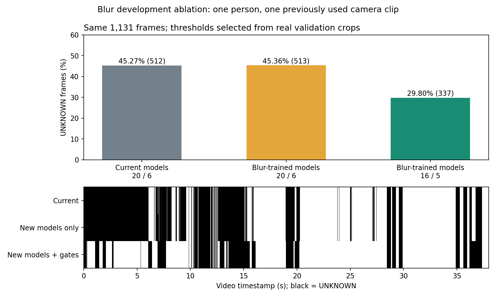

# Fine-tune với ảnh mờ và đánh giá trên PC

Ngày đánh giá: 07/10/2026.

Đã tạo hai checkpoint thử trong `models/blur_refined/` và profile `configs/camera_blur_candidate.yaml`. Dữ liệu gồm crop rõ, crop mờ thật đã có nhãn và crop được thêm Gaussian/motion blur. Những số dưới đây là kết quả phát triển trên dữ liệu hiện có; chưa phải nghiệm thu độc lập trong cabin hoặc trên Radxa.

## Chạy thử trên camera

Tại thư mục gốc dự án, dùng PowerShell:

```powershell
& '.\.venv\Scripts\python.exe' -m driver_monitor run --config configs/camera_blur_candidate.yaml --source 0 --backend onnx --display
```

Profile PC đối chiếu vẫn là `configs/camera_pc.yaml`. Ngưỡng xác nhận hai mắt nhắm/ngáp và bộ lọc chuyển động đầu dùng cùng logic hiện có. Ảnh quá tối, lóa, mất mặt và ảnh vẫn mờ dưới ngưỡng mới tiếp tục trả về `UNKNOWN`.

## Dữ liệu và huấn luyện

YuNet tìm mặt và tâm mắt trên ảnh thu nhỏ; crop lấy từ ảnh gốc với kích thước mắt 0,8d × 0,6d và mặt mở rộng 10%. Gaussian/motion blur được thêm ở độ phân giải crop gốc trước bước RGB, resize cạnh ngắn 224 và center crop 224×224. Không thêm nhiễu vào vector đặc trưng đã cache để giả lập ảnh mờ.

Hai model vẫn là YOLOv8n classification. Chỉ Linear 1280→2 được fine-tune; extractor, BN và preprocessing được giữ và kiểm tra bằng checksum. Huấn luyện có ràng buộc KL giữ dự đoán trên ảnh rõ và L2 giữ trọng số gần checkpoint đối chiếu. Checkpoint được chọn bằng validation, lưu lại, nạp lại rồi kiểm tra trước khi xuất ONNX. Bộ mắt/ngáp đọc tên lớp từ manifest.

| Model | Crop gốc train | Crop mờ thật train | Gaussian/motion train | Toàn bộ mẫu train sau augmentation |
|---|---:|---|---:|---:|
| Mắt | 1750 | {'Open': 14, 'Closed': 28} | 3500 | 14000 |
| Ngáp | 6292 | {'no_yawn': 28, 'yawn': 8} | 12584 | 19987 |

Ảnh mắt mờ thật gồm các frame camera có từng mắt được xem và gán nhãn `Open`, cùng ảnh CEW `Closed` có nhóm ảnh gốc được giữ cùng split. Ngáp mờ thật lấy từ khoảng thời gian đã gán nhãn trong video camera cũ; nhãn mắt không suy từ nhãn ngáp/cười. Các mẫu cười/nói chuyện và ảnh rõ cũ được giữ để kiểm tra báo ngáp sai. Dữ liệu mờ thật hiện còn ít; không có video của lần camera áo đỏ.

Các bản mirror/gray/dim/roll/Gaussian/motion kế thừa split của ảnh gốc. Chỉ mục kiểm tra SHA ảnh, SHA tensor đầu vào và photo family; 3 parent trùng pixel giữa split của bộ ngáp đã bị loại ở split thấp hơn. Các mẫu stress validation/test tách khỏi augmentation train. Tách theo người độc lập chưa được chứng minh đối với dữ liệu cũ; các crop liền kề từ một clip có tương quan.

## F1 trên tập ảnh phát triển giữ lại

Bảng dưới tính nhãn argmax trên crop, trước quality gate và xác nhận theo thời gian. Một ảnh có thể tạo nhiều view/crop; số mẫu không phải số người hay số sự kiện độc lập. F1 này không thay thế đánh giá video có nhãn theo người.

| Model | Loại crop | Mẫu | Macro-F1 đối chiếu | Macro-F1 mới |
|---|---|---:|---:|---:|
| Mắt | Gốc, gồm mờ thật | 415 | 99.00% | 99.00% |
| Mắt | Gaussian σ=0,75 | 415 | 98.76% | 98.76% |
| Mắt | Motion 3 px, 30° | 415 | 98.75% | 98.75% |
| Ngáp | Gốc, gồm mờ thật | 1322 | 99.43% | 99.43% |
| Ngáp | Gaussian σ=0,75 | 1322 | 99.01% | 99.15% |
| Ngáp | Motion 3 px, 30° | 1322 | 99.15% | 99.15% |

Cải thiện F1 của model nhỏ; kết quả rõ nhất của pipeline đến từ cho phép suy luận các crop mờ vừa đã được kiểm tra bằng validation. Trên bộ crop mắt runtime có nhãn giữ lại, recall `Closed ≥0,8` tính cả frame bị chặn tăng từ 122/138 lên 127/138; số dự đoán mắt nhắm sai ở confidence này không tăng. Bộ mờ thật test riêng có 8 crop mắt: 4 được quality gate mới cho qua và nhận đúng, 4 vẫn bị chặn. Không hạ tiếp ngưỡng dựa trên các mẫu test này.

## Chọn ngưỡng độ nét

Grid mặt 20/18/16/14/12 và mắt 6/5/4/3 được đánh giá chỉ trên crop validation thật, chưa biến đổi. Mỗi phương án phải giữ recall kể cả UNKNOWN, không tăng lỗi confidence theo lớp và theo nguồn, và không tăng tỷ lệ chưa quyết định. Các ngưỡng quá tối/lóa và logic theo thời gian được giữ. Phương án đồng hạng chọn ngưỡng cao hơn.

Chọn **mặt 16, mắt 5**, thêm 9 crop validation được suy luận. [Chi tiết calibration](../models/blur_refined/quality_calibration.json) ghi cả phương án bị loại. Ngưỡng là phương sai Laplacian, phụ thuộc camera/kích thước crop; không coi 16/5 là ngưỡng chung cho mọi camera.

## Replay toàn pipeline

Cùng video 37.969 giây, cùng 1.131 frame và timestamp của video. Đã chạy ba cấu hình để phân biệt ảnh hưởng của model với ảnh hưởng của quality gate.

| Cấu hình | Mặt/mắt | UNKNOWN | Tỷ lệ UNKNOWN | Ngáp xác nhận | Ngáp sai trong 17 giây bình thường/cười |
|---|---|---:|---:|---:|---:|
| Model PC hiện tại | 20/6 | 512/1131 | 45.27% | 2/2 | 0 |
| Model blur mới, ngưỡng cũ | 20/6 | 513/1131 | 45.36% | 2/2 | 0 |
| Model blur mới + ngưỡng validation | 16/5 | 337/1131 | 29.80% | 2/2 | 0 |

Giảm **175 frame UNKNOWN**, tương đương **34.18%** so với đối chiếu (15.47 điểm phần trăm). Ngáp đầu được xác nhận ở 7,109 giây thay cho 10,625 giây; ngáp thứ hai ở 29,047 giây. Không có frame bật cảnh báo trong các khoảng bình thường đã gán nhãn. Không suy ra tỷ lệ báo nhầm mỗi giờ từ 17 giây này.



Tốc độ dưới đây là replay PC, chưa phải camera trực tiếp hoặc NPU Radxa. Thời gian từng lần chạy có dao động; vòng đo trên cùng ảnh không tái hiện mức chậm gấp đôi do đổi checkpoint, nên không kết luận model mới làm tăng gấp đôi thời gian suy luận.

| Cấu hình | FPS lần replay cuối | p95 đọc frame → quyết định |
|---|---:|---:|
| Đối chiếu | 33.92 | 64 ms |
| Chỉ model mới | 31.71 | 62 ms |
| Model mới + ngưỡng mới | 16.47 | 78 ms |

## Kiểm tra và giới hạn

- 80 test phần mềm đạt, 0 test bị bỏ qua; kiểm tra dependency và mô phỏng firmware đạt.
- 21 ca kiểm tra với profile mới đạt: cười/ngáp, mắt mở hẹp, một mắt nhắm, hai mắt nhắm kéo dài, chuyển động đầu và blur thêm vào ảnh thật.
- PT/ONNX có nhãn giống nhau trên 51 crop đại diện mỗi model; sai khác xác suất lớn nhất 4.32e-08 (mắt) và 8.52e-07 (ngáp).
- Chưa có video áo đỏ, test người mới, clip hai mắt nhắm có nhãn đầy đủ, 2 giờ bình thường hoặc chạy liên tục 2 giờ. Những tiêu chí nghiệm thu này vẫn cần đo.
- Không có RKNN cho checkpoint blur mới; RKNN gốc trong `models/` dùng trọng số khác. Chưa chạy NPU/còi trên bo thật.

[Kết quả ảnh và parity](../models/blur_refined/evaluation.json), [replay](blur_refinement/replay_comparison.json), [regression pixel](blur_refinement/pixel_regressions.json), [phần mềm](blur_refinement/software_verification.json).

## Tái tạo và bổ sung dữ liệu

Những lệnh này dùng dữ liệu và chỉ mục cục bộ trong workspace hiện có; GitHub không chứa dataset, ảnh review, video hoặc feature cache. Sau khi clone chỉ cần model/ONNX để chạy thử; muốn train cần khôi phục dữ liệu hoặc chuẩn bị chỉ mục có nhãn tương ứng trong YAML.

```powershell
& '.\.venv\Scripts\python.exe' tools/refine_blur.py all --settings configs/blur_training.yaml
& '.\.venv\Scripts\python.exe' tools/check_blur_candidate.py --require-local-evidence
```

Các stage riêng: `prepare`, `extend-eye`, `train`, `export`, `calibrate`, `evaluate`; `--kind eye|yawn|both` áp dụng cho prepare/train. Có thể thay epochs, learning rate, anchor hoặc grid mà không tạo lại feature khi pixels/seed/config không đổi. Khi đổi crop/model/nhãn/seed phải chuẩn bị lại; ảnh gán nhãn thêm phải vào train/validation theo người/clip, không dùng test để chỉnh ngưỡng.

`real_eye_labels` trong YAML nhận JSON có `records`: mỗi mục chứa `path` từ gốc repo, `sha256`, `split`, `eye_boxes` từ runtime và `eye_labels` gồm hai nhãn `Open|Closed|Unknown`. `source_manifest`/`source_sha256` có thể lưu nguồn ngoài. `camera_labels` chứa video và các khoảng `[start,end)` có `label`, `action`, `split`; khoảng chuyển trạng thái không rõ để ngoài nhãn.

Cơ chế blur dùng `cv2.GaussianBlur` và kernel motion chuẩn hóa qua `cv2.filter2D`, theo [tài liệu lọc ảnh OpenCV](https://docs.opencv.org/4.x/d4/d13/tutorial_py_filtering.html). Model giữ quy trình classification; [tài liệu Ultralytics](https://docs.ultralytics.com/tasks/classify/) là nguồn tham khảo kiến trúc/API, không thay thế phiên bản thư viện và checksum đã khóa trong manifest.
