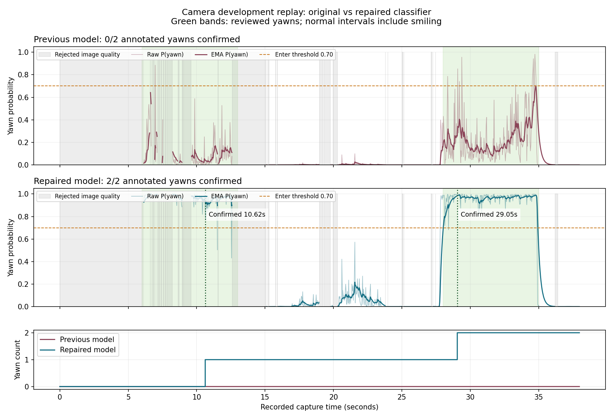

# Sửa bỏ sót ngáp trên video camera ngày 07/10/2026

Đã sửa và kiểm tra trên video người dùng gửi: bản trước xác nhận **0/2** lần ngáp; bản mới xác nhận **2/2**, không tạo sự kiện ngáp trong các đoạn bình thường/cười được gán nhãn. `configs/camera_pc.yaml` đã chọn model mới. Kết quả này là kiểm thử phát triển một người; chưa phải đánh giá độc lập hoặc nghiệm thu Radxa.

## Dữ liệu và phép tái hiện

Video: `yawn_camera_check/20261007T070644_475102Z.avi`, SHA256 `8a904d2c6234c1792804410b77374185eb5884128c53e5667e3bdbe8f5a92e45`. Có 1.131 frame, thời gian lấy frame 37,969 giây theo `.timestamps.json`. Runtime đọc timestamp ghi thật; FPS danh nghĩa trong AVI không được dùng thay sidecar.

Đã xem khung hình gốc, vùng cắt YuNet và đầu vào RGB 224×224. Các khung hình cho thấy hai lần mở miệng/ngáp và một đoạn cười lộ răng. Nhãn phát triển ở `yawn_camera_check/camera_development_labels.json`; nhãn sự kiện ở `yawn_camera_check/annotations.development.csv`. Khoảng chuyển tiếp không chắc được bỏ khỏi nhãn học. Mốc hướng dẫn của công cụ ghi video không tự động trở thành nhãn đúng.

## Nguyên nhân và bản sửa

Đầu phân loại `smile_refined` trước đó giảm mạnh xác suất ngáp trên các vùng cắt ngáp thật trong camera này. Ở 28, 30 và 32 giây, P(ngáp) lần lượt khoảng 0,128; 0,053; 0,167 dù chất lượng ảnh đạt. Vì thế, chuỗi xác nhận 0,70 liên tục 1 giây không hình thành. So sánh bản gốc và bản sửa cười trên cùng đầu vào xác định sự khác biệt nằm ở model; tắt EMA không xử lý được nguyên nhân này.

Vùng cắt mặt cao bị center crop làm mất một phần dưới khuôn mặt trong một số frame. Thử vùng cắt vuông giữ trọn mặt chưa cải thiện model hiện tại; bản sửa không thay hình học ROI hoặc preprocessing mà chưa được huấn luyện/kiểm chứng.

Chỉ huấn luyện lại Linear 1280→2 của classifier ngáp với đặc trưng đóng băng. Giữ dữ liệu train ngáp/không ngáp và ảnh cười cũ; thêm các vùng cắt camera có nhãn ngáp/bình thường/cười. Mẫu train camera cách nhau ít nhất 0,2 giây. Chọn model bằng validation ảnh cũ và các đoạn camera dành riêng, với điều kiện giữ hiệu quả ngáp và tỷ lệ nhận nhầm cười. Cấu hình được chọn: trọng số loss camera 0,15; regularization 0,001; epoch 150. Thông tin mọi ứng viên nằm ở `models/yawn_camera_refined/validation.json`.

Lần ngáp thứ nhất cung cấp đoạn train 6–9 giây và validation 10–12 giây, có khoảng cách thời gian giữa hai đoạn. Lần ngáp thứ hai 28–34 giây không tham gia huấn luyện hoặc lựa chọn model, chỉ đo sau khi khóa trọng số. Các đoạn vẫn cùng một người và cùng clip, nên không được gọi là test độc lập theo người. Ảnh test cũ cũng chưa có bằng chứng tách theo người.

Checkpoint và ONNX mới ở `models/yawn_camera_refined/`. Manifest giữ đúng `no_yawn, yawn`, preprocessing RGB/resize cạnh ngắn/center crop 224/chia 255 và checksum. YuNet và hai artifact mắt `eye_refined_v4` được tham chiếu nguyên trạng. Trọng số gốc và RKNN gốc không bị ghi đè; trọng số ngáp mới chưa có RKNN.

Các điều kiện quyết định giữ nguyên: xác nhận P≥0,70 trong 1 giây; kết thúc P≤0,35 trong 0,5 giây; EMA 0,20 giây; mặt sharpness≥20, mắt≥6; khoảng mất frame >250 ms ngắt chuỗi. Không bỏ kiểm tra chất lượng ảnh hoặc nới thời gian xác nhận để tạo sự kiện.

## Kết quả đo

| Phép kiểm tra | Trước sửa | Sau sửa |
|---|---:|---:|
| Lần ngáp xác nhận trên replay 1.131 frame | 0/2 | 2/2 |
| Thời điểm xác nhận | Không có | 10,625 s và 29,047 s |
| Sự kiện ngáp sai trong 17 s bình thường có nhãn, gồm cười | 0 | 0 |
| Ngáp bị đếm thêm ngoài hai sự kiện có nhãn | 0 | 0 |
| Macro-F1 test ảnh mặt, 215 mẫu, tính cả 6 UNKNOWN là bỏ sót | 97,62% | 98,09% |
| Recall ảnh ngáp tại P≥0,70 | 94,34% | 95,28% |
| Ảnh SMILES test bị nhận ngáp tại P≥0,70 | 0/582 | 0/582 |
| Ảnh GENKI test bị nhận ngáp tại P≥0,70 | 2/316 | 1/316 |
| GENKI test có chất lượng runtime đạt bị nhận ngáp | 0/172 | 0/172 |

Trên đoạn cười 17–23 giây, xác suất ngáp thô cao nhất sau sửa khoảng 0,573, không đạt ngưỡng xác nhận. Ba frame ngáp hồi quy tại 28, 30, 32 giây có P mới lần lượt 0,965; 0,960; 0,989.



ONNX và PyTorch được suy luận lại từ điểm ảnh trên tập 215 ảnh test với quy trình cắt runtime: cùng nhãn trên mọi mẫu có suy luận; sai số xác suất lớn nhất `1,04×10^-6`; giảm macro-F1 **0 điểm phần trăm**. Sáu ảnh bị loại chất lượng vẫn được tính là bỏ sót. Bằng chứng: `yawn_camera_check/yawn_onnx_parity.json`.

Replay ONNX trên PC: khoảng 51,37 frame/giây xử lý offline; p95 toàn pipeline 33 ms theo histogram summary. Đây là tốc độ xử lý video trên PC, không phải FPS camera trực tiếp hoặc NPU Radxa. Không có lỗi runtime trong phiên phát lại.

Có 373 frame bị đánh giá mờ; tổng trạng thái UNKNOWN là 512/1.131 frame (45,27%), còn bao gồm mắt chưa rõ/chuyển động đầu. Bộ đếm ngáp có thể tăng khi kênh miệng hợp lệ còn kênh mắt chưa rõ. Nhiều frame mờ trong lần ngáp đầu làm xác nhận muộn; chất lượng camera và ánh sáng vẫn cần cải thiện. Số 0 báo sai trong 17 giây không đủ chứng minh tiêu chí ≤1 lần/giờ.

## Kiểm thử và sử dụng

Thêm `tests/test_yawn_camera_classifier.py` với frame camera thật, checksum và ca ngáp/cười/bình thường. Trước đổi cấu hình, ba frame ngáp đều làm kiểm thử thất bại; sau sửa đạt. **67 kiểm thử** trong `tests/` đã đạt, gồm ca nháy một mắt, nhắm hai mắt, chớp mắt, đổi góc đầu, confidence thấp, mất frame, một lần ngáp, xác suất dao động, mất serial và thoát runtime. Giao tiếp serial trong bộ test là mô phỏng; chưa có đo còi vật lý trong lần sửa này.

Đóng phiên camera cũ và chạy lại bằng PowerShell tại thư mục dự án:

```powershell
& '.\.venv\Scripts\python.exe' -m driver_monitor run --config configs/camera_pc.yaml --source 0 --backend onnx --display
```

Xem video với tốc độ trình chiếu theo thời gian ghi:

```powershell
& '.\.venv\Scripts\python.exe' -m driver_monitor run --config configs/camera_pc.yaml --source reports/yawn_camera_check/20261007T070644_475102Z.avi --backend onnx --display --realtime
```

Đối chiếu hoặc quay lại model trước sửa: thay `--config configs/camera_pc.yaml` bằng `--config configs/camera_yawn_previous.yaml`. Lệnh bỏ `--config` chọn cấu hình chung `driver_monitor.yaml`, không chọn bản sửa PC này.

Kiểm tra tự động trên log replay đã lưu:

```powershell
& '.\.venv\Scripts\python.exe' tools/check_yawn_replay.py --frames reports/yawn_camera_check/candidate/20261007T072121_487775Z.csv --baseline-frames reports/yawn_camera_check/baseline/20261007T070908_529141Z.csv --output reports/yawn_camera_check/candidate.regression.json
```

Công cụ trả thành công khi khớp đủ các sự kiện có nhãn và không có ngáp dư/nhận nhầm trong khoảng bình thường. Bản trước lưu `passed: false` với 0/2; bản mới lưu `passed: true` với 2/2. CSV/JSONL/summary của hai lần chạy và annotation đi kèm giữ số đo gốc để kiểm tra.

## Công việc còn lại

Thu video mới hoàn toàn sau khi khóa model, có ngáp tự nhiên, cười, nói chuyện, kính và nhiều góc/ánh sáng; tách theo người theo kế hoạch nghiệm thu. Video hiện tại là dữ liệu phát triển đã được xem và sử dụng hiệu chỉnh, không dùng để tuyên bố đạt F1/sự kiện trên tài xế độc lập. ROCK 4D chưa được setup; chuyển checkpoint mới sang RKNN và đo trên bo là bước tiếp theo khi có môi trường bo.
